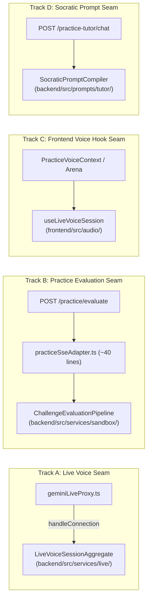

# Spec 23: Codebase Deepening and Seam Consolidation

> **Status:** Draft -> Approved  
> **Date:** 2026-11-22  
> **Parent Documents:** [GLOSSARY.md](../../GLOSSARY.md), [ADR 0001](../../docs/adr/0001-sota-2026-design-patterns-practice.md), [ADR 0003](../../docs/adr/0003-omnipresent-ai-copilot-and-company-track-enrichment.md), [ADR 0004](../../docs/adr/0004-voice-dialogue-fast-handoff-and-cross-arena-copilot.md)  
> **Governing Vocabulary:** `module`, `interface`, `implementation`, `depth`, `deep`, `shallow`, `seam`, `adapter`, `leverage`, `locality`

---

## 1. Intent & Workload Envelope

### Context & Problem Statement
During the evolution of InterviewPrep AI under Rule 8 (350-line cognitive file length limit), several deep modules were mechanically split into clusters of shallow procedural helpers. This caused four distinct architectural frictions across recent commit churn hotspots:
1. **Live Voice Gateway (Backend):** `LiveVoiceSession` was hollowed out into 8 procedural files mutating an anemic 70-field `ProxySession` data bag, scattering FSM transitions, watchdogs, and chunk guards.
2. **Practice Evaluation (Backend):** `practiceSseAdapter.ts` (266 lines) acts as a transport adapter but leaks domain evaluation knowledge, synthesizing scores (Score 0 on Gate 1 failure, Score 30 on Gate 2 AST violation) and completion payloads when the pipeline halts early.
3. **Voice Client (Frontend):** `frontend/src/hooks/useLiveAudioSession.ts` (108 lines) is an obsolete wrapper re-mapping 20 methods over `useLiveVoiceSession.ts`, while an extracted helper (`liveMicChunkDispatcher.ts`) takes 11 arguments due to torn encapsulation.
4. **Socratic Copilot (AI Tutor):** Text Copilot (`/api/practice-tutor/chat`, ADR 0003) and Live Voice Copilot (`/ws/live?type=tutor`, ADR 0004) duplicate anti-sycophancy rules and Socratic hint ladders across bifurcated prompt hierarchies, while `tutorService.ts` is misnamed (it generates bug hunt challenges).

### Operating Envelope
- **Concurrency & Ingress:** Real-time bidirectional WebSocket streaming (Gemini 3.8 Live, 16kHz PCM audio, 50-chunk/sec pacing), SSE evaluation streaming (5 concurrent gates), REST API (<50ms p95 latency).
- **Physical Server Constraint:** Strictly 1.8 GB RAM on host VPS. Zero local docker builds, compilers, or heavy test runners; remote verification via GitHub Actions CI/CD (`remote-verify`).
- **Tenancy & Security:** Multi-tenant isolated users with invite-code / session-token authentication; zero token leakage; tenant-scoped evaluation persistence.
- **Cognitive Bounding (Rule 8):** Newly created source files $\le 350$ lines, modified files $\le 400$ lines.

---

## 2. Explicit Non-Goals (Blast-Radius Protection)

The implementation agents are **physically forbidden** from modifying:
1. **Database Schema & DDL:** `data/interview.db`, `CANONICAL_TABLES_SQL` in `backend/src/services/dbSchema.ts`, table structures (`questions`, `coding_challenges`, `coding_submissions`, `company_question_mastery`). All database tables and columns remain untouched.
2. **Java 21 AST Verifiers & Sandbox Runner:** `backend/src/services/sandbox/JvmExecutionService.ts`, `RefactoringAstVerifier.ts`, `JvmMutationEngine.ts`. Their internal verification rules must not be altered.
3. **Core Web Audio DSP & Playout:** `frontend/src/services/AudioPlayoutManager.ts`, `MicrophoneCapture.ts`, `audioWorkletProcessor.ts`. Web Audio low-level DSP nodes and sample-rate converters remain untouched.
4. **LiteLLM Gateway Configuration & Routes:** `D:\projects\LiteLLM_Proxy`, `http://litellm-gateway:4000`, `/api/health`. Provider proxying and model registry contracts are immutable.
5. **UI Component Layouts & Render Trees:** `VoiceModal.tsx`, `CompanyPrepStudio.tsx`, `PracticeArena.tsx`. Visual layout, CSS, and JSX structure are preserved.

---

## 3. Pre-Agreed Verification Seams

Every refactoring track has exactly **one authoritative testing seam**:



### Seam Invariants:
1. **Track A (Live Voice Seam):** `LiveVoiceSessionAggregate.start(...)` accepts a standard `WebSocket` and `http.IncomingMessage`. Tests verify session state transitions, greeting delivery, barge-in, and turn completion without inspecting internal helper data bags.
2. **Track B (Evaluation Seam):** `ChallengeEvaluationPipeline.evaluate(...)` yields fully formed `EvaluationPipelineEvent` objects with complete, typed payloads on early exits (Gate 1 failure, Gate 2 AST failure). Zero fallback synthesis in the HTTP adapter.
3. **Track C (Frontend Hook Seam):** `useLiveVoiceSession` is the single reactive interface. `useLiveAudioSession.ts` is deleted; all arenas consume `useLiveVoiceSession` directly.
4. **Track D (Tutor Prompt Seam):** `SocraticPromptCompiler.compile(...)` is the single source of truth for Socratic hint ladders and anti-sycophancy rules across text and voice.

---

## 4. Formal Wire & Architectural Contracts

### 4.1. Track A: `LiveVoiceSessionAggregate` Public Contract

```typescript
export interface LiveSessionStartOptions {
  clientSocket: WebSocket;
  req: http.IncomingMessage;
  earlyQueue?: any[];
  cleanupEarlyCapture?: () => void;
}

export class LiveVoiceSessionAggregate {
  /**
   * Factory method: authenticates, resolves configuration, connects upstream,
   * arms watchdogs, and begins bidirectional streaming.
   */
  public static start(options: LiveSessionStartOptions): Promise<LiveVoiceSessionAggregate | null>;

  /**
   * Dispatches incoming client WebSocket frames (audio PCM, turnComplete, bargeIn, text, canvas).
   * Validates chunk guards and updates FSM atomically.
   */
  public dispatchClientFrame(raw: unknown): void;

  /**
   * Cleanly closes downstream and upstream sockets, disarming all watchdog timers.
   */
  public terminate(reason?: string, code?: number): void;

  /**
   * Observability projection for health checks, telemetry, and tests.
   */
  public get state(): SessionFsmState;
  public get sessionId(): string;
  public get hasCandidateResponded(): boolean;
}
```

### 4.2. Track B: `ChallengeEvaluationPipeline` Verdict Contract

```typescript
export interface EvaluationPipelineEvent {
  gate: 'JVM_UNIT_TESTS' | 'AST_INVARIANTS' | 'MUTATION_TESTS' | 'AI_EVALUATION' | 'PERSISTENCE';
  status: 'PENDING' | 'RUNNING' | 'PASSED' | 'FAILED' | 'SKIPPED';
  progressPercent: number;
  timestamp: number;
  payload?: {
    testResults?: EvaluationTestResultsPayload;
    astViolations?: EvaluationAstViolation[];
    mutationScore?: EvaluationMutationScorePayload;
    aiFeedback?: EvaluationAiFeedbackPayload;
    evaluation?: NormalizedEvaluationVerdict; // Always present on terminal PASSED / FAILED
    error?: string;
  };
}

export interface NormalizedEvaluationVerdict {
  compilationStatus: { isCompilable: boolean; syntaxErrors: unknown[] };
  scoreBreakdown: { overallScore: number; summaryReview: string };
  virtualExecutionResult?: { passCount: number; failCount: number; testCases: unknown[] };
  astViolations?: EvaluationAstViolation[];
  mutationScore?: EvaluationMutationScorePayload;
}
```

### 4.3. Track C: Unified `useLiveVoiceSession` Return Contract

```typescript
export interface UseLiveVoiceSessionReturn {
  state: VoiceEngineState;
  metrics: LiveAudioMetrics;
  statusMessage: string;
  dialogueTurns: DialogueTurnItem[];
  activeScorecard: HrScorecard | VoiceEvaluationResult | null;

  connect: (params: LiveAudioSessionParams) => Promise<void>;
  disconnect: () => void;
  toggleMic: () => void;
  handleInteraction: () => void; // Symmetrically handles tactile barge-in, turn commit, or retry

  sendTextMessage: (text: string, displayText?: string) => void;
  sendCustomFrame: (frame: unknown) => void;

  // Direct boolean projections (eliminating need for compatibility wrapper)
  isConnected: boolean;
  isAiSpeaking: boolean;
  isListening: boolean;
  isRecording: boolean;
  isUserSpeaking: boolean;
  isPauseHolding: boolean;
  rmsDb: number;
}
```

### 4.4. Track D: `BugChallengeGeneratorService` Contract

```typescript
// Renamed from tutorService.ts to reflect true domain responsibility
export class BugChallengeGeneratorService {
  public static async generateBugChallenge(
    params: GenerateBugChallengeParams
  ): Promise<BugChallenge>;

  public static buildSystemPrompt(
    params: BugChallengeSystemPromptParams
  ): string;
}
```

---

## 5. Storage & Zero-Downtime Migration Contract

- **Rollout Strategy:** Additive & In-Place Code Deepening.
- **Database Impact:** 0 database schema changes. No new tables, no dropped columns, no altered constraints.
- **Backward Compatibility:** All existing HTTP REST endpoints (`/api/practice/evaluate`, `/api/practice-tutor/chat`, `/api/tutor/saved-challenges`) retain identical external request/response contracts and status codes (200, 400, 401, 500).
- **WebSocket Protocol:** Upstream LiteLLM Proxy and downstream client protocol remain 100% compliant with SOTA Late 2026 Gemini Live protocol (PCM 16kHz audio, `audioStreamEnd: true`, server VAD, zero illegal interruption frames).

---

## 6. Hoare-Logic Behavioral Contracts ({P} C {Q})

### 6.1. Track A: Live Voice Session Lifecycle
- **Pre-Conditions {P}:** Client initiates WebSocket connection to `/ws/live` with valid session ticket or auth cookie.
- **Algorithm C:**
  1. `LiveVoiceSessionAggregate.start()` resolves authentication and configuration atomically.
  2. Spawns upstream WebSocket to LiteLLM Proxy.
  3. Transitions FSM: `INIT` $\rightarrow$ `GREETING`.
  4. Delivers greeting audio with Turn 0 tool lockdown.
  5. Upon audio drain: transitions FSM to `CANDIDATE_LISTENING`.
  6. Client frames pass through Zero-Chunk Guard and Flood Guard before forwarding.
  7. Turn completion disarms candidate mic and arms two-phase watchdog (5s nudge, 22s dead-air recovery).
- **Post-Conditions {Q}:** Socket state, FSM state, and watchdog timers are completely encapsulated. Zero state mutations leak outside aggregate.
- **Orthogonal Invariants:** `hasCandidateResponded` can only transition `false` $\rightarrow$ `true`. Turn 0 evaluation tools are strictly blocked before candidate speech.

### 6.2. Track B: Practice Evaluation Terminal Verdict
- **Pre-Conditions {P}:** Authenticated candidate submits code files to `/api/practice/challenges/:id/evaluate`.
- **Algorithm C:**
  1. If Gate 1 (JVM Sandbox) fails to compile: pipeline immediately yields terminal FAILED event with fully synthesized `NormalizedEvaluationVerdict` (`overallScore: 0`, compilation error details).
  2. If Gate 2 (AST Invariants) detects forbidden patterns: pipeline yields terminal FAILED event with fully synthesized `NormalizedEvaluationVerdict` (`overallScore: 30`, AST violation details).
  3. `practiceSseAdapter` writes events directly to SSE stream without altering scores or fabricating complete payloads.
- **Post-Conditions {Q}:** The terminal payload yielded by the pipeline matches the final payload received by the client verbatim.
- **Orthogonal Invariants:** In JSON mode (`Accept: application/json`), evaluation halts on first failing gate and returns HTTP 200 with `success: true, isPassed: false, evaluation: verdict`.

### 6.3. Track C: Frontend Voice Hook Unification
- **Pre-Conditions {P}:** Caller invokes `useLiveVoiceSession()`.
- **Algorithm C:**
  1. Binds directly to `NativeLiveVoiceEngine` singleton/ref.
  2. Dispatches chunk dispatching directly through private engine methods.
  3. Exposes direct state projections (`isConnected`, `isAiSpeaking`, `isListening`, `isRecording`).
- **Post-Conditions {Q}:** All arenas (`VoiceModal`, `PracticeVoiceContext`, `useSystemDesignVoiceDefense`) share identical state machine and behavior. Zero references to `useLiveAudioSession.ts`.
- **Orthogonal Invariants:** Tactile clicks during AI speech trigger 5ms de-click ramp and instant mic reclamation across all arenas.
