# Spec 24: Architectural Deepening and Seam Hardening

> **Status:** Approved  
> **Date:** 2026-11-23  
> **Parent Documents:** [GLOSSARY.md](../../GLOSSARY.md), [ADR 0001](../../docs/adr/0001-sota-2026-design-patterns-practice.md), [ADR 0002](../../docs/adr/0002-pglite-wasm-sql-sandbox-and-curated-company-tracks.md), [ADR 0003](../../docs/adr/0003-omnipresent-ai-copilot-and-company-track-enrichment.md), [ADR 0004](../../docs/adr/0004-voice-dialogue-fast-handoff-and-cross-arena-copilot.md)  
> **Governing Vocabulary:** `module`, `interface`, `implementation`, `depth`, `deep`, `shallow`, `seam`, `adapter`, `leverage`, `locality`

---

## 1. Intent & Workload Envelope

### Context & Problem Statement
Following the seam consolidation of Spec 23, an architectural audit across commit churn hotspots and domain boundaries identified four concrete areas of friction where shallow modules, leaked abstractions, or anemic parameter bags weaken locality and maintainability:
1. **Frontend Voice Hook Abstraction Leak (Track A):** `useLiveVoiceSession.ts` forces a cast `(engineRef.current as any)?.playoutManager` to leak `playoutManagerRef` to UI callers. In `SystemDesignArena.tsx`, tactile barge-in calls `playoutManagerRef.current.handleInterruption()`, which silences local Web Audio physically but **fails to send the cancellation frame upstream**, leaving Gemini 3.8 Live generating tokens in the background and desynchronizing the voice FSM.
2. **Scattered Static Verification & Defect Masking (Track B):** Static analysis in `backend/src/services/sandbox/` is split across three shallow modules (`AstSecurityScanner`, `RefactoringAstVerifier`, `TestQualityScanner`). `AstSecurityScanner` is called redundantly twice (Gate 1 and Gate 3). `TestQualityScanner` is only called inside `JvmMutationEngine`, meaning it is completely bypassed when a challenge has no mutants, and when it fails, `ChallengeEvaluationPipeline` masks the error message as a surviving mutant failure (`Мутационный скор ниже 60%`).
3. **Split Stage Navigation & Leaked UI Callbacks (Track C):** `launchArenaTask` in `frontend/src/services/arenaNavigator.ts` requires caller-provided UI closures (`LocalStudioCallbacks`). For `practice`, it makes ad-hoc fetches and envelope unwrapping; for `sql_arena` and `voice_modal`, it relies on local React state callbacks, causing silent no-ops when invoked from any other caller (e.g. Copilot or breadcrumbs).
4. **Anemic Session Bag & Parameter Explosion (Track D):** `createLiveAudioStreamRouter` takes 22 loose arguments in `StreamRouterOptions`, while multiple handler modules directly mutate fields on the 70-field anemic `ProxySession` data bag.

### Operating Envelope
- **Concurrency & Ingress:** Real-time bidirectional WebSocket streaming (Gemini 3.8 Live, 16kHz PCM audio), SSE evaluation streaming (5 deterministic gates), REST API (<50ms p95 latency).
- **Physical Server Constraint:** Strictly 1.8 GB RAM on host VPS. Zero local docker builds, compilers, or test suites; cloud verification via GitHub Actions (`remote-verify`).
- **Tenancy & Security:** Multi-tenant isolated users, session token auth, tenant-scoped SQLite persistence.
- **Rule 8 Cognitive Bounding:** Newly created files $\le 350$ lines, modified files $\le 400$ lines.

---

## 2. Explicit Non-Goals (Blast-Radius Protection)

The implementation agents are **physically forbidden** from modifying:
1. **Database Schema & DDL:** `data/interview.db`, `CANONICAL_TABLES_SQL` in `dbSchema.ts`. Table schemas and migration sequences remain immutable.
2. **Core Audio Worklet & DSP:** `MicrophoneCapture.ts`, `audioWorkletProcessor.ts`, `AudioPlayoutManager.ts` internal ring buffers and de-click curves.
3. **External Upstream Gateway:** `LiteLLM_Proxy` gateway configuration, Docker network definitions, or port mappings.
4. **Visual Layouts & CSS:** Visual look and feel in `VoiceModal.tsx`, `CompanyPrepStudio.tsx`, and `SystemDesignArena.tsx`.

---

## 3. Pre-Agreed Verification Seams

```mermaid
flowchart TD
    subgraph TrackA [Track A: Voice Seam]
        UIHooks[PracticeVoiceContext / Arena] --> HookSeam["useLiveVoiceSession.handleInteraction()<br/>(frontend/src/audio/useLiveVoiceSession.ts)"]
    end
    subgraph TrackB [Track B: Static Analysis Seam]
        PipelineIn[ChallengeEvaluationPipeline] --> StaticSeam["JavaStaticAnalysisEngine.verify()<br/>(backend/src/services/sandbox/)"]
    end
    subgraph TrackC [Track C: Workspace Hydration Seam]
        CompanyUI[CompanyPrepStudio / Copilot] --> NavSeam["ArenaWorkspaceCoordinator.launch()<br/>(frontend/src/services/arenaNavigator.ts)"]
    end
    subgraph TrackD [Track D: Live Workspace Seam]
        LiveStream[liveAudioStreamRouter] --> WsContext["LiveWorkspaceContext.resolve()<br/>(backend/src/services/live/)"]
    end
```



### Seam Invariants:
1. **Track A (Voice Seam):** `useLiveVoiceSession` exposes `handleInteraction()` as the single authoritative interaction seam. Zero `playoutManagerRef` leakage; zero `(engineRef.current as any)` casts.
2. **Track B (Static Analysis Seam):** `JavaStaticAnalysisEngine.verify(files, policy)` runs synchronously in <5ms, returning a typed `StaticAnalysisVerdict` covering Security, Structural AST, and Test Quality.
3. **Track C (Workspace Hydration Seam):** `ArenaWorkspaceCoordinator.launch(target)` resolves targets and pre-hydrates target stores (`useAppStore.openPracticeChallengeById` and `openSystemDesignById`) with zero required UI closures.
4. **Track D (Live Workspace Seam):** `LiveWorkspaceContext` encapsulates SQLite statement caches and workspace manifest diffs. `createLiveAudioStreamRouter` options collapse from 22 parameters to 3 (`session`, `clientSocket`, `upstreamWsUrl`).

---

## 4. Formal Wire & Architectural Contracts

### 4.1. Track A: `useLiveVoiceSession` Sealed Interface
```typescript
export interface UseLiveVoiceSessionReturn {
  state: VoiceEngineState;
  metrics: LiveAudioMetrics;
  statusMessage: string;
  dialogueTurns: DialogueTurnItem[];
  activeScorecard: HrScorecard | VoiceEvaluationResult | null;

  connect: (params: LiveAudioSessionParams) => Promise<void>;
  disconnect: () => void;
  toggleMic: () => void;
  handleInteraction: () => void;

  sendTextMessage: (text: string, displayText?: string) => void;
  sendCustomFrame: (frame: unknown) => void;
  sendCanvasDelta?: (delta: unknown) => void;

  isConnected: boolean;
  isAiSpeaking: boolean;
  isListening: boolean;
  isRecording: boolean;
  isMuted: boolean;
  isUserSpeaking: boolean;
  isPauseHolding: boolean;
  rmsDb: number;
}
```

### 4.2. Track B: `JavaStaticAnalysisEngine` Contract
```typescript
export interface StaticAnalysisPolicy {
  structuralConstraints?: AstBytecodeConstraint;
  isRefactoring?: boolean;
  enforceTestQuality?: boolean;
}

export interface StaticAnalysisViolation {
  category: 'SECURITY' | 'AST_INVARIANT' | 'TEST_QUALITY';
  rule: string;
  file: string;
  line: number;
  message: string;
  severity: 'ERROR' | 'WARNING';
}

export interface StaticAnalysisVerdict {
  passed: boolean;
  violations: StaticAnalysisViolation[];
  blockingFailure?: {
    gate: 'JVM_UNIT_TESTS' | 'AST_INVARIANTS' | 'MUTATION_TESTS';
    score: number;
    error: string;
  };
}
```

### 4.3. Track C: `ArenaWorkspaceCoordinator` Contract
```typescript
export interface ArenaLaunchIntent {
  arena: TargetArena;
  entityId: string;
  contextTitle?: string;
  companyProfileId?: string;
}

export class ArenaWorkspaceCoordinator {
  public static launch(intent: ArenaLaunchIntent): Promise<void>;
}
```

### 4.4. Track D: `LiveWorkspaceContext` Contract
```typescript
export class LiveWorkspaceContext {
  public static resolve(input: ChallengeResolutionInput): LiveWorkspaceContext;
  public applyFrame(type: string, payload: any): boolean;
  public getResolved(): ResolvedChallengeContext;
  public toXmlManifest(): string;
}
```

---

## 5. Storage & Zero-Downtime Migration Contract

- **Storage:** All existing SQLite tables (`coding_challenges`, `questions`, `coding_submissions`) remain untouched. Zero schema migrations required.
- **Rollout Strategy:** Additive-only TypeScript code refactoring. 100% backward compatibility maintained via facades and re-exports.

---

## 6. Hoare-Logic Behavioral Contracts ({P} C {Q})

### Track A: Tactile Barge-In
- **{P}**: User clicks central HUD button or calls `handleInteraction()` while `isAiSpeaking === true`.
- **C**: `NativeLiveVoiceEngine.handleInteraction()` aborts audio playout via `playoutManager.handleInterruption()`, transitions FSM to `CANDIDATE_LISTENING`, and dispatches cancellation frame upstream.
- **{Q}**: Audio is instantly silenced, mic is unlocked, upstream stops token synthesis.
- **Invariant**: Upstream and client playout state never diverge.

### Track B: Test Quality Scanner Execution
- **{P}**: Candidate submits challenge with or without defined mutants.
- **C**: `JavaStaticAnalysisEngine.verify()` evaluates `TestQualityScanner.scan(files)`. If `Thread.sleep` or missing assertions are detected, `verdict.passed === false`.
- **{Q}**: Pipeline emits early `FAILED` event with exact test quality violation message (e.g. `Использование Thread.sleep() в тестах строго запрещено`), never masked as mutant survival.
- **Invariant**: Test quality anti-patterns are deterministically blocked across all challenges.

### Track C: Stage Navigation
- **{P}**: User or copilot invokes `ArenaWorkspaceCoordinator.launch({ arena: 'practice', entityId: 'iban-validator' })`.
- **C**: Fetches manifest, unwraps `{ challenge, savedDraft }`, calls `useAppStore.openPracticeChallenge(challenge, draft)`, sets `currentStudioTab: 'practice'`.
- **{Q}**: Practice arena mounts with populated workspace files (`canonicalFiles.length > 0`). Zero blank screen regressions.
