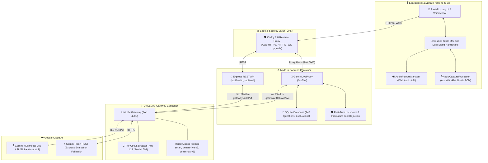
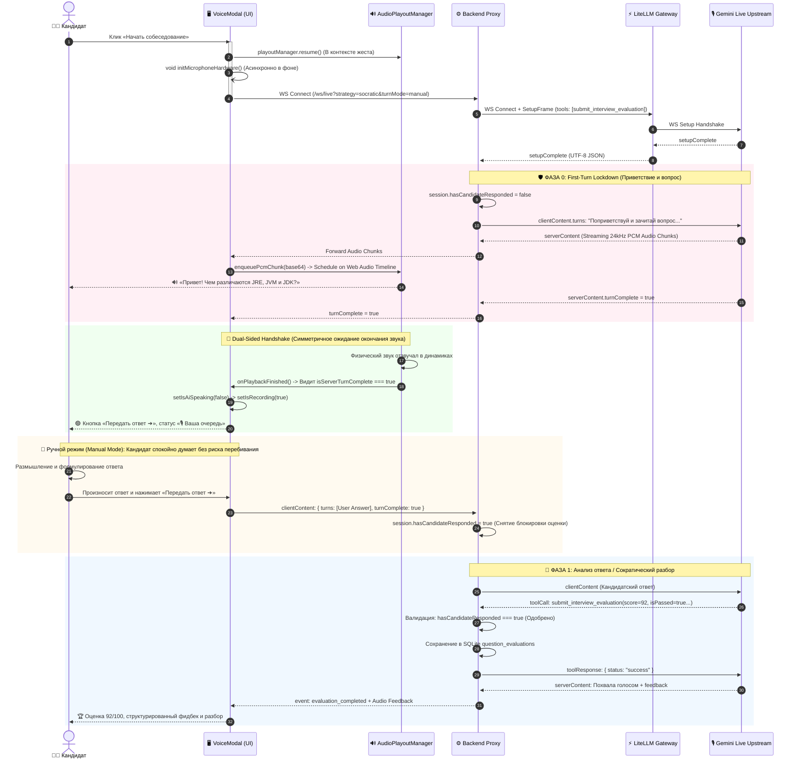
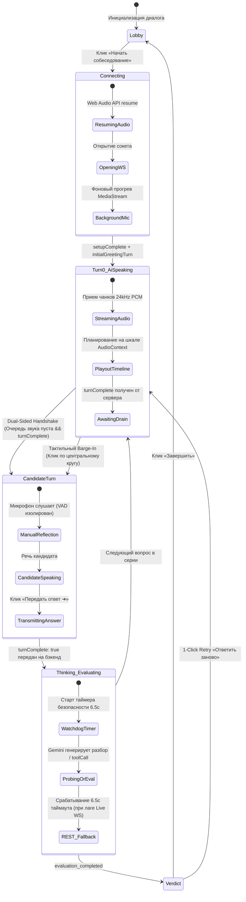

# Architectural Guidelines & Invariants for InterviewPrep AI

## 1. LiteLLM Proxy Invariant (No Direct Provider Calls / No Hardcoded Keys)
- All LLM, Live Audio WebSocket, and TTS interactions MUST route strictly through `LiteLLM_Proxy` (`D:\projects\LiteLLM_Proxy` / `http://litellm-gateway:4000`) running in Docker:
  - HTTP REST endpoints: `${LITELLM_PROXY_URL}` (`http://host.docker.internal:4000/v1` or `http://localhost:4000/v1`).
  - Live Multimodal WebSocket endpoint: `ws://host.docker.internal:4000/ws/live?model=${GEMINI_LIVE_MODEL}&token=${LITELLM_API_KEY}`.
- NEVER hardcode Google API keys (`AQ.*`) or internal upstream model names (`gemini-2.5-flash-native-audio-latest`, etc.) in the application code.
- Always use environment variables:
  - `GEMINI_TEXT_MODEL` (e.g. `gemini-smart`)
  - `GEMINI_LIVE_MODEL` (e.g. `gemini-live` / `gemini-tts-live-v3`)
  - `GEMINI_TTS_MODEL` (e.g. `gemini-tts-v3`)
  - `LITELLM_API_KEY` (virtual key for proxy authorization)
- Dynamic model mapping, API key pool failover, and two-tier Circuit Breaker (Key 429 vs Model 503 Fast-Failover) are handled centrally by `LiteLLM_Proxy`.

---

## 2. Gemini Live Realtime Audio Architecture & State Machine

### 2.1. First-Turn Tool Lockdown Invariant
- **Strict Turn 0 Directive:** In all system prompts (`socratic_tutoring`, `adaptive_probing`, and `customPromptOverride`), the AI interviewer is strictly forbidden from invoking `submit_interview_evaluation` during the initial greeting turn.
- **Backend Premature Evaluation Rejection Guard:** The backend WebSocket session tracks `hasCandidateResponded`. If Gemini attempts to call `submit_interview_evaluation` when `hasCandidateResponded === false`, the backend rejects the call with a structured `toolResponse` error, forcing the model to speak the greeting and read the question aloud.

### 2.2. Dual-Sided Handshake Invariant (Race Condition Elimination)
- The transition from AI speech to candidate microphone (`isAiSpeaking: false`, `isRecording: true`) is symmetrically unblocked by whichever event finishes LAST:
  1. `AudioPlayoutManager.onPlaybackFinished` (when physical audio finishes draining in headphones).
  2. WebSocket `turnComplete: true` arrival (when network generation concludes).
- If audio drains before `turnComplete` arrives $\rightarrow$ `turnComplete` handler detects empty playout queue and immediately unlocks candidate mic.
- If `turnComplete` arrives before audio drains $\rightarrow$ `onPlaybackFinished` unlocks candidate mic upon physical timeline drain.

### 2.3. Non-Blocking Hardware Initialization
- `initMicrophoneHardware()` executes in an asynchronous background promise (`void initMicrophoneHardware()`).
- WebSocket connection and AI greeting audio are NEVER blocked by operating system microphone permission prompts.

### 2.4. Single-Sink Audio Routing & Tactile Barge-In
- Mobile (Android/iOS): Routes EXCLUSIVELY to `MediaStreamAudioDestinationNode` + HTML5 Audio element to prevent dual-output echo and force speakerphone.
- Desktop: Direct Web Audio `context.destination` with low latency.
- Tactile Barge-In: User click on central circle during AI speech triggers `AudioPlayoutManager.handleInterruption()` with a 5ms de-click ramp, immediately silencing audio and switching UI to active recording.

---

## 3. Аудио Lifecycle State Machine

---

## 4. UI/UX Standard & Aesthetic Principles
- Target Audience: Soft luxury pastel aesthetics (`#FFF0F5`, lavender, rose, gentle mesh glow auras).
- Audio Session: 3-Stage flow (Lobby -> Active Session -> Verdict with 1-click retry).
- Health Monitoring: `/api/health` validates liveness AND checks the presence of all 4 required models (`GEMINI_TEXT_MODEL`, `GEMINI_LIVE_MODEL`, `GEMINI_TTS_MODEL`, `GEMINI_EMBEDDING_MODEL`) in the LiteLLM registry with latency metrics.

---

## 5. Turbo-Prefetching & Token Economy Invariant
- **User-Controlled Turbo Switch:** Speculative background prefetching is controlled by an explicit toggle in the Lobby (default: off).
- When enabled: the system pre-generates Challenge $N+1$ in a background buffer while the user solves Challenge $N$, delivering **0ms latency** on "Следующий вопрос".
- When disabled: strictly on-demand generation with zero wasted background tokens.

---

## 6. Cancellation Propagation & Zero Blank Screen Invariant
- **AbortSignal:** Closing the modal or clicking "Прервать" fires `AbortController.abort()`, which propagates to LiteLLM Proxy and cancels upstream Google generation to save quota tokens.
- **Recovery State Card:** In case of persistent network timeouts or provider cluster outages, the UI displays a structured Recovery Card with 3 actionable paths (Retry, Open Bank, Lobby), completely eliminating white blank screens.
- **Multi-Stack Curated Fallbacks:** The backend maintains battle-tested offline incident templates across all stack archetypes (`fintech_transactional`, `reactive_streaming`, `modern_cloud`, `enterprise_migration`).

