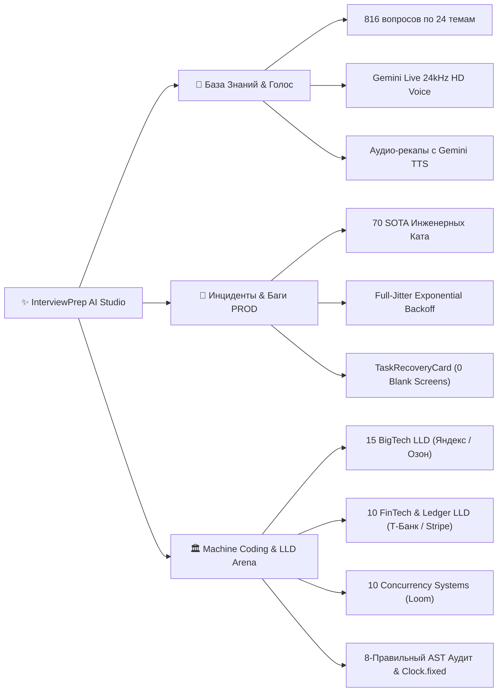

# 📚 InterviewPrep AI — Платформа Подготовки к Техническим Собеседованиям (SOTA Сентябрь 2026)

Интерактивная Fullstack-платформа промышленного уровня для подготовки к техническим собеседованиям на позиции **Java 21+ & Spring Boot Developer / Lead / Architect**.

Платформа объединяет 3 ключевых режима подготовки:
1. 🧠 **База Знаний & Голосовой AI-Интервьюер:** 816 вопросов по 24 темам, Сократический тьютор на Gemini Live 24kHz HD Voice, радар пробелов и аудио-подкасты.
2. 🐛 **Прод-инциденты & Баги PROD:** 70 SOTA инженерных ката (Streams, Concurrency, Loom Pinning, Spring Boot 3.4 `@MockitoBean`), Full-Jitter Backoff и `TaskRecoveryCard`.
3. 🏛️ **Live-Coding, Machine Coding & LLD Arena:** 35 комплексных задач Low-Level Design (Яндекс, Т-Банк, Stripe, Озон) с полным многофайловым каркасом, детерминированным временем `Clock.fixed` и 8-факторным AST-аудитом.

---

## 🗂 3 Режима платформы



---

## 🏛️ Каталог 35 SOTA LLD Задач по Трекам

| Трек | Количество | Ключевые Задачи | Архитектурные Инварианты |
| :--- | :---: | :--- | :--- |
| **🏛️ BigTech Core LLD** | 15 | • Notification Filtering & 24h Deduplication (Яндекс)<br>• In-Memory Rate Limiter (Token Bucket / Sliding Window)<br>• In-Memory Cache (TTL, LRU/LFU)<br>• Task Scheduler (Cron, Priority)<br>• Order State Machine, Circuit Breaker, Event Bus | Внедрение `java.time.Clock`, Specification, OCP, Очистка памяти sliding-window |
| **💳 FinTech & Ledger LLD** | 10 | • Double-Entry Accounting Ledger (Т-Банк / Stripe)<br>• Idempotency Key Processor (SHA-256 / TTL)<br>• Transactional Outbox (SKIP LOCKED)<br>• Multi-Currency Wallet (Hold/Capture/Release)<br>• Fraud Detection Sliding Window Rules | Упорядоченный захват блокировок `min(id1, id2) -> max(id1, id2)`, `BigDecimal HALF_EVEN`, 0 `double`/`float` |
| **⚡ Concurrency Systems LLD** | 10 | • Multi-threaded Elevator Dispatcher (Virtual Threads)<br>• Custom ThreadPoolExecutor & Work-Stealing<br>• Connection Pool Manager (Leak Detection, MaxWait)<br>• Async Batch Flusher (Size $N$ \|\| Time $T$ ms)<br>• Multi-tier Cache Stampede Protection (SingleFlight)<br>• LMAX Disruptor Ring Buffer | Zero Carrier Pinning, `ReentrantLock` + `Condition`, Striped Cells |

---

## 🤖 Архитектура и SOTA-инварианты

1. **LiteLLM AI Gateway (`http://litellm-gateway:4000`):**
   * Все вызовы моделей (`gemini-smart`, `gemini-live-v2`, `gemini-tts-v3`, `gemini-embedding`) маршрутизируются через единый шлюз с пулингом API-ключей, Circuit Breaker и идемпотентным реестром.
2. **Детерминированный AST-анализ (8 правил):**
   * Блокировка `synchronized` на Virtual Threads (`carrier-thread-pinning`), `ThreadLocal` утечек, прямых вызовов `System.currentTimeMillis()` (`enforce-clock-injection`) и `double` в финансовых полях (`no-double-in-money`).
3. **Мобильная адаптивность (Android / iOS):**
   * Поддержка `100dvh` (`h-[calc(100dvh-4rem)]`), исключающая смещение панелей клавиатурой, и плавный свайп файлов `touch-pan-x`.
4. **Отказоустойчивость и Zero-Phantom-Fallback:**
   * Full-Jitter Exponential Backoff на 429/503 ошибках и модальная карточка `TaskRecoveryCard` с диагностикой здоровья `/api/health`.

---

## 🚀 Запуск и деплой

### 1. Локальный запуск
```bash
# Бэкенд
cd backend
npm install
npm run dev

# Фронтенд
cd ../frontend
npm install
npm run dev
```

### 2. Развертывание на VPS
```bash
python scripts/deploy_to_vps.py
```

Подробные схемы архитектуры, стейт-машины и sequence-диаграммы описаны в [docs/architecture.md](docs/architecture.md), синтез исследований — в [docs/deep_research_synthesis.md](docs/deep_research_synthesis.md), а инварианты агента — в [AGENTS.md](AGENTS.md).
