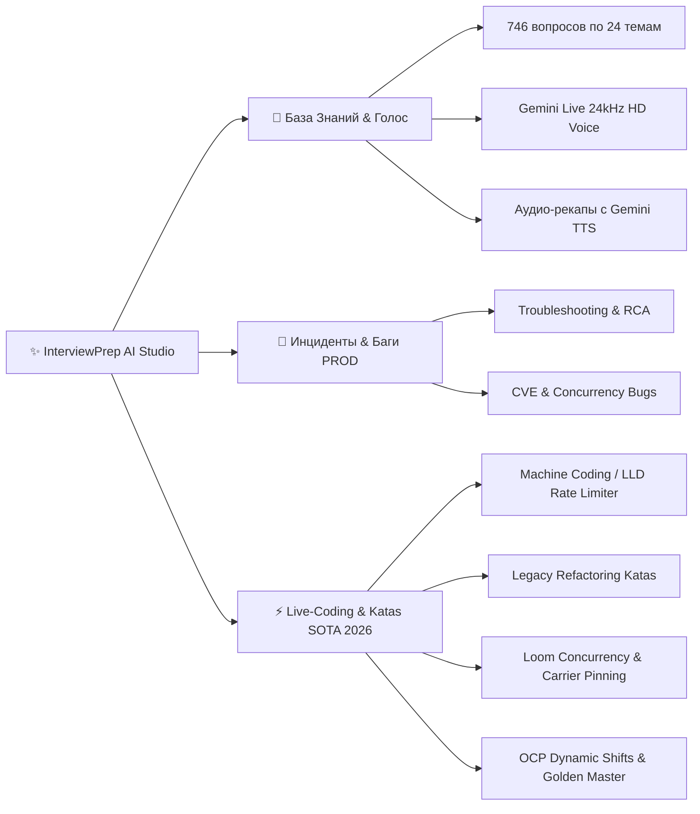

# 📚 InterviewPrep AI — Платформа Подготовки к Техническим Собеседованиям (SOTA Август 2026)

Интерактивная Fullstack-платформа для подготовки к техническим собеседованиям на позиции **Java & Spring Developer** (от Junior до Principal/Architect).

Платформа объединяет 3 ключевых режима подготовки:
1. 🧠 **База Знаний & Голосовой AI-Интервьюер** (746+ вопросов по 24 темам, Сократический тьютор на Gemini Live, генерация аудио-подкастов).
2. 🐛 **Прод-инциденты & Баги PROD** (симулятор аварий, поиск утечек памяти, deadlock'ов, гонок данных и уязвимостей).
3. ⚡ **Live-Coding, Katas & Machine Coding Studio** (7 премиальных практических задач LLD/SOLID с гибридной оценкой кода Gemini 3.7 Flash и AST-анализом).

---

## 🗂 3 Режима платформы



---

## ⚡ Каталог задач Live-Coding & Katas Studio

| Задача (Slug) | Категория | Стек & Ключевые паттерны | Уровень |
| :--- | :--- | :--- | :---: |
| **In-Memory Thread-Safe Rate Limiter** | `machine_coding` | Java 21, `ConcurrentHashMap`, Token Bucket, Virtual Threads Safe | **Senior** |
| **Transactional Outbox Event Publisher** | `machine_coding` | Spring Boot 3, JPA, Kafka, Idempotency, At-Least-Once | **Senior** |
| **Trip Service Legacy Refactoring Kata** | `refactoring_kata` | Seam Pattern, Isolated Unit Testing, Approval Testing | **Middle** |
| **Gilded Rose Modern Java 21 Kata** | `refactoring_kata` | Sealed Interfaces, Pattern Matching for switch, Records | **Middle** |
| **Virtual Threads Carrier Pinning Lab** | `concurrency_lab` | Project Loom, `ReentrantLock` vs `synchronized`, JFR Signals | **Senior** |
| **High-Throughput Order Matching Engine** | `machine_coding` | Ring Buffer, Lock-Free Concurrency, L1/L2 Cache Locality | **Lead** |
| **Domain Event Sourced Bank Account** | `machine_coding` | CQRS, Immutable Event Streams, Optimistic Concurrency | **Senior** |

---

## 🤖 Архитектура и SOTA-инварианты

1. **LiteLLM AI Gateway (`http://litellm-gateway:4000`):**
   * Все вызовы моделей (`gemini-smart`, `gemini-live-v2`, `gemini-tts-v3`, `gemini-embedding`) идут через единый шлюз с пулингом API-ключей, Circuit Breaker и идемпотентной синхронизацией в PostgreSQL.
2. **Двухэтапная гибридная оценка кода (Dual-Pass AST + AI):**
   * **Этап 1 (AST Pre-Processor):** Детерминированная очистка комментариев с сохранением Text Blocks Java 21 (`"""`), выявление `synchronized`, CountDownLatch, Carrier Pinning и нарушений слоев.
   * **Этап 2 (Gemini 3.7 Flash):** Флагманская модель с рассуждениями анализирует потокобезопасность, виртуальное выполнение и критерии SOLID/OCP за ~15 секунд.
3. **Мобильная адаптивность (Android & Tablets):**
   * На мобильных экранах доступен удобный переключатель вкладок **[📄 Спека | 💻 Код]** с поддержкой отступов клавишей `Tab` (4 пробела).
4. **Голосовой протокол Gemini Live:**
   * Гарантированный **First-Turn Lockdown** (приветствие и вопрос Turn 0) и **Dual-Sided Handshake** для синхронизации очереди воспроизведения с сетевым протоколом.

---

## 🚀 Запуск и деплой

### 1. Локальный запуск
```bash
# Бэкенд
cd backend
npm install
npm run dev

# Фронтенд
cd ../frontend
npm install
npm run dev
```

### 2. Развертывание на VPS
```bash
python scripts/deploy_to_vps.py
```

Подробные схемы архитектуры, стейт-машины и sequence-диаграммы описаны в [docs/architecture.md](docs/architecture.md), а инварианты агента — в [AGENTS.md](AGENTS.md).
