# System Architecture & Technical Specification: InterviewPrep AI (SOTA September 2026)

> **Canonical System Specification & Master Reference (SSOT)**  
> **Production Target:** `https://djelu.site` (Docker Compose + Caddy 2.8 Reverse Proxy + Node.js 22 Backend + LiteLLM AI Gateway)  
> **LLM/Audio Gateway:** `http://litellm-gateway:4000` (LiteLLM Proxy with 4-Model Dual-Tier Circuit Breaker)  
> **Target Framework & Runtime:** Java 21 LTS, Spring Boot 3.4+, Virtual Threads (Project Loom), TypeScript 5.6+, React 19

---

## 1. Executive Summary & Platform Vision

**InterviewPrep AI** is an institutional-grade technical preparation and skill evaluation platform specifically engineered for Java 21+ and Spring Boot software engineers targeting Senior, Staff, and Principal roles.

Unlike static quiz platforms or disjointed coding sandboxes, InterviewPrep AI is organized around **8 integrated learning pillars** anchored by an interactive Socratic AI Tutor, deterministic AST auditing, sub-second execution engines, and a unified cognitive knowledge graph powered by the SOTA FSRS-5 spaced repetition model.

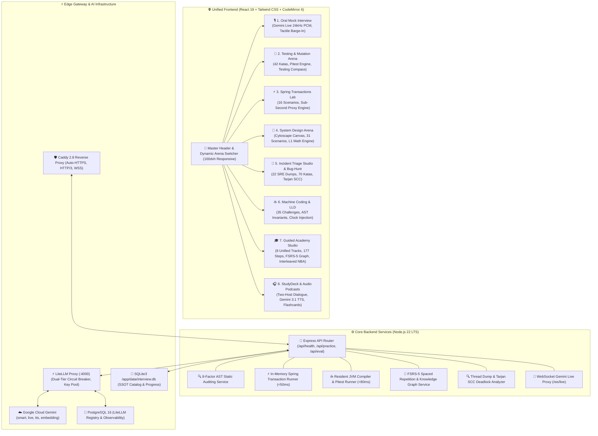

---

## 2. Authoritative Domain Specifications (SSOT Directory)

InterviewPrep AI enforces a modular, hierarchical specification model (SOTA Late 2026). Before proposing or executing architectural changes in any domain, engineers and AI agents MUST consult the authoritative domain specification in [`docs/architecture/specs/`](specs/README.md):

| Domain / Pillar | Authoritative Domain SSOT | Core Scope & Enforced Standards |
| :--- | :--- | :--- |
| **00: Core Infrastructure & Security** | [`specs/00_CORE_INFRASTRUCTURE_AND_SECURITY.md`](specs/00_CORE_INFRASTRUCTURE_AND_SECURITY.md) | LiteLLM gateway, Circuit Breaker, SQLite WAL, Zero-Trust WS tickets |
| **01: Oral Mock Interview & Voice** | [`specs/01_ORAL_MOCK_INTERVIEW_AND_AUTO_VAD.md`](specs/01_ORAL_MOCK_INTERVIEW_AND_AUTO_VAD.md) | Real-time multimodal voice, Headless `LiveVoiceEngine`, subcomponents |
| **—: Auto-VAD Protocol SSOT** | [`specs/AUTO_VAD_LIVE_AUDIO_SPECIFICATION.md`](specs/AUTO_VAD_LIVE_AUDIO_SPECIFICATION.md) | DSP 16k/24k PCM, Dual-Sided Handshake truth table, EchoGuard |
| **02: Testing & Mutation Arena** | [`specs/02_TESTING_AND_MUTATION_ARENA.md`](specs/02_TESTING_AND_MUTATION_ARENA.md) | Pitest bytecode mutation, 42 katas, Testing Compass, anti-potemkin |
| **03: Spring Transactions Lab** | [`specs/03_SPRING_TRANSACTIONS_LAB.md`](specs/03_SPRING_TRANSACTIONS_LAB.md) | In-memory proxy engine (<50ms), propagation rules, checked exception trap |
| **04: System Design Arena** | [`specs/04_SYSTEM_DESIGN_ARENA.md`](specs/04_SYSTEM_DESIGN_ARENA.md) | Cytoscape canvas graph model, L1 capacity math, 31 scenarios, SPOF |
| **05: Production Incident Triage** | [`specs/05_PRODUCTION_INCIDENT_TRIAGE.md`](specs/05_PRODUCTION_INCIDENT_TRIAGE.md) | Tarjan SCC deadlock cycle detector (<1ms), thread dump parsing, MTTM/MTTR |
| **06: Machine Coding & LLD** | [`specs/06_MACHINE_CODING_AND_LLD.md`](specs/06_MACHINE_CODING_AND_LLD.md) | AST rules: `enforce-clock-injection`, `no-double-in-money`, ordered locks |
| **07: Guided Academy Studio** | [`specs/07_GUIDED_ACADEMY_AND_FSRS5.md`](specs/07_GUIDED_ACADEMY_AND_FSRS5.md) | FSRS-5 17-weight memory model, 8-track curricular DAG (177 nodes) |
| **08: StudyDeck & Audio Podcasts** | [`specs/08_STUDYDECK_AND_AUDIO_PODCASTS.md`](specs/08_STUDYDECK_AND_AUDIO_PODCASTS.md) | Two-host dialogue generation, Gemini TTS synthesis, lock-screen player |

---

## 3. Global Architectural Hard Invariants

All modules and future extensions MUST strictly observe the following platform invariants:

### 2.1. LiteLLM Proxy Invariant (Zero Hardcoded Keys)
- All LLM reasoning, multimodal audio WebSocket, and TTS synthesis MUST route through `LiteLLM_Proxy` (`http://litellm-gateway:4000` or `http://localhost:4000` via `${LITELLM_PROXY_URL}`).
- Direct calls to Google Gemini endpoints and hardcoded API keys (`AQ.*`) are strictly prohibited in application code.
- Models are mapped through canonical environment variables:
  - `GEMINI_TEXT_MODEL` (e.g. `gemini-smart`)
  - `GEMINI_LIVE_MODEL` (e.g. `gemini-live` / `gemini-tts-live-v3`)
  - `GEMINI_TTS_MODEL` (e.g. `gemini-tts-v3`)
  - `GEMINI_EMBEDDING_MODEL` (e.g. `text-embedding-3-small` / `gemini-embedding`)
  - `LITELLM_API_KEY` (virtual authorization key)

### 2.2. Deterministic Time & Financial Invariants in Machine Coding (Java 21)
- **Time Virtualization:** Business logic must NEVER invoke `System.currentTimeMillis()`, `Instant.now()`, or `LocalDate.now()` directly. Time must be constructor-injected via `java.time.Clock`. Enforced statically via AST rule `enforce-clock-injection`.
- **Financial Precision:** All monetary amounts, fees, and balances must use `java.math.BigDecimal` with explicit scale and `RoundingMode.HALF_EVEN` (Banker's Rounding). Primitive `double` or `float` in financial domains is blocked via AST rule `no-double-in-money`.
- **Deadlock-Free Lock Acquisition:** In multi-account or multi-resource operations, lock acquisition must follow strict global ID ordering: `lock(min(id1, id2)) -> lock(max(id1, id2))`.

### 2.3. Gemini Live Multimodal Invariants & State Machine
> 📖 **Authoritative Protocol Specification (SSOT):** See [AUTO_VAD_LIVE_AUDIO_SPECIFICATION.md](specs/AUTO_VAD_LIVE_AUDIO_SPECIFICATION.md) for full mathematical DSP models, Dual-Sided Handshake truth table, and EchoGuard drop conditions.

- **Canonical Gemini Live Protocol & Native Cloud VAD:** In Auto-VAD mode, server-side VAD is active (`automaticActivityDetection.disabled = false`). Candidate audio flows continuously as 16kHz Mono PCM wrapped in `{ realtimeInput: { audio: ... } }`. Interleaving empty `{ clientContent: { turnComplete: true } }` frames into active audio streams is strictly forbidden. Client Silero VAD signals endpointing via canonical `{ realtimeInput: { audioStreamEnd: true } }`.
- **First-Turn Lockdown:** In Turn 0 greeting, the AI interviewer is strictly forbidden from invoking `submit_interview_evaluation`. The backend tracks `hasCandidateResponded` and rejects early evaluations with a structured `toolResponse` error.
- **Dual-Sided Handshake:** Transition from AI speaking to candidate recording is unblocked symmetrically by whichever event finishes LAST:
  1. `AudioPlayoutManager.onPlaybackFinished` (headphones buffer drain).
  2. WebSocket `turnComplete: true` arrival (server network completion).
- **Terminal Frame Deduplication:** Deduplicates consecutive `generationComplete` and `turnComplete` frames (1ms delta) to prevent false-positive circuit breaker activations when `currentTurnAudioBytes === 0`.
- **Round-Robin Key Pool Balancing:** LiteLLM Proxy balances requests across the 4-key pool (`round_robin` in `gateway_settings`) to prevent single-key quota starvation (429) during high-throughput thinking dialogue.
- **Tactile Barge-In:** Clicking the center orb during AI speech triggers a 5ms de-click ramp, mutes audio immediately, cancels server playout, and activates the candidate mic.

### 2.4. Zero-Phantom-Fallback & Full-Jitter Backoff
- When upstream LLMs experience rate limits (429) or proxy failures (503), the backend executes Full-Jitter Exponential Backoff ($T = \text{random}(0, \min(2500, 800 \times 1.8^{\text{attempt}}))$) up to 2 retries.
- Under NO circumstance does the backend fabricate fake static responses disguised as dynamic AI generation. If retries fail, it returns a structured HTTP 503 rendering `TaskRecoveryCard`.

### 2.5. Mobile Ergonomics & Viewport Standard
- All full-screen arenas utilize `100dvh` (`h-[calc(100dvh-4rem)]`) to prevent virtual keyboard viewport bouncing.
- Nested modals and drawers use a module-level reference-counted scroll lock (`useBodyScrollLock`) to prevent premature `document.body` unlock.
- Large catalogs use CSS `content-visibility: auto; contain-intrinsic-size: 0 90px;` for 120 FPS scrolling on mobile devices.

### 2.6. Dual ID ↔ Slug Aliasing Invariant (Zero-Broken-Steps)
- Challenge references in Guided Roadmaps (`json/guided_roadmaps.json`) and database lookup APIs can be expressed either as numeric primary keys (`id: "1"`) or human-readable slugs (`slug: "kata_test_threadpool_rejection"`).
- All progress resolution services (`getUserEntityProgress`) MUST join submissions symmetrically on `(s.challenge_id = c.id OR s.challenge_id = c.slug)` and populate both identifiers in the user's completed set.
- Under NO circumstance should a candidate who completed a challenge under its slug find the corresponding roadmap step marked incomplete or unnavigable ("дырявая лестница").

### 2.7. Unified 4-Compass Ergonomics (`Ctrl + /`)
- Every specialized technical practice environment (Testing, Transactions, System Design, SRE Incident Triage) MUST provide a domain-specific interactive heuristic compass.
- Compasses MUST be uniformly accessible via the global shortcut `Ctrl + /` (or `Cmd + /` on macOS) as well as a tactile floating action button in the arena header.
- Compasses provide instant multi-axis radar diagnostics (Coverage vs Mutants, Proxy vs Pool Depth, CAP vs SPOF, MTTR vs Root Cause) to turn blind trial-and-error into structured engineering analysis.

---

## 4. The 8 Specialized Architectural Pillars

---

### 4.1. Pillar 1: Oral Mock Interview & Voice Studio

> 📖 **Authoritative Domain Specification (SSOT):** [01_ORAL_MOCK_INTERVIEW_AND_AUTO_VAD.md](specs/01_ORAL_MOCK_INTERVIEW_AND_AUTO_VAD.md)  
> 📖 **Low-Level Protocol SSOT:** [AUTO_VAD_LIVE_AUDIO_SPECIFICATION.md](specs/AUTO_VAD_LIVE_AUDIO_SPECIFICATION.md)  
> All frontend consumers MUST use the headless [`LiveVoiceEngine`](file:///d:/projects/interview_projects/spring/frontend/src/audio/LiveVoiceEngine.ts). Creating parallel WebSocket implementations is strictly blocked by Invariant 8.

The Oral Mock Interview studio delivers real-time voice technical interviews using Gemini Multimodal Live API over WebSockets, operating at 24kHz bidirectional PCM audio.

```mermaid
sequenceDiagram
    autonumber
    actor Candidate as 👤 Candidate
    participant UI as 📱 VoiceModal / React
    participant AudioMgr as 🔊 AudioPlayoutManager
    participant NodeProxy as ⚙️ Node.js LiveProxy (/ws/live)
    participant LiteLLM as ⚡ LiteLLM Proxy (:4000)
    participant GeminiLive as ☁️ Gemini Multimodal Live

    Candidate->>UI: Click «Начать собеседование»
    UI->>AudioMgr: initMicrophoneHardware() (async background)
    UI->>NodeProxy: WS Connect (/ws/live?scenario=mock_junior)
    NodeProxy->>LiteLLM: WS Upstream (gemini-live)
    LiteLLM->>GeminiLive: Bidi WebSocket Handshake
    GeminiLive-->>NodeProxy: setupComplete
    
    rect rgb(240, 248, 255)
        Note over GeminiLive,AudioMgr: Turn 0: AI Speaks Greeting
        GeminiLive-->>NodeProxy: audio chunks (24kHz PCM)
        NodeProxy-->>UI: Binary WS Frame (Decoded as UTF-8 / PCM)
        UI->>AudioMgr: scheduleBuffer()
        AudioMgr-->>Candidate: 🔊 Voice Greeting Reads Question
        GeminiLive-->>NodeProxy: turnComplete: true
        NodeProxy-->>UI: turnComplete: true
        AudioMgr-->>UI: onPlaybackFinished (Buffer Drained)
        Note over UI: Dual-Sided Handshake Unlocks Mic
    end

    rect rgb(255, 245, 245)
        Note over Candidate,NodeProxy: Candidate Speaks Answer (Continuous 16kHz PCM)
        Candidate->>UI: Speaks into microphone
        UI->>NodeProxy: realtimeInput { audio: { data, mimeType: 'audio/pcm;rate=16000' } }
        NodeProxy->>GeminiLive: realtimeInput (continuous 16kHz PCM chunks)
        Note over Candidate,UI: Silero VAD detects speech cessation / Cloud VAD detects ACTIVITY_END
        UI->>NodeProxy: realtimeInput { audioStreamEnd: true } (Fast Handoff)
        NodeProxy->>GeminiLive: realtimeInput { audioStreamEnd: true }
    end

    rect rgb(245, 255, 245)
        Note over GeminiLive,UI: Socratic Evaluation & Scoring
        GeminiLive-->>NodeProxy: toolCall: submit_interview_evaluation(scores)
        NodeProxy->>NodeProxy: Verify hasCandidateResponded === true
        NodeProxy-->>GeminiLive: toolResponse: OK
        GeminiLive-->>NodeProxy: Audio verdict + structured JSON
        NodeProxy-->>UI: evaluation_completed
        UI-->>Candidate: Render STAR/PREP Feedback Cards
    end
```

#### Key Technical Components:
- **`AudioPlayoutManager` (`frontend/src/utils/audioPlayoutManager.ts`):** High-precision Web Audio scheduler managing jitter buffers, seamless sample stitching without clicks, and single-sink routing on mobile (HTML5 Audio element via `MediaStreamAudioDestinationNode` for `STREAM_MUSIC` routing).
- **First-Turn Lockdown Engine:** Guards Turn 0 to eliminate hallucinated instant evaluations.
- **STAR & PREP Rubrics:** Structured evaluation assessing Situation, Task, Action, Result for behavioral/incident questions, and Point, Reason, Example, Point for architectural discussions.

---

### 4.2. Pillar 2: Testing & Mutation Arena

> 📖 **Authoritative Domain Specification (SSOT):** [02_TESTING_AND_MUTATION_ARENA.md](specs/02_TESTING_AND_MUTATION_ARENA.md)  
> Enforces bytecode mutation via Pitest with sub-80ms execution, 42 industrial katas, and 4-axis Testing Compass.

The Testing & Mutation Arena provides 42 industrial coding challenges across an L0–L3 cognitive ladder, bridging the gap between superficial line coverage and robust mutation test quality.

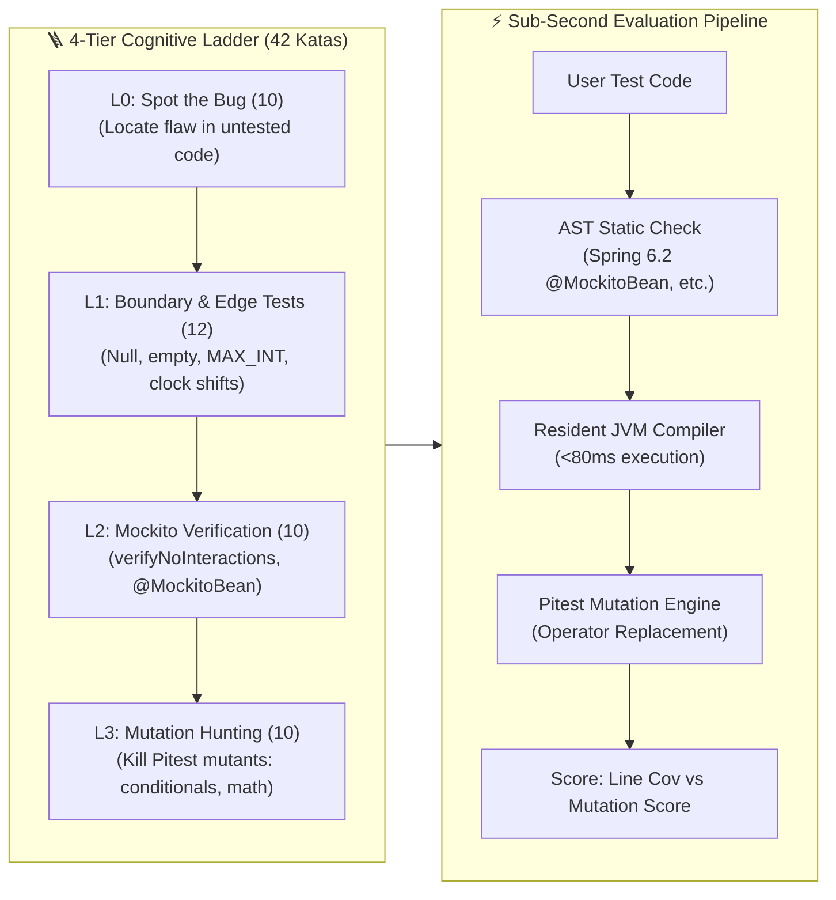

#### Cognitive Ladder Breakdown:
1. **L0: Spot the Flaw (10 Katas):** Rapid diagnostics of faulty business logic without writing test code.
2. **L1: Boundary & Edge Suite (12 Katas):** Writing JUnit 5 parameterized tests for off-by-one errors, timezone boundary bugs, and overflow conditions.
3. **L2: Spring 6.2 Mockito Mastery (10 Katas):** Testing slice isolation with `@MockitoBean` (replacing deprecated `@MockBean`), argument captors (`ArgumentCaptor`), and strict verification (`verifyNoMoreInteractions`).
4. **L3: Mutation Combat (10 Katas):** Surviving mutation attacks where Pitest substitutes relational operators (`>=` $\to$ `>`), inverts conditionals, or mutates return values.
- **Testing Compass:** Live visual radar plotting Coverage %, Mutation Kill Ratio %, Mocking Hygiene, and Boundary Deficit.

---

### 4.3. Pillar 3: Spring Transactions Lab

> 📖 **Authoritative Domain Specification (SSOT):** [03_SPRING_TRANSACTIONS_LAB.md](specs/03_SPRING_TRANSACTIONS_LAB.md)  
> In-memory proxy simulation engine (<50ms), propagation rules, checked exception rollback trap, and HikariCP deadlock theorem.

The Spring Transactions Lab teaches relational transactions, isolation anomalies, proxy mechanics, and connection pool sizing through interactive timelines and deterministic sub-second simulation.

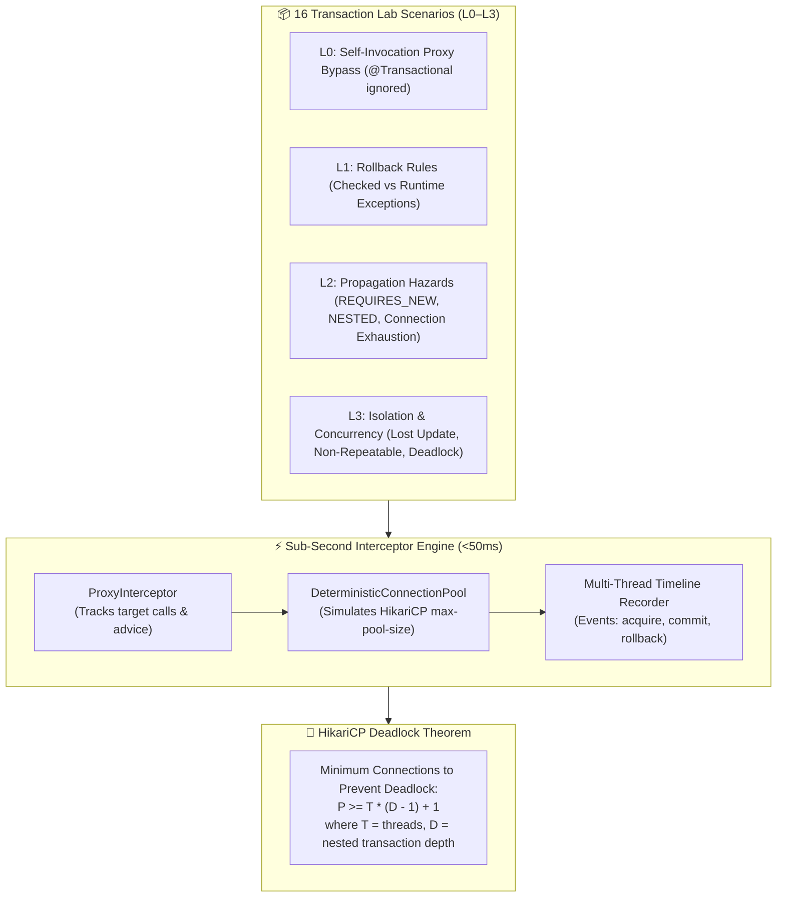

#### Core Engine Features:
- **Ultra-Fast In-Memory Proxy Interceptor:** Replaces heavy 8-second Spring Boot testcontainer startup with an in-memory execution harness evaluating proxy boundaries in **20–50ms**.
- **Interactive Multi-Threaded Timeline:** Renders step-by-step visual interleaving of Thread 1 and Thread 2 connection acquisition, locks, and commit/rollback points.
- **Connection Starvation & Pool Deadlock Detection:** Demonstrates HikariCP pool exhaustion when nested transactions require $D > 1$ simultaneous connections per request thread.

---

### 4.4. Pillar 4: System Design Arena

> 📖 **Authoritative Domain Specification (SSOT):** [04_SYSTEM_DESIGN_ARENA.md](specs/04_SYSTEM_DESIGN_ARENA.md)  
> Cytoscape.js interactive topology canvas, deterministic L1 capacity math engine, 31 FAANG scenarios, and SPOF analysis.

The System Design Arena bridges the gap between blank-canvas design intimidation and high-velocity interview execution through Cytoscape.js interactive graph topologies, mathematical capacity estimation, and faded scaffolding.

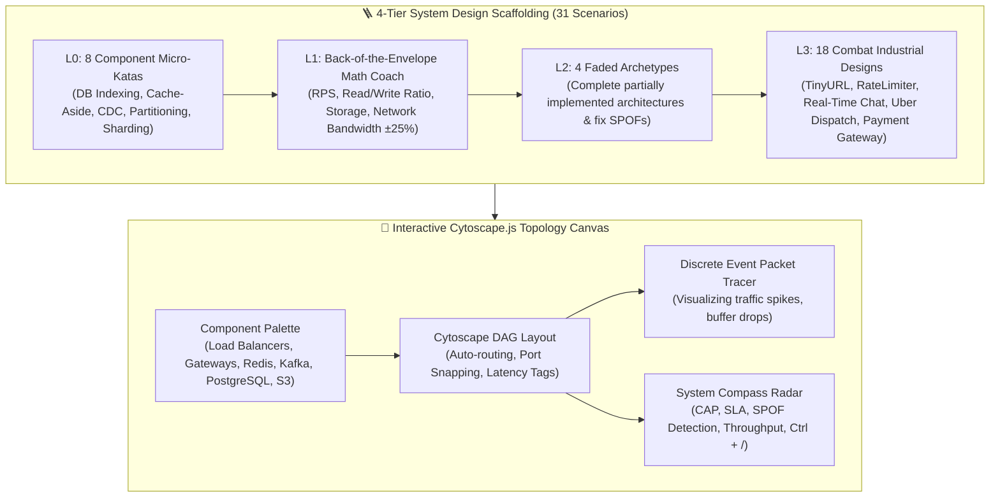

#### Key Capabilities & 31-Scenario Catalog:
- **8 L0 Micro-Katas:** Bite-sized interactive challenges focusing on single architectural decisions (e.g., configuring Redis Sentinel vs Cluster, setting Kafka partition keys, designing compound indexes).
- **L1 Capacity Estimation Math Coach:** Socratic interactive coach validating RPS, IOPS, network throughput, and storage with a $\pm 25\%$ tolerance window before canvas work begins.
- **4 L2 Faded Archetype Scaffolding:** Partially completed topologies where candidates identify and remediate Single Points of Failure (SPOFs), insert write-back buffers, or configure multi-region data replication.
- **18 L3 Combat Industrial Scenarios:** End-to-end full canvas designs covering Tier-1 interview classics (TinyURL, Distributed Rate Limiter, Ride Hailing Dispatch, Flash Sale Engine, Collaborative Text Editor).
- **System Design Compass (`Ctrl + /`):** Real-time architectural heuristic analyzer scoring the candidate's design on Reliability, Scalability, Cost Efficiency, Latency, and Security.

---

### 4.5. Pillar 5: Production Incident Triage Studio & Bug-Hunt Arena

> 📖 **Authoritative Domain Specification (SSOT):** [05_PRODUCTION_INCIDENT_TRIAGE.md](specs/05_PRODUCTION_INCIDENT_TRIAGE.md)  
> Tarjan Strongly Connected Components (SCC) deadlock detection in <1ms, 22 real-world SRE outages, and dual-phase MTTM/MTTR rubric.

The platform cleanly separates diagnostic problem-solving into two dedicated, non-overlapping environments:
1. **«Баг-Хант» (Bug Hunt Arena — 70 Katas):** Rapid visual code-inspection katas focused on identifying concurrency bugs, off-by-one errors, and memory leaks in specific Java methods.
2. **«Триаж Аварий» (Incident Triage Studio — 22 Scenarios):** Full-scale SRE post-mortem environments providing raw JVM thread dumps, heap summaries, flamegraphs, and a Socratic Incident Commander.

```mermaid
flowchart LR
    subgraph Incidents ["🚨 22 Production Incident Scenarios"]
        I1["High CPU / Infinite Loop"]
        I2["Thread Pool Starvation"]
        I3["Project Loom Carrier Pinning"]
        I4["Metaspace OOM / ClassLoader Leak"]
        I5["HikariCP Connection Pool Exhaustion"]
        I6["Circular DB Deadlock (SKIP LOCKED missing)"]
        I7["Kafka Consumer Group Rebalance Storm"]
        I8["Epoll Socket Leak in Netty Gateway"]
    end

    subgraph Tooling ["🛠️ Diagnostic Workstation"]
        TDV["🧵 Thread Dump Visualizer\n(Color-coded states: RUNNABLE, BLOCKED, WAITING)"]
        Tarjan["🔍 Tarjan SCC Cycle Detector\n(Finds circular 'waiting to lock <0x...>' in <1ms)"]
        MDV["💾 Memory & Heap Profiler\n(Dominator Tree, Retained Size, GC Roots)"]
        SQL["⏱️ Slow Query & Hikari Monitor\n(Active, Idle, Pending connections)"]
        Compass["🧭 Triage Compass Radar\n(MTTA, MTTR, Blast Radius, Root Cause, Ctrl + /)"]
    end

    subgraph Commander ["🧑‍✈️ Socratic Incident Commander"]
        Mitigate["Phase 1: Immediate Mitigation\n(Traffic shed, restart, rollback)"]
        RCA["Phase 2: Root Cause Hypothesis Tree\n(Evidence-based deduction)"]
        PostMortem["Phase 3: Preventative Action Items\n(P99 timeout, bounded queues)"]
        Mitigate --> RCA --> PostMortem
    end

    Incidents --> Tooling
    Tooling --> Commander
```

#### Key Components:
- **Tarjan Strongly Connected Components (SCC) Engine:** Automatically extracts circular wait graphs from thread dump raw text to pinpoint deadlock origins in $<1\text{ms}$.
- **Thread & Memory Tree Visualizer:** Interactive hierarchical views replacing impenetrable 50,000-line log files.
- **Triage Compass (`Ctrl + /`):** Visual diagnostic radar plotting MTTA/MTTR velocity, blast radius containment, cycle resolution, and root cause isolation.
- **Dual-Phase Rubric:** Evaluates candidates separately on **Time-to-Mitigate** (stopping customer bleeding) and **Time-to-Resolve** (identifying underlying software flaw).

---

### 4.6. Pillar 6: Machine Coding & Low-Level Design (LLD) Studio

> 📖 **Authoritative Domain Specification (SSOT):** [06_MACHINE_CODING_AND_LLD.md](specs/06_MACHINE_CODING_AND_LLD.md)  
> 35 design challenges, AST rules `enforce-clock-injection`, `no-double-in-money`, deadlock-free lock ordering, and Loom carrier pinning guard.

The Machine Coding Studio evaluates candidate code against rigorous production standards across 35 multi-file design challenges.

#### 35 Challenges Across 3 Industrial Tracks:
| Track | Count | Core Archetypes | Key Enforced Invariants |
| :--- | :---: | :--- | :--- |
| **🏛️ BigTech Core LLD** | 15 | Rate Limiter (Token Bucket / Sliding Log), LRU/LFU Cache, Task Scheduler, Notification Filtering, Order State Machine | Injected `java.time.Clock`, Specification Pattern, OCP, Bounded Cache Eviction |
| **💳 FinTech & Ledger LLD** | 10 | Double-Entry Ledger, Idempotency Processor, Transactional Outbox, Multi-Currency Wallet, Fraud Rules | Ordered ID Locks (Deadlock-Free), `BigDecimal` with `RoundingMode.HALF_EVEN`, Zero `float`/`double` |
| **⚡ Concurrency Systems LLD** | 10 | Virtual Thread Elevator Dispatcher, Custom ThreadPoolExecutor, Connection Pool Manager, Async Batch Flusher, Cache Stampede SingleFlight, Disruptor Ring Buffer | Zero Carrier Pinning, `ReentrantLock` + `Condition`, Striped Cells |

#### Deterministic 8-Factor AST Static Auditing Service:
Code submissions must pass deterministic AST rules before AI scoring:
1. `carrier-thread-pinning` (Critical): Blocks `synchronized` blocks inside virtual threads.
2. `unbounded-threadlocal-leak` (High): Enforces `try-finally { tl.remove(); }` or `ScopedValue`.
3. `unsafe-tomap-collision` (High): Flags 2-argument `Collectors.toMap` without merge functions.
4. `deprecated-mockbean-springboot34` (Medium): Flags `@MockBean`, requiring Spring 6.2 `@MockitoBean`.
5. `blocking-call-in-controller` (Critical): Flags `Thread.sleep` or blocking I/O in HTTP controllers.
6. `side-effects-in-peek` (Medium): Catches state mutation inside `Stream.peek()`.
7. `enforce-clock-injection` (High): Enforces constructor-injected `java.time.Clock`.
8. `no-double-in-money` (Critical): Enforces `BigDecimal` with `RoundingMode.HALF_EVEN`.

#### 5-Factor Evaluation Formula:
$$\text{FinalScore} = 0.40 \cdot S_{\text{correctness}} + 0.20 \cdot S_{\text{concurrency}} + 0.20 \cdot S_{\text{architecture}} + 0.10 \cdot S_{\text{time\_testability}} + 0.10 \cdot S_{\text{java21\_idioms}}$$

---

### 4.7. Pillar 7: Guided Academy Studio

> 📖 **Authoritative Domain Specification (SSOT):** [07_GUIDED_ACADEMY_AND_FSRS5.md](specs/07_GUIDED_ACADEMY_AND_FSRS5.md)  
> FSRS-5 17-weight cognitive memory model, 8-track curricular DAG (177 nodes), and Next-Best-Action cognitive interleaving scheduler.

The Guided Academy Studio orchestrates candidate progression across all technical arenas into **8 structured, level-calibrated roadmaps totaling 177 verified steps**, powered by a closed-loop FSRS-5 Knowledge Graph and a Socratic Next Best Action Recommender with Cognitive Interleaving.

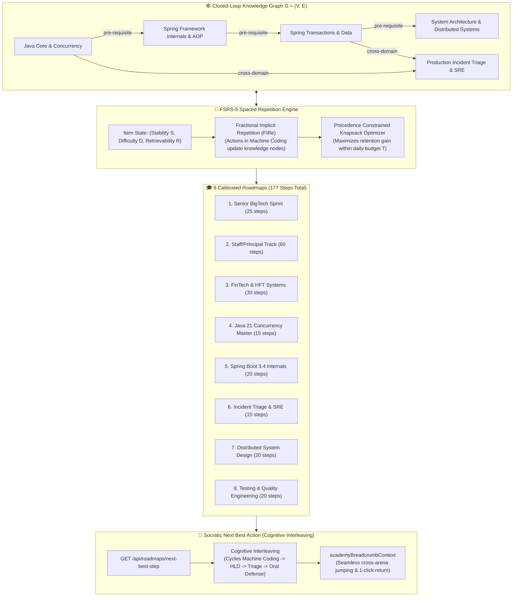

#### The 8 Guided Roadmaps:
1. **Senior BigTech Sprint (25 steps):** High-yield fast-track covering Java 21 virtual threads, Spring proxy gotchas, BigTech LLD archetypes, and System Design fundamentals.
2. **Staff/Principal Architecture & Leadership (60 steps):** Rigorously rebalanced flagship curriculum (23 System Design, 16 Machine Coding, 9 Incident Triage, 5 Oral Defense, 4 Architecture Invariants, 2 Transactions Lab, 1 Mutation Kata).
3. **FinTech & High-Frequency Systems (30 steps):** Double-entry ledgers, lock-free ring buffers, idempotency, zero-double precision, and high-load payment gateways.
4. **Java 21 Concurrency & Systems Master (15 steps):** Project Loom, carrier pinning elimination, ScopedValue, lock-free contention, and custom ThreadPoolExecutors.
5. **Spring Boot 3.4 & Framework Internals (20 steps):** CGLIB proxy bypass, transaction rollback rules, `@MockitoBean` isolation, and auto-configuration lifecycle.
6. **Production Incident Triage & SRE (15 steps):** Thread pool starvation, Tarjan SCC deadlock resolution, heap dominator trees, and P99 latency mitigation.
7. **Distributed System Design Specialist (20 steps):** Math estimation coach, faded architectures, partition strategies, and multi-region high availability.
8. **Testing & Quality Engineering (20 steps):** Boundary edge testing, Mockito verification hygiene, and Pitest mutation hunting.

#### Socratic Next Best Action Recommender (`GET /api/roadmaps/next-best-step`):
- **Cognitive Interleaving:** Deliberately rotates practice modalities (Machine Coding $\to$ System Design $\to$ Incident Triage $\to$ Mock Defense) to prevent cognitive tunnel vision and maximize long-term neurological retention.
- **Cross-Arena Breadcrumb Envelope (`academyBreadcrumbContext`):** Automatically injects the active roadmap context into any target arena, allowing seamless 1-click return upon task completion.

#### Mathematical Formulation:
- **Retention Probability:**
  $$R(t, S) = \left(1 + \text{factor} \times \frac{t}{S}\right)^{-1}$$
- **Daily Sprint Optimization (PCKP):**
  $$\max \sum_{i \in \mathcal{V}} \Delta \text{KnowledgeGain}_i \cdot x_i \quad \text{s.t.} \quad \sum_{i \in \mathcal{V}} t_i x_i \le T_{\text{budget}}, \quad x_j \le x_i \; \forall (i, j) \in \mathcal{E}$$
- **Cross-Arena Universal Context Payload (`frontend/src/types/tutor.ts`):** Standardized context envelope transmitted to the Socratic AI Tutor regardless of active arena.

---

### 4.8. Pillar 8: StudyDeck & Audio Podcasts

> 📖 **Authoritative Domain Specification (SSOT):** [08_STUDYDECK_AND_AUDIO_PODCASTS.md](specs/08_STUDYDECK_AND_AUDIO_PODCASTS.md)  
> Two-host conversational podcast generation (Elena & Dmitry), Gemini 3.1 TTS multi-voice synthesis, and lock-screen MediaSession player.

The StudyDeck provides auditory spaced learning via two-host conversational podcasts generated dynamically using Gemini 3.1 Flash TTS.

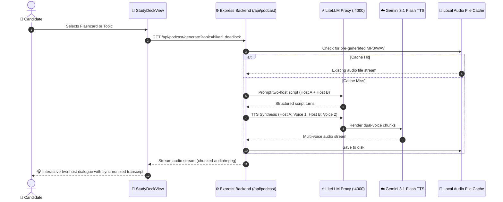

#### Highlights:
- **Two-Host Dynamic Dialogue:** Host A plays the curious interviewer posing edge-case questions; Host B plays the seasoned Staff Architect explaining the JVM/Spring internals.
- **Synchronized Transcripts:** Live karaoke-style highlight tracking along the audio playback timeline.
- **Anki-Style Spaced Repetition:** Flashcard evaluation (Again, Hard, Good, Easy) directly adjusting node stability in the FSRS-5 engine.

---

### 3.9. The 4 Interactive Technical Compasses (`Ctrl + /`)

To eliminate aimless trial-and-error, each technical arena provides an interactive radar compass triggered universally via `Ctrl + /` (or `Cmd + /` on macOS) or the floating compass badge:

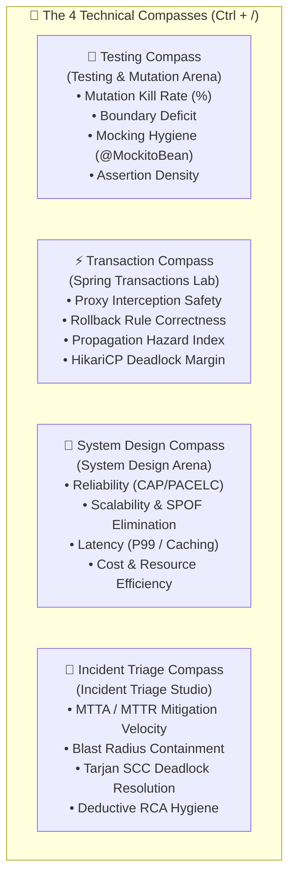

1. **Testing Compass:** Diagnoses test suites against mutation engines, highlighting surviving mutant vulnerabilities and missing boundary tests without revealing the solution.
2. **Transaction Compass:** Evaluates transactional topologies against Spring AOP proxy rules, checked exception rollback semantics, and HikariCP connection starvation formulas ($P \ge T \times (D - 1) + 1$).
3. **System Design Compass:** Evaluates Cytoscape architectural DAGs against distributed trade-offs (CAP theorem, single points of failure, partition keys, read/write bottlenecks).
4. **Incident Triage Compass:** Scores SRE post-mortem workflows, penalizing premature speculation and rewarding rapid traffic shedding followed by systematic thread/heap graph isolation.

---

## 4. Cross-Cutting Engineering & Resilience Architecture

### 4.1. Two-Tier Circuit Breaker Architecture

All upstream calls pass through a resilient dual-tier Circuit Breaker in `LiteLLM_Proxy`:

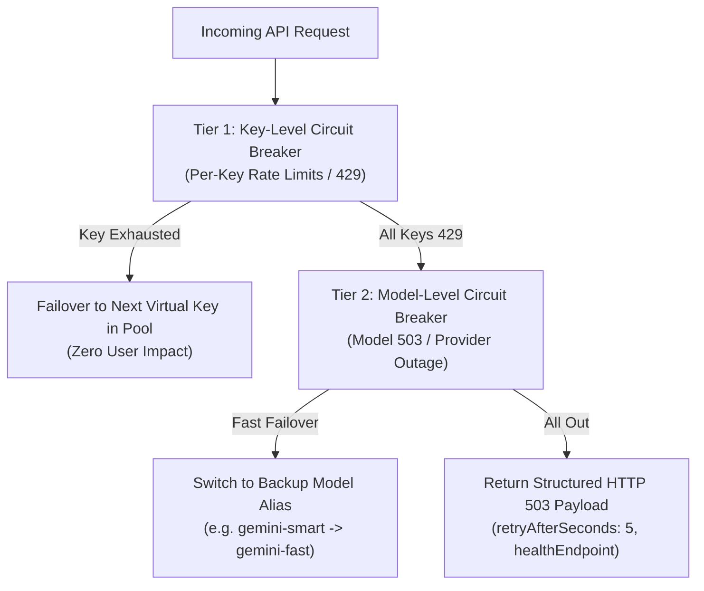

### 4.2. Actionable HTTP 503 Recovery Contract

When the AI gateway experiences an upstream outage, the backend returns a structured JSON payload:

```json
{
  "error": "LLM_GATEWAY_TEMPORARILY_UNAVAILABLE",
  "reason": "rate_limit_exceeded | proxy_unreachable | upstream_timeout",
  "userMessage": "Нейросеть испытывает повышенную нагрузку при генерации комплексного кейса.",
  "retryAfterSeconds": 5,
  "healthEndpoint": "/api/health",
  "availableBankCount": 70
}
```

The frontend renders `TaskRecoveryCard`:
- Live animated countdown timer with pause/resume toggle.
- 1-click retry button.
- Instant access to the offline catalog of 70 SOTA katas.
- Real-time inline gateway health diagnostics.

### 4.3. UI Performance, Virtualization & Scroll Lock Invariants

- **Reference-Counted Scroll Lock (`useBodyScrollLock`):** Tracks an integer `activeLocksCount`. Eliminates the classic modal bug where closing an inner modal releases body scrolling while the outer modal is still mounted.
- **100dvh Standard:** Replaces problematic `100vh` on mobile viewports with `100dvh` (`h-[calc(100dvh-4rem)]`) to absorb mobile browser address bar and keyboard resizes without layout reflows.
- **CSS `content-visibility: auto`:** Large lists of 800+ questions render with zero DOM virtualization lag, guaranteeing 120 FPS scrolling on iOS and Android devices.

---

## 5. Database Topology & Schema Reference

The primary persistence layer uses SQLite3 at `/app/data/interview.db` (with PostgreSQL 16 backing LiteLLM state and vector embeddings).

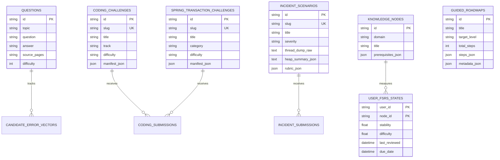

---

## 6. Production Deployment & Infrastructure Topology

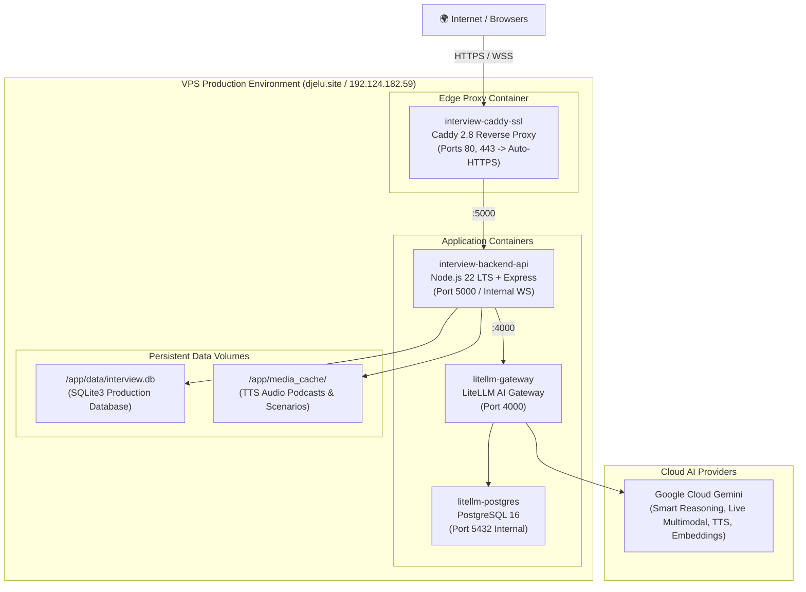

---

## 7. Health Diagnostics & Observability Standard

The platform exposes unified health and diagnostic endpoints:
- `GET /api/health`: Validates process uptime, memory footprint, SQLite connectivity, and tests upstream connectivity to `LiteLLM_Proxy` with latency timings for all 4 primary model aliases:
  1. `GEMINI_TEXT_MODEL`
  2. `GEMINI_LIVE_MODEL`
  3. `GEMINI_TTS_MODEL`
  4. `GEMINI_EMBEDDING_MODEL`
- `GET /api/health/diagnostics`: Detailed breakdown of active connection pools, resident compiler warm status, and FSRS cache hits.
