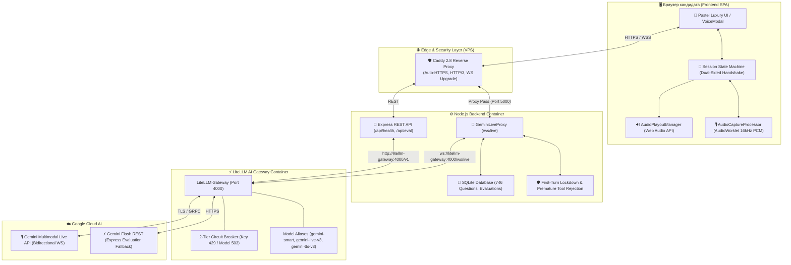
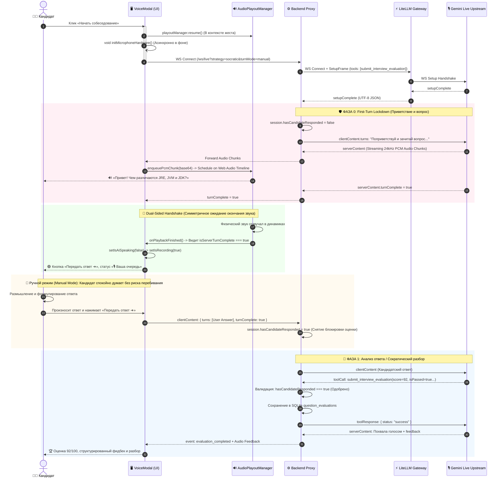
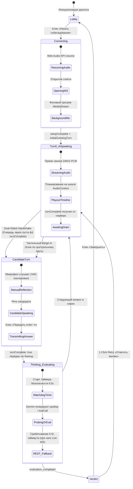

# System Architecture & Technical Specification: InterviewPrep AI (SOTA August 2026)

## 1. System Overview & End-to-End Topology

InterviewPrep AI is a real-time multimodal audio interview preparation platform for Java & Spring developers. All LLM, Audio WebSocket, and TTS interactions are strictly decoupled through a central AI Gateway (`LiteLLM_Proxy`).

---

## 2. Gemini Live Realtime Audio Protocol & Handshake

### 2.1. First-Turn Lockdown Invariant
* **Directive:** In all system prompts (`socratic_tutoring`, `adaptive_probing`, and `customPromptOverride`), the AI interviewer is strictly forbidden from invoking `submit_interview_evaluation` during Turn 0 (initial greeting).
* **Backend Guard:** The WebSocket session maintains `session.hasCandidateResponded = false`. Any premature invocation of `submit_interview_evaluation` is rejected with a structured `toolResponse` error, forcing the model to speak the greeting and read the question aloud.

### 2.2. Dual-Sided Handshake (Race Condition Elimination)
The transition from AI speech to candidate microphone (`isAiSpeaking: false`, `isRecording: true`) is symmetrically unblocked by whichever event finishes LAST:
1. `AudioPlayoutManager.onPlaybackFinished` (when physical audio finishes draining in headphones).
2. WebSocket `turnComplete: true` arrival (when network generation concludes).

---

## 3. Audio Lifecycle State Machine

---

## 4. Hardware Audio Architecture

### 4.1. Single-Sink Audio Routing
- **Mobile (Android/iOS):** Routes EXCLUSIVELY to `MediaStreamAudioDestinationNode` + HTML5 Audio element (`STREAM_MUSIC` loud speakerphone), bypassing `context.destination` to prevent dual-output echo.
- **Desktop:** Routes EXCLUSIVELY to `context.destination` for minimal latency (~10ms).

### 4.2. Tactile Barge-In
- Clicking the central interactive circle during AI speech invokes `AudioPlayoutManager.handleInterruption()` with a 5ms linear de-click ramp, stopping playback cleanly and switching UI to active recording (`isRecording: true`).

### 4.3. Non-Blocking Microphone Hardware Init
- `initMicrophoneHardware()` executes in an asynchronous background promise (`void initMicrophoneHardware()`).
- WebSocket connection and AI greeting audio are never blocked by operating system permission prompts.
