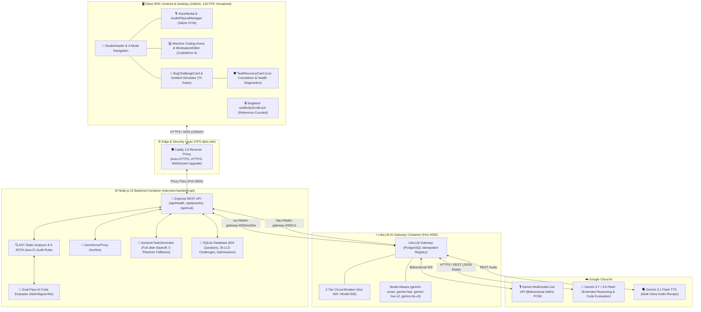
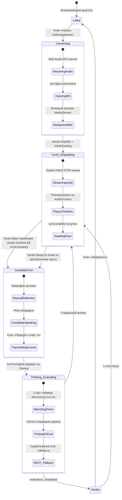
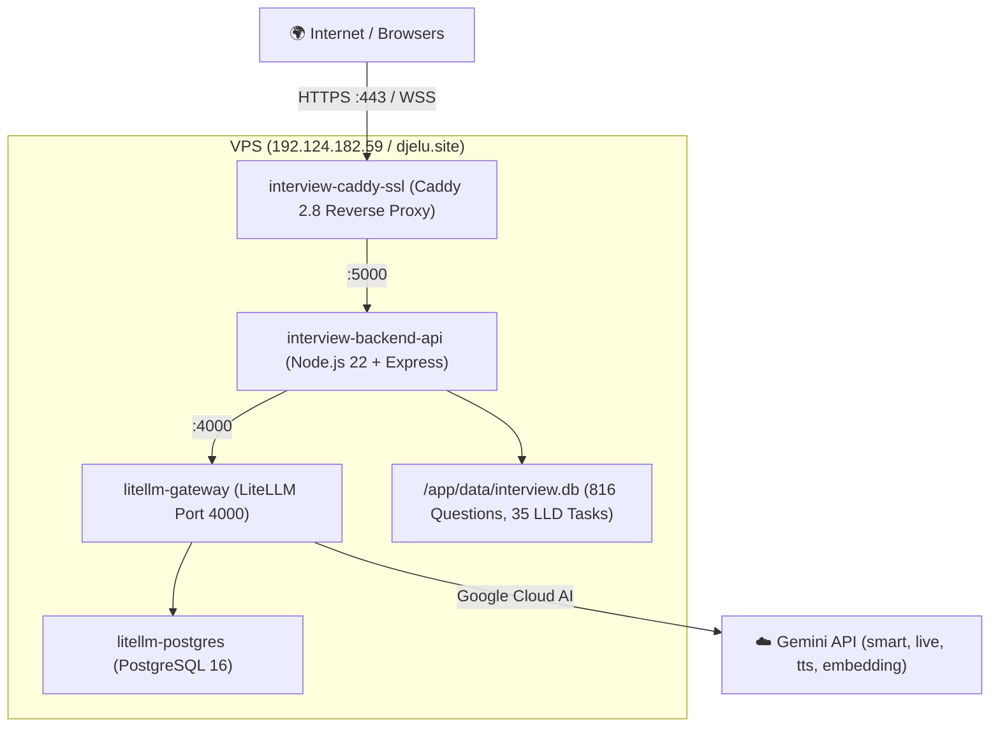

# System Architecture & Technical Specification: InterviewPrep AI (SOTA September 2026)

> **Canonical System Specification & Master Reference**  
> **Production Target:** `https://djelu.site` (Docker Compose + Caddy 2.8 Reverse Proxy)  
> **LLM/Audio Gateway:** `http://litellm-gateway:4000` (LiteLLM Proxy with 4-Model Dual-Tier Circuit Breaker)

---

## 1. System Overview & Platform Topology

InterviewPrep AI is an institutional-grade technical interview preparation platform for Java 21+ & Spring Boot engineers, architected around three unified learning and assessment pillars:

1. 🧠 **Knowledge Base & Voice Socratic Interviewer:** 816 curated Java/Spring questions with real-time bidirectional multimodal audio (Gemini Live 24kHz PCM) and automated speech evaluations.
2. 🐛 **Production Incident & Bug Simulator:** 70 SOTA engineering katas (Streams, Concurrency, Loom Pinning, Spring Boot 3.4 `@MockitoBean`) with dynamic task generation, Full-Jitter Backoff resilience, and `TaskRecoveryCard` zero-blank-screen recovery.
3. 🏛️ **Live-Coding, Machine Coding & LLD Arena:** 35 production-grade Low-Level Design challenges (BigTech Core, FinTech Ledger, Concurrency Systems) with full multi-file scaffolds, deterministic `Clock.fixed` virtual time testing, and 8-factor AST static auditing.



---

## 2. Machine Coding & LLD Arena Architecture

### 2.1. 35 SOTA LLD Challenges Catalog
The platform provides 35 end-to-end Low-Level Design challenges organized across 3 industrial tracks:

| Track | Challenges Count | Representative Archetypes | Key Invariants |
| :--- | :---: | :--- | :--- |
| **🏛️ BigTech Core LLD** | 15 | • Notification Filtering & 24h Deduplication (Яндекс)<br>• In-Memory Rate Limiter (Token Bucket / Sliding Window)<br>• In-Memory Cache (TTL, LRU/LFU)<br>• Task Scheduler (Cron, Priority)<br>• Order State Machine, Circuit Breaker, Event Bus | Injected `java.time.Clock`, Specification Pattern, OCP, Bounded Cache Eviction |
| **💳 FinTech & Ledger LLD** | 10 | • Double-Entry Accounting Ledger (Т-Банк / Stripe)<br>• Idempotency Key Processor (SHA-256 / TTL)<br>• Transactional Outbox (SKIP LOCKED)<br>• Multi-Currency Wallet (Hold/Capture/Release)<br>• Fraud Detection Sliding Window Rules | Ordered ID Locking (Deadlock-Free), `BigDecimal` with `RoundingMode.HALF_EVEN`, Zero `float`/`double` |
| **⚡ Concurrency Systems LLD** | 10 | • Multi-threaded Elevator Dispatcher (Virtual Threads)<br>• Custom ThreadPoolExecutor & Work-Stealing<br>• Connection Pool Manager (Leak Detection, MaxWait)<br>• Async Batch Flusher (Size $N$ \|\| Time $T$ ms)<br>• Multi-tier Cache Stampede Protection (SingleFlight)<br>• LMAX Disruptor Ring Buffer | Zero Carrier Pinning, `ReentrantLock` + `Condition`, Non-blocking Striped Cells |

### 2.2. Deterministic Static AST Analysis Engine (8 Rules)
Before invoking LLM reasoning, code submissions are audited through an 8-rule deterministic AST engine synchronized between `frontend/src/utils/astRules.ts` and `backend/src/services/astAuditService.ts`:

1. **`carrier-thread-pinning` (Critical):** Blocks `synchronized` blocks/methods that pin OS carrier threads in Project Loom virtual thread runtimes.
2. **`unbounded-threadlocal-leak` (High):** Flags `ThreadLocal.set()` without guaranteed `try-finally { remove(); }` or unmigrated to Java 21 `ScopedValue`.
3. **`unsafe-tomap-collision` (High):** Catches 2-argument `Collectors.toMap(k, v)` lacking a merge function.
4. **`deprecated-mockbean-springboot34` (Medium):** Flags `@MockBean` in Spring Boot 3.4+, requiring Spring 6.2 `@MockitoBean`.
5. **`blocking-call-in-controller` (Critical):** Blocks `Thread.sleep` in REST controller request threads.
6. **`side-effects-in-peek` (Medium):** Detects state mutations inside `Stream.peek()`.
7. **`enforce-clock-injection` (High):** Prohibits direct `System.currentTimeMillis()` / `Instant.now()` in business services, enforcing constructor-injected `java.time.Clock`.
8. **`no-double-in-money` (Critical):** Prohibits `double`/`float` in monetary/balance calculations, enforcing `BigDecimal` with `RoundingMode.HALF_EVEN`.

### 2.3. SOTA 5-Factor Scoring Formula
The dual-pass evaluation produces an objective 0–100 score:
$$\text{FinalScore} = 0.40 \cdot S_{\text{correctness}} + 0.20 \cdot S_{\text{concurrency}} + 0.20 \cdot S_{\text{architecture}} + 0.10 \cdot S_{\text{time\_testability}} + 0.10 \cdot S_{\text{java21\_idioms}}$$

---

## 3. Resilience & Zero-Phantom-Fallback Invariants

### 3.1. Elimination of Fake Fallbacks
* Under no circumstances does the system fabricate static tasks pretending to be AI generation when the LLM gateway is degraded.
* `DynamicTaskGenerator` implements **Full-Jitter Exponential Backoff**:
  $$T_{\text{wait}} = \text{random}\left(0, \min(2500, 800 \times 1.8^{\text{attempt}})\right)$$
* Up to 2 automated retries occur transparently for HTTP 429, 503, or upstream timeouts.

### 3.2. Structured HTTP 503 Contract & Actionable Recovery UI
When the gateway is persistently unavailable, `POST /api/practice/generate-task` returns a structured HTTP 503 JSON payload:
```json
{
  "error": "LLM_GATEWAY_TEMPORARILY_UNAVAILABLE",
  "reason": "rate_limit_exceeded | proxy_unreachable | upstream_timeout",
  "userMessage": "Нейросеть испытывает повышенную нагрузку при генерации комплексного кейса.",
  "retryAfterSeconds": 5,
  "healthEndpoint": "/api/health",
  "availableBankCount": 70
}
```

The frontend renders [`TaskRecoveryCard`](file:///d:/projects/interview_projects/spring/frontend/src/components/TaskRecoveryCard.tsx):
* Live animated countdown timer with progress bar and Pause/Resume toggle.
* 3 one-click actions: 🔄 *«Повторить сейчас»*, 📚 *«Банк 70 задач»*, 🩺 *«Диагностика шлюза»* (inline query to `/api/health`).

---

## 4. Gemini Live Multimodal Protocol & State Machine

### 4.1. First-Turn Lockdown Invariant
* **Turn 0 Directive:** In all system prompts, the AI interviewer is strictly forbidden from calling `submit_interview_evaluation` during Turn 0 greeting.
* **Backend Guard:** The backend WebSocket session tracks `hasCandidateResponded`. Early evaluation attempts are rejected with structured `toolResponse` errors.

### 4.2. Dual-Sided Handshake
The transition from AI speech to candidate microphone (`isAiSpeaking: false`, `isRecording: true`) is symmetrically unblocked by whichever event finishes LAST:
1. `AudioPlayoutManager.onPlaybackFinished` (physical audio drains in headphones).
2. WebSocket `turnComplete: true` arrival (network streaming concludes).



---

## 5. UI/UX Ergonomics & Mobile Responsiveness

### 5.1. Mobile Viewport Stability (`100dvh`)
* `PracticeArena.tsx` utilizes `h-[calc(100dvh-4rem)]` to prevent virtual keyboard displacement on Android / iOS devices.
* File tabs in `WorkspaceEditor.tsx` feature `touch-pan-x no-scrollbar` for smooth horizontal swiping with touch targets $\ge 36\text{px}$.

### 5.2. Multi-Modal Reference-Counted Scroll Lock
* `useBodyScrollLock.ts` maintains a module-level `activeLocksCount` reference counter. Opening nested drawers (e.g. Memory Radar over Bug Hunt Modal) does not prematurely unlock `document.body` when an inner drawer closes.

### 5.3. CSS Virtualization for 120 FPS Scrolling
* Question cards (`QuestionExplorer.tsx`) and topic cards (`TopicSelector.tsx`) utilize `.card-content-visibility` (`content-visibility: auto; contain-intrinsic-size: 0 90px;`), enabling buttery-smooth 120 FPS scrolling across all 816 questions on mobile hardware.

---

## 6. Production Deployment Topology



---

## 7. Database Schema Reference (SQLite `interview.db`)

* `questions`: 816 questions (`id`, `topic`, `question`, `answer`, `source_pages`).
* `coding_challenges`: 42 challenges (`id`, `slug`, `title`, `category`, `track`, `difficulty`, `manifest_json`).
* `coding_submissions`: User code submissions (`challenge_id`, `user_id`, `files_json`, `score`, `evaluation_json`).
* `bug_challenges`: 70 SOTA katas (`id`, `topic_id`, `code_snippet`, `bug_explanation`, `fixed_code`, `hints_json`).
* `candidate_error_vectors`: Deficit tracking (`topic`, `error_concept`, `embedding`, `deficit_weight`, `solo_streak`).
* `interview_profiles`: Presets (`socratic_tutoring`, `adaptive_probing`, `voice`, `strategy`).
