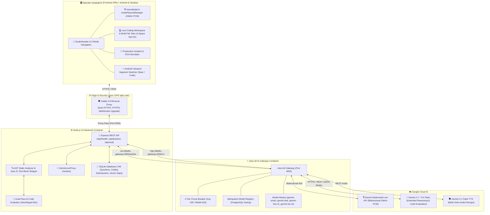
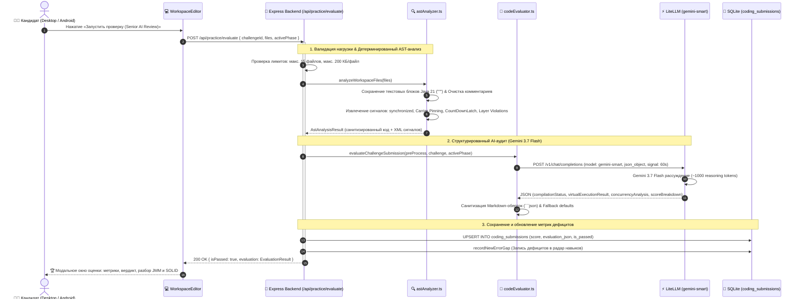
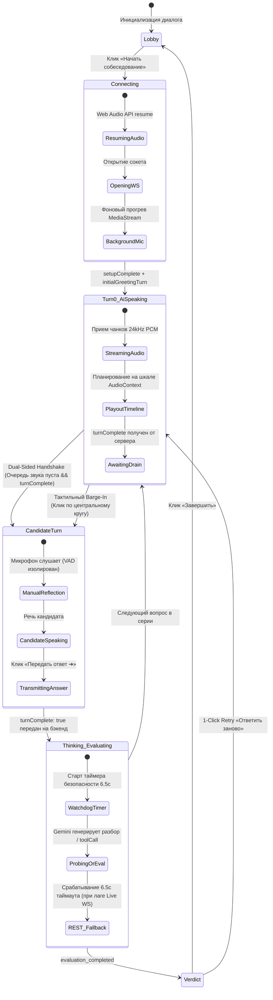

# System Architecture & Technical Specification: InterviewPrep AI (SOTA August 2026)

## 1. System Overview & Platform Topology

InterviewPrep AI is an advanced preparation studio for Java 21 & Spring developers featuring three unified learning and assessment pillars:
1. 🧠 **Knowledge Base & Voice Socratic Interviewer** (Real-time multimodal WebSocket with Gemini Live).
2. 🐛 **Production Incidents & Bug Simulator** (Live production incident debugging, root-cause analysis, and CVE detection).
3. ⚡ **Live-Coding, Katas & Machine Coding Studio** (Dual-pass AST static analysis + Gemini 3.7 Flash Senior evaluation, Multi-file workspace, OCP phased shifts, and Golden Master Approval Testing).

All LLM, Audio WebSocket, and TTS interactions are strictly routed through `LiteLLM_Proxy` (`http://litellm-gateway:4000`).

---

## 2. Live-Coding & Machine Coding Studio Architecture

### 2.1. Dual-Pass Hybrid Code Evaluation Engine
The platform combines deterministic static analysis (Phase 1) with deep AI reasoning from `gemini-smart` (Phase 2) to eliminate hallucinations while capturing nuanced architectural insights.

### 2.2. Scoring Formula & Rubric
The multi-dimensional evaluation calculates an overall score using industry-weighted criteria:
$$\text{Score} = 0.35 \cdot S_{\text{correctness}} + 0.25 \cdot S_{\text{concurrency}} + 0.25 \cdot S_{\text{architecture}} + 0.15 \cdot S_{\text{idioms}}$$

* **Functional Correctness (35%):** Simulation of test cases, boundary limits, and contract satisfaction.
* **Concurrency & Loom Safety (25%):** Thread safety under high contention, atomicity (`computeIfAbsent`), non-blocking locks, and carrier thread pinning prevention.
* **Architecture & SOLID (25%):** Dependency Inversion, single responsibility, OCP compliance, and clean separation of concerns.
* **Modern Java 21 Idioms (15%):** Adoption of Records, Sealed Interfaces, Pattern Matching for switch, and Virtual Threads.

---

## 3. Gemini Live Realtime Audio Protocol & Handshake

### 3.1. First-Turn Lockdown Invariant
* **Turn 0 Directive:** In all system prompts (`socratic_tutoring`, `adaptive_probing`), the AI interviewer is strictly forbidden from invoking `submit_interview_evaluation` during Turn 0 greeting.
* **Backend Guard:** The backend WebSocket session tracks `hasCandidateResponded`. If Gemini attempts to call `submit_interview_evaluation` when `hasCandidateResponded === false`, the backend rejects the call with a structured `toolResponse` error, forcing the model to speak the greeting and read the question aloud.

### 3.2. Dual-Sided Handshake
The transition from AI speech to candidate microphone (`isAiSpeaking: false`, `isRecording: true`) is symmetrically unblocked by whichever event finishes LAST:
1. `AudioPlayoutManager.onPlaybackFinished` (when physical audio finishes draining in headphones).
2. WebSocket `turnComplete: true` arrival (when network generation concludes).

---

## 4. Hardware Audio & Mobile Ergonomics

### 4.1. Single-Sink Audio Routing
* **Android / Mobile:** Routes exclusively to `MediaStreamAudioDestinationNode` + HTML5 Audio element (`STREAM_MUSIC` loud speakerphone), bypassing `context.destination` to prevent dual-output echo.
* **Desktop:** Routes exclusively to `context.destination` for minimal latency (~10ms).

### 4.2. Android Mobile Responsive Split
* On mobile screens (`< 768px`), `PracticeArena.tsx` renders a segmented pill switcher:
  - **[📄 Спека]:** Full problem description, DDD criteria, tiered hints, and Phase 2 OCP requirements.
  - **[💻 Код]:** Multi-file editor with Tab indentation (4 spaces) and execution controls.
