# Архитектурный аудит и детальный анализ кандидатов на рефакторинг платформы

> **Статус документа:** Authoritative Architectural Analysis  
> **Дата:** 1 ноября 2026 г.  
> **Область охвата:** Frontend Voice DSP, Backend Live Streaming FSM, Code Evaluation & Mutation Pipeline  
> **Связанные спецификации:** [`AGENTS.md`](file:///home/djelu/projects/interview_tutor/AGENTS.md), [`docs/architecture.md`](file:///home/djelu/projects/interview_tutor/docs/architecture.md), [`docs/architecture/functional_registry/INDEX.md`](file:///home/djelu/projects/interview_tutor/docs/architecture/functional_registry/INDEX.md)

---

## 1. Введение и контекст аудита

В ходе комплексного архитектурного сканирования кодовой базы платформы подготовки к техническим собеседованиям (включающей симуляторы Gemini 3.8 Live, арены баг-хантинга, рефакторинга и HR-скрининга) были выявлены 4 критических очага архитектурного трения (hotspots), страдающих от антипаттернов **Shallow Module Chain**, **Anemic Data Bags**, **Leaky Transports** и **Orphaned Clones**.

- **Кандидат 1 (Успешно реализован):** *Collapse the Live Tool Dispatcher Cluster* — свертывание 5 разрозненных файлов диспетчеризации в глубокий модуль `LiveToolEngine` с чистым контрактом вызовов и выделением независимого доменного хранилища `workspaceManifestStore.ts` (ветка `refactor/collapse-live-tool-dispatcher`, коммит `0f8ca27`).
- **Остальные 3 кандидата:** Требуют бескомпромиссного, профессионального и беспристрастного анализа первопричин с акцентом на устранение системного корня проблем, а не симптоматическое «подпирание костылями».

Настоящий документ формулирует глубокий технический разбор Кандидатов 2, 3 и 4: генезис техдолга, анатомию текущей реализации (As-Is), риски и скрытые сбои в проде, целевую архитектуру (To-Be) и пошаговую стратегию рефакторинга.

---

## 2. Кандидат 2: Углубление сессии голосового клиента и удаление параллельных клонов

### 2.1. Идентификация и целевые файлы
- **Тематическая область:** Frontend Web Audio DSP, React Voice State Machine, Gemini Live Client.
- **Целевые файлы:**
  - [`frontend/src/audio/LiveVoiceEngine.ts`](file:///home/djelu/projects/interview_tutor/frontend/src/audio/LiveVoiceEngine.ts) — **360 строк (100% мертвый клон)**.
  - [`frontend/src/audio/SileroVadDetector.ts`](file:///home/djelu/projects/interview_tutor/frontend/src/audio/SileroVadDetector.ts) — **143 строки (100% мертвый код)**.
  - [`frontend/src/audio/AcousticBargeInGuard.ts`](file:///home/djelu/projects/interview_tutor/frontend/src/audio/AcousticBargeInGuard.ts) — **72 строки (100% мертвый код)**.
  - [`frontend/src/audio/NativeLiveVoiceEngine.ts`](file:///home/djelu/projects/interview_tutor/frontend/src/audio/NativeLiveVoiceEngine.ts) — **458 строк (перегруженный класс)**.
  - [`frontend/src/audio/useLiveVoiceSession.ts`](file:///home/djelu/projects/interview_tutor/frontend/src/audio/useLiveVoiceSession.ts) — **336 строк (протекающий хук с 33 свойствами)**.
  - [`frontend/src/audio/types.ts`](file:///home/djelu/projects/interview_tutor/frontend/src/audio/types.ts) — **265 строк (фрагментированные контракты)**.

### 2.2. Анализ первопричины (Root Cause vs. Symptom)
- **Симптом:** Инженеры и AI-агенты путаются между двумя голосовыми движками (`LiveVoiceEngine` и `NativeLiveVoiceEngine`). Периодически возникают гонки состояний в UI: индикатор речи зависает в `isAiSpeaking`, tactile barge-in клик не останавливает звук в наушниках, а хук сессии требует передачи ссылки на низкоуровневый `AudioPlayoutManager` во внешние компоненты.
- **Глубинная причина (Root Cause):**
  1. **Нарушение Invariant 8 (Zero Parallel Reimplementations):** В ходе эволюции (Wave 14) кодовая база мигрировала с клиентского Silero VAD на нативный протокол Gemini 3.8 Live WebSocket с облачным VAD. Был создан класс `NativeLiveVoiceEngine.ts`. Однако старый `LiveVoiceEngine.ts` вместе со своими зависимостями (`SileroVadDetector`, `AcousticBargeInGuard`) не был удален. Более 575 строк мертвого кода висят в проекте, загрязняя глобальную систему типов и вводя разработчиков в заблуждение.
  2. **Протекающая абстракция (Leaky Audio Sink):** Хук `useLiveVoiceSession.ts` не инкапсулирует управление воспроизведением звука. Он экспортирует во внешние компоненты сырой `playoutManagerRef: React.MutableRefObject<AudioPlayoutManager | null>`. Компоненты (`VoiceModal.tsx`, `BugHuntVoiceMentor.tsx`, `PracticeVoiceContext.tsx`, `HrScreeningArena.tsx`) напрямую вызывают `playoutManagerRef.current.handleInterruption()`, минуя FSM движка. Это ломает симметричный Dual-Sided Handshake (Инвариант 2.2).
  3. **Антипаттерн «Решето состояний» (State Explosion):** Вместо атомарного конечного автомата интерфейс `UseLiveVoiceSessionReturn` выставляет наружу **33 публичных свойства**, включая 10 независимых булевых флагов: `isConnected`, `isAiSpeaking`, `isListening`, `isRecording`, `isEvaluating`, `isDraining`, `isMuted`, `isUserSpeaking`, `isTransientFiltered`, `isPauseHolding`. Это порождает недопустимые комбинации состояний (например, `isAiSpeaking: true` при `isRecording: true`), провоцирующие визуальное мерцание и рассинхронизацию микрофона.

```mermaid
flowchart TD
    subgraph CURRENT_STATE["Текущее состояние (Протекающая абстракция и мертвые клоны)"]
        UI[React Arena UI] -->|33 публичных свойства| HOOK[useLiveVoiceSession]
        HOOK -.утечка низкоуровневого синка.-> APM[AudioPlayoutManager]
        UI -.прямой неконтролируемый вызов прерывания.-> APM
        HOOK --> NVE[NativeLiveVoiceEngine]
        NVE --> APM
        
        subgraph ORPHANS["Мертвые клоны (Грубое нарушение Invariant 8)"]
            LVE[LiveVoiceEngine.ts - 360 строк]
            SVD[SileroVadDetector.ts - 143 строки]
            ABG[AcousticBargeInGuard.ts - 72 строки]
        end
    end
    
    subgraph TARGET_STATE["Целевое состояние (Глубокий модуль LiveVoiceSession)"]
        UI2[React Arena UI] -->|Минимальный интерфейс: 8 свойств| HOOK2[useLiveVoiceSession]
        HOOK2 --> ENGINE[NativeLiveVoiceEngine - Глубокий модуль]
        subgraph ENGINE_INTERNALS["Полная внутренняя инкапсуляция"]
            FSM[LiveVoiceStateMachine]
            SINK[AudioPlayoutManager Sink]
            MIC[Continuous 16kHz Streamer]
            KWS[ClientKeywordSpotter]
        end
    end
    
    classDef leak stroke:#dc2626,stroke-width:2px;
    classDef target fill:#0f172a,stroke:#38bdf8,stroke-width:2px,color:#fff;
    class ORPHANS,APM leak;
    class TARGET_STATE target;
```



### 2.3. Целевая архитектура и дизайн глубокого модуля
1. **Физическая ликвидация мертвого графа:** Бескомпромиссное удаление `LiveVoiceEngine.ts`, `SileroVadDetector.ts` и `AcousticBargeInGuard.ts`.
2. **Сжатие публичного шва `useLiveVoiceSession` до 8 канонических свойств:**
   ```typescript
   export interface UseLiveVoiceSessionReturn {
     state: VoiceEngineState;                  // Единственный источник правды FSM
     telemetry: LiveAudioMetrics;             // rmsDb, vadState, latency
     turns: DialogueTurnItem[];               // Реплики диалога
     activeScorecard: HrScorecard | null;     // Оценка / скоркорд
     connect: (params: SessionParams) => Promise<void>;
     disconnect: () => void;
     toggleMic: () => void;                   // Единый метод мьюта/размьюта
     interruptOrCommit: () => void;           // Тактильный barge-in / ручной коммит
   }
   ```
3. **Строгая изоляция `AudioPlayoutManager`:** Ссылка на менеджер воспроизведения становится строго приватным полем `NativeLiveVoiceEngine`. Любой barge-in (тактильный или акустический) обрабатывается через метод движка `engine.handleUserBargeIn()`, гарантируя 5-миллисекундный de-click ramp и синхронный переход FSM в состояние `CANDIDATE_LISTENING`.

---

## 3. Кандидат 3: Консолидация жизненного цикла сессии и параметров WebSocket

### 3.1. Идентификация и целевые файлы
- **Тематическая область:** Backend WebSocket Pipeline, Upstream Audio Routing, Watchdog Lifeline.
- **Целевые файлы:**
  - [`backend/src/services/live/liveWsConnectionHandler.ts`](file:///home/djelu/projects/interview_tutor/backend/src/services/live/liveWsConnectionHandler.ts) — **298 строк**.
  - [`backend/src/services/live/liveWsSessionParams.ts`](file:///home/djelu/projects/interview_tutor/backend/src/services/live/liveWsSessionParams.ts) — **280 строк**.
  - [`backend/src/services/live/liveWsChallengeResolver.ts`](file:///home/djelu/projects/interview_tutor/backend/src/services/live/liveWsChallengeResolver.ts) — **243 строки**.
  - [`backend/src/services/live/liveWsClientFrameHandler.ts`](file:///home/djelu/projects/interview_tutor/backend/src/services/live/liveWsClientFrameHandler.ts) — **394 строки**.
  - [`backend/src/services/live/liveAudioStreamRouter.ts`](file:///home/djelu/projects/interview_tutor/backend/src/services/live/liveAudioStreamRouter.ts) — **372 строки**.
  - [`backend/src/services/live/liveWsTurnCommitHandler.ts`](file:///home/djelu/projects/interview_tutor/backend/src/services/live/liveWsTurnCommitHandler.ts) — **145 строк**.
  - [`backend/src/services/live/liveSessionTypes.ts`](file:///home/djelu/projects/interview_tutor/backend/src/services/live/liveSessionTypes.ts) — **110 строк**.

### 3.2. Анализ первопричины (Root Cause vs. Symptom)
- **Симптом:** При сетевых задержках или нестандартном порядке фреймов клиентские сессии иногда «зависают» в режиме ожидания ответа AI, сторожевые таймеры (`nudgeWatchdog`, `deadAirWatchdog`) стреляют не вовремя или перезаписывают друг друга, а отладка сессии требует отслеживания десятков мутаций в разных файлах.
- **Глубинная причина (Root Cause):**
  1. **Антипаттерн Procedural Scripting & Anemic Bag:** Интерфейс `ProxySession` — это огромный анемичный объект структуры данных (более 55 публичных мутабельных полей). Ни одно поле не защищено инвариантами.
  2. **Каскад распаковки 70+ параметров:** Функция `resolveLiveWsSessionParams` собирает плоский объект из 45 полей. В `handleLiveClientConnection` все эти 45 полей деструктурируются вручную, после чего прокидываются через аргументы функций в `liveWsClientFrameHandler` (10 параметров) и `liveAudioStreamRouter` (15 параметров).
  3. **Разрозненное управление сторожевыми таймерами (Watchdog Fragmentation):**
     - `session.nudgeWatchdog` создается в `liveWsTurnCommitHandler.ts`, сбрасывается в `LiveToolEngine.ts` и `liveAudioStreamRouter.ts`, но очищается с таймаутом в `liveWsClientFrameHandler.ts`.
     - `session.deadAirWatchdog` управляется независимо в `liveAudioStreamRouter.ts`.
     - `session.heartbeatInterval` и `session.reconnectTimer` живут своей жизнью.
     При возникновении гонки между поступлением звукового чанка от кандидата и генерацией Gemini таймеры перезаписываются без вызова `clearTimeout`, что приводит к утечкам таймеров в Node.js Event Loop и ложным срабатываниям `dead_air_recovery`.

```mermaid
flowchart TD
    subgraph AS_IS["Текущая архитектура: Процедурный каскад и анемичный мешок"]
        REQ[HTTP Upgrade Request] --> SP[liveWsSessionParams: 45 распакованных полей]
        SP --> CH[liveWsConnectionHandler: 70+ прокидываемых параметров]
        CH -->|хаотичная мутация 55 полей| BAG[(ProxySession: Anemic Mutable Bag)]
        CH --> FH[liveWsClientFrameHandler]
        CH --> ASR[liveAudioStreamRouter]
        FH --> TCH[liveWsTurnCommitHandler]
        
        FH -.мутирует таймеры без блокировок.-> BAG
        ASR -.мутирует таймеры без блокировок.-> BAG
        TCH -.мутирует таймеры без блокировок.-> BAG
    end

    subgraph TO_BE["Целевая архитектура: Инкапсулированный Session Aggregate"]
        REQ2[HTTP Upgrade Request] --> AGG[LiveSessionPipeline - Инкапсулированный агрегат]
        subgraph AGG["LiveSessionPipeline (Stateful Aggregate)"]
            FSM_BACK[Session Lifecycle FSM]
            RESOLVER[Private Session Resolver]
            WM[Encapsulated Watchdog Manager]
            BRIDGE[Bidi Audio Router]
        end
        AGG -->|Чистый поток событий| CLIENT_SOCK[Client WebSocket]
        AGG -->|Канонический Gemini Bidi| GEMINI_SOCK[Gemini Live Gateway]
    end

    classDef leak stroke:#dc2626,stroke-width:2px;
    classDef target fill:#0f172a,stroke:#38bdf8,stroke-width:2px,color:#fff;
    class BAG,AS_IS leak;
    class TO_BE target;
```



### 3.3. Целевая архитектура и дизайн глубокого модуля
1. **Превращение `ProxySession` в инкапсулированный класс `LiveSessionAggregate`:**
   - Поля `deadAirWatchdog`, `nudgeWatchdog`, `isToolCallPending`, `frameQueue` становятся приватными.
   - Любое изменение состояния выполняется через типизированные методы:
     - `session.recordCandidateSpeechStart()`
     - `session.recordCandidateSpeechEnd(durationMs)`
     - `session.armWatchdogs(mode: 'thinking' | 'standard')`
     - `session.disarmAllWatchdogs()`
2. **Транзакционный шов `startLiveSession(clientSocket, req)`:**
   - Входная точка сворачивается в единую фабрику:
     ```typescript
     export async function startLiveSession(clientSocket: WebSocket, req: http.IncomingMessage, earlyQueue?: Buffer[]): Promise<LiveSessionAggregate>;
     ```
   - Вся процедура разрешения параметров из SQLite, конфигурации промпта, установки соединения с LiteLLM Proxy и привязки клиентских слушателей скрыта за приватным жизненным циклом агрегата.

---

## 4. Кандидат 4: Декуплер пайплайна оценки от веб-транспорта и возврат мутационного тестирования

### 4.1. Идентификация и целевые файлы
- **Тематическая область:** Code Evaluation Pipeline, JVM Sandbox, PITest Mutation Testing, Express API.
- **Целевые файлы:**
  - [`backend/src/services/challengeSubmissionService.ts`](file:///home/djelu/projects/interview_tutor/backend/src/services/challengeSubmissionService.ts) — **238 строк**.
  - [`backend/src/services/codeEvaluator.ts`](file:///home/djelu/projects/interview_tutor/backend/src/services/codeEvaluator.ts) — **260 строк**.
  - [`backend/src/services/sandbox/JvmExecutionService.ts`](file:///home/djelu/projects/interview_tutor/backend/src/services/sandbox/JvmExecutionService.ts) — **155 строк**.
  - [`backend/src/services/sandbox/JvmMutationEngine.ts`](file:///home/djelu/projects/interview_tutor/backend/src/services/sandbox/JvmMutationEngine.ts) — **160 строк (100% сирота)**.
  - [`backend/src/routes/practice.ts`](file:///home/djelu/projects/interview_tutor/backend/src/routes/practice.ts) — **120 строк**.
  - [`frontend/src/components/practice/useEvaluationPipeline.ts`](file:///home/djelu/projects/interview_tutor/frontend/src/components/practice/useEvaluationPipeline.ts) — **180 строк**.

### 4.2. Анализ первопричины (Root Cause vs. Symptom)
- **Симптом:**
  1. Пайплайн проверки задач машинного кодинга невозможно покрыть изолированными unit-тестами, так как сервис требует живой инстанс `express.Response`.
  2. Мутационное тестирование кода кандидатов (PITest), заявленное в спецификации платформы, **фактически не работает в основном процессе сдачи решений**: модуль `JvmMutationEngine` существует, но никогда не вызывается в боевом флоу!
- **Глубинная причина (Root Cause):**
  1. **Нарушение Clean Architecture (Ports & Adapters):** Доменный сервис проверки решений `challengeSubmissionService.ts` напрямую импортирует `import { Response } from 'express';` и принимает `res: Response` в качестве параметра. Внутри доменной функции перемешаны: чтение манифеста из SQLite, валидация AST, компиляция в JVM, сетевые вызовы LiteLLM и прямая запись в HTTP-поток `res.write('data: ...\n\n')`.
  2. **Сиротство мутационного тестирования:** Из-за того что добавление промежуточного шага в текущую спагетти-функцию требовало ручной возни с SSE-строками и `res.write`, интеграция `JvmMutationEngine` была заброшена на полпути. Платформа проверяет только «зеленые» тесты, но не проверяет качество самих тестов (убийство мутантов).

```mermaid
flowchart TD
    subgraph AS_IS["Текущее состояние: Express Response протек в ядро бизнес-логики"]
        ROUTE[routes/practice.ts] -->|Передает объект Express res| CSS[challengeSubmissionService]
        CSS -.вызовы res.write / res.flush.-> SSE[HTTP SSE Client Stream]
        CSS --> JVM[JvmExecutionService: Unit-тесты]
        CSS --> AST[RefactoringAstVerifier: AST проверки]
        CSS --> LLM[codeEvaluator: LiteLLM Judge]
        
        subgraph ORPHAN_MUTATION["Забытый модуль (Оркестрация потеряна)"]
            MUT[JvmMutationEngine.ts: Мутационный анализ PITest]
        end
        CSS -.НИКОГДА НЕ ВЫЗЫВАЕТ.-> MUT
    end

    subgraph TO_BE["Целевое состояние: Ports & Adapters через AsyncIterable"]
        ROUTE2[routes/practice.ts] -->|SSE Adapter| ADAPTER[SSE Streaming Adapter]
        ADAPTER -->|Вызов чистого интерфейса| PIPE[ChallengeEvaluationPipeline - Чистый домен]
        
        subgraph PIPE["ChallengeEvaluationPipeline (AsyncIterable<EvaluationEvent>)"]
            G1[Gate 1: JVM Unit Tests Execution]
            G2[Gate 2: AST Invariant Verification]
            G3[Gate 3: PITest Mutation Testing Gate]
            G4[Gate 4: Senior AI Judge & Scoring]
            STORE[User Progress Ledger Persistence]
        end
    end

    classDef leak stroke:#dc2626,stroke-width:2px;
    classDef target fill:#0f172a,stroke:#38bdf8,stroke-width:2px,color:#fff;
    class ORPHAN_MUTATION,CSS leak;
    class TO_BE target;
```

### 4.3. Целевая архитектура и дизайн глубокого модуля
1. **Полное удаление зависимости от Express из доменных сервисов:**
   `challengeSubmissionService.ts` переименовывается в `ChallengeEvaluationPipeline.ts` и возвращает асинхронный итератор доменных событий:
   ```typescript
   export interface EvaluationPipelineEvent {
     phase: 'INIT' | 'JVM_TESTS' | 'AST_VERIFY' | 'MUTATION_TESTS' | 'AI_JUDGING' | 'COMPLETED' | 'ERROR';
     status: 'RUNNING' | 'PASSED' | 'FAILED';
     payload: any;
     timestamp: number;
   }

   export class ChallengeEvaluationPipeline {
     public static async *evaluate(
       params: Omit<EvaluateChallengeParams, 'res' | 'isSse'>
     ): AsyncIterable<EvaluationPipelineEvent> {
       // Gate 1: JVM Unit Tests
       yield { phase: 'JVM_TESTS', status: 'RUNNING', payload: ... };
       // Gate 2: AST Rules
       yield { phase: 'AST_VERIFY', status: 'RUNNING', payload: ... };
       // Gate 3: Mutation Verification (активация JvmMutationEngine!)
       yield { phase: 'MUTATION_TESTS', status: 'RUNNING', payload: ... };
       // Gate 4: AI Evaluation
       yield { phase: 'AI_JUDGING', status: 'RUNNING', payload: ... };
       // Persistence: Запись в ledger
       yield { phase: 'COMPLETED', status: 'PASSED', payload: ... };
     }
   }
   ```
2. **Транспортный адаптер в `routes/practice.ts`:**
   Роут отвечает исключительно за HTTP-специфику:
   ```typescript
   router.post('/challenges/:id/evaluate', async (req, res) => {
     res.setHeader('Content-Type', 'text/event-stream');
     res.setHeader('Cache-Control', 'no-cache');
     
     for await (const event of ChallengeEvaluationPipeline.evaluate(submissionParams)) {
       res.write(`data: ${JSON.stringify(event)}\n\n`);
     }
     res.end();
   });
   ```
3. **Безусловные выигрыши:**
   - Пайплайн тестируется за 5 мс без развертывания веб-сервера.
   - Мутационный движок `JvmMutationEngine` возвращается в производственный цикл платформы.
   - Один и тот же пайплайн проверки может вызываться через CLI-раннер, фоновые очереди или WebSocket без дублирования логики.

---

## 5. Сравнительная матрица и дорожная карта реализации

| Параметр | Кандидат 2: Voice Client & Dead Clones | Кандидат 3: Live Session Pipeline & Params | Кандидат 4: Evaluation Pipeline & Mutation |
| :--- | :--- | :--- | :--- |
| **Приоритет** | **P1 (Highest)** | **P2 (High)** | **P2 (High)** |
| **Сложность (T-Shirt Size)** | **Medium (M)** | **Large (L)** | **Medium (M)** |
| **Влияние на надежность** | Устраняет рассинхрон аудио/UI и удаляет 575 строк мертвого кода | Устраняет гонки сторожевых таймеров и утечки мутаций сессии | Устраняет привязку к Express, возвращает мутационные тесты |
| **Затрагиваемые файлы** | 6 файлов (`frontend/src/audio/*`) | 7 файлов (`backend/src/services/live/*`) | 6 файлов (`backend/src/services/*`) |
| **Соблюдение Rule 8** | Новые файлы $\le 250$ строк | Декомпозиция сессии на модули $\le 300$ строк | Сервис $\le 220$ строк, роут $\le 80$ строк |
| **Предотвращение рисков** | Нарушение Invariant 8, утечка `playoutManagerRef` | Зависание Gemini Live WebSocket, утечки `Timeout` в Node.js | Слепые непротестированные решения кандидатов, спагетти SSE |

### Рекомендуемая последовательность исполнения:

1. **Фаза 1: Исполнение Кандидата 2 (Frontend Voice Cleanse):**
   - Самый чистый выигрыш с минимальным риском регрессий в бэкенде.
   - Немедленно удаляет 3 мертвых файла (`LiveVoiceEngine.ts`, `SileroVadDetector.ts`, `AcousticBargeInGuard.ts`).
   - Закрывает `playoutManagerRef` внутри движка, делая UI-компоненты независимыми от низкоуровневого Web Audio DSP.

2. **Фаза 2: Исполнение Кандидата 4 (Evaluation Pipeline Ports & Adapters):**
   - Полная независимость доменной логики задач от Express.
   - Подключение `JvmMutationEngine` в 4-гейтовый пайплайн.
   - Написание детерминированных тестов без моков HTTP.

3. **Фаза 3: Исполнение Кандидата 3 (Live Session Aggregate):**
   - Инкапсуляция `ProxySession` в единый FSM-агрегат.
   - Консолидация сторожевых таймеров и устранение параметров-«бурильщиков» (parameter drilling).
   - Завершение полной архитектурной очистки подсистемы Gemini Live.

---

## 6. Заключение

Все три рассмотренных кандидата бьют в **первопричины архитектурного трения** платформы:
- Кандидат 2 ликвидирует исторические артефакты эволюции аудио-стека и замыкает аудио-синк.
- Кандидат 3 заменяет анемичные процедурные мутации на объектную инкапсуляцию жизненного цикла сессии.
- Кандидат 4 возвращает кодовую базу к принципам чистой архитектуры (Hexagonal / Ports & Adapters), восстанавливая мутационное тестирование кода.

Реализация данных кандидатов гарантирует платформе максимальную масштабируемость, нулевой техдолг и строгую верифицируемость каждого узла системы.
