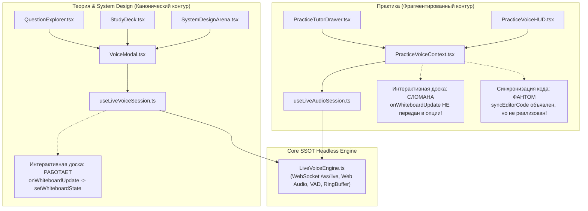

# Комплексный Архитектурный Аудит AI-Напарника в Разделе «Практика»

> **Дата проведения:** 3 октября 2026 года  
> **Статус:** Выполнен глубокий статический и системный аудит  
> **Методология:** Multi-Faceted Research-Driven Architecture (MFRDA), SOTA Late 2026  
> **Цель:** Полное исключение техдолга, выявление причин (root cause) расхождений с разделом «Теория Собеседование», обеспечение 100% переиспользования и контекстной синхронизации.

---

## 1. Исполнительное резюме (Executive Summary)

В ходе глубокого ревью кодовой базы раздела «Практика» (Live-Coding, Katas & Machine Coding Arena, включая 7 подразделов и треков) обнаружен **критический архитектурный раскол (Split-Brain)** между голосовым движком раздела «Теория / Собеседование» и AI-Напарником в «Практике».

Несмотря на наличие единого низкоуровневого движка [`LiveVoiceEngine.ts`](file:///home/djelu/spring/frontend/src/audio/LiveVoiceEngine.ts), уровень React-адаптеров и пользовательского интерфейса оказался фрагментирован на две параллельные ветки с потерей ключевой функциональности:

---

## 2. Сравнительный анализ: Теория vs Практика (The Reusability Gap)

| Параметр / Возможность | Теория Собеседование ([`VoiceModal`](file:///home/djelu/spring/frontend/src/components/VoiceModal.tsx)) | Практика AI-Напарник ([`PracticeVoiceContext`](file:///home/djelu/spring/frontend/src/components/practice/tutor/PracticeVoiceContext.tsx)) | Статус паритета |
| :--- | :--- | :--- | :--- |
| **Низкоуровневый движок** | [`LiveVoiceEngine.ts`](file:///home/djelu/spring/frontend/src/audio/LiveVoiceEngine.ts) | [`LiveVoiceEngine.ts`](file:///home/djelu/spring/frontend/src/audio/LiveVoiceEngine.ts) | ✅ Общий движок |
| **React-хук адаптер** | [`useLiveVoiceSession.ts`](file:///home/djelu/spring/frontend/src/audio/useLiveVoiceSession.ts) | [`useLiveAudioSession.ts`](file:///home/djelu/spring/frontend/src/hooks/useLiveAudioSession.ts) | ❌ **Дублирование** (нарушение Правила 8) |
| **Вывод на интерактивную доску** | `onWhiteboardUpdate -> setWhiteboardState` | **Не передано** в `useLiveAudioSession` | ❌ **Критический дефект** (доска слепа) |
| **Синхронизация кода из редактора** | Не требуется (статический вопрос) | `syncEditorCode` объявлен в типах, но **не реализован в Provider** | ❌ **Критический дефект** (ИИ не видит правки) |
| **Синхронизированные субтитры** | [`VoiceSubtitles.tsx`](file:///home/djelu/spring/frontend/src/components/voice/VoiceSubtitles.tsx) (SOTA streaming) | Примитивный блок `aiTranscript` без пословной подсветки | ❌ Деградация UX |
| **Настройки сессии (Drawer)** | [`VoiceSettingsDrawer.tsx`](file:///home/djelu/spring/frontend/src/components/VoiceSettingsDrawer.tsx) (VAD, паузы, темп) | **Отсутствует** (кандидат заблокирован в настройках) | ❌ Деградация UX |
| **Передача ошибок компиляции** | Не применимо | В текстовый чат передается, **в голос — НЕТ** | ❌ Асимметрия каналов |
| **Передача упавших тестов/мутантов** | Не применимо | В текстовый чат передается, **в голос — НЕТ** | ❌ Асимметрия каналов |

---

## 3. Четыре системных дефекта первопричины (Root Cause Defects)

### Дефект №1: «Глухая доска» в режиме голоса Практики
- **Где возникает:** [`frontend/src/components/practice/tutor/PracticeVoiceContext.tsx:43-57`](file:///home/djelu/spring/frontend/src/components/practice/tutor/PracticeVoiceContext.tsx#L43-L57).
- **Суть:** В хуке `useLiveAudioSession` есть коллбек `onWhiteboardUpdate`. Однако при его инстанцировании в `PracticeVoiceContext` передаются только `onError`, `getActiveCode`, `getActiveFileName`, `getActiveLanguage`. Опция `onWhiteboardUpdate` **не передана вовсе**!
- **Следствие:** Когда Gemini Live через tool-call `update_whiteboard` выводит архитектурную схему или код-пример, бэкенд шлет фрейм `{ type: 'whiteboard_update' }`, фронтенд его принимает, но коллбек `undefined` $\rightarrow$ состояние доски в Zustand не обновляется, кандидат ничего не видит.

### Дефект №2: «Мертвая кнопка» защиты в Spring Transactions Lab
- **Где возникает:** [`frontend/src/components/practice/TransactionVerdictCard.tsx:43`](file:///home/djelu/spring/frontend/src/components/practice/TransactionVerdictCard.tsx#L43) и [`frontend/src/components/practice/PracticeArena.tsx:40-43`](file:///home/djelu/spring/frontend/src/components/practice/PracticeArena.tsx#L40-L43).
- **Суть:** Компонент вердикта транзакций имеет кнопку `<button onClick={() => onStartVoiceDefense(...)}>Защитить у AI</button>`, обернутую в условие `{onStartVoiceDefense && ...}`. Но в родительской арене `PracticeArena.tsx` проп `onStartVoiceDefense` **никогда не передается** в `<TransactionLabArena>`!
- **Следствие:** Функционал устной защиты решенного сценария транзакций полностью недоступен пользователю.

### Дефект №3: Иллюзия синхронизации кода (`syncEditorCode`)
- **Где возникает:** [`frontend/src/components/practice/tutor/PracticeVoiceContext.tsx:27`](file:///home/djelu/spring/frontend/src/components/practice/tutor/PracticeVoiceContext.tsx#L27), [`WorkspaceEditor.tsx:128`](file:///home/djelu/spring/frontend/src/components/practice/WorkspaceEditor.tsx#L128).
- **Суть:** Редактор Monaco и панель файлов добросовестно вызывают `syncEditorCode(...)`. Но в `PracticeVoiceContext.tsx` этот метод объявлен опциональным в интерфейсе и **вообще отсутствует в теле `PracticeVoiceProvider`**!
- **Следствие:** Во время голосового звонка ИИ знает только тот сниппет кода, который был в файле в момент старта звонка. Любые новые строки, правки и исправления ошибок для ИИ невидимы.

### Дефект №4: Асимметрия промптов и контекста (Текст vs Голос)
- **Где возникает:** [`backend/src/routes/practiceTutor.ts`](file:///home/djelu/spring/backend/src/routes/practiceTutor.ts) vs [`backend/src/prompts/live/livePairPrompts.ts`](file:///home/djelu/spring/backend/src/prompts/live/livePairPrompts.ts).
- **Суть:** Текстовый AI-тьютор получает богатый контекст: `compilerError`, список упавших тестов, список выживших мутантов PITest, детекторы гонок и дедлоков `concurrencyHarness`, нарушения правил транзакций `latestTxEvaluation`. Голосовой же парный промпт `buildLivePairPrompt` получает только общее описание задачи и начальный код. Если тесты падают или мутанты выживают, голосовой напарник слеп к этим результатам.

---

## 4. Карта ревью по подразделам Практики

Детальные протоколы ревью сформированы в отдельных файлах:
1. [01. Spring Transactions Lab](file:///home/djelu/spring/docs/architecture/reviews/practice_subsections/01_SPRING_TRANSACTIONS_LAB_AUDIT.md) — 16 сценариев, Flame Chart, ловушка прокси, дефект кнопки защиты.
2. [02. Testing & Mutation Katas](file:///home/djelu/spring/docs/architecture/reviews/practice_subsections/02_TESTING_AND_MUTATION_KATAS_AUDIT.md) — 42 каты L0–L3, Gregor-мутаторы, модель RIPR, выпадение мутаций из голоса.
3. [03. BigTech LLD (Яндекс/Озон)](file:///home/djelu/spring/docs/architecture/reviews/practice_subsections/03_BIGTECH_LLD_AUDIT.md) — 35 задач, виртуальное время Clock, паттерны GoF, дефект доски.
4. [04. FinTech & Ledger (Т-Банк/Stripe)](file:///home/djelu/spring/docs/architecture/reviews/practice_subsections/04_FINTECH_LEDGER_AUDIT.md) — Двойная запись, BigDecimal HALF_EVEN, иерархия локов `min(id1, id2)`.
5. [05. Concurrency Lab (Loom & Threads)](file:///home/djelu/spring/docs/architecture/reviews/practice_subsections/05_CONCURRENCY_LAB_AUDIT.md) — **Критический баг:** домен `concurrency` в `livePairPrompts.ts` сваливается в prompt юнит-тестов!
6. [06. Refactoring Katas & Java 21 Idioms](file:///home/djelu/spring/docs/architecture/reviews/practice_subsections/06_REFACTORING_AND_JAVA21_AUDIT.md) — **Критический баг:** Компас и промпты сваливаются в тестирование мутантов вместо правил рефакторинга.

---

## 5. Целевая архитектура устранения техдолга (SOTA Late 2026)

В соответствии с правилом 8 (File-Hygiene & Strict Reuse Invariant) и лучшими практиками сентября 2026 года:
1. **Ликвидация хука-дублера:** Объединить возможности `useLiveAudioSession` и `useLiveVoiceSession` в единый канонический хук [`useLiveVoiceSession.ts`](file:///home/djelu/spring/frontend/src/audio/useLiveVoiceSession.ts), поддерживающий как модальный режим (Теория/System Design), так и встраиваемый сайдкар (Практика).
2. **Подключение доски:** В `PracticeVoiceContext` передать `onWhiteboardUpdate: (payload) => useAppStore.getState().setWhiteboardState(payload)`.
3. **Реализация `syncEditorCode`:** Передавать деиктические фреймы `screen_context_sync` (`type: 'screen_context_sync'`, `clientContent: { turns: [{ role: 'user', parts: [{ text: '📝 [АКТУАЛЬНЫЙ КОД]...' }] }], turnComplete: false }`) с дебаунсом 1500мс при правках в Monaco.
4. **Активация устной защиты:** Пробросить `onStartVoiceDefense` из `PracticeArena` в `TransactionLabArena` с открытием канонического `VoiceModal` (по аналогии с `SystemDesignArena`).
5. **Исправление сваливания доменов:** Добавить полноценные ветки `concurrency`, `refactoring` и `java21` в `livePairPrompts.ts`, `practiceTutorPrompts.ts` и `PracticeCompassSheet.tsx`.
