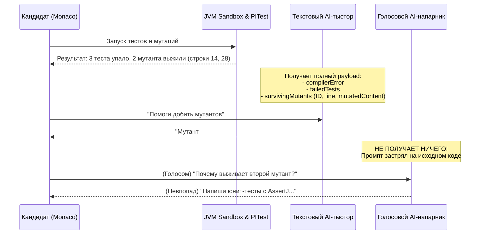

# Глубокий Аудит Подраздела: Testing & Mutation Katas (PITest Arena)

> **Подраздел:** `testing_mutation` / [PracticeArena.tsx](file:///home/djelu/spring/frontend/src/components/practice/PracticeArena.tsx)  
> **Объем каталога:** 42 каты (уровни сложности L0–L3, 8 инженерных архетипов)  
> **Инструментарий:** Gregor Mutators (PITest), JUnit 5, AssertJ, Mockito 5, Sub-150ms JVM Sandbox, Radar Compass

---

## 1. Архитектурный профиль и архетипы катов

Каты мутационного тестирования тренируют выявление логических дефектов и выживших мутантов через строгое следование модели RIPR (Reachability $\rightarrow$ Infection $\rightarrow$ Propagation $\rightarrow$ Revealability):
- **L0 Primitives (6):** Чистые функции, скалярные ассерты, инварианты времени.
- **L1 Reverse Testing (6):** Поиск скрытых дефектов в реализации путем написания тестов-ловушек.
- **Legacy Seams (5):** Разрушение жестких зависимостей через швы (Subclass and Override Method, Extract Interface).
- **JUnit 5 Boundaries (5):** `@ParameterizedTest`, `@CsvSource`, кастомные матчеры AssertJ.
- **Mockito 5 Verification (5):** `ArgumentCaptor`, строгий режим `lenient()`, предотвращение овермокинга по закону Фаулера.
- **State Machines & Retries (5):** Тестирование недетерминированных автоматов и сбоев.
- **Concurrency & Loom (5):** Виртуальные потоки, Awaitility, фиксация дедлоков через `ThreadMXBean`.
- **ArchUnit & Slices (5):** Архитектурные правила чистоты слоев и изоляции пакетов.

---

## 2. Проверка соответствия AI-Напарника (Voice & Text)

### 2.1. Переиспользование кода голосового движка
- **Текущее состояние:** Вызов происходит через [PracticeVoiceContext.tsx](file:///home/djelu/spring/frontend/src/components/practice/tutor/PracticeVoiceContext.tsx).
- **Проблема переиспользования:**
  - В отличие от модального окна Собеседования в Теории, где кандидат фокусируется на речи, здесь кандидат одновременно пишет код тестов в Monaco Editor.
  - Однако интерфейс [PracticeVoiceHUD.tsx](file:///home/djelu/spring/frontend/src/components/practice/tutor/PracticeVoiceHUD.tsx) в Практике скрыт внутри дровера [PracticeTutorDrawer.tsx](file:///home/djelu/spring/frontend/src/components/practice/tutor/PracticeTutorDrawer.tsx). Пользователь вынужден открывать боковой ящик, чтобы увидеть состояние микрофона и кнопку ручного подтверждения фразы.
  - Отсутствует компонент бегущих субтитров [VoiceSubtitles.tsx](file:///home/djelu/spring/frontend/src/components/voice/VoiceSubtitles.tsx).

---

### 2.2. Точность системного промпта
- **Бэкенд-билдер:** [buildLivePairPrompt(domain='testing')](file:///home/djelu/spring/backend/src/prompts/live/livePairPrompts.ts#L90-L114):
  - **Роль:** `=== 1. РОЛЬ: MULTIMODAL AI PAIR-PROGRAMMER & TESTING COACH ===`
  - **Персоны:**
    - `junior_explainer`: концепции юнит-тестирования, шаблоны AssertJ.
    - `senior_socratic`: запрет диктовки готовых тестов, модель RIPR, указание на выживших мутантов.
    - `faang_interviewer`: закон моков Фаулера, виртуальное время Clock, изоляция тестов.
    - `middle_scaffold`: граничные условия, `.isEqualByComparingTo`, AssertJ.
  - **Вердикт по промпту:** Профессиональный, точный и педагогически выверенный промпт.

---

### 2.3. Полнота контекста задачи (Слепота голосового ИИ к мутантам)

Здесь обнаружена **самая серьезная асимметрия платформы**:



- **Причина:** В [PracticeTutorDrawer.tsx:130-168](file:///home/djelu/spring/frontend/src/components/practice/tutor/PracticeTutorDrawer.tsx#L130-L168) вычисляются `compilerError`, `failureParts`, `survivingMutants` и передаются в тело HTTP-запроса `/api/practice-tutor/chat`. Но в [PracticeVoiceContext.tsx](file:///home/djelu/spring/frontend/src/components/practice/tutor/PracticeVoiceContext.tsx) нет обработчика завершения тестов, и эти данные **никогда не инжектируются в активную голосовую WebSocket-сессию**.

---

### 2.4. Интерактивная доска (Whiteboard)
- **Проблема:** Из-за отсутствия `onWhiteboardUpdate` в `PracticeVoiceContext`, голосовой тьютор не может визуализировать структуру теста (Given-When-Then или RIPR цепочку) на доске кандидата.
- **Статус:** Сломано из-за дефекта №1 (отсутствие биндинга).

---

### 2.5. Контекстный Компас (Ctrl + /)
- **Компонент:** [TestingCompassSheet.tsx](file:///home/djelu/spring/frontend/src/components/practice/compass/TestingCompassSheet.tsx) и [TestingCompassRadar.tsx](file:///home/djelu/spring/frontend/src/components/practice/compass/TestingCompassRadar.tsx).
- **Содержимое:**
  - Интерактивный радар: Line Coverage, Branch Coverage, Mutation Score, Assertion Density.
  - 5 Золотых Заповедей: Модель RIPR, Закон моков Фаулера, Мутационный скор > Покрытия строк, Виртуальное время Clock, Борьба с зомби-мутантами.
- **Связка с ИИ:** При клике «Применить правило» запрос уходит в `/api/practice-tutor/rule-grounding` (текстовый чат). Голосовой сессии об этом событии ничего не сообщается.

---

## 3. Рекомендации по устранению дефектов

1. **Реактивная инжекция результатов PITest в Live WebSocket:** При получении `latestMutationResult` или `latestSandboxResult` отправлять в сокет деиктический фрейм:
   ```json
   {
     "type": "screen_context_sync",
     "clientContent": {
       "turns": [{
         "role": "user",
         "parts": [{ "text": "📊 [РЕЗУЛЬТАТЫ PITest]: Скор: 60%. Выжило мутантов: 2. Мутант #1: строка 14 (ConditionalsBoundary). Мутант #2: строка 28 (MathMutator)." }]
       }],
       "turnComplete": false
     }
   }
   ```
2. **Включение Whiteboard:** Пробросить `onWhiteboardUpdate` в `useAppStore.setWhiteboardState`.
3. **Вынос плавающего VoiceHUD наружу:** Разместить компактный `AmbientVoicePill` непосредственно в тулбаре редактора кодинга, чтобы кандидат видел состояние VAD и субтитры без открытия правого дровера.
