# Генеральный План Полного Устранения Дефектов AI-Напарника в Разделе «Практика» (SOTA Late 2026)

> **Статус:** Окончательный архитектурный план (Master Implementation Plan)  
> **Методология:** Multi-Faceted Research-Driven Architecture (MFRDA), SOTA September/October 2026  
> **Инварианты платформы:** AGENTS.md (Правило 1, 2, 8), Zero Phantom Fallbacks, Strict Reuse Invariant  
> **Область действия:** Все 7 подразделов Практики (Spring Transactions, Testing/Mutation Katas, BigTech LLD, FinTech Ledger, Concurrency Lab, Refactoring Katas, Java 21 Idioms).

---

## 1. Карта выявленных первопричин (Root Causes Matrix)

| ID | Область | Симптом | Первопричина (Root Cause) | Место в коде |
| :--- | :--- | :--- | :--- | :--- |
| **RC-1** | Голосовой сокет | ИИ не видит условие задачи и код; домен сваливается в `testing` | `liveVoiceUrlBuilder.ts` молча отбрасывает поля `bugTitle`, `bugExplanation`, `codeSnippet`, `challengeCategory`, `challengeDomain` из query-параметров URL WebSocket. | [`frontend/src/audio/liveVoiceUrlBuilder.ts`](file:///home/djelu/spring/frontend/src/audio/liveVoiceUrlBuilder.ts) |
| **RC-2** | Архитектура протокола | Риск обрезания длинного кода в GET URL (HTTP 414 / Proxy drop) | Попытка передать весь исходный код и markdown-условие через строку URL (`ws://...`) вместо канонического фрейма инициализации `session_init` после установления соединения. | [`frontend/src/audio/LiveVoiceEngine.ts`](file:///home/djelu/spring/frontend/src/audio/LiveVoiceEngine.ts) & [`backend/src/services/live/liveWsSessionParams.ts`](file:///home/djelu/spring/backend/src/services/live/liveWsSessionParams.ts) |
| **RC-3** | Текстовый стор | В Parking Lot и других LLD-задачах приветствие и контекст о мутациях | В `usePracticeTutorStore.ts` приветственное сообщение ассистента статически захардкожено под мутационное тестирование. Оно передаётся в историю диалога и сбивает LLM с толку. | [`frontend/src/store/usePracticeTutorStore.ts:71-77`](file:///home/djelu/spring/frontend/src/store/usePracticeTutorStore.ts#L71-L77) |
| **RC-4** | Нормализация категорий | Задачи `machine_coding` не распознаются как LLD | Проверки строк используют `cat.includes('machine coding')` с пробелом, тогда как слаг категории в каталоге — `'machine_coding'` с подчёркиванием. | [`backend/src/prompts/practiceTutorPrompts.ts:85`](file:///home/djelu/spring/backend/src/prompts/practiceTutorPrompts.ts#L85) |
| **RC-5** | Контекст воркспейса | В LLD ИИ видит только 10 строк `VehicleType.java`, не видя основной класс `ParkingLotManager.java` | Передаётся только `practiceWorkspaceFiles[activeWorkspaceFileIndex]`. В мультифайловых проектах отсутствует сборка манифеста воркспейса (`<project_workspace>`). | [`frontend/src/components/practice/tutor/PracticeTutorDrawer.tsx:51`](file:///home/djelu/spring/frontend/src/components/practice/tutor/PracticeTutorDrawer.tsx#L51) |
| **RC-6** | Реактивность табов | Смена файла в редакторе не обновляет фокус внимания ИИ | При клике по вкладкам файлов в `WorkspaceEditor` не вызывается `injectActiveFocusGroundingFrame`. | [`frontend/src/components/practice/WorkspaceEditor.tsx`](file:///home/djelu/spring/frontend/src/components/practice/WorkspaceEditor.tsx) |
| **RC-7** | Телеметрия в сокет | Голосовой напарник не реагирует на упавшие тесты и дедлоки | Реактивные эффекты в `PracticeVoiceContext` есть, но не форматируют структурированные системные алерты с директивой немедленной реакции. | [`frontend/src/components/practice/tutor/PracticeVoiceContext.tsx`](file:///home/djelu/spring/frontend/src/components/practice/tutor/PracticeVoiceContext.tsx) |

---

## 2. Иерархическая структура этапов и шагов реализации

```mermaid
graph TD
    subgraph Phase_1["Фаза 1: Канонический протокол WebSocket (Handshake & Manifest)"]
        P1_1["1.1. Двухфазный Handshake: фрейм session_init"]
        P1_2["1.2. Backend Handshake Router в liveWsClientFrameHandler"]
        P1_3["1.3. Сборка манифеста мультифайлового проекта ProjectWorkspaceManifest"]
    end

    subgraph Phase_2["Фаза 2: Нормализация доменов и устранение Split-Brain"]
        P2_1["2.1. Единый канонический нормализатор категорий normalizeCategorySlug"]
        P2_2["2.2. Синхронизация бэкенда и фронтенда (challengeDomain.ts & TutorDomain.ts)"]
        P2_3["2.3. Устранение выпадения Machine Coding в тестирование"]
    end

    subgraph Phase_3["Фаза 3: Динамическая гидратация Текстового AI-Тьютора"]
        P3_1["3.1. Динамический генератор приветствий getDomainWelcomeMessage"]
        P3_2["3.2. Реактивный сброс и инициализация чата при смене задачи"]
        P3_3["3.3. Передача полного мультифайлового контекста в /api/practice-tutor/chat"]
    end

    subgraph Phase_4["Фаза 4: Мультимодальный симбиоз Monaco, Whiteboard и Voice"]
        P4_1["4.1. Связывание смены табов с injectActiveFocusGroundingFrame"]
        P4_2["4.2. Верификация двусторонней связи Whiteboard (Voice + Monaco)"]
        P4_3["4.3. Реактивная трансляция телеметрии рантайма (дедлоки, тесты, PITest)"]
    end

    subgraph Phase_5["Фаза 5: E2E Верификация всех 7 подразделов Практики"]
        P5_1["5.1. E2E Тест: BigTech LLD (Parking Lot & Rate Limiter)"]
        P5_2["5.2. E2E Тест: Spring Transactions (Self-Invocation & Propagation)"]
        P5_3["5.3. E2E Тест: Concurrency Lab (Loom Pinning & Deadlock)"]
        P5_4["5.4. E2E Тест: Refactoring Katas & Java 21 Idioms"]
        P5_5["5.5. E2E Тест: Testing & Mutation Katas (RIPR & PITest)"]
        P5_6["5.6. Автоматизированные тесты verifyPrompts.ts + tsc --noEmit"]
    end

    Phase_1 --> Phase_2
    Phase_2 --> Phase_3
    Phase_3 --> Phase_4
    Phase_4 --> Phase_5
```



---

## 3. Детальное описание фаз и атомарных шагов

### Фаза 1. Канонический протокол WebSocket (Handshake & Workspace Manifest)

#### Шаг 1.1. Двухфазный WebSocket Handshake (`session_init` Frame)
- **Проблема:** Передача многокилобайтных исходников и условий задачи через URL-параметры `ws://...` ломает URL, обрезается и отбрасывается.
- **Решение:**
  - В `liveVoiceUrlBuilder.ts` URL очищается от длинных параметров и содержит только: `sessionId`, `sessionType`, `voice`, `turnMode`, `liveModel`, `vadPauseMs`.
  - Сразу после события `ws.onopen` в [`LiveVoiceEngine.ts`](file:///home/djelu/spring/frontend/src/audio/LiveVoiceEngine.ts) отправляется первоначальный фрейм:
    ```typescript
    interface LiveSessionInitFrame {
      type: 'session_init';
      sessionId: string;
      challenge: {
        id: string;
        title: string;
        domain: 'lld' | 'transactions' | 'concurrency' | 'refactoring' | 'java21' | 'testing';
        category: string;
        track: string;
        instructions: string;
        activeFilePath: string;
        activeFileContent: string;
        workspaceManifest?: {
          files: Array<{ path: string; content: string; isReadOnly?: boolean; isMain?: boolean }>;
        };
      };
      persona: string;
      strategy: string;
    }
    ```
- **Критерий приёмки:** Ни одного байта кода в URL; полный структурированный фрейм `session_init` отправляется при каждом соединении.

#### Шаг 1.2. Обработчик `session_init` на бэкенде
- **Файл:** [`backend/src/services/live/liveWsClientFrameHandler.ts`](file:///home/djelu/spring/backend/src/services/live/liveWsClientFrameHandler.ts) и [`backend/src/services/live/LiveSessionRouter.ts`](file:///home/djelu/spring/backend/src/services/live/LiveSessionRouter.ts).
- При получении `session_init`:
  1. Бэкенд обновляет состояние сессии: сохраняет `bugTitle`, `bugExplanation`, `codeSnippet`, `challengeCategory`, `challengeDomain`, манифест файлов.
  2. Пересобирает системный промпт через `buildLivePairPrompt` со 100% заполненными полями.
  3. Отправляет приветственный синтез (`LiveGreetingReplay`), точно соответствующий задаче (для Parking Lot: архитектурное приветствие LLD, а не мутации).
- **Критерий приёмки:** Бэкенд логирует `[LIVE_SESSION_INIT]` с корректным доменом `lld` и ненулевым размером инструкций и кода.

#### Шаг 1.3. Сборщик манифеста воркспейса (`buildWorkspaceManifest`)
- **Файл:** [`frontend/src/utils/workspaceManifest.ts`](file:///home/djelu/spring/frontend/src/utils/workspaceManifest.ts) (новый модуль, $\le 100$ строк).
- Функция `buildWorkspaceManifest(files: FileNode[], activeIndex: number)`:
  - Возвращает активный файл целиком.
  - Форматирует вторичные файлы проекта (интерфейсы, вспомогательные классы, тесты) в компактный XML-блок:
    ```xml
    <project_workspace active_file="src/main/java/com/assessment/parking/ParkingLotManager.java">
      <file path="src/main/java/com/assessment/parking/VehicleType.java">...</file>
      <file path="src/main/java/com/assessment/parking/ParkingSpot.java">...</file>
      <file path="src/test/java/com/assessment/parking/ParkingLotManagerTest.java">...</file>
    </project_workspace>
    ```
- **Критерий приёмки:** ИИ видит не только активный файл, но и всю структуру классов проекта.

---

### Фаза 2. Нормализация доменов и устранение Split-Brain

#### Шаг 2.1. Единая функция нормализации категорий (`normalizeChallengeCategory`)
- Создаётся shared-утилита или зеркалируется в бэкенд и фронтенд:
  ```typescript
  export function normalizeCategorySlug(rawCategory: string): string {
    return (rawCategory || '')
      .toLowerCase()
      .replace(/[-_]/g, ' ')
      .trim();
  }
  ```
- Категории `'machine_coding'`, `'machine-coding'`, `'machine coding'` приводятся к `'machine coding'`.
- Категории `'spring_transactions'`, `'spring-transactions'` приводятся к `'spring transactions'`.
- Категории `'concurrency_lab'`, `'concurrency-lab'` приводятся к `'concurrency'`.

#### Шаг 2.2. Синхронизация `challengeDomain.ts` и `TutorDomain.ts`
- И в [`backend/src/utils/challengeDomain.ts`](file:///home/djelu/spring/backend/src/utils/challengeDomain.ts), и в [`frontend/src/components/practice/tutor/TutorDomain.ts`](file:///home/djelu/spring/frontend/src/components/practice/tutor/TutorDomain.ts):
  - Применяется `normalizeCategorySlug`.
  - Порядок разрешения доменов унифицирован:
    1. `transactions` (если активен сценарий транзакций или категория содержит `transaction`)
    2. `refactoring` (если категория/трек/название содержит `refactoring`, `legacy`, `seam`, `gilded`, `trip`)
    3. `java21` (если категория содержит `java21`, `pattern matching`, `sealed`, `record`)
    4. `concurrency` (если категория содержит `concurrency`, `deadlock`, `loom`, `thread`, `atomic`, `disruptor` ИЛИ трек `concurrency`)
    5. `lld` (если категория содержит `lld`, `machine coding`, `architecture`, `solid` ИЛИ название `parking lot`, `rate limiter`, `cache`, `sliding window`)
    6. `testing` (дефолтная ветка)
- **Критерий приёмки:** Задача Parking Lot (`category: 'machine_coding'`) стабильно и на бэкенде, и на фронтенде классифицируется как **`lld`**.

---

### Фаза 3. Динамическая гидратация Текстового AI-Тьютора (`usePracticeTutorStore`)

#### Шаг 3.1. Генератор приветственных сообщений по домену
- **Файл:** [`frontend/src/components/practice/tutor/tutorWelcomeMessages.ts`](file:///home/djelu/spring/frontend/src/components/practice/tutor/tutorWelcomeMessages.ts) ($\le 90$ строк).
- Создаётся генератор приветствий:
  - **LLD:** *«👋 Привет! Я твой AI-напарник по низкоуровневому проектированию (LLD) и архитектуре на Java 21. Помогу спроектировать чистые интерфейсы, применить паттерны GoF, защититься от гонок данных и инжектировать виртуальное время `Clock`. Чем помочь по текущей архитектуре?»*
  - **Spring Transactions:** *«👋 Привет! Я твой AI-напарник по транзакциям Spring Boot и аномалиям БД. Помогу разобрать распространение `@Transactional`, CGLIB-прокси и защитить балансы от дедлоков. С какого метода начнем разбор?»*
  - **Concurrency & Loom:** *«👋 Привет! Я твой AI-напарник по многопоточности и Project Loom. Проверим код на пиннинг carrier-потоков, видимость JMM и race conditions. Что планируешь реализовать?»*
  - **Refactoring:** *«👋 Привет! Я твой AI-напарник по рефакторингу легаси-кода. Найдем швы по Физерсу (Seams), напишем Characterization-тесты и декомпозируем God-классы. С чего начнем изоляцию?»*
  - **Java 21:** *«👋 Привет! Я твой AI-напарник по идиомам Java 21 LTS. Переведем логику на Record Patterns, запечатанные иерархии (sealed) и pattern matching switch. Какую часть отрефакторим?»*
  - **Testing:** *«👋 Привет! Я твой AI-напарник по юнит-тестированию и мутациям. Разберем упавшие тесты, добьем выживших мутантов по модели RIPR и сверимся с Тестинг-Компасом (`Ctrl + /`).»*

#### Шаг 3.2. Автоматическая смена контекста при переключении задач
- В [`usePracticeTutorStore.ts`](file:///home/djelu/spring/frontend/src/store/usePracticeTutorStore.ts) добавляется метод `initChallengeContext(domain: TutorDomain, challengeTitle: string)`:
  - При открытии новой задачи история сбрасывается и выставляется релевантное приветствие.
  - В [`PracticeArena.tsx`](file:///home/djelu/spring/frontend/src/components/practice/PracticeArena.tsx) хук `useEffect` при изменении `activePracticeChallenge?.id` или `activeTransactionLabScenarioId` вызывает `initChallengeContext`.
- **Критерий приёмки:** При открытии Parking Lot в чате мгновенно появляется приветствие про LLD и паттерны Java 21; мутации и RIPR не упоминаются.

#### Шаг 3.3. Передача манифеста воркспейса в текстовый чат
- В `PracticeTutorDrawer.tsx`:
  - `currentContext` дополняется полем `workspaceManifest: buildWorkspaceManifest(...)`.
- В `backend/src/routes/practiceTutor.ts`:
  - Если передано `workspaceManifest`, оно форматируется в `<project_workspace>` и включается в системный промпт.
- **Критерий приёмки:** Текстовый ассистент отвечает с пониманием всех файлов `ParkingLotManager.java`, `ParkingSpot.java`, `VehicleType.java`, `ParkingLotManagerTest.java`.

---

### Фаза 4. Мультимодальный симбиоз Monaco Editor, Whiteboard и Voice

#### Шаг 4.1. Реакция на переключение файлов и фокус строк
- В [`frontend/src/components/practice/WorkspaceEditor.tsx`](file:///home/djelu/spring/frontend/src/components/practice/WorkspaceEditor.tsx):
  - При переключении вкладок файлов вызывается `injectActiveFocusGroundingFrame(file.path, file.content)`.
- В голосовой сокет отправляется легкий деиктический контекст:
  `🎯 [ФОКУС ВНИМАНИЯ]: Кандидат переключился на файл ParkingLotManager.java`.
- **Критерий приёмки:** Голосовой ассистент знает, какой файл открыт прямо сейчас перед глазами кандидата.

#### Шаг 4.2. Сквозная проверка интерактивной доски (Whiteboard)
- Проверка цепочки:
  1. Голосовой ассистент вызывает tool `update_whiteboard({ action: 'write', title: '...', code: '...' })`.
  2. Бэкенд шлет `{ type: 'whiteboard_update', ... }`.
  3. `useLiveAudioSession` вызывает `onWhiteboardUpdate` $\rightarrow$ `setWhiteboardState` в Zustand.
  4. В заголовке `PracticeArena` на кнопке «Доска ИИ» загорается пульсирующий бейдж наличия кода.
  5. Открытие выдвижной доски отображает корректно подсвеченный Java-код.
- **Критерий приёмки:** Кандидат голосом просит «покажи интерфейс на доске», и через 1 секунду код отображается на доске.

#### Шаг 4.3. Реактивная трансляция телеметрии рантайма в сокет
- В `PracticeVoiceContext.tsx` события:
  - Компиляция не прошла $\rightarrow$ отправка алерта `🚨 [ОШИБКА КОМПИЛЯЦИИ]: Строка X: ...`.
  - Обнаружен дедлок $\rightarrow$ отправка алерта `🚨 [КРИТИЧЕСКИЙ ДЕДЛОК]: Взаимная блокировка потоков!`.
  - Тесты упали $\rightarrow$ отправка алерта `⚠️ [УПАВШИЕ ТЕСТЫ]: 2 из 5 тестов провалены...`.
- Все алерты размечаются как `isDeicticFrame`, чтобы не нарушать естественный Turn-Taking и VAD.
- **Критерий приёмки:** Кандидат нажимает «Запустить тесты», получает ошибку компиляции, и голосовой напарник естественным голосом комментирует ошибку.

---

### Фаза 5. E2E Верификация по всем 7 подразделам Практики

Для каждого подраздела проводится сквозная проверка по чек-листу:

| Подраздел | Тестовая задача / сценарий | Проверяемые инварианты |
| :--- | :--- | :--- |
| **1. BigTech LLD** | `mc_parking_lot_manager` (Multi-Floor Parking Lot) | 1. Домен `lld` в голосе и тексте.<br/>2. ИИ видит все 4 файла и условие задачи.<br/>3. Приветствие про LLD & Clock.<br/>4. Компас открывает `LldCompassSheet`. |
| **2. Spring Transactions** | `self_invocation_bypass` (Self-Invocation Lab) | 1. Домен `transactions`.<br/>2. ИИ видит код сервиса и аномалии транзакций.<br/>3. Кнопка устной защиты открывает `VoiceModal`.<br/>4. Компас открывает `TransactionCompassSheet`. |
| **3. Concurrency Lab** | `virtual_threads_crawler` / `deadlock_challenge` | 1. Домен `concurrency`.<br/>2. ИИ предупреждает о пиннинге carrier-потоков.<br/>3. Детекция дедлока транслируется в голос.<br/>4. Компас открывает `ConcurrencyCompassSheet`. |
| **4. Refactoring Katas** | `gilded_rose_kata` / `trip_service_kata` | 1. Домен `refactoring`.<br/>2. ИИ предлагает швы (Seams) и Golden Master.<br/>3. Компас открывает `RefactoringCompassSheet`. |
| **5. Java 21 Idioms** | `pattern_matching_switch` | 1. Домен `java21`.<br/>2. ИИ обучает Sealed & Record Patterns.<br/>3. Компас открывает `LldCompassSheet`. |
| **6. FinTech Ledger** | `double_entry_transfer` | 1. Домен `lld` / FinTech.<br/>2. ИИ строго следит за `BigDecimal HALF_EVEN` и `lock(min, max)`. |
| **7. Testing & Mutations** | `discount_calculator_mutation` | 1. Домен `testing`.<br/>2. ИИ видит выживших мутантов PITest и ведёт по модели RIPR.<br/>3. Компас открывает `TestingCompassSheet`. |

#### Финальные автоматизированные проверки:
1. `docker run ... node:22-alpine npx tsc --noEmit` во фронтенде $\rightarrow$ **0 ошибок**.
2. `docker run ... node:22-alpine npm run build` в бэкенде $\rightarrow$ **0 ошибок**.
3. `docker run ... npx ts-node src/scripts/verifyPrompts.ts` $\rightarrow$ **все 35+ инвариантов пройдены**.
4. Проверка правила 8: `wc -l` для всех новых файлов $\le 350$, для модифицированных $\le 400$.

---

## 4. Порядок выполнения работ (Execution Flow)

1. **Этап 1 (Фаза 1 & 2 — Бэкенд и Протокол):**
   - Создать `normalizeCategorySlug`.
   - Внедрить фрейм `session_init` в `liveWsClientFrameHandler.ts` и `LiveSessionRouter.ts`.
   - Обновить `livePromptBuilder.ts` для поддержки полного контекста задачи и манифеста.
2. **Этап 2 (Фаза 1 & 2 — Клиентский движок):**
   - Создать `workspaceManifest.ts`.
   - Обновить `LiveVoiceEngine.ts` для отправки `session_init` сразу после `ws.onopen`.
   - Очистить `liveVoiceUrlBuilder.ts` от обрезаемых длинных параметров.
3. **Этап 3 (Фаза 3 — Текстовый AI-Тьютор):**
   - Создать `tutorWelcomeMessages.ts`.
   - Внедрить `initChallengeContext` в `usePracticeTutorStore.ts`.
   - Связать `PracticeArena.tsx` с динамической инициализацией контекста.
4. **Этап 4 (Фаза 4 — Monaco, Whiteboard, Telemetry):**
   - Пробросить смену табов в `injectActiveFocusGroundingFrame`.
   - Отладить трансляцию алертов компиляции и дедлоков.
5. **Этап 5 (Фаза 5 — Верификация и Деплой):**
   - Пройти все 7 подразделов по матрице тестирования.
   - Запустить CI/CD тесты, коммит, пуш на VPS.
   - Проверить работоспособность задачи Parking Lot на боевом стенде.
