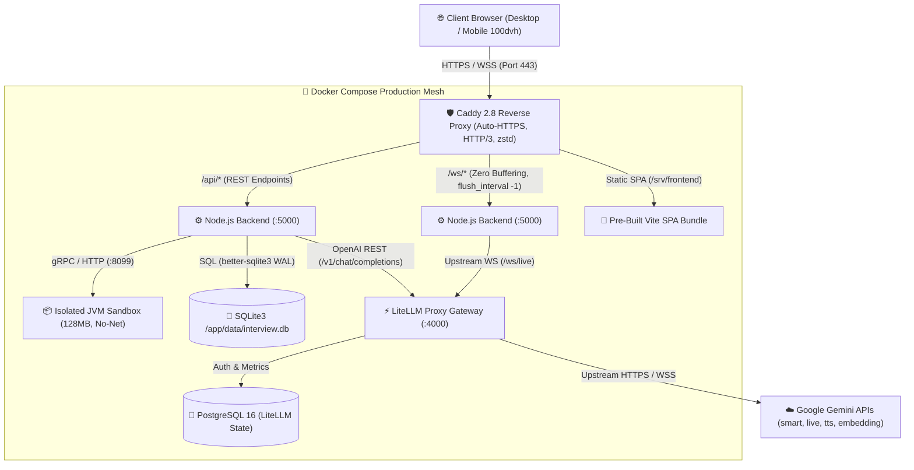

# Core Infrastructure, AI Gateway & Security Specification (SSOT)

> **Document:** `00_CORE_INFRASTRUCTURE_AND_SECURITY.md`  
> **Status:** Authoritative Single Source of Truth (SSOT)  
> **Target Standard:** SOTA Late September 2026  
> **Parent Master Architecture:** [docs/architecture.md](file:///d:/projects/interview_projects/spring/docs/architecture.md)

---

## 1. Edge & Network Topology

The InterviewPrep AI production environment runs as a multi-container Docker Compose mesh on Linux (Ubuntu 24.04 LTS), fronted by Caddy 2.8 with automatic TLS, HTTP/3, and real-time WebSocket pass-through:



---

## 2. LiteLLM Proxy Invariant & Two-Tier Circuit Breaker

### 2.1. Strict No-Direct-Provider Rule
All application services MUST communicate with AI models strictly via `http://litellm-gateway:4000/v1` (or `${LITELLM_PROXY_URL}`).
- Direct calls to Google Gemini (`generativelanguage.googleapis.com`) or DeepSeek are **strictly forbidden**.
- Hardcoding upstream API keys (`AQ.*`) in application code is strictly blocked by AST and CI guards.
- All requests use the virtual authorization key `LITELLM_API_KEY`.

### 2.2. Canonical Virtual Model Registry
| Logical Alias | Environment Variable | Upstream Target | Primary Purpose |
| :--- | :--- | :--- | :--- |
| `gemini-smart` | `GEMINI_TEXT_MODEL` | `gemini-3.5-flash` / `gemini-3.7-flash` | Socratic tutoring, AST evaluation, code review, report synthesis |
| `gemini-live-v3` | `GEMINI_LIVE_MODEL` | `gemini-3.8-live` / `gemini-2.5-flash-native-audio` | Real-time multimodal bidirectional voice (Auto-VAD 24kHz) |
| `gemini-live-thinking-v3` | `GEMINI_LIVE_PREVIEW_MODEL` | `gemini-3.8-live-extended-thinking` | Multi-turn complex reasoning interview with CoT audit |
| `gemini-tts-v3` | `GEMINI_TTS_MODEL` | `gemini-3.1-flash-tts` | Two-host podcast synthesis and study audio recitation |
| `gemini-embedding` | `GEMINI_EMBEDDING_MODEL` | `gemini-embedding-2` / `text-embedding-3-small` | 1536-dim vector memory and cosine gap injection |

### 2.3. Two-Tier Circuit Breaker Protocol
1. **Tier 1 (Key 429 Fast-Failover):** If a Google API key in the pool hits rate limits (429), LiteLLM rotates to the next available API key in $<5\text{ms}$ without dropping the client connection.
2. **Tier 2 (Model 503 Cascade):** If a model family suffers upstream degradation (503/500), LiteLLM fails over from Primary (`gemini-3.8-live`) to Secondary (`gemini-2.5-flash-native-audio-latest`).
3. **Application Backoff:** If upstream is exhausted, backend triggers Full-Jitter Exponential Backoff:
   $$T = \text{random}\left(0, \min(2500, 800 \times 1.8^{\text{attempt}})\right) \quad (\text{max 2 retries})$$

---

## 3. Database Architecture & SSOT Persistence

### 3.1. Engine & File Topology
- **Engine:** `better-sqlite3` running in Synchronous `WAL` (Write-Ahead Logging) mode.
- **Master Database File:** `/app/data/interview.db` (persisted on host volume `./data:/app/data`).
- **Performance Pragma Configuration:**
  ```sql
  PRAGMA journal_mode = WAL;
  PRAGMA synchronous = NORMAL;
  PRAGMA temp_store = MEMORY;
  PRAGMA mmap_size = 268435456; -- 256MB memory-mapped I/O
  PRAGMA cache_size = -64000;    -- 64MB cache
  ```

### 3.2. Core Domain Schemas
- `users`: User identity, invite linkage, role (`admin`, `owner`, `user`), activity timestamps.
- `invites`: Cryptographic invite codes, usage quotas, expiration, revoked status.
- `submissions`: Machine coding and kata submissions, test pass count, execution duration, code snapshot.
- `question_evaluations`: Multi-turn voice transcripts, audio file paths, turn telemetry envelopes, scorecards.
- `fsrs_cards`: Cognitive memory state, stability ($S$), difficulty ($D$), reps, lapses, scheduled due dates.
- `user_entity_progress`: Dual ID/slug progress tracker ensuring completed katas remain marked across roadmaps.

---

## 4. Zero-Trust Security & Authentication Architecture

### 4.1. Invite-Only Gateway Access
Access to the platform is gated by cryptographic invite codes (e.g. `SENIOR-JAVA-2026-VIP`):
- Codes are verified via `POST /api/auth/login`.
- Upon verification, an HMAC-SHA256 JWT session token is issued (HTTP-only or Bearer header).
- Unauthorized requests to `/api/*` are rejected with `401 Unauthorized` before hitting business services.

### 4.2. One-Time Ephemeral WebSocket Tickets
Browser WebSockets cannot send custom `Authorization: Bearer` headers during native handshake. To maintain zero-trust security without leaking long-lived tokens in query strings:
1. Client requests an ephemeral ticket: `POST /api/auth/ws-ticket` (authenticated via session token).
2. Backend generates a 32-byte cryptographically secure token, caches it in memory with a **60-second TTL**, and returns `{ ticket: "ws_..." }`.
3. Client connects: `wss://java.djelu.site/ws/live?ticket=ws_...`.
4. Gateway consumes the ticket atomically. Reusing an expired or consumed ticket results in immediate close code `4401`.

---

## 5. Isolated JVM Sandbox Daemon (`interview-sandbox`)

### 5.1. Security Sandboxing Constraints
Candidate-submitted Java 21 code is compiled and executed in an isolated container daemon (`sandbox/`):
- **User:** Non-root unprivileged runner (`sandboxuser`, UID 10001).
- **Filesystem:** Read-only rootfs (`read_only: true`), temporary in-memory scratch space (`tmpfs: /tmp:size=64M`).
- **Resources:** Hard limit `mem_limit: 128m`, `cpus: 1.0`, `pids_limit: 64` (preventing fork-bombs).
- **Network:** `internal: true` (zero external internet connectivity, blocking data exfiltration).
- **Security Audit:** Code passes `AstSecurityScanner.ts` blocking `System.exit()`, reflection, and file access before JVM invocation.

---

## 6. Verification Commands & Health Gates

```bash
# 1. Health check & model readiness diagnostic
curl -fsS https://java.djelu.site/api/health

# 2. Verify static file hygiene standards
npm run verify-hygiene

# 3. Full live deployment & zero-trust auth suite
python scripts/deploy_to_vps.py
```
