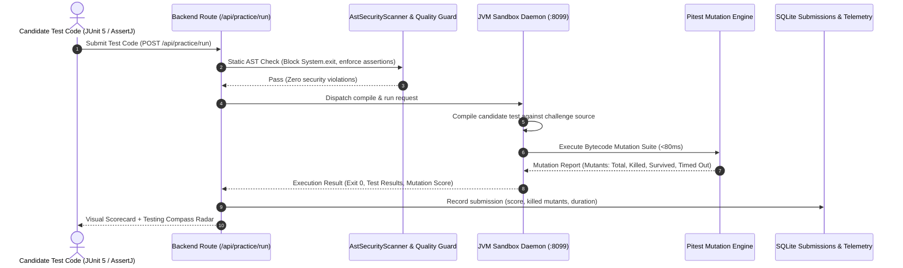

# Testing & Mutation Arena Specification (Pillar 2 SSOT)

> **Document:** `02_TESTING_AND_MUTATION_ARENA.md`  
> **Status:** Authoritative Single Source of Truth (SSOT)  
> **Target Standard:** SOTA Late September 2026  
> **Parent Master Architecture:** [docs/architecture.md](file:///d:/projects/interview_projects/spring/docs/architecture.md)

---

## 1. Domain Vision & Anti-Potemkin Paradigm

Traditional coding interview platforms rely solely on line coverage, allowing candidates to submit "Potemkin tests" (100% coverage with zero assertions or trivial tests that never fail).

The **Testing & Mutation Arena** subjects candidate unit tests to real bytecode mutations (Pitest engine). A candidate passes a kata only when their test suite catches and kills $\ge 80\%$ of injected mutants.



---

## 2. Bytecode Mutation Engine & Operators

### 2.1. Active Mutation Operators
The Pitest engine dynamically alters compiled JVM bytecode in memory without modifying source files:

| Operator Group | Mutation Logic | Candidate Flaw Caught |
| :--- | :--- | :--- |
| **Conditionals Boundary** | Replaces `<` with `<=`, `>` with `>=` | Off-by-one errors in sliding windows, pagination, and rate limiters |
| **Negate Conditionals** | Inverts `==` to `!=`, `if (x)` to `if (!x)` | Missing negative test cases and inverted guard clauses |
| **Return Values** | Mutates primitives to `0`/`1`, objects to `null`, optionals to `empty` | Tests that call methods but never assert return values |
| **Math Inversion** | Replaces `+` with `-`, `*` with `/`, `++` with `--` | Flawed accumulator calculations and incorrect financial calculations |
| **Void Method Elimination** | Strips out calls to void methods (e.g. `cache.evict()`, `publisher.send()`) | Missing verification of critical side effects |

### 2.2. Scoring Formula & Graduation Thresholds
$$\text{MutationScore} = \frac{\text{MutantsKilled}}{\text{TotalMutants} - \text{MutantsTimedOut}} \times 100\%$$

- **Junior Baseline:** $\ge 65\%$ killed.
- **Senior Standard:** $\ge 80\%$ killed.
- **Staff / Principal Standard:** $\ge 90\%$ killed with 0 survived edge cases.

---

## 3. Heuristic Testing Compass (`Ctrl + /`)

The Testing Arena features an interactive 4-axis heuristic radar accessible via `Ctrl + /`:

```
          [ Mutation Score (%) ]
                   ▲
                   │
[ Edge-Case Res ] ───┼─── [ Assertion Density ]
                   │
                   ▼
          [ Line Coverage (%) ]
```

1. **Mutation Score:** Percentage of injected bytecode mutants terminated.
2. **Assertion Density:** Ratio of assertions (`assertThat`, `assertEquals`) to executable lines of test code.
3. **Edge-Case Resilience:** Evaluation against null boundaries, empty collections, maximum values, and concurrency transients.
4. **Line Coverage:** Baseline executable instruction path verification.

---

## 4. 42-Kata Industrial Challenge Catalog

The Arena provides 42 curated katas partitioned into 3 distinct complexity tiers:
- **Tier 1 (Foundation):** String calculators, boundary checks, state machine transitions.
- **Tier 2 (Enterprise Spring):** Cache evictions, `@Transactional` boundaries, exception translations.
- **Tier 3 (High-Concurrency & Distributed):** Striped locks, sliding window rate limiters, idempotent message consumers.

---

## 5. Security & Execution Invariants

1. **Deterministic Execution Bounds:** JVM execution timeout is capped at **2,000 ms** to eliminate infinite loop attacks.
2. **Assertion Enforcement:** Submissions with 0 assertions are rejected before execution by `TestQualityScanner.ts`.
3. **Tree Edit Distance:** `TreeEditDistanceGuard.ts` prevents candidates from modifying read-only challenge infrastructure classes.

---

## 6. Verification Commands

```bash
# Run local practice resilience & fault injection test suite
npm --prefix backend run test:practice:resilience

# Verify challenge task code integrity
npm --prefix backend run test:practice:task-codes
```
