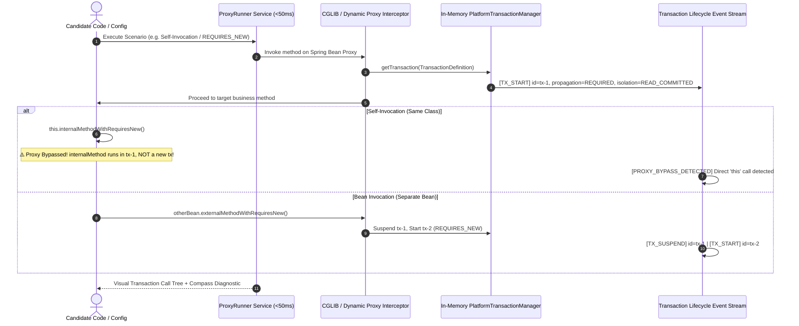

# Spring Transactions Lab & Proxy Simulation Engine (Pillar 3 SSOT)

> **Document:** `03_SPRING_TRANSACTIONS_LAB.md`  
> **Status:** Authoritative Single Source of Truth (SSOT)  
> **Target Standard:** SOTA Late September 2026  
> **Parent Master Architecture:** [docs/architecture.md](file:///d:/projects/interview_projects/spring/docs/architecture.md)

---

## 1. Executive Summary & Proxy Engine Vision

Spring's `@Transactional` abstraction is one of the most frequent sources of subtle production outages in enterprise Java (phantom reads, broken rollbacks, proxy self-invocation bypass).

The **Spring Transactions Lab** provides an ultra-fast, deterministic in-memory proxy execution engine ($<50\text{ms}$) that visualizes and evaluates transaction boundary propagation, isolation semantics, and exception rollbacks without requiring a heavyweight database spinning up.



---

## 2. Hard Invariants of Transaction Propagation

| Propagation Type | Existing Transaction Present | No Existing Transaction | Rollback Behavior |
| :--- | :--- | :--- | :--- |
| **`REQUIRED`** (Default) | Joins existing transaction | Creates new transaction | Rollback in child marks entire outer transaction `RollbackOnly` |
| **`REQUIRES_NEW`** | Suspends existing, creates independent transaction | Creates new transaction | Child rollback does NOT roll back parent (unless exception is propagated) |
| **`MANDATORY`** | Joins existing transaction | **Throws `IllegalTransactionStateException`** | Fails fast if caller forgot transaction boundary |
| **`SUPPORTS`** | Runs in existing transaction | Runs non-transactionally | No transaction created if none existed |
| **`NOT_SUPPORTED`** | Suspends existing transaction, runs non-transactionally | Runs non-transactionally | Guarantees code runs outside database transaction |
| **`NEVER`** | **Throws `IllegalTransactionStateException`** | Runs non-transactionally | Blocks transaction leaks into read-only external calls |
| **`NESTED`** | Creates JDBC Savepoint inside existing transaction | Creates new transaction | Child rollback restores savepoint without aborting outer transaction |

---

## 3. Exception Rollback Semantics (The Checked Exception Trap)

1. **Default Rule:** Spring rolls back transactions ONLY for unchecked exceptions (`RuntimeException` and `Error`).
2. **Checked Exception Trap:** If a method throws a checked exception (e.g. `IOException`, `SQLException`, custom business checked exception) without `rollbackFor`:
   $$\text{Throws } \text{CheckedException} \implies \text{Transaction Commits Successfully!}$$
3. **Enterprise Invariant:** All production financial and ledger services MUST explicitly declare:
   ```java
   @Transactional(rollbackFor = Exception.class)
   ```

---

## 4. The Self-Invocation Proxy Bypass

In standard Spring AOP, `@Transactional` operates via runtime proxies (CGLIB or JDK Dynamic Proxies).
- When method `A()` calls method `B()` on `this` inside the same class:
  $$\text{this.B()} \longrightarrow \text{Calls direct target instance, completely bypassing the proxy!}$$
- Annotations on `B()` (`REQUIRES_NEW`, `@Async`, `@Cacheable`, `@Secured`) are **silently ignored**.
- **Remediation Archetypes:**
  1. Refactor `B()` into a separate collaborator bean (Recommended).
  2. Inject self-proxy (`@Autowired private MyService self;`).
  3. Use compile-time AspectJ weaving (`mode = AdviceMode.ASPECTJ`).

---

## 5. The 16 Transaction Laboratory Scenarios

The Lab contains 16 interactive production scenarios:
1. `tx_self_invocation_bypass`: The classic direct method call trap.
2. `tx_requires_new_exception_leak`: Unhandled child exception crashing the parent.
3. `tx_checked_exception_silent_commit`: Why your money disappeared without rollback.
4. `tx_dirty_read_simulation`: Concurrency anomaly under `READ_UNCOMMITTED`.
5. `tx_non_repeatable_read`: Changing row values mid-transaction under `READ_COMMITTED`.
6. `tx_phantom_read`: Injected new rows under `REPEATABLE_READ`.
7. `tx_nested_savepoint_recovery`: Partial rollback with JDBC savepoints.
8. `tx_event_listener_commit_sync`: `@TransactionalEventListener(phase = AFTER_COMMIT)`.
9. `tx_async_context_loss`: Spawning new threads losing `SecurityContext` & `TransactionContext`.
10. `tx_deadlock_circular_locks`: Two transactions updating accounts in opposite order.
11. `tx_connection_pool_starvation`: Holding database connections across remote HTTP calls.
12. `tx_read_only_optimization`: Hibernate snapshot elimination and replica routing.
13. `tx_distributed_saga_compensation`: Compensating transactions across microservices.
14. `tx_outbox_pattern_guarantee`: Atomically saving domain event and outbox record.
15. `tx_optimistic_locking_retry`: Handling `OptimisticLockingFailureException` with backoff.
16. `tx_pessimistic_write_deadlock`: Row-level locking pitfalls under high write contention.

---

## 6. Heuristic Transaction Compass (`Ctrl + /`)

Visual 4-axis radar diagnostics:
- **Proxy Integrity:** Validates that method invocations cross proxy boundaries.
- **Propagation Depth:** Traces nested and suspended transaction hierarchies.
- **Rollback Correctness:** Asserts that exceptions trigger expected rollback states.
- **Lock Contention:** Evaluates lock acquisition ordering and timeout exposure.
