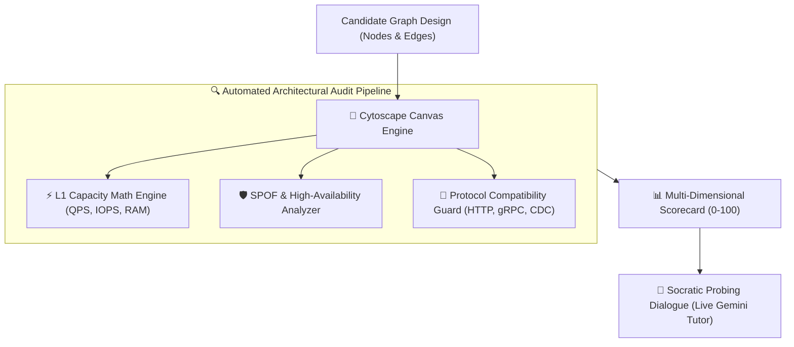

# Interactive System Design Arena Specification (Pillar 4 SSOT)

> **Document:** `04_SYSTEM_DESIGN_ARENA.md`  
> **Status:** Authoritative Single Source of Truth (SSOT)  
> **Target Standard:** SOTA Late September 2026  
> **Parent Master Architecture:** [docs/architecture.md](file:///d:/projects/interview_projects/spring/docs/architecture.md)

---

## 1. Domain Vision & Interactive Graph Canvas

The **System Design Arena** replaces unstructured diagramming tools with an interactive, verified graph engine powered by Cytoscape.js. 

Candidate topologies are audited in real time against mathematical throughput formulas, storage budgets, single-points-of-failure (SPOF), and latency trade-offs.

---

## 2. Canvas Graph Topology & Component Archetypes

### 2.1. Canonical Node Archetypes
- **Edge Layer:** Client (Mobile/Web), CDN (Cloudflare/Fastly), Anycast DNS, Reverse Proxy / API Gateway (Kong/Envoy).
- **Compute Layer:** Stateless Microservices (Spring Boot 3, Virtual Threads), Cron / Worker Daemons.
- **Caching Layer:** Distributed Cache (Redis Cluster), Local L1 Cache (Caffeine), CDN Edge Cache.
- **Storage Layer:** Relational DB Primary (PostgreSQL/MySQL), Read Replicas, Document Store (MongoDB), Key-Value (DynamoDB/Cassandra), Time-Series (ClickHouse).
- **Asynchronous Messaging:** Distributed Commit Log (Kafka), Task Queue (RabbitMQ), Event Mesh.
- **Blob Storage:** Object Storage (S3 / GCS), Block Storage.

### 2.2. Edge Semantics & Protocol Constraints
- `SYNC_HTTP` / `SYNC_GRPC`: Request-response, blocking caller latency.
- `ASYNC_EVENT`: Eventual consistency, decouples producer and consumer.
- `REPLICATION_SYNC` / `REPLICATION_ASYNC`: Master-replica data synchronization.
- `CDC_STREAM`: Change Data Capture (Debezium) from WAL to Kafka.

---

## 3. L1 Capacity Math Engine (Back-of-the-Envelope)

The Arena embeds deterministic formulas to evaluate candidate sizing:

### 3.1. Throughput & Peak QPS
$$\text{Read QPS} = \frac{\text{DAU} \times N_{\text{reads/day}}}{86,400 \text{ s}}$$

$$\text{Peak QPS} = \text{Read QPS} \times \text{PeakFactor} \quad (\text{Default } \text{PeakFactor} = 2.0)$$

### 3.2. Daily Storage Growth
$$\text{Daily Storage} = \text{Write QPS} \times \text{AvgPayloadSize} \times 86,400 \text{ s}$$

$$\text{5-Year Storage Capacity} = \text{Daily Storage} \times 365 \times 5 \times (1 + \text{ReplicationFactor})$$

### 3.3. RAM Caching Tier (Pareto 80/20 Sizing)
Following the 80/20 Pareto principle (20% of hot data serves 80% of read requests):
$$\text{RAM Required} = \text{Daily Read Volume} \times 0.20$$

---

## 4. Heuristic Failure & SPOF Analysis

The Arena analyzes graph connectivity to highlight architecture traps:
1. **Single Point of Failure (SPOF):** A component whose removal disconnects client traffic from critical persistent data without an automated failover path.
2. **Synchronous Call Cascades:** Chains of $\ge 3$ synchronous HTTP dependencies between microservices ($T_{\text{total}} = \sum T_i$), flagging circuit breaker omission.
3. **Database Write Bottlenecks:** Single master databases handling $> 10,000 \text{ write QPS}$ without sharding or write coalescing.
4. **Cache Stampede Vulnerability:** Direct cache-aside queries without single-flight mutex coalescing or stale-while-revalidate policies.

---

## 5. The 31 Distributed System Design Scenarios

1. `sd_url_shortener`: Base62 encoding, KGS (Key Generation Service), distributed counter.
2. `sd_distributed_rate_limiter`: Sliding window counter, Redis Lua scripts, token bucket.
3. `sd_payment_gateway`: Two-phase commit, idempotent keys, transactional outbox, reconciliation.
4. `sd_realtime_chat`: WebSocket gateway, connection registry, Redis Pub/Sub, Cassandra message store.
5. `sd_video_streaming`: Transcoding pipeline, adaptive bitrate (HLS/DASH), CDN edge chunking.
6. `sd_collaborative_editor`: Operational Transformation (OT) vs CRDTs, WebSocket broadcast.
7. `sd_ride_sharing_dispatch`: Geospatial indexing (H3 / S2 / Geohash), driver-rider matching.
8. `sd_metrics_monitoring`: Time-series ingestion, LSM trees, Prometheus scraping, downsampling.
9. `sd_web_crawler`: Distributed frontier queue, URL deduping (Bloom filter), politeness delays.
10. `sd_notification_service`: Multi-channel fanout, priority queues, user preference filtering.
*(And 21 additional FAANG scenarios in `scenarios/system_design/`).*

---

## 6. Heuristic System Design Compass (`Ctrl + /`)

Visual 4-axis radar diagnostics:
- **L1 Math Accuracy:** Alignment between design topology and capacity requirements.
- **SPOF Elimination:** Redundancy, failover clustering, and multi-region resilience.
- **Data Consistency (CAP):** Strict linearizability vs eventual consistency trade-offs.
- **Extensibility & Decoupling:** Event-driven isolation and domain boundary hygiene.
