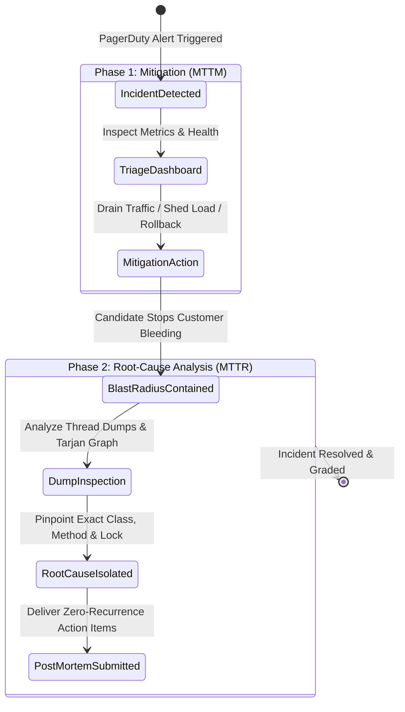

# Production Incident Triage & SRE Studio Specification (Pillar 5 SSOT)

> **Document:** `05_PRODUCTION_INCIDENT_TRIAGE.md`  
> **Status:** Authoritative Single Source of Truth (SSOT)  
> **Target Standard:** SOTA Late September 2026  
> **Parent Master Architecture:** [docs/architecture.md](file:///d:/projects/interview_projects/spring/docs/architecture.md)

---

## 1. Domain Vision & Dual-Phase Triage Paradigm

Production incident triage is the ultimate test of a Senior/Staff engineer's systemic maturity. During SEV-1 outages, chaotic guessing or blindly restarting servers can exacerbate database deadlocks or destroy diagnostic forensic evidence.

The **Production Incident Triage Studio** immerses candidates in 22 authentic production outages, evaluating them through a strict dual-phase rubric:

---

## 2. Tarjan Strongly Connected Components (SCC) Deadlock Algorithm

### 2.1. Mathematical Graph Formulation
JVM deadlocks are modeled as a directed bipartite graph $G = (V, E)$:
- **Vertices ($V$):** $V = V_{\text{threads}} \cup V_{\text{locks}}$.
- **Edges ($E$):**
  - **Wait Edge:** $(t, l) \in E \iff \text{Thread } t \text{ is BLOCKED waiting to acquire lock } l$.
  - **Hold Edge:** $(l, t) \in E \iff \text{Lock } l \text{ is currently held by Thread } t$.

### 2.2. Algorithmic Cycle Detection
The engine implements Tarjan's linear-time algorithm ($O(|V| + |E|)$) using depth-first search (DFS) with low-link values:
- Any strongly connected component with $|C| > 1$ represents a circular wait dependency:
  $$t_1 \xrightarrow{\text{waiting}} l_1 \xrightarrow{\text{held}} t_2 \xrightarrow{\text{waiting}} l_2 \xrightarrow{\text{held}} t_1$$
- The engine extracts and highlights the exact cycle in $<1\text{ms}$, displaying the colliding stack traces to the candidate.

---

## 3. JVM Thread State Classification & Forensic Signs

| State | Typical Production Origin | Diagnostic Forensic Indicator |
| :--- | :--- | :--- |
| **`BLOCKED`** | Java monitor lock (`synchronized`) contention | Thread waiting for `parking to wait for <0x...>` |
| **`WAITING`** | Lock condition wait (`ReentrantLock`, `CountDownLatch`) | Calling `Unsafe.park(false, 0L)` or `Object.wait()` |
| **`TIMED_WAITING`** | Connection pool timeouts, `Thread.sleep()`, socket reads | `SocketInputStream.socketRead0()`, HikariCP `getConnection(30000)` |
| **`RUNNABLE` (Hung)** | Infinite loop, quadratic regex backtrack, busy-spin | High CPU usage on thread, stack unchanged across dump intervals |

---

## 4. The 22 Production Incident Scenarios

Curated from real-world enterprise outages (documented in `Java Spring Production Incident Taxonomy.md`):

1. `inc_hikari_connection_leak`: Unclosed JDBC connections exhausting pool under load.
2. `inc_threadpool_rejection_storm`: Unbounded queue starvation blocking critical health endpoints.
3. `inc_tarjan_circular_deadlock`: Two services acquiring pessimistic database locks in opposite order.
4. `inc_metaspace_oom_cglib`: Dynamic proxy generation leak blowing Metaspace memory.
5. `inc_gc_stop_the_world_pause`: Old Gen fragmentation triggering 15-second STW pauses.
6. `inc_kafka_rebalance_spiral`: Processing time exceeding `max.poll.interval.ms`.
7. `inc_redis_connection_spike`: Missing connection reuse exhausting ephemeral OS ports (TIME_WAIT).
8. `inc_virtual_thread_carrier_pinning`: `synchronized` block over database driver pinning carrier threads.
9. `inc_feign_read_timeout_cascade`: Missing circuit breaker cascading failure through upstream services.
10. `inc_out_of_direct_memory`: Netty byte buffer leak triggering crash in API Gateway.
*(And 12 additional production triage scenarios in `scenarios/incident_triage/`).*

---

## 5. Dual-Phase Scoring Rubric & Compass

### 5.1. Evaluation Metrics
- **$T_{\text{mttm}}$ (Mean Time to Mitigate):** Time from alert to effective traffic isolation or feature-flag disablement (target: $< 3$ minutes).
- **$T_{\text{mttr}}$ (Mean Time to Resolve):** Time to pinpoint exact line of code and propose permanent remediation (target: $< 8$ minutes).
- **Blast Radius Discipline:** Deductions for hazardous actions (e.g. running unbounded `SELECT *` on production DB during high load).

### 5.2. Heuristic Triage Compass (`Ctrl + /`)
Visual 4-axis radar diagnostics:
- **MTTM Velocity:** Speed of customer-facing stabilization.
- **Blast Radius Containment:** Safe mitigation without secondary outages.
- **Cycle Resolution:** Correct isolation of deadlock cycles or memory leaks.
- **RCA Depth:** Architectural explanation of the root cause in the postmortem.
