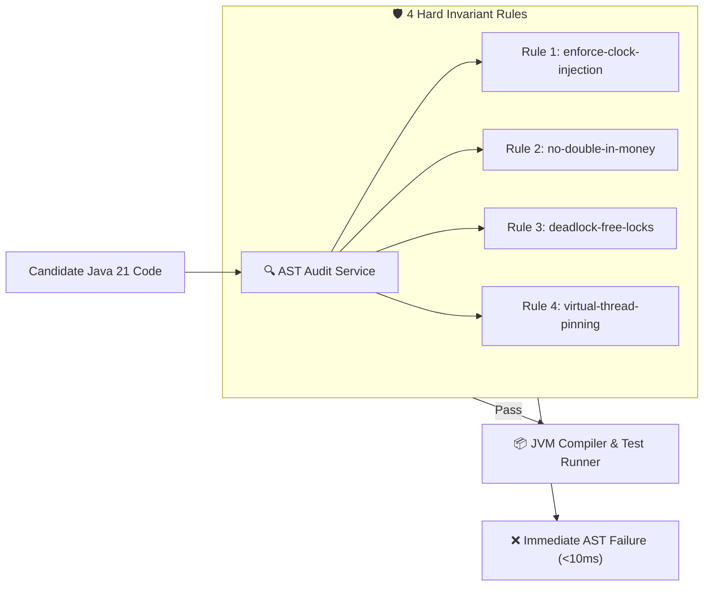

# Machine Coding & Low-Level Design (LLD) Specification (Pillar 6 SSOT)

> **Document:** `06_MACHINE_CODING_AND_LLD.md`  
> **Status:** Authoritative Single Source of Truth (SSOT)  
> **Target Standard:** SOTA Late September 2026  
> **Parent Master Architecture:** [docs/architecture.md](file:///d:/projects/interview_projects/spring/docs/architecture.md)

---

## 1. Executive Summary & Machine Coding Philosophy

The **Machine Coding Studio** evaluates candidate software architecture across 35 multi-file production design challenges. Unlike algorithmic leetcode sandboxes, machine coding measures:
- Clean Architecture (Domain-Driven Design, Separation of Concerns).
- Strict Invariant Compliance (Deterministic time, financial precision, deadlock avoidance).
- Concurrency Safety (Virtual Threads, lock-free ring buffers, fair dispatching).
- Extensibility via Gang of Four (GoF) design patterns (Strategy, Factory, State, Observer, Decorator).

---

## 2. Hard Platform Invariants (AST-Enforced)

Submissions are evaluated through a two-phase pipeline: static AST inspection (`astAuditService.ts`) followed by deterministic unit test execution:



### 2.1. Invariant 1: Time Virtualization (`enforce-clock-injection`)
- **Banned:** Direct invocations of system clocks:
  ```java
  // ❌ Strictly forbidden in business services
  System.currentTimeMillis();
  Instant.now();
  LocalDate.now();
  LocalDateTime.now();
  ```
- **Mandated:** Constructor injection of `java.time.Clock`:
  ```java
  // ✅ Mandatory pattern
  public class RateLimiter {
      private final Clock clock;
      public RateLimiter(Clock clock) { this.clock = clock; }
      public boolean allowRequest() {
          Instant now = Instant.now(this.clock);
          // ...
      }
  }
  ```
- **Rationale:** Enables unit tests to simulate sliding time windows, token leaks, and expirations deterministically in 0ms using `Clock.fixed()` or `Clock.offset()`, eliminating flaky `Thread.sleep()`.

### 2.2. Invariant 2: Financial Precision (`no-double-in-money`)
- **Banned:** Primitive `double` or `float` for balances, currency conversions, fees, or transactions.
- **Mandated:** `java.math.BigDecimal` with explicit scale and Banker's Rounding:
  ```java
  // ✅ Mandatory precision standard
  BigDecimal balance = amount.setScale(4, RoundingMode.HALF_EVEN);
  ```
- **Rationale:** Floating point arithmetic produces IEEE 754 precision artifacts (`0.1 + 0.2 = 0.30000000000000004`), which is unacceptable in banking ledgers.

### 2.3. Invariant 3: Deadlock-Free Multi-Account Locking
- In multi-resource transfers (e.g. `transferMoney(fromAccountId, toAccountId, amount)`), lock acquisition MUST follow a globally ordered sequence based on immutable IDs:
  ```java
  // ✅ Mandatory deadlock prevention
  String firstId = fromId.compareTo(toId) < 0 ? fromId : toId;
  String secondId = fromId.compareTo(toId) < 0 ? toId : fromId;
  
  synchronized (getLock(firstId)) {
      synchronized (getLock(secondId)) {
          // Atomic transfer logic
      }
  }
  ```
- **Rationale:** Guarantees that concurrent transfers between accounts $A \to B$ and $B \to A$ acquire locks in the identical order ($A$ then $B$), mathematically eliminating circular wait conditions ($T_{\text{hold}} \land T_{\text{wait}} = \emptyset$).

### 2.4. Invariant 4: Virtual Thread Carrier Pinning Guard
- In Java 21 Virtual Threads (`Loom`), candidate code MUST NOT execute blocking I/O inside `synchronized` blocks or methods:
  ```java
  // ❌ Carrier Pinning: Pins OS carrier thread during blocking network/disk I/O
  synchronized (lock) { socket.read(); }
  
  // ✅ Recommended: Use ReentrantLock instead
  lock.lock();
  try { socket.read(); } finally { lock.unlock(); }
  ```

---

## 3. The 35-Challenge Curricular Catalog

| Track | Challenges | Core Architectural Focus |
| :--- | :---: | :--- |
| **BigTech Core LLD** | 15 | Rate Limiters (Token Bucket, Leaky Bucket, Sliding Log), LRU/LFU Caches, Distributed Task Scheduler, In-Memory Message Broker, Dynamic Pricing Engine |
| **FinTech & Ledger LLD** | 10 | Double-Entry General Ledger, Idempotent Payment Processor, Transactional Outbox, Multi-Currency Wallet, Fraud Risk Rule Engine, High-Throughput Matching Engine |
| **Concurrency Systems LLD** | 10 | Virtual Thread Elevator Dispatcher, Custom ThreadPoolExecutor, Connection Pool Manager with Fair Queue, Async Batch Flusher, SingleFlight Cache Coalescing, LMAX Disruptor Ring Buffer |

---

## 4. Verification & Testing Contracts

```bash
# 1. Verify AST security and rules audit engine
npm --prefix backend run test:vad:unit

# 2. Test challenge task codes and resolution
npm --prefix backend run test:practice:task-codes
```
