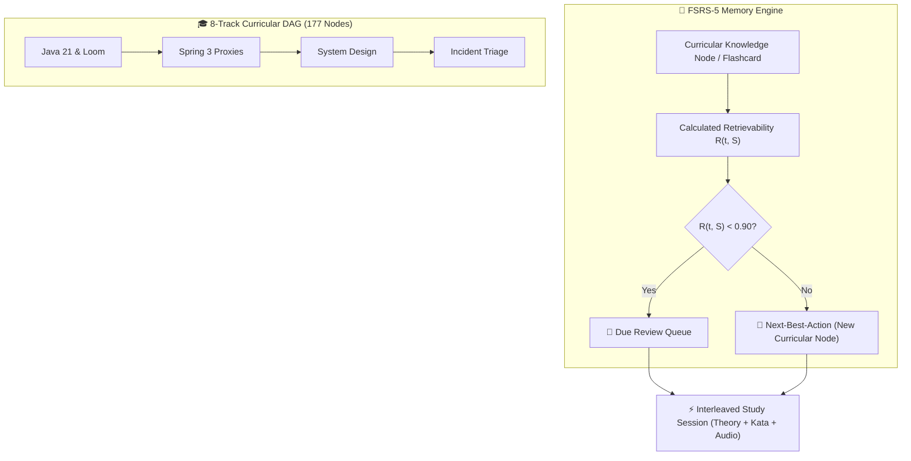

# Guided Academy & FSRS-5 Knowledge Graph Specification (Pillar 7 SSOT)

> **Document:** `07_GUIDED_ACADEMY_AND_FSRS5.md`  
> **Status:** Authoritative Single Source of Truth (SSOT)  
> **Target Standard:** SOTA Late September 2026  
> **Parent Master Architecture:** [docs/architecture.md](file:///d:/projects/interview_projects/spring/docs/architecture.md)

---

## 1. Domain Vision & Cognitive Retention Paradigm

Cramming for technical interviews creates an ephemeral illusion of competence that vanishes within days. 

The **Guided Academy Studio** replaces brute-force memorization with an adaptive knowledge graph backed by the **FSRS-5 (Free Spaced Repetition Scheduler)** model. The system continually optimizes study intervals based on memory decay curves, guaranteeing $\ge 90\%$ retention on interview day.



---

## 2. The FSRS-5 Mathematical Memory Model

FSRS-5 models human memory through three core variables:
- **Retrievability ($R \in [0, 1]$):** Probability of successfully recalling information at elapsed time $t$ (days).
- **Stability ($S \ge 0.1$):** Memory stability, defined as the duration in days required for $R$ to drop from $1.0$ to $0.90$.
- **Difficulty ($D \in [1, 10]$):** Inherent cognitive friction of the concept.

### 2.1. Retrievability Forgetting Curve
$$R(t, S) = \left( 1 + \text{FACTOR} \times \frac{t}{S} \right)^{\text{DECAY}} \quad \text{where } \text{DECAY} = -0.5, \; \text{FACTOR} = 19/81$$

### 2.2. Stability & Difficulty Updates
When a candidate reviews a card with rating $G \in \{1: \text{Again}, 2: \text{Hard}, 3: \text{Good}, 4: \text{Easy}\}$:

1. **Difficulty Adjustment:**
   $$D' = \text{clamp}\left( D - w_6 \times (G - 3), \; 1, \; 10 \right)$$
   $$D_{\text{new}} = w_7 \times D_0(3) + (1 - w_7) \times D'$$

2. **Stability Update on Successful Recall ($G \ge 2$):**
   $$S'_r(D, S, R, G) = S \times \left( 1 + e^{w_8} \times (11 - D) \times S^{-w_9} \times (e^{w_{10} \times (1 - R)} - 1) \times w_{15+G-2} \right)$$

3. **Stability Update on Memory Lapse ($G = 1$):**
   $$S'_f(D, S, R) = w_{11} \times D^{-w_{12}} \times \left( (S + 1)^{w_{13}} - 1 \right) \times e^{w_{14} \times (1 - R)}$$

### 2.3. Default 17 FSRS-5 Weights ($w_0 \dots w_{16}$)
```typescript
export const DEFAULT_FSRS5_WEIGHTS = [
  0.4072, 1.1829, 3.1262, 15.4722,  // Initial stabilities for ratings 1..4
  7.2102, 0.5316, 1.0651, 0.0234,   // Difficulty parameters
  1.6160, 0.1544, 1.0824,           // Recall stability scaling
  1.9813, 0.0953, 0.2975, 0.2204,   // Forgetting lapse dynamics
  0.2407, 2.9466                    // Hard & Easy multipliers
];
```

---

## 3. The 8-Track Curricular Backbone (177 Nodes)

The Academy curriculum is structured as a Directed Acyclic Graph (DAG) with prerequisites:
1. **Track 1: Java 21 Core & Virtual Threads (Project Loom):** Carrier pinning, structured concurrency, scoped values.
2. **Track 2: Spring Boot 3 Internals & Proxies:** AOP proxy mechanics, Bean lifecycle, conditional configuration.
3. **Track 3: Distributed Systems & System Design:** Consensus, partitioning, replication topologies, L1 math.
4. **Track 4: Database Engines, SQL & Transactions:** Isolation levels, MVCC, B-Trees vs LSM, ACID propagation.
5. **Track 5: High-Concurrency, Atomics & Memory Models:** JMM happens-before, CAS, volatile, memory fences.
6. **Track 6: Testing, Mutation & Reliability Engineering:** Pitest mutation, contract tests, property-based testing.
7. **Track 7: Production Incident Triage & SRE:** Thread dump analysis, Tarjan SCC deadlock graphs, heap leaks.
8. **Track 8: Architectural Leadership & Systemic Trade-offs:** Staff+ technical strategy, RFC authorship, ADRs.

---

## 4. Next-Best-Action (NBA) Interleaved Scheduler

The scheduler prevents cognitive exhaustion by interleaving different operational modalities:
- **Priority 1 (Due Reviews):** Nodes with $R(t, S) < 0.90$ are scheduled first to halt forgetting.
- **Priority 2 (Prerequisite Forward Advancement):** Next unblocked node in candidate's target track.
- **Modality Rotation:** Alternates between **Oral Voice**, **Machine Coding Kata**, **SRE Incident**, and **Podcast Audio** to stimulate diverse neuro-cognitive pathways.

---

## 5. Verification Commands

```bash
# Verify FSRS-5 decay formulas and spaced repetition transitions
npm --prefix backend run test:telemetry:db
```
