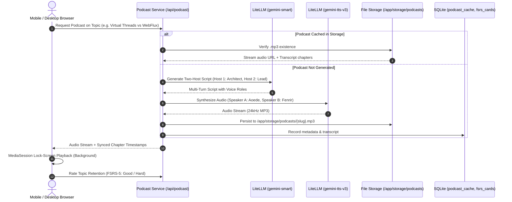

# StudyDeck & Two-Host Audio Podcasts Specification (Pillar 8 SSOT)

> **Document:** `08_STUDYDECK_AND_AUDIO_PODCASTS.md`  
> **Status:** Authoritative Single Source of Truth (SSOT)  
> **Target Standard:** SOTA Late September 2026  
> **Parent Master Architecture:** [docs/architecture.md](file:///d:/projects/interview_projects/spring/docs/architecture.md)

---

## 1. Domain Vision & Ambient Learning Paradigm

A significant portion of a senior engineer's week is spent commuting, walking, or away from the terminal. 

The **StudyDeck & Audio Podcasts** pillar turns dead time into high-retention learning hours by synthesizing deep technical topics into engaging **two-host podcast dialogues** (Senior Architect vs Staff Engineer), coupled with an offline flashcard player synchronized with FSRS-5.



---

## 2. Two-Host Persona Dynamic & Voice Casting

### 2.1. Host Personas
- **Host 1 (Elena — The Pragmatic Architect):** Leads the discussion, probes real-world failure cases, challenges theoretical assumptions, voice model `Aoede` (Warm, analytical).
- **Host 2 (Dmitry — The Systems Specialist):** Explains JVM internals, bytecode nuances, kernel interactions, and performance metrics, voice model `Fenrir` (Deep, technical).

### 2.2. Dialogue Script Rules
- **Anti-Monologue Invariant:** Neither host may speak for longer than 3 consecutive sentences ($< 45\text{ seconds}$) without an interjection, clarifying question, or counter-example.
- **Concrete Code Recitation:** Complex code is transformed into acoustic analogies rather than reading punctuation aloud (e.g. *"Instead of a synchronized block that pins the carrier thread, Elena swaps it for a ReentrantLock with try-finally"*).
- **Socratic Tension:** Every episode includes at least one technical disagreement (e.g. *Optimistic vs Pessimistic Locking under 95% write contention*) resolved through first-principles analysis.

---

## 3. Audio Engineering & Synthesis Standards

### 3.1. Audio Pipeline Formats
- **Sampling Frequency:** $24,000\text{ Hz}$ or $48,000\text{ Hz}$ (High-Fidelity Stereo).
- **Compression:** Variable Bitrate MP3 (128 kbps) or Opus (64 kbps) for minimal mobile data consumption.
- **Normalized Loudness:** EBU R128 standard ($-16\text{ LUFS}$ integrated loudness, $\pm 1.0\text{ LUFS}$) to prevent volume jumping between episodes.

### 3.2. Background Mobile Playback (`MediaSession` API)
On mobile devices (iOS Safari & Android Chrome), playback integrates with operating system audio controls:
```typescript
if ('mediaSession' in navigator) {
  navigator.mediaSession.metadata = new MediaMetadata({
    title: topic.title,
    artist: 'InterviewPrep AI Deep Dive',
    album: 'Senior Java & Distributed Systems',
    artwork: [{ src: '/icons/podcast-512.png', sizes: '512x512', type: 'image/png' }]
  });
  navigator.mediaSession.setActionHandler('seekbackward', () => skip(-15));
  navigator.mediaSession.setActionHandler('seekforward', () => skip(15));
}
```

---

## 4. Flashcard StudyDeck & In-Player Spaced Repetition

The audio player is directly linked to the candidate's personal FSRS-5 spaced repetition deck:
1. While listening, the candidate can bookmark key moments or tap rating buttons (`Again`, `Hard`, `Good`, `Easy`).
2. Tapping a rating sends an instant telemetry update to `/api/memory/review`, updating stability ($S$) and difficulty ($D$) in SQLite without interrupting playback.
3. Lock-screen and car dashboard controls allow hands-free rating via headset gestures.

---

## 5. Verification Commands

```bash
# Verify podcast synthesis route & model readiness
npm --prefix backend run test:telemetry:router
```
