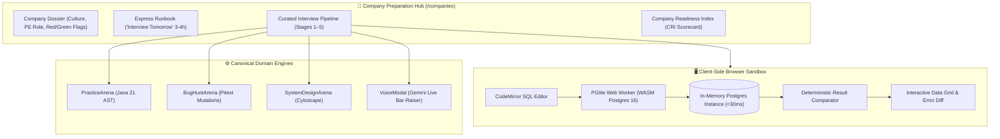

# Targeted Company Preparation Hub & In-Browser SQL Arena (Pillar 10 SSOT)

> **Document:** `10_COMPANY_TARGETED_PREPARATION_AND_SQL_ARENA.md`  
> **Status:** Authoritative Single Source of Truth (SSOT)  
> **Target Standard:** SOTA Late 2026  
> **Parent Master Architecture:** [docs/architecture.md](file:///d:/projects/interview_projects/spring/docs/architecture.md)

---

## 1. Domain Vision & Paradigm Shift

Candidate preparation in enterprise software engineering is fundamentally company-specific. A generic Java developer preparing for Raiffeisen DGTL faces an entirely different set of architectural expectations (End-to-End Product Engineer ownership, strict financial precision, zero-tolerance for floating-point money, pessimistic locking against DB deadlocks, idempotency, and transactional outbox) compared to an algorithmic BigTech screen.

The **Targeted Company Preparation Hub & SQL Arena** provides:
1. **Curated Company Pipelines (Projections over SSOT):** Reuses canonical domain entities across `PracticeArena`, `BugHuntArena`, `SystemDesignArena`, and `VoiceModal` without creating parallel silos.
2. **In-Browser PGlite WASM SQL Arena:** Executes real PostgreSQL 16 queries entirely inside candidate browsers via WebAssembly. Guarantees 0 MB memory overhead on the 1.8 GB VPS while supporting 100% PostgreSQL SQL semantics (window functions, CTEs, `NOT EXISTS` vs `NOT IN` three-valued logic, and `INTERVAL` expressions).
3. **Company Readiness Index (CRI):** Telemetry-backed readiness metric aggregating scorecards across all company stages.



---

## 2. Hard Invariants of Company Preparation & SQL Engine

### 2.1. Canonical Entity Reuse Invariant (Zero Silos)
- All coding challenges, bug-hunt katas, system design scenarios, and questions MUST reside in canonical storage (`machine_coding_challenges.json`, `refactoring_challenges.json`, `scenarios/manifests/`, `all_interview_questions.json`).
- A Company Track is strictly a **curated projection DAG** that references canonical IDs with company-specific metadata and instructions.

### 2.2. Zero-VPS-Load SQL Engine Invariant (WASM Isolation)
- SQL queries MUST NEVER execute in native Docker containers or OS processes on the VPS.
- All SQL verification executes inside `@electric-sql/pglite` (WebAssembly Postgres 16) running in the client browser or a sandboxed headless worker.
- Cold startup time MUST remain $\le 50\text{ms}$; query evaluation time $\le 10\text{ms}$.

### 2.3. Deterministic Result Comparison Invariant
- Candidate SQL execution is evaluated against the author's `expectedQuery` using:
  1. Column count and normalized column names comparison.
  2. Row count and tuple value equivalence (handling `NULL`, numeric scale, and string trimming).
  3. Strict ordering assertion when `orderMatters === true`.
- Evaluator returns visual diffs showing missing, unexpected, or mismatched rows.

### 2.4. Company Readiness Index (CRI) Formula
$$CRI = \sum_{k=1}^{N} w_k \times S_k \in [0\%, 100\%]$$
Where:
- $S_k \in [0, 1]$ is the candidate's completion score for Stage $k$ (Theory, Live Coding, Code Review, SQL, System Design, Voice Fit).
- $w_k$ is the stage weight configured in the company profile (e.g. Code Review: 0.25, SQL: 0.20, Live Coding: 0.20, System Design: 0.20, Fit: 0.15).

---

## 3. Data Contracts & Metamodel

### 3.1. SQL Challenge Schema (`SqlChallenge`)
```typescript
export interface SqlChallenge {
  id: string;
  slug: string;
  title: string;
  category: 'traps' | 'window_functions' | 'aggregations' | 'financial_analytics';
  difficulty: 'middle' | 'senior';
  companyContext: {
    company: string;
    stage: string;
    importance: 'CRITICAL' | 'HIGH' | 'MEDIUM';
    interviewTrapDescription: string;
  };
  instructionsMarkdown: string;
  schemaSql: string;              // DDL: CREATE TABLE statements
  seedSql: string;                // DML: INSERT statements with NULLs, boundaries
  expectedQuery: string;          // Authoritative reference SQL query
  initialEditorSql: string;       // Boilerplate in CodeMirror
  orderMatters: boolean;          // Whether ORDER BY is strictly checked
  explanationMarkdown: string;    // Deep dive into PostgreSQL internal behavior
}
```

### 3.2. Company Profile Schema (`CompanyProfile`)
```typescript
export interface CompanyProfile {
  id: string;
  name: string;
  brandColor: string;
  logoBadge: string;
  tagline: string;
  culture: {
    engineeringParadigm: string; // e.g. "Product Engineer (End-to-End Ownership)"
    metricsFocus: string[];      // e.g. ["TTM", "Pain Index", "Conversion Lift"]
    redFlags: string[];          // Instant rejections
    greenFlags: string[];        // Senior indicators
  };
  expressRunbook: {
    pitchScriptMarkdown: string;
    mustReviewTaskIds: string[];
    checklist: string[];
  };
  stages: CompanyPipelineStage[];
}

export interface CompanyPipelineStage {
  id: string;
  stageNumber: number;
  title: string;
  format: 'voice_fit' | 'live_coding' | 'code_review' | 'sql_arena' | 'system_design';
  estimatedMinutes: number;
  description: string;
  targetArena: 'practice' | 'incidents' | 'system_design' | 'sql_arena' | 'voice_modal';
  targetEntityId: string;
  weight: number;
}
```

---

## 4. Verification Seam & Acceptance Standards

```bash
# Verify shared and backend TypeScript contracts
npm --prefix shared run build
npm --prefix backend run build

# Verify frontend types and linting
node frontend/node_modules/typescript/bin/tsc -p frontend/tsconfig.json --noEmit
```
