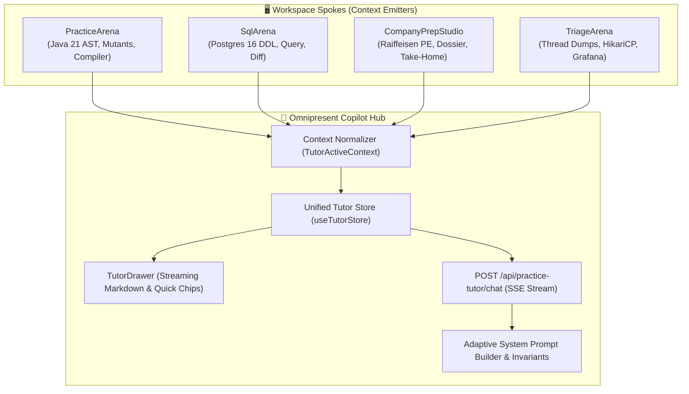

# Omnipresent AI Copilot & Contextual Tutor Architecture (Pillar 11 SSOT)

> **Document:** `11_OMNIPRESENT_AI_COPILOT_ARCHITECTURE.md`  
> **Status:** Authoritative Single Source of Truth (SSOT)  
> **Target Standard:** SOTA Late 2026  
> **Parent Master Architecture:** [docs/architecture.md](file:///d:/projects/interview_projects/spring/docs/architecture.md)

---

## 1. Domain Vision & SOTA 2026 Paradigm Shift

In modern technical assessment platforms, developer copilots must never be implemented as siloed, duplicated chat widgets or generic disconnected chatbots. A candidate preparing for a Staff/Lead role in fin-tech requires an **ambient, context-aware AI partner (Hub-and-Spoke)** that seamlessly follows them across all arenas (Live Coding, SQL Sandbox, Company Prep Studio, Incident Triage, and System Design) while strictly preserving pedagogical integrity.

The **Omnipresent AI Copilot** enforces:
1. **Single Headless Engine (Strict Reuse Invariant):** One unified store (`useTutorStore`), one streaming transport route (`/api/practice-tutor/chat` / `/api/tutor/chat`), and one responsive UI drawer (`TutorDrawer`).
2. **Polymorphic Context Ingestion:** The active workspace (CodeMirror editor, PGlite SQL sandbox, company dossier, or thread dump) automatically injects a structured snapshot into the copilot without requiring manual copy-pasting from the user.
3. **Socratic Ladder & Anti-Solution Leak:** The copilot never vomits raw solutions on initial tiers. It employs progressive Socratic hints (Tier 1 Nudge $\to$ Tier 2 Structural Scaffold $\to$ Tier 3 Invariant Deep Dive) backed by AST Tree-Edit-Distance guards.
4. **Company-Calibrated Personas:** Adapts tone, terminology, and heuristics to specific company DNA (e.g. Raiffeisen DGTL Product Engineer emphasizing TTM, Pain Index, Zero-Downtime, and strict financial precision).



---

## 2. Hard Invariants of Omnipresent Copilot Architecture

### 2.1. Zero Parallel Reimplementation Invariant
- Creating secondary copilot components (e.g. `CompanyTutorDrawer`, `SqlTutorDrawer`) is strictly forbidden.
- All workspace arenas MUST bind to the single `TutorDrawer` and `useTutorStore` by feeding their respective `TutorActiveContext` slice.

### 2.2. Zero-Copy Context Grounding Invariant
- The copilot MUST automatically ingest:
  1. The active entity identifier, domain, and title.
  2. The candidate's active code, SQL query, or review notes.
  3. The latest compiler output, PostgreSQL engine error, or relational diff.
  4. Active company culture markers (Red/Green flags) when inside a company track.
- The user is NEVER required to copy-paste error messages or schema DDL into the chat.

### 2.3. Socratic Scaffolding & Anti-Leak Invariant
- **Tier 1 (Nudge):** Focuses candidate attention on the broken invariant or edge case (e.g. *"What happens when `NOT IN` encounters a row with `NULL`?"*).
- **Tier 2 (Scaffold):** Explains structural pattern without giving the concrete syntax or code.
- **Tier 3 (Deep Dive):** Explains engine internals (PostgreSQL executor, AOP proxy generation, JVM memory layout) only after candidate attempt.

### 2.4. Non-Blocking Streaming & Dynamic Cancellation
- Generation streams over Server-Sent Events (SSE) via `LiteLLM_Proxy`.
- Closing the drawer, switching tabs, or selecting another challenge triggers immediate `AbortController.abort()`, releasing backend resources and LiteLLM sockets in $< 50\text{ms}$.

---

## 3. Data Contracts & Polymorphic Metamodel

### 3.1. Unified Active Context Schema (`TutorActiveContext`)
```typescript
export type TutorArenaType = 'practice' | 'sql_arena' | 'companies' | 'incidents' | 'system_design';

export type TutorPersona = 'junior_explainer' | 'middle_scaffold' | 'senior_socratic' | 'faang_interviewer' | 'company_interviewer';

export interface TutorActiveContext {
  arena: TutorArenaType;
  entityId: string;
  entityTitle: string;
  domain: string;
  persona: TutorPersona;
  assistanceLevel: number; // 1 (Nudge) .. 4 (Staff)

  // Code & Query Workspace Payload
  activeCodeOrQuery?: string;
  activeFilePath?: string;
  schemaOrDdl?: string;

  // Real-Time Execution Feedback
  compilerError?: string;
  runtimeError?: string;
  executionDiff?: {
    missingRowsCount?: number;
    unexpectedRowsCount?: number;
    mismatchSample?: string;
  };

  // Company Culture Context
  companyContext?: {
    companyId: string;
    companyName: string;
    stageTitle?: string;
    cultureMetrics?: string[];
    redFlags?: string[];
    takeHomeContext?: {
      title: string;
      prAntiPatternsSummary?: string;
    };
  };

  // Domain Quick Chips Configuration
  quickActionChips: Array<{
    id: string;
    label: string;
    promptMessage: string;
    icon?: string;
  }>;
}
```

### 3.2. Domain Quick-Action Chips Specifications
| Arena | Chip Label | Semantic Intent |
| :--- | :--- | :--- |
| **SQL Arena** | 🔍 Почему пустая выборка? | Explains 3-valued logic and `NULL` trap without writing the SQL query |
| **SQL Arena** | ⚡ План индексов | Explains B-Tree suitability for composite predicates and window partition |
| **SQL Arena** | 💡 Намёк без решения | Triggers Tier 1 Socratic nudge on the relational invariant |
| **Companies** | 🎙️ Отрепетируй 4-мин питч | Evaluates candidate presentation against Product Engineer metrics |
| **Companies** | 🚨 Каверзный вопрос по STAR | Simulates Bar-Raiser probing compliance, legacy migration, or post-mortem |
| **Companies** | 🧦 Ловушки «Склада носков» | Explains race condition in Java memory read vs atomic database update |
| **Companies** | 🛡️ Дефекты TransferService | Probes deadlock order, Lost Update, and `@Transactional` rollbackFor |

---

## 4. Verification Seam & Acceptance Standards

```bash
# Verify shared context contracts and backend compilation
npm --prefix shared run build
npm --prefix backend run build

# Verify backend tutor route and AST guard test suite
npm --prefix backend run test:live:tool-isolation

# Verify frontend types and clean zero-warning build
node frontend/node_modules/typescript/bin/tsc -p frontend/tsconfig.json --noEmit
```
