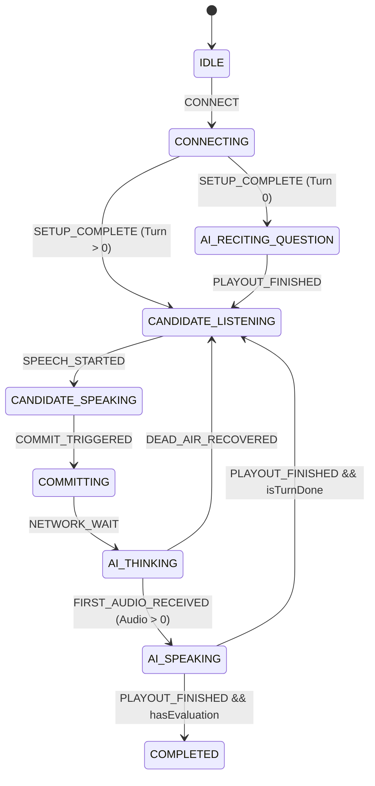

# Spec 16: Live Voice Modality Separation, Symmetrical Keepalive, & Defensive Dialog Layout

> **Parent Specification:** [`docs/architecture/specs/01_ORAL_MOCK_INTERVIEW_AND_AUTO_VAD.md`](01_ORAL_MOCK_INTERVIEW_AND_AUTO_VAD.md), [`AUTO_VAD_LIVE_AUDIO_SPECIFICATION.md`](AUTO_VAD_LIVE_AUDIO_SPECIFICATION.md)  
> **Status:** Approved for Implementation (SOTA Late 2026)  
> **Traceability:** Aligned with `~/projects/gemini_live_reference/` & VAD Lab Step 6  

---

## 1. Intent & Workload Envelope

- **Context & Glossary:**  
  Governed by `GLOSSARY.md` (Dual-Sided Handshake, Modality Separation, Anti-Lapping, Cloud VAD Fast-Handoff). Resolves voice degradation where the AI writes text without playing speech, socket drops with `1006` during conversational pauses, and vertical layout shifting in modal dialogs.
- **Operating Envelope:**  
  - Target TTFA (Time to First Audio): $\le 900$ ms.
  - Symmetrical Keepalive Heartbeat: Ping/Pong interval 15–20 s; inactivity cutoff relaxed from 180 s to 900 s (15 min).
  - Modal Viewport Constraints: $100$ dvh compliant, zero header/footer clipping on viewports down to $640 \times 700$ px.
  - Data Classification: Internal / Session Ephemeral.

---

## 2. Explicit Non-Goals (Blast-Radius Protection)

The implementation agent is **strictly forbidden from modifying**:
1. `LiteLLM_Proxy/` source code and Docker container configurations.
2. `public/worklets/audio-capture-processor.js` (100ms 16kHz downsampler is already canonical).
3. Backend database schema, SQLite migrations, or Question Catalog files (`all_interview_questions.json`, `company_profiles.json` structure).
4. Unrelated practice arenas (PGlite SQL Arena, Cytoscape System Design, WASM Code Editor).

---

## 3. Pre-Agreed Verification Seams

- **Client Voice Engine Seam:** `frontend/src/audio/NativeLiveVoiceEngine.ts` and `frontend/src/audio/LiveVoiceStateMachine.ts`.
- **Backend Stream Routing & Session Seam:** `backend/src/services/live/LiveVoiceSession.ts`, `liveWsClientFrameHandler.ts`, and `liveAudioStreamRouter.ts`.
- **UI Dialog Presentation Seam:** `frontend/src/components/VoiceModal.tsx` and `frontend/src/components/voice/VoiceModalHeader.tsx`.
- **Canary & Unit Test Seam:** `frontend/src/audio/__tests__/` and `backend/tests/audio/`. Zero domain mocks; verification via cloud runner `remote-verify`.

---

## 4. Formal Wire & Messaging Contracts

### 4.1 Symmetrical Heartbeat Ping/Pong Envelope
When backend dispatches ping:
```json
{
  "type": "ping",
  "timestamp": 1731171000000
}
```
Client immediately replies:
```json
{
  "type": "pong",
  "timestamp": 1731171000000
}
```
And client-initiated ping (sent every 20s during idle/listening):
```json
{
  "type": "ping",
  "timestamp": 1731171020000
}
```
Backend response:
```json
{
  "type": "pong",
  "timestamp": 1731171020000
}
```
Both events reset `session.lastActivityAt = Date.now()`, completely eliminating false-positive `KeepaliveTimeout` kills.

### 4.2 SOTA Modality Separation Contract
In `NativeLiveVoiceEngine.handleServerFrame(data)`:
```typescript
// Incoming Speech Transcription / Text
if (parsed.hasText) {
  for (const textChunk of parsed.textDeltas) {
    this.currentAiTurnAccumulator += textChunk;
    this.callbacks.onTranscriptDelta?.('ai', textChunk);
    this.turnManager.updateLastAiTurn(this.currentAiTurnAccumulator);
  }
}

// Incoming PCM Audio Chunks (STRICTLY GATED)
if (parsed.hasAudio && parsed.audioChunks.length > 0) {
  this.isSessionReady = true;
  this.isServerTurnComplete = false;
  this.clearClientSafetyTimer();
  this.fsm.transition({ type: 'FIRST_AUDIO_RECEIVED' });
  this.callbacks.onStatusMessage?.('🔊 ИИ говорит...');
  for (const pcm of parsed.audioChunks) {
    this.playoutManager.enqueuePcmChunk(pcm);
  }
}
```

---

## 5. Dual-Sided Handshake & State Machine Contracts

### 5.1 Evaluation Completion Drain Protocol
When backend sends `type: "evaluation_completed"`:
1. `NativeLiveVoiceEngine` does NOT transition FSM to `COMPLETED` immediately if audio is playing or enqueued.
2. Store `pendingEvaluation` in engine/modal.
3. If `playoutManager.isPlaying()`:
   - Allow closing verbal statement from Gemini to finish draining physically.
   - Upon `onPlaybackFinished`: FSM transitions to `COMPLETED`, invoking `callbacks.onEvaluationReceived(eval)`.
4. If `!playoutManager.isPlaying()` and `isServerTurnComplete`:
   - FSM transitions immediately to `COMPLETED`.

### 5.2 State Machine Transition Rules


---

## 6. Hoare-Logic Behavioral Contracts ({P} C {Q})

### Contract 1: Audio Playback Before Verdict Transition
- **Pre-Conditions {P}:** `evaluation` payload received via WebSocket frame; Gemini Live closing audio chunk is enqueued in `AudioPlayoutManager`.
- **Algorithm C:** Defer `setStage('verdict')` and `fsm.transition('EVALUATION_COMPLETED')` until `AudioPlayoutManager.onPlaybackFinished` triggers.
- **Post-Conditions {Q}:** Candidate hears full verbal concluding remarks without premature cut-off; UI switches to scorecard with zero truncated speech.

### Contract 2: Symmetrical Keepalive Invariant
- **Pre-Conditions {P}:** Candidate is silent, on hold, or thinking for $> 180$ seconds in an open session.
- **Algorithm C:** Client heartbeat worker emits `{ type: 'ping' }` every 20s; backend answers and resets `lastActivityAt`. Backend inactivity ceiling is set to 900s (15 min).
- **Post-Conditions {Q}:** Socket remains healthy `OPEN` (`readyState === 1`); zero `1006 Abnormal Closure` drops during deliberation pauses.

### Contract 3: Defensive Dialog Layout & Sticky Controls
- **Pre-Conditions {P}:** Modal opened on any viewport down to $640 \times 700$ px with multi-line question text.
- **Algorithm C:** Outer dialog has `max-h-[90dvh] flex flex-col`; `VoiceModalHeader` has `shrink-0` with topic title bounded by `max-w-[45%] truncate`; close button styled with high-contrast `text-slate-700 bg-white/90 border border-slate-200/90 shadow-xs`; intermediate transcript container has `overflow-y-auto min-h-0 flex-1`.
- **Post-Conditions {Q}:** Close button ('X') is always visible and clickable; controls never push off-screen or trigger layout shifts.
