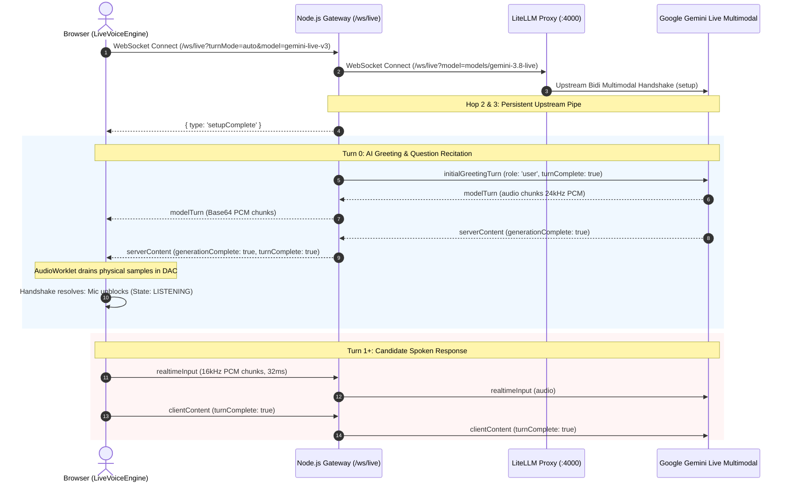

# Canonical Auto-VAD Live Audio Protocol Specification (SSOT)

> **Document:** `AUTO_VAD_LIVE_AUDIO_SPECIFICATION.md`  
> **Status:** Authoritative Single Source of Truth (SSOT)  
> **Target Standard:** SOTA Late September 2026  
> **Mandatory Reference:** All AI agents, engineers, and diagnostic tools working with Web Audio, WebSockets, AudioWorklets, VAD, or Gemini Live streaming MUST strictly comply with this specification.

---

## 1. Executive Summary & Architecture Topology

The InterviewPrep AI platform delivers zero-latency, full-duplex conversational voice tutoring and technical interview simulations. Voice interactions are executed over a 3-hop WebSocket pipeline:



---

## 2. Mathematical Audio Formats & DSP Models

### 2.1. Candidate Microphone Capture (Uplink)
- **Sampling Frequency ($f_{s,\text{in}}$):** $16,000 \text{ Hz}$ (16 kHz).
- **Channels ($C_{\text{in}}$):** 1 (Mono).
- **Quantization:** 16-bit Linear PCM (Signed integer, Little-Endian, 2 bytes/sample).
- **Frame Buffer Size ($N_{\text{frame}}$):** 512 samples.
- **Frame Duration ($\Delta t_{\text{frame}}$):**
  $$\Delta t_{\text{frame}} = \frac{N_{\text{frame}}}{f_{s,\text{in}}} = \frac{512}{16000} = 0.032 \text{ s} = 32 \text{ ms}$$
- **Frame Byte Payload ($B_{\text{frame}}$):**
  $$B_{\text{frame}} = 512 \text{ samples} \times 2 \text{ bytes} = 1024 \text{ bytes}$$
- **Data Throughput:** $16,000 \times 2 = 32,000 \text{ B/s} = 32 \text{ kB/s}$.
- **Acoustic Pre-Processing:** Hardware AEC (Acoustic Echo Cancellation), Noise Suppression, and AGC (Automatic Gain Control) enabled via `navigator.mediaDevices.getUserMedia`.

### 2.2. AI Speech Playout (Downlink)
- **Sampling Frequency ($f_{s,\text{out}}$):** $24,000 \text{ Hz}$ (24 kHz).
- **Channels ($C_{\text{out}}$):** 1 (Mono).
- **Sample Format:** Int16 Linear PCM (Base64 encoded inside JSON `modelTurn.parts[].inlineData.data`).
- **Throughput:** $24,000 \times 2 = 48,000 \text{ B/s} = 48 \text{ kB/s}$.
- **Web Audio Playout Graph:**
  `AudioWorkletNode ('gemini-audio-processor')` $\longrightarrow$ `GainNode (Master)` $\longrightarrow$ `AudioContext.destination` (or `MediaStreamAudioDestinationNode` on mobile).
- **Ring Buffer Size:** $2^{20} = 1,048,576 \text{ samples}$ ($\approx 43.7 \text{ s}$ of audio buffer) to guarantee zero wrap-around.
- **Resampling:** Dynamic 4-point, 3rd-order Hermite polynomial interpolation from 24 kHz to host DAC hardware frequency ($44.1 \text{ kHz}$ or $48 \text{ kHz}$) with persistent filter history to eliminate Gibbs phenomena and phase clicks.

---

## 3. The Dual-Sided Handshake Invariant

A major race condition in voice conversational AI occurs when network generation concludes while physical audio is still draining in the candidate's headphones, or when audio drains before the final network packet arrives.

### 3.1. Formal State Equation
Turn custody from AI to Candidate is unblocked if and only if:

$$\text{CanCandidateSpeak} \iff \Big( \text{NetworkGenerationFinished} \land \text{PhysicalDacBufferDrained} \Big)$$

### 3.2. Truth Table

| Network Generation Finished | AudioWorklet Drained (`drained`) | System State | Candidate Mic | EchoGuard State |
| :---: | :---: | :---: | :---: | :---: |
| **False** | **False** | `AI_SPEAKING` | Locked (Gated) | Drops all candidate mic chunks |
| **True** | **False** | `AI_DRAINING` | Locked (Gated) | Drops candidate mic chunks (+450ms reverb) |
| **False** | **True** | `AI_SPEAKING` (Network lag) | Locked (Gated) | Drops all candidate mic chunks |
| **True** | **True** | `LISTENING` | **Unlocked (Green)** | Pass-through to Gemini |

### 3.3. Symmetrical Resolution
- **Case 1 (Network completes first):** Gemini sends `generationComplete`. The engine sets `isServerTurnComplete = true` and dispatches `{ type: 'drain' }` to AudioWorklet. When the buffer reaches 0 samples, AudioWorklet posts `{ type: 'drained' }` $\rightarrow$ `onPlaybackFinished()` instantly unlocks candidate mic.
- **Case 2 (Audio drains first):** Audio finishes playing while network is still waiting for terminal packet. `isServerTurnComplete` is false $\rightarrow$ mic remains locked. When `generationComplete` arrives, the engine detects that the playout queue is already empty $\rightarrow$ instantly unlocks candidate mic in 0ms.

---

## 4. Terminal Signal Equivalence & Normalization

Google Gemini Multimodal Live API (`models/gemini-3.8-live` via LiteLLM) emits `serverContent.generationComplete: true` upon speech synthesis conclusion. It does not consistently emit `turnComplete: true` for turn-based prompt recitations.

### 4.1. Equivalence Invariant
All backend routers and frontend voice engines MUST treat:
$$\text{IsTurnFinished} \equiv \text{Boolean}(\text{serverContent.turnComplete} \lor \text{serverContent.generationComplete})$$

### 4.2. Backend Normalization Contract
Whenever the backend receives `serverContent.generationComplete: true` and `turnComplete` is falsy, it MUST inject `turnComplete: true` into the forwarded client payload:
```typescript
if (parsed?.serverContent?.generationComplete && !parsed.serverContent?.turnComplete) {
  parsed.serverContent.turnComplete = true;
  str = JSON.stringify(parsed);
}
```
This guarantees 100% interoperability across all frontend consumers, test fixtures, and mobile web clients.

---

## 5. EchoGuard & Acoustic Isolation

### 5.1. Server-Side Half-Duplex Acoustic Guard
In `liveWsConnectionHandler.ts`, candidate microphone packets arriving while:
$$\text{isAudioEmitting} \equiv (\text{session.isAiGenerating} \land \text{session.firstAudioChunkLogged}) \lor \text{isPlayoutActive}$$
MUST be silently dropped at the server gateway boundary unless flagged with `bargeIn: true`.

### 5.2. Reverb Cooldown Epoch
Because physical sound reverberates in rooms and acoustic echo cancellation has latency:
$$\text{aiPlayoutEstimatedEndEpoch} = T_{\text{current}} + \text{RemainingPlayoutDurationMs} + 450 \text{ ms}$$
Microphone frames received before this epoch are dropped to prevent acoustic self-interruption loops.

---

## 6. Barge-In (Interruption) Mechanics

### 6.1. Tactile Barge-In (User Click or Tap)
When the user taps the central circle or spacebar during AI speech:
1. `AudioPlayoutManager.handleInterruption()` triggers a **5ms exponential de-click ramp down** on `masterGain` and dispatches `{ type: 'flush' }` to AudioWorklet.
2. An upstream message is immediately dispatched:
   ```json
   { "clientContent": { "turnComplete": true, "interrupted": true }, "bargeIn": true }
   ```
3. Audio playout queue is cleared in 0ms.
4. Candidate microphone opens immediately (`isRecording: true`).

### 6.2. Acoustic Barge-In (Speech VAD)
If the candidate speaks over the AI and Energy VAD exceeds threshold:
- Client attaches `bargeIn: true` to the mic chunk.
- Server EchoGuard permits the frame to reach Gemini.
- Gemini emits `serverContent.interrupted: true`.
- Engine silences active playback and transitions to `LISTENING`.

---

## 7. Turn 0 Gating Invariant & Immutable Tools Constraint

### 7.1. Gemini Live Immutable Tools Rule
In the Gemini Multimodal Live API, tools declared in `setup.tools` are **immutable for the lifespan of that WebSocket connection**. Sending a secondary `setup` frame terminates the connection with protocol error.

### 7.2. Turn 0 Prompt Shield
To prevent the model from preemptively executing evaluation functions (`submit_interview_evaluation`) before the candidate has answered:
1. Turn 0 prompt explicitly directs speech output:
   `"Привет! Я готова к собеседованию. Пожалуйста, поприветствуй меня в 1 фразе и четко зачитай технический вопрос вслух: \"${questionText}\". (Внимание: сейчас только задай вопрос голосом, оценку выставлять не нужно, я еще не отвечала)."`
2. If the model attempts to call evaluation tools on Turn 0 (`!session.hasCandidateResponded`), `liveToolDispatcher` returns a structured error instructing the model to speak the question.

---

## 8. Subtitle Pacing & Skew Calibration

### 8.1. Actual Word Token Counting
Dynamic subtitle reveal algorithms MUST count real linguistic words rather than whitespace delimiters:
```typescript
const actualWords = allTokens.filter(t => t.trim().length > 0).length;
const estimatedDurationMs = isComplete
  ? Math.max(600, audioDurationQueuedMsRef.current)
  : Math.max(audioDurationQueuedMsRef.current, Math.max(600, actualWords * 240));
```

### 8.2. Unconditional Text Flush
Whenever `isTurnDone` or `onPlaybackFinished()` triggers, `finalizeAiTurnSubtitles()` MUST be invoked unconditionally to reveal 100% of accumulated text in 0ms, preventing slow-typing deadlocks.

---

## 9. Verification & Architectural Checkpoints

Any code changes touching voice audio MUST satisfy the following test contracts before merging:
1. `npm run test:telemetry:router` (Backend router mock & `generationComplete` normalization).
2. `npm run test:telemetry:playout` (Dual-sided handshake race condition matrix).
3. `npm run test:audio-contracts` (AudioWorklet draining & single-voice contracts).
4. `replay_turn.ts` (Headless acoustic loopback with 0 EchoGuard dropped chunks).
