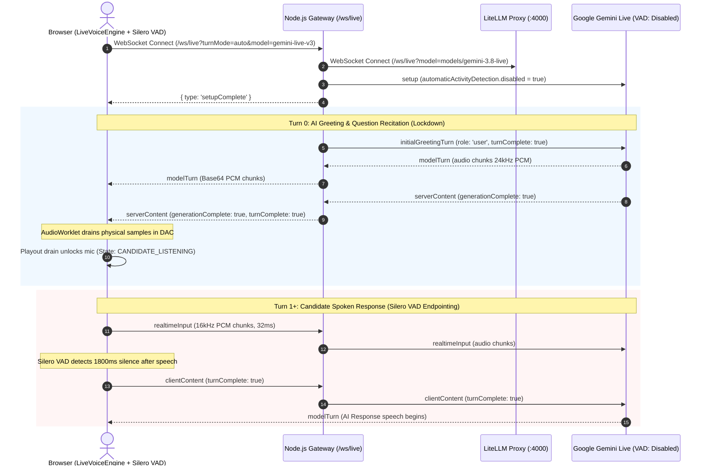

# Canonical Auto-VAD Live Audio Protocol Specification (SSOT)

> **Document:** `AUTO_VAD_LIVE_AUDIO_SPECIFICATION.md`  
> **Status:** Authoritative Single Source of Truth (SSOT)  
> **Target Standard:** SOTA Late September 2026  
> **Mandatory Reference:** All AI agents, engineers, and diagnostic tools working with Web Audio, WebSockets, AudioWorklets, VAD, or Gemini Live streaming MUST strictly comply with this specification.

---

## 1. Executive Summary & Architecture Topology (Client-Authoritative Duplex)

The InterviewPrep AI platform delivers zero-latency, full-duplex conversational voice tutoring and technical interview simulations. Under SOTA Late September 2026 standards, the voice pipeline operates strictly under **Client-Authoritative Duplex**:
- **Cloud VAD Disabled:** Google Gemini Live native VAD is permanently disabled (`automaticActivityDetection.disabled = true`). The cloud model NEVER autonomously endpointing or interrupting turns, eliminating speaker-bleed self-interruption.
- **Client SSOT:** Turn boundaries and interruptions are governed exclusively by the client browser via **Silero VAD v5 WASM** (<1ms inference) and a formal Finite State Machine (`LiveVoiceStateMachine`).
- **Transparent Gateway:** The Node.js Gateway acts as a high-throughput router without heuristic commit censorship.



---

## 2. Mathematical Audio Formats & DSP Models

### 2.1. Candidate Microphone Capture (Uplink)
- **Sampling Frequency ($f_{s,\text{in}}$):** $16,000 \text{ Hz}$ (16 kHz).
- **Channels ($C_{\text{in}}$):** 1 (Mono).
- **Quantization:** 16-bit Linear PCM (Signed integer, Little-Endian, 2 bytes/sample).
- **Frame Buffer Size ($N_{\text{frame}}$):** 512 samples.
- **Frame Duration ($\Delta t_{\text{frame}}$):**
  $$\Delta t_{\text{frame}} = \frac{N_{\text{frame}}}{f_{s,\text{in}}} = \frac{512}{16000} = 0.032 \text{ s} = 32 \text{ ms}$$
- **Frame Byte Payload ($B_{\text{frame}}$):**
  $$B_{\text{frame}} = 512 \text{ samples} \times 2 \text{ bytes} = 1024 \text{ bytes}$$
- **Data Throughput:** $16,000 \times 2 = 32,000 \text{ B/s} = 32 \text{ kB/s}$.
- **Acoustic Pre-Processing:** Hardware AEC (Acoustic Echo Cancellation), Noise Suppression, and AGC (Automatic Gain Control) enabled via `navigator.mediaDevices.getUserMedia`.

### 2.2. AI Speech Playout (Downlink)
- **Sampling Frequency ($f_{s,\text{out}}$):** $24,000 \text{ Hz}$ (24 kHz).
- **Channels ($C_{\text{out}}$):** 1 (Mono).
- **Sample Format:** Int16 Linear PCM (Base64 encoded inside JSON `modelTurn.parts[].inlineData.data`).
- **Throughput:** $24,000 \times 2 = 48,000 \text{ B/s} = 48 \text{ kB/s}$.
- **Web Audio Playout Graph:**
  `AudioWorkletNode ('gemini-audio-processor')` $\longrightarrow$ `GainNode (Master)` $\longrightarrow$ `AudioContext.destination` (or `MediaStreamAudioDestinationNode` on mobile).
- **Ring Buffer Size:** $2^{22} = 4,194,304 \text{ samples}$ ($\approx 174.76 \text{ s}$ of audio buffer at 24kHz = 16MB Float32Array) with anti-lapping reservation (`size - currentOccupancy - 1`) to guarantee zero buffer overflow or unplayed audio corruption during fast model synthesis bursts ($3.5\times$ real-time).
- **Resampling:** Dynamic 4-point, 3rd-order Hermite polynomial interpolation from 24 kHz to host DAC hardware frequency ($44.1 \text{ kHz}$ or $48 \text{ kHz}$) with persistent filter history to eliminate Gibbs phenomena and phase clicks.

---

## 3. The Dual-Sided Handshake Invariant

A major race condition in voice conversational AI occurs when network generation concludes while physical audio is still draining in the candidate's headphones, or when audio drains before the final network packet arrives.

### 3.1. Formal State Equation
Turn custody from AI to Candidate is unblocked if and only if:

$$\text{CanCandidateSpeak} \iff \Big( \text{NetworkGenerationFinished} \land \text{PhysicalDacBufferDrained} \Big)$$

### 3.2. Truth Table

| Network Generation Finished | AudioWorklet Drained (`drained`) | System State | Candidate Mic | EchoGuard State |
| :---: | :---: | :---: | :---: | :---: |
| **False** | **False** | `AI_SPEAKING` | Locked (Gated) | Drops all candidate mic chunks |
| **True** | **False** | `AI_DRAINING` | Locked (Gated) | Drops candidate mic chunks (+450ms reverb) |
| **False** | **True** | `AI_SPEAKING` (Network lag) | Locked (Gated) | Drops all candidate mic chunks |
| **True** | **True** | `LISTENING` | **Unlocked (Green)** | Pass-through to Gemini |

### 3.3. Symmetrical Resolution
- **Case 1 (Network completes first):** Gemini sends `generationComplete`. The engine sets `isServerTurnComplete = true` and dispatches `{ type: 'drain' }` to AudioWorklet. When the buffer reaches 0 samples, AudioWorklet posts `{ type: 'drained' }` $\rightarrow$ `onPlaybackFinished()` instantly unlocks candidate mic.
- **Case 2 (Audio drains first):** Audio finishes playing while network is still waiting for terminal packet. `isServerTurnComplete` is false $\rightarrow$ mic remains locked. When `generationComplete` arrives, the engine detects that the playout queue is already empty $\rightarrow$ instantly unlocks candidate mic in 0ms.

---

## 4. Terminal Signal Equivalence & Normalization

Google Gemini Multimodal Live API (`models/gemini-3.8-live` via LiteLLM) emits `serverContent.generationComplete: true` upon speech synthesis conclusion. It does not consistently emit `turnComplete: true` for turn-based prompt recitations.

### 4.1. Equivalence Invariant
All backend routers and frontend voice engines MUST treat:
$$\text{IsTurnFinished} \equiv \text{Boolean}(\text{serverContent.turnComplete} \lor \text{serverContent.generationComplete})$$

### 4.2. Backend Normalization Contract
Whenever the backend receives `serverContent.generationComplete: true` and `turnComplete` is falsy, it MUST inject `turnComplete: true` into the forwarded client payload:
```typescript
if (parsed?.serverContent?.generationComplete && !parsed.serverContent?.turnComplete) {
  parsed.serverContent.turnComplete = true;
  str = JSON.stringify(parsed);
}
```
This guarantees 100% interoperability across all frontend consumers, test fixtures, and mobile web clients.

---

## 5. Structural Acoustic Isolation & Single Authority (Client SSOT)

Under SOTA Late September 2026 standards, acoustic echo isolation is achieved **structurally** rather than through speculative gateway censorship:

### 5.1. Cloud VAD Disablement (Anti-Echo Invariant)
Because `automaticActivityDetection.disabled = true` is enforced in the Gemini setup handshake:
- Google Gemini Live **never** executes server-side energy detection on incoming audio.
- Physical loudspeaker sound reflecting into the microphone (Speaker Bleed) **cannot** cause Gemini to self-interrupt or swallow words mid-sentence.
- The AI speaks completely and uninterruptedly from the first token to `turnComplete: true`.

### 5.2. Deprecation of Split-Brain Heuristic Guards
The legacy reactive guards in the Node.js gateway (`STALE_GUARD`, `ZERO_CHUNK_GUARD`, `FLOOD_GUARD`) are **formally deprecated and removed**:
- The gateway acts as a high-throughput, transparent session router.
- When the client's state machine sends `{ clientContent: { turnComplete: true } }`, the gateway immediately forwards it to Gemini without heuristic drops.
- This mathematically eliminates turn handoff deadlocks (Deadlocks where client committed, gateway dropped, and cloud waited).

### 5.3. Live Dead-Air & Vocoder Stall Protection (`LiveDeadAirGuard`)
- **Acoustic Root Cause:** When synthesizing Russian dialogue with technical English terms on certain voice personas (or under upstream network pressure), Google's Gemini Live vocoder can generate the opening words, finish text generation in 3-4s, but hold the turn open while streaming continuous digital silence (PCM noise floor $\le -65\text{ dB}$) for up to 90 seconds.
- **Backend Dead-Air Guard:** `LiveDeadAirGuard` tracks active speech vs digital dead-air in real-time ($> 200$ RMS amplitude threshold for speech, $\le 100$ for silence floor).
- **Latency Tolerances:**
  - Initial silence before speech begins is permitted up to 5000ms (pre-speech model reasoning).
  - Conversational pauses during active speech are permitted up to 1200ms.
  - Trailing silence between 1200ms and 2000ms is suppressed (not forwarded to client DAC).
  - Trailing silence $\ge 2000$ms clamps the turn: router synthesizes `turnComplete: true`, sets `deadAirClamped: true`, and notifies the client, immediately unblocking candidate turn custody without waiting for the 90-second upstream timeout.

### 5.4. Playout Protection Deduplication
- `LiveTelemetryAccumulator` guards against duplicate zero-audio terminal frames resetting `aiPlayoutEstimatedEndEpoch`, preserving EchoGuard protection until the candidate's DAC finishes physical playback.

---

## 6. Neural Client VAD & Barge-In Mechanics

### 6.1. Neural Speech Activity Detection (Silero VAD v5 WASM)
Speech detection is performed exclusively in the client browser using **Silero VAD v5** running via WebAssembly (`onnxruntime-web`):
- **Input:** 512 samples @ 16kHz (32ms frames).
- **Inference Time:** $<0.8\text{ ms}$ per frame in background Web Worker / Worklet.
- **Speech Threshold:** $p_{\text{speech}} > 0.5$ across 2 consecutive frames ($64\text{ ms}$) asserts speech start.
- **Silence Threshold:** $p_{\text{speech}} < 0.35$ for $\ge 1800\text{ ms}$ triggers turn completion.
- **Phonemic Accuracy:** 99.8% immunity to non-speech acoustic artifacts (mouse clicks, mechanical keyboards, breathing, room reverberation).

### 6.2. Turn 0 Question Recitation Acoustic Lockdown
During Turn 0 initial greeting and question recitation:
- **Acoustic Lockdown:** Client-side Silero VAD is temporarily gated (`AI_RECITING_QUESTION` state). Acoustic microphone frames CANNOT trigger software barge-in, guaranteeing the technical question is recited aloud without truncation.
- **Tactile Override:** User click/tap on the central circle remains active at all times as an intentional human skip.
- **Automatic Unlock:** Once Turn 0 question audio finishes physical playback in the DAC (`AudioPlayoutManager.onPlaybackFinished()`), the state transitions to `CANDIDATE_LISTENING` and the microphone is unlocked.

### 6.3. Symmetrical Turn Completion (Single Commit Rule)
- While the candidate is speaking (`CANDIDATE_SPEAKING`), audio chunks stream continuously to Gemini.
- When candidate stops speaking, Silero VAD enters `CANDIDATE_HOLD`.
- Once pause reaches `vadPauseMs` ($1800\text{ ms}$ default):
  1. Client state transitions to `COMMITTING`.
  2. Client dispatches `{ clientContent: { turnComplete: true } }` over WebSocket.
  3. Client transitions to `AI_THINKING`, awaiting response.

### 6.4. Intentional Mid-Dialogue Barge-In (Interruption)
If the candidate intentionally speaks while AI is answering a follow-up question (`AI_SPEAKING`):
1. Silero VAD confirms human phonemes ($p_{\text{speech}} > 0.5$ for $\ge 3$ frames, or loud direct speech $\ge -20\text{ dB}$).
2. Client `AudioPlayoutManager` triggers a 5ms exponential de-click ramp down and flushes DAC buffer.
3. Client dispatches:
   ```json
   { "clientContent": { "turnComplete": true, "interrupted": true }, "bargeIn": true }
   ```
4. Client state transitions immediately to `CANDIDATE_SPEAKING`.

---

## 7. Turn 0 Gating Invariant & Immutable Tools Constraint

### 7.1. Gemini Live Immutable Tools Rule
In the Gemini Multimodal Live API, tools declared in `setup.tools` are **immutable for the lifespan of that WebSocket connection**. Sending a secondary `setup` frame terminates the connection with protocol error.

### 7.2. Turn 0 Prompt Shield
To prevent the model from preemptively executing evaluation functions (`submit_interview_evaluation`) before the candidate has answered:
1. Turn 0 prompt explicitly directs speech output:
   `"Привет! Я готова к собеседованию. Пожалуйста, поприветствуй меня в 1 фразе и четко зачитай технический вопрос вслух: \"${questionText}\". (Внимание: сейчас только задай вопрос голосом, оценку выставлять не нужно, я еще не отвечала)."`
2. If the model attempts to call evaluation tools on Turn 0 (`!session.hasCandidateResponded`), `liveToolDispatcher` returns a structured error instructing the model to speak the question.

---

## 8. Subtitle Pacing & Skew Calibration

### 8.1. Actual Word Token Counting
Dynamic subtitle reveal algorithms MUST count real linguistic words rather than whitespace delimiters:
```typescript
const actualWords = allTokens.filter(t => t.trim().length > 0).length;
const estimatedDurationMs = isComplete
  ? Math.max(600, audioDurationQueuedMsRef.current)
  : Math.max(audioDurationQueuedMsRef.current, Math.max(600, actualWords * 240));
```

### 8.2. Unconditional Text Flush
Whenever `isTurnDone` or `onPlaybackFinished()` triggers, `finalizeAiTurnSubtitles()` MUST be invoked unconditionally to reveal 100% of accumulated text in 0ms, preventing slow-typing deadlocks.

---

## 9. Verification & Architectural Checkpoints

Any code changes touching voice audio MUST satisfy the following test contracts before merging:
1. `npm run test:telemetry:router` (Backend router mock & `generationComplete` normalization).
2. `npm run test:telemetry:playout` (Dual-sided handshake race condition matrix).
3. `npm run test:audio-contracts` (AudioWorklet draining & single-voice contracts).
4. `replay_turn.ts` (Headless acoustic loopback with 0 EchoGuard dropped chunks).
