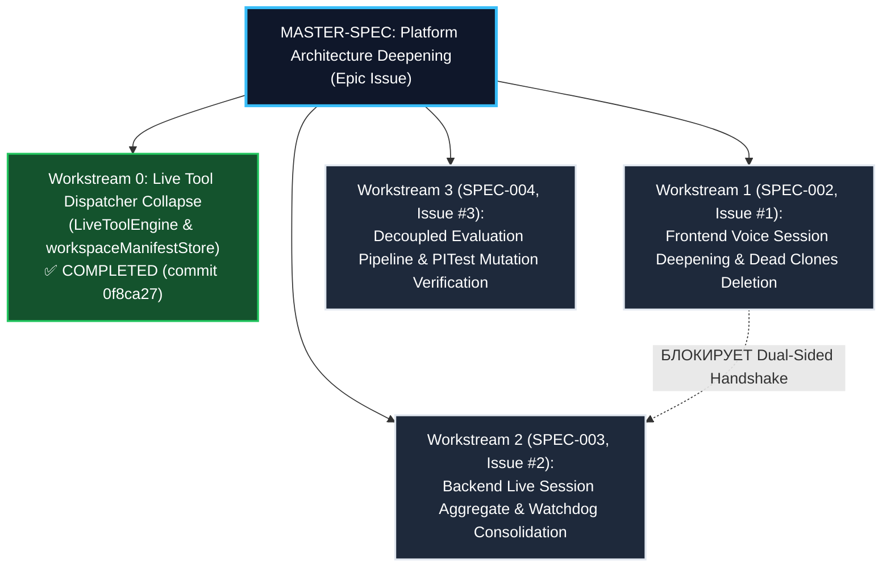

# Master Spec: Platform Architectural Deepening & Clean Seams Wave (SPEC-MASTER)

> **Статус:** Tier 1 Master Specification (Epic)  
> **Версия:** 1.0.0 (SOTA Late 2026)  
> **Область:** Fullstack AI Assessment Platform (Frontend Audio DSP, Backend WebSocket FSM, JVM Sandboxing)  
> **Связанные спецификации:** [`GLOSSARY.md`](file:///home/djelu/projects/interview_tutor/GLOSSARY.md), [`AGENTS.md`](file:///home/djelu/projects/interview_tutor/AGENTS.md), [`docs/architecture/ARCHITECTURAL_CANDIDATES_DEEP_DIVE.md`](file:///home/djelu/projects/interview_tutor/docs/architecture/ARCHITECTURAL_CANDIDATES_DEEP_DIVE.md)

---

## 1. Executive Intent & Architectural Vision

Настоящая мастер-спецификация формализует комплексный переход платформы InterviewPrep AI от поверхностных транзитных модулей (shallow pass-through chains), анемичных структур данных и протекающих транспортов к **глубоким, высокосвязным модулям с узкими интерфейсами (Deep Modules by John Ousterhout)** и архитектуре **Ports & Adapters**.

### Архитектурные цели волны:
1. **Ликвидация мертвого кода и клонов (Invariant 8):** Физическое удаление 575+ строк дублирующих звуковых движков и неиспользуемых детекторов.
2. **Инкапсуляция мутабельных состояний:** Замена анемичных глобальных объектов (`ProxySession`) и открытых ссылок на звуковые синки (`playoutManagerRef`) на инкапсулированные агрегаты с приватными сторожевыми таймерами.
3. **Чистые границы транспортов (Ports & Adapters):** Полная изоляция бизнес-логики оценки решений от веб-фреймворка Express с возвращением мутационного тестирования (PITest) в боевой цикл платформы.
4. **Единая каноническая сериализация протоколов:** Защита от разрывов апстрим-соединений Gemini Live (1008/1011) за счет строгой декларативной типизации.

---

## 2. Иерархия подспецификаций (Sub-Specifications / Workstreams)

Мастер-спецификация декомпозируется на 4 взаимосвязанных стрима:

### Сводная таблица воркстримов:

| Воркстрим | Документ спецификации | GitHub Issue | Статус | Пререквизиты |
| :--- | :--- | :--- | :--- | :--- |
| **WS-0: Tool Dispatcher** | Реализовано в `LiveToolEngine` | — | **COMPLETED** | — |
| **WS-1: Voice Client** | [`SPEC_02_FRONTEND_VOICE_SESSION_DEEPENING.md`](file:///home/djelu/projects/interview_tutor/docs/architecture/specs/SPEC_02_FRONTEND_VOICE_SESSION_DEEPENING.md) | [#1](https://github.com/iliaIz/interview_tutor/issues/1) | **READY** | Blocked by: None |
| **WS-2: Backend Session** | [`SPEC_03_BACKEND_LIVE_SESSION_AGGREGATE.md`](file:///home/djelu/projects/interview_tutor/docs/architecture/specs/SPEC_03_BACKEND_LIVE_SESSION_AGGREGATE.md) | [#2](https://github.com/iliaIz/interview_tutor/issues/2) | **PLANNED** | **Blocked by: WS-1 (#1)** |
| **WS-3: Code Evaluation** | [`SPEC_04_DECOUPLED_EVALUATION_AND_MUTATION_PIPELINE.md`](file:///home/djelu/projects/interview_tutor/docs/architecture/specs/SPEC_04_DECOUPLED_EVALUATION_AND_MUTATION_PIPELINE.md) | [#3](https://github.com/iliaIz/interview_tutor/issues/3) | **READY** | Blocked by: None (Ортогонален) |

---

## 3. Сквозные платформенные инварианты

Все дочерние спецификации и тикеты подчиняются следующим жестким правилам:

1. **Memory & VPS Safety (Инвариант 0 — Strict Prohibition of Local Builds & Tests):**
   - Хост VPS имеет строго 1.8 GB RAM.
   - **КАТЕГОРИЧЕСКИ ЗАПРЕЩЕНО** выполнять на VPS локальные компиляции (`cargo build`, `mvn`, `gradle`, `gcc`), сборщики (`npm run build`, `vite build`), запуск тестовых фреймворков (`npm test`, `pytest`, `cargo test`, `vitest`, `jest`), контейнерные тесты (`docker exec ... runAcousticVadMatrix`), запуск JVM Sandbox или `docker build`.
   - Любая локальная верификация на VPS ограничена **исключительно** быстрым статическим тайпчеком без эмита файлов (`export PATH="/home/djelu/.local/node/bin:$PATH" && npx tsc --noEmit`).
   - Все тяжелые сборки, прогоны юнит/интеграционных тестов, PITest-мутации, компиляция Java Sandbox runner и акустические канарейки выполняются **исключительно в облачном раннере GitHub Actions** через команду `remote-verify`.
2. **Dual-Sided Handshake (Инвариант 2.2):**
   - Переход от речи AI к микрофону кандидата симметрично разблокируется по завершении **последнего** из двух событий: слив физического аудио в буфере клиента (`onPlaybackFinished`) и прибытие сетевого пакета `turnComplete: true`.
3. **Cognitive Bounding & File Hygiene (Инвариант 8):**
   - Любой новый файл $\le 350$ строк.
   - Любой модифицированный файл $\le 400$ строк.
   - Запрет параллельных реализаций существующих абстракций.
4. **Mandatory Functional Registry Logging (Инвариант 10):**
   - Любое архитектурное изменение фиксируется в [`docs/architecture/functional_registry/`](file:///home/djelu/projects/interview_tutor/docs/architecture/functional_registry/INDEX.md) с фиксацией гипотез, первопричин и исключенных сбоев.

---

## 4. Сквозная стратегия верификации платформы (Двухуровневая модель)

### Уровень 1: Локальный быстрый шлюз (На хосте VPS — строго без сборщиков и тестов)
- **Команда:** `export PATH="/home/djelu/.local/node/bin:$PATH" && cd <package> && npx tsc --noEmit`
- **Критерий:** 0 ошибок типов, время выполнения $\le 5$s, потребление памяти $< 200$MB.
- **Строгий запрет:** Никаких локальных `npm run build`, `vitest`, `jest`, `gradle`, `docker build` или `docker exec` с тестами на VPS.

### Уровень 2: Облачный шлюз верификации (GitHub Actions CI/CD via `remote-verify`)
- **Команда вызова с VPS:** `remote-verify` (автоматически отправляет коммит в ветку `feat/*` и запускает workflow верификации в облаке с 16 GB RAM).
- **Облачные проверки:**
  - **Шов 2 (Аудио-сеть):** Акустический тест-комплекс [`backend/tests/test_hr_acoustic_canary.js`](file:///home/djelu/projects/interview_tutor/backend/tests/test_hr_acoustic_canary.js), VAD fault-injection (`testVadFaultInjection.js`) и loopback resilience.
  - **Шов 3 (JVM Sandbox & Mutation):** Сборка Java Sandbox runner (`npm run build:sandbox`), прогон unit-тестов, AST-правил и PITest-мутаций.
  - **Шов 4 (Build & Bundle Integrity):** Полная сборка backend и frontend SPA (`npm run build`).

---

## 5. Дорожная карта исполнения (Phased Execution)

1. **Этап I (Параллельный):**
   - Исполнение **WS-1 (Issue #1)**: Очистка фронтенд-движка, удаление 575 строк мертвых клонов, сжатие хука до 8 свойств.
   - Исполнение **WS-3 (Issue #3)**: Выделение `ChallengeEvaluationPipeline` и оживление мутационного тестирования PITest.
2. **Этап II (Синхронизирующий):**
   - Исполнение **WS-2 (Issue #2)**: Инкапсуляция сессии бэкенда в `LiveVoiceSession` с централизацией сторожевых таймеров на базе стабильного клиентского контракта.
3. **Этап III (Релиз и верификация):**
   - Прогон полного канареечного прогона матрицы Gemini Live VAD.
   - Слияние ветки рефакторинга в `main`.
