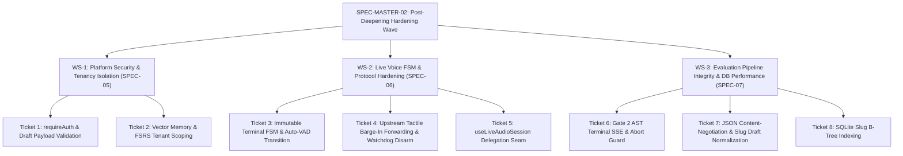

# Spec: Post-Deepening Security, Protocol & Evaluation Hardening (SPEC-MASTER-02)

## 1. Intent & Workload Envelope
- **Context & Glossary**: Governing [`GLOSSARY.md`](file:///home/djelu/projects/interview_tutor/GLOSSARY.md) terms: `Evaluation Gate`, `Tenant Scoping`, `Live Voice Session Aggregate`, `Auto-VAD`, `Dual-Sided Handshake Invariant`. Harmonizes findings from the 6-Angle Distributed Systems Review.
- **Operating Envelope**:
  - Target latency: p95 $\le 2.0$s for full evaluation pipeline; p99 $\le 30$ms for realtime voice turn transitions.
  - Multi-tenant isolation: `isolated-multi-tenant` across REST APIs, SQLite tables, Vector Memory, and WebSocket live sessions.
  - Verification: 100% remote execution via GitHub Actions cloud runner; zero heavy builds/tests on VPS (Rule 0).

## 2. Explicit Non-Goals (Blast-Radius Protection)
The implementation agent is **physically forbidden** from modifying:
1. **Frontend audio worklet DSP processor**: `frontend/public/audio/live-audio-processor.js`.
2. **Docker container base images on VPS**: Zero local Docker builds or compiler runs on VPS host (Rule 0).
3. **LiteLLM Gateway proxy routing**: `LiteLLM_Proxy/*`.
4. **Existing challenge manifests**: `coding_challenges` test cases in SQLite DB.

## 3. Pre-Agreed Verification Seams
- **Workstream 1 (Security & Tenancy)**: `backend/src/routes/practice.ts`, `backend/src/services/live/liveEvaluationToolDispatcher.ts`
- **Workstream 2 (Live Voice Protocol)**: `backend/src/services/live/sessionFsm.ts`, `backend/src/services/live/liveAudioStreamRouter.ts`, `frontend/src/hooks/useLiveAudioSession.ts`
- **Workstream 3 (Evaluation Integrity & DB)**: `backend/src/services/sandbox/ChallengeEvaluationPipeline.ts`, `backend/src/routes/practiceSseAdapter.ts`, `backend/src/services/dbIndexes.ts`

## 4. Workstream Structure & Child Specifications

## 5. Storage & Zero-Downtime Migration Contract
- **Rollout Strategy**: Additive-Only index creation (`idx_coding_challenges_slug`, `idx_spring_tx_challenges_slug`). Zero destructive DDL.
- **Lock Safety**: Executed during startup sequence before HTTP and WebSocket servers accept connections.

## 6. Global Orthogonal Invariants
1. **Strict Rule 0 (VPS 1.8 GB RAM)**: Zero local builds (`npm run build`, `tsc` on frontend, `docker build`) or heavy test suites on host. All verification is performed in cloud runners via `remote-verify`.
2. **Cognitive Bounding (Rule 8)**: Newly created files MUST NOT exceed 350 lines; modified files MUST NOT exceed 400 lines.
3. **Zero Phantom Fallbacks**: All errors must fail cleanly or provide actionable retry envelopes; no fabricated mocks.
