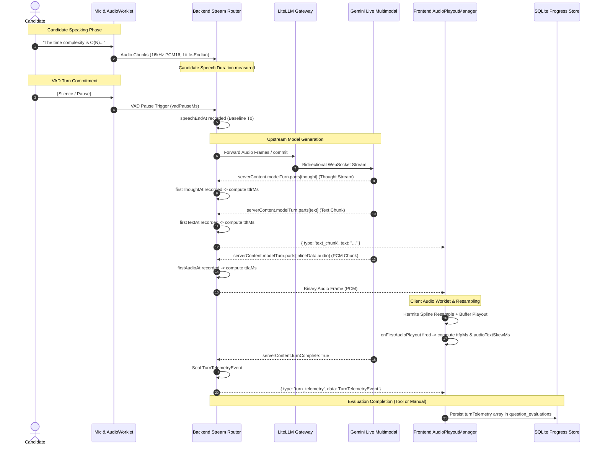

# Voice Observability & Canonical Turn Telemetry Architecture

> **Status:** Active & Implemented (September 2026 SOTA Specification)  
> **Package Reference:** `@interview-tutor/shared` (`TurnTelemetryEventSchema`, `TurnTelemetryEvent`, `VOICE_TELEMETRY_SLA`)  
> **Persistent Storage:** SQLite `question_evaluations.turn_telemetry` (JSON array of sealed turns)

---

## 1. Motivation & Problem Statement

Prior to this architecture, Gemini Live multimodal streaming lacked granular decomposition of model latency and client-side playout. Specifically:
1. **Text vs. Audio Ambiguity:** Server logs labeled the first audio chunk as `ttft` ("Time to First Token"), blinding operators to the actual arrival of reasoning tokens, textual tokens, and audio PCM chunks.
2. **Playout Buffer Blindness:** Audio received by the browser traverses an AudioWorklet ring buffer and Hermite spline resampler before physically reaching acoustic transducers. Text displayed instantaneously created an unmanaged **Audio-Text Skew**, causing visual subtitles to prematurely spoil spoken audio by 40–200ms.
3. **Guesswork in Diagnostic Incidents:** In acoustic replay or user degradation reports, engineers could not discern whether high perceived latency was caused by network RTT, LiteLLM gateway queueing, Gemini 2.5/Flash reasoning dwell time, TTS synthesis lag, or client-side playout queue starvation.

This architecture introduces the **Canonical Turn Trace Envelope** (`TurnTelemetryEvent`), establishing deterministic observability across the entire bidirectional voice lifecycle.

---

## 2. Voice Turn Lifecycle & Timing Pipeline

Every conversational turn progresses through a synchronized multi-stage pipeline:



---

## 3. The Canonical Turn Envelope (`TurnTelemetryEvent`)

Defined in [shared/src/schemas/telemetry.ts](file:///c:/projects/interview_tutor/shared/src/schemas/telemetry.ts):

```typescript
export interface TurnTelemetryEvent {
  turnIndex: number;
  speechDurationMs: number;
  vadPauseMs: number;
  ttfrMs: number | null;        // Time to First Thought (Model Reasoning)
  ttftMs: number | null;        // Time to First Text token
  ttfaMs: number | null;        // Time to First Audio chunk (Network Arrival)
  ttfpMs?: number | null;       // Time to First Playout (Acoustic Air in Browser)
  audioTextSkewMs?: number | null; // ttfpMs - ttftMs
  totalModelTurnMs: number;     // Baseline T0 to turnComplete
  audioDurationMs: number;      // Calculated from total PCM bytes generated
  audioChunkCount: number;
  textChunkCount: number;
  droppedEchoFrames: number;    // Echo frames suppressed by Half-Duplex guard
  bargeInOccurred: boolean;     // Candidate interrupted AI mid-turn
  rttMs: number | null;         // WebSocket Pong round-trip latency
  turnComplete: boolean;
  timestamp: string;            // ISO-8601 UTC
}
```

### Metrics Definitions

| Metric | Symbol / Formula | Description |
| :--- | :--- | :--- |
| **Speech Duration** | $T_{\text{speech}}$ | Duration (ms) the candidate spent speaking before silent pause. |
| **VAD Pause Delay** | $T_{\text{vad}}$ | Configured silence threshold before turn boundary is committed (default 1200ms). |
| **Time to First Thought** | $\text{TTFR} = T_{\text{thought}} - T_0$ | Dwell time until Gemini emits initial reasoning token (`thought: true`). |
| **Time to First Text** | $\text{TTFT} = T_{\text{text}} - T_0$ | Latency until first textual response token arrives at server router. |
| **Time to First Audio** | $\text{TTFA} = T_{\text{audio}} - T_0$ | Latency until first audio PCM chunk arrives at server router over WebSocket. |
| **Time to First Playout** | $\text{TTFP} = T_{\text{playout}} - T_0$ | Physical latency until the browser's AudioWorklet begins audible playback. |
| **Audio-Text Skew** | $\Delta_{\text{skew}} = \text{TTFP} - \text{TTFT}$ | Disparity between audio sounding and text subtitle display. Negative = Audio before Text; Positive = Text spoiled before Audio. |
| **Total Model Turn** | $T_{\text{turn}} = T_{\text{complete}} - T_0$ | Total round-trip time until Gemini signals `turnComplete: true`. |
| **Dropped Echo Frames**| $N_{\text{echo}}$ | Mic frames discarded while AI was speaking (Half-Duplex guard). |
| **Barge-In Occurred**  | $B_{\text{barge}} \in \{0, 1\}$ | True if user tactile click interrupted active AI playback. |

---

## 4. Voice Telemetry SLA Thresholds (September 2026 SOTA)

Configured in `VOICE_TELEMETRY_SLA`:

```typescript
export const VOICE_TELEMETRY_SLA = {
  IDEAL_TTFA_MS: 800,        // Natural human conversational turn latency (<800ms)
  DEGRADED_TTFA_MS: 1500,    // Acceptable latency under mobile/high-load (<1.5s)
  CRITICAL_TTFA_MS: 3000,    // Unacceptable latency requiring incident triage (>3.0s)
  MAX_TOLERABLE_SKEW_MS: 150,// Max acceptable audio-text divergence (40-150ms)
  MAX_VAD_PAUSE_MS: 1600,    // Maximum speech silence before mandatory turn commit
  IDEAL_RTT_MS: 80,          // WebSocket RTT target
} as const;
```

---

## 5. Automated Diagnostic Decision Matrix for AI Agents

When triaging latency or audio quality issues, AI diagnostic agents (`auto-vad-diagnostics` skill) and human engineers MUST follow this decision tree without guessing:

```
                                  [High Perceived Turn Latency (>1800ms)]
                                                    |
                         +--------------------------+--------------------------+
                         |                                                     |
                 [RTT > 250ms]                                           [RTT <= 250ms]
                         |                                                     |
             Network Transport Bottleneck                            Check TTFR vs TTFA
             - Client Wi-Fi/4G packet loss                                     |
             - LiteLLM Gateway WebSocket proxy delay           +---------------+---------------+
             - Regional hop latency                            |                               |
                                                       [TTFR > 1200ms]                 [TTFR <= 400ms & TTFA > 1600ms]
                                                               |                               |
                                                   Model Reasoning Congestion         Audio Synthesis (TTS) Delay
                                                   - Deep thinking overhead           - Downstream TTS model bottleneck
                                                   - Upstream Gemini queueing         - Chunk buffering in LiteLLM
                                                   - Complex prompt token context     - High audio sampling overhead

                                  [Subtitles Out of Sync / Desynchronized]
                                                    |
                         +--------------------------+--------------------------+
                         |                                                     |
          [audioTextSkewMs > +200ms]                                [audioTextSkewMs < -50ms]
                         |                                                     |
             Visual Subtitle Spoiler                               Audio Precedes Text Subtitles
             - Text streamed immediately                           - Streaming buffer delayed
             - AudioWorklet queue starved/lagging                  - Audio socket faster than text parser
             - Browser AudioContext backgrounded
```

### Triangulation Playbook

1. **High TTFA (> 1500ms) with Low TTFT (< 600ms):**
   - **Root Cause:** Audio synthesis or proxy chunking latency. Gemini is generating text rapidly, but audio frames are lagging.
   - **Action:** Inspect LiteLLM Proxy audio buffer size and verify gateway model mapping (`GEMINI_LIVE_MODEL`).

2. **High TTFR (> 1500ms):**
   - **Root Cause:** Gemini reasoning dwell time or prompt overload.
   - **Action:** Inspect system prompt complexity in `liveSystemPrompts.ts`, turn conversation history size, and ensure `thought: true` handling is active.

3. **High Dropped Echo Frames ($N_{\text{echo}} > 50$):**
   - **Root Cause:** Candidate microphone is picking up AI speaker output or candidate is trying to speak while AI is speaking without clicking barge-in.
   - **Action:** Check candidate audio hardware, verify `Half-Duplex` gating, verify loudspeaker vs earpiece routing.

4. **Skew Discrepancy ($\Delta_{\text{skew}} > 200\text{ms}$):**
   - **Root Cause:** AudioWorklet sample-rate resampling overhead (e.g. converting 16kHz to 48kHz on mobile) or browser main thread blocking.
   - **Action:** Check frontend FPS and AudioPlayoutManager ring buffer size.

---

## 6. Persistence & Querying

Sealed turn events are automatically stored in the SQLite database table `question_evaluations`:
- Column: `turn_telemetry TEXT` (JSON-encoded array of `TurnTelemetryEvent`).
- Querying via CLI:
  ```bash
  python .agents/skills/auto-vad-diagnostics/scripts/collect_telemetry.py --limit 5
  ```
- Retrieval via REST API:
  `GET /api/eval/latest/:questionId` returns the latest evaluation record with hydrated `turnTelemetry`.

---

## 7. Zero-Overhead & Invariants Compliance

- **WebSocket Bandwidth:** Telemetry payload is sent **once per turn** upon `turnComplete` over the existing control WebSocket channel (< 1 KB payload). Zero high-frequency polling overhead.
- **Audio Thread Isolation:** Playout timing is measured synchronously within the Web Audio `AudioPlayoutManager` without blocking the AudioWorklet render cycle.
- **Backwards Compatibility:** Existing evaluation records without telemetry deserialize gracefully to `turnTelemetry: []` via schema validation.
