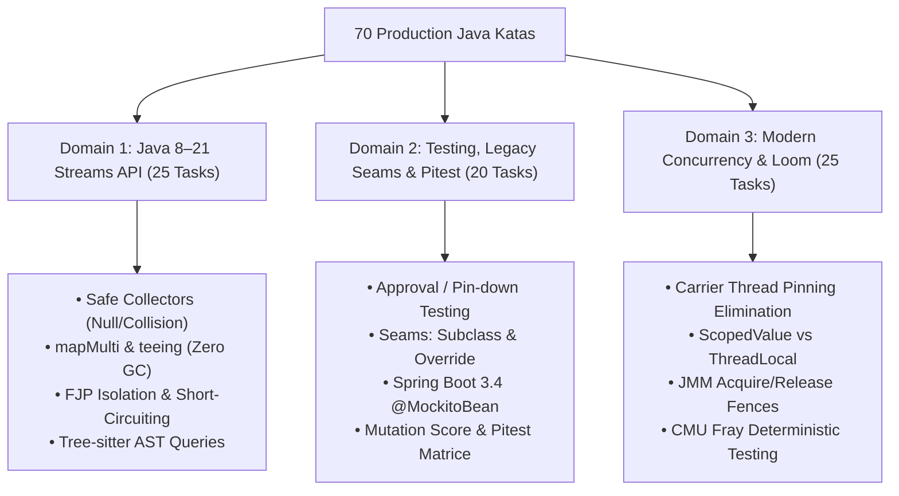

# Master Synthesis: SOTA Java 8–21 Engineering Katas, Streams, Concurrency & Modern Testing

> **Document Type:** Master Research Synthesis & Canonical Technical Reference  
> **Target Platform:** Java 21+ LTS, Spring Boot 3.4+, JUnit 5, Pitest 1.18+, ArchUnit, Testcontainers  
> **Source Reports:**  
> 1. `ds_reports/Исследование Java Streams API.md` (25 SOTA Tasks, Tree-sitter AST, LLM Rubrics)  
> 2. `ds_reports/Java Testing Katas Research.md` (20 SOTA Katas, Legacy Seams, Pitest Mutation Scoring)  
> 3. `ds_reports/Исследование задач Java Concurrency.md` (25 SOTA Katas, Virtual Threads Pinning, ScopedValue, CMU Fray)

---

## 🏛️ Executive Summary & Core Invariants

This Master Synthesis establishes the golden technical standard for real-world Java engineering practice and assessment in the InterviewPrep AI platform. It consolidates **70 production-grade practical tasks** across three vital engineering pillars:



---

## 1. Domain 1: Java 8–21 Streams API Mastery

### 1.1. Ground Truth & Hard Invariants
1. **`Collectors.toMap` Null Constraint:** The standard OpenJDK collector invokes `Map.merge(k, v, mergeFn)` internally. `Map.merge()` has a strict `Objects.requireNonNull(value)` assertion, throwing `NullPointerException` if any mapper returns `null`, regardless of the underlying `Map` implementation.
2. **`Collectors.toMap` Collision Guarantee:** A two-argument `Collectors.toMap(keyMapper, valueMapper)` throws `IllegalStateException` on duplicate keys. A 3-argument version with an explicit `BinaryOperator<V>` is mandatory.
3. **Collector Combiner Associativity:** In parallel streams, intermediate containers are combined via `combiner.apply(c1, c2)`. The combiner MUST be associative: $(A \oplus B) \oplus C = A \oplus (B \oplus C)$. Violations cause silent data corruption in `parallelStream()`.
4. **Stream Memory Footprint & Allocation Invariants:**
   - `flatMap(e -> Stream.ofNullable(...))` allocates a new `Stream` object per element, putting heavy allocation pressure on the JVM Young Generation.
   - `Stream.mapMulti(BiConsumer<T, Consumer<R>>)` (Java 16+) eliminates stream object allocations by pushing elements directly to downstream imperative consumers.
   - `Collectors.teeing(c1, c2, merger)` (Java 12+) executes composite aggregations in a single pass without re-iterating or multi-streaming.
5. **Stateful Intermediate Operations & Short-Circuiting:**
   - `distinct()` and `sorted()` before `skip()` or `limit()` on infinite or unindexed sources buffer unbounded elements in memory, causing `OutOfMemoryError`.
   - `parallelStream()` with `findFirst()` forces encounter order synchronization across threads, degrading throughput compared to `findAny()`.

### 1.2. Complete 25-Task Taxonomy: Streams API

| № | Level | Category | Defect / Problem | Root Mechanism | Golden Master / SOTA Solution |
| :--- | :--- | :--- | :--- | :--- | :--- |
| **1** | Middle | Collectors & Null-safety | `Collectors.toMap` with null values | `Map.merge` requires non-null values | Custom `SafeMapCollector` using `HashMap.put` |
| **2** | Middle | Collectors & Collisions | `Collectors.toMap` duplicate keys | Missing merge function throws `IllegalStateException` | Explicit `(oldVal, newVal) -> newVal` |
| **3** | Senior | Custom Collectors | Non-associative `combiner()` | Inconsistent chunk merging in parallel mode | Associative binary operator |
| **4** | Lead | Custom Collectors | Mutable state without `CONCURRENT` | Race condition in parallel accumulation | Thread-safe accumulator or thread-local containers |
| **5** | Senior | Collectors & Grouping | `groupingBy` with nested `mapping` | Redundant `List<List<T>>` heap allocations | `Collectors.flatMapping` (Java 9+) |
| **6** | Senior | Custom Collectors | Fixed-size batching collector | Streams have no native chunking operator | Custom `BatchingCollector` or `Gatherers.windowFixed` (Java 22+) |
| **7** | Lead | Single-pass Aggregation | Multi-pass stream processing | Re-iterating source doubles time complexity | `Collectors.teeing` (Java 12+) |
| **8** | Middle | Pipeline Ordering | Heavy `map()` before `filter()` | Transforming discarded items wastes CPU | Filter early, map late |
| **9** | Senior | Memory & Short-circuiting | `distinct()` before `limit()` on huge streams | Unbounded `HashSet` buffering in memory | `limit()` before `distinct()` or indexed sampling |
| **10** | Senior | Parallel Optimization | `findFirst()` in `parallelStream()` | Encounter order lock overhead | Use `findAny()` when order is non-critical |
| **11** | Middle | Side-Effects | Mutation in `peek()` | Side effects break stream lazyness & JIT | Pure declarative transformations or terminal `forEach` |
| **12** | Lead | Pipeline Safety | `sorted()` on infinite streams | Buffers infinite source into memory $\to$ OOM | Strict `limit()` before stateful `sorted()` |
| **13** | Senior | Short-circuiting | Deep nested `flatMap()` before `limit()` | Eager flattening defeats short-circuiting | Early bounds and streaming lazy flattening |
| **14** | Lead | ForkJoinPool Isolation | Blocking I/O in `parallelStream()` | Exhausts `ForkJoinPool.commonPool()` | Custom isolated `ForkJoinPool` or Virtual Threads |
| **15** | Senior | Thread Safety | Mutating external `ArrayList` in `forEach` | Concurrent modification without synchronization | Collect with thread-safe collectors (`toList()`) |
| **16** | Senior | Reduction Invariants | Non-associative accumulator in `reduce` | Mathematical contract violation in parallel reduction | Proper identity and associative accumulator |
| **17** | Lead | FJP Starvation | Nested `parallelStream()` / `CompletableFuture` | Deadlock in commonPool worker threads | Dedicated executor pools for async tasks |
| **18** | Senior | Resource Leaks | `Files.lines()` without try-with-resources | Unclosed file descriptors | `try (Stream<String> lines = Files.lines(...))` |
| **19** | Lead | Spliterator Customization | Standard Spliterator on unbalanced tree | Thread skew: 1 thread processes 95% of data | Custom tree-aware `Spliterator.trySplit()` |
| **20** | Middle | GC & Boxing | `Stream<Integer>` boxing overhead | Heavy wrapper object allocations | Primitive `IntStream`, `LongStream`, `DoubleStream` |
| **21** | Senior | Memory & GC | `flatMap` returning 0-1 elements | Creates stream object wrapper per element | Use `mapMulti` or `Optional.stream()` with filtering |
| **22** | Senior | Performance Optimization | Using `flatMap` instead of `Stream.mapMulti` | 300-400% higher GC pressure | Java 16 `Stream.mapMulti` with direct consumer |
| **23** | Middle | Redundant Collections | `stream().collect().stream()` chaining | Unnecessary intermediate collection objects | Compose stream operators directly |
| **24** | Senior | API Idioms | `Collectors.toList()` vs `Stream.toList()` | `Collectors.toList()` returns mutable list | Use unmodifiable `Stream.toList()` (Java 16+) |
| **25** | Lead | Sliding Window Processing | Index-based random access on LinkedList | $O(N^2)$ algorithmic blowup | Deque-based rolling collector $O(N)$ |

---

## 2. Domain 2: Modern Java Testing, Legacy Seams & Pitest Mutation Scoring

### 2.1. Ground Truth & Hard Invariants
1. **Code Coverage Myth:** 100% Line/Branch coverage can be achieved with zero assertions. Code coverage measures executed lines, NOT fault detection capability.
2. **Mutation Score ($MS$):**
   $$MS = \frac{\text{Killed Mutants}}{\text{Total Mutants} - \text{Timed Out Mutants}} \times 100\%$$
   A candidate test suite is robust only if $MS \ge 85\%$ and ZERO mutants in `Negated Conditionals` survive.
3. **Michael Feathers' Seams Invariant:** Modifying production code to make it testable must NEVER change the public API or break backwards compatibility. Use:
   - **Subclass and Override Method:** Extract static or I/O calls to `protected` methods, override in test fixture subclasses.
   - **Overloaded Constructor Seam:** Keep default constructor calling `this(defaultDependency)` while exposing package-private parameterized constructor for test injection.
4. **Spring Boot 3.4+ Deprecation:** `org.springframework.boot.test.mock.mockito.MockBean` is deprecated. Spring Boot 3.4+ mandates `org.springframework.test.context.bean.override.mockito.MockitoBean`.
5. **Testcontainers @ServiceConnection:** Spring Boot 3.1+ eliminates manual `DynamicPropertyRegistry` configuration for PostgreSQL/Redis/Kafka through container `@ServiceConnection` beans.

### 2.2. Complete 20-Task Taxonomy: Testing & Quality Katas

| № | Level | Category | Kata Name | Core Challenge | Tooling / Pattern |
| :--- | :--- | :--- | :--- | :--- | :--- |
| **1** | Middle | Legacy Seams | Subclass & Override | Isolate static `LegacyPaymentGateway.execute()` | Protected seam + test double subclass |
| **2** | Middle | Legacy Seams | Overloaded Constructor | Isolate file system and system clock in constructor | Package-private constructor + `Clock.fixed()` |
| **3** | Senior | Legacy Seams | Static Security Wrapper | Decouple `SecurityContextHolder.getContext()` | `AuthenticationProvider` seam + Mockito |
| **4** | Senior | Approval Testing | Golden Master Pin-down | Protect 100+ branches in legacy `InvoiceCalculator` | JUnit 5 `@ParameterizedTest` + Golden Master snapshot |
| **5** | Middle | JUnit 5 Advanced | Parameterized Business Matrix | Matrix validation of complex `TransactionRequest` | `@ParameterizedTest` + `@MethodSource` (Stream of Arguments) |
| **6** | Senior | JUnit 5 Advanced | Dynamic State Machine | Dynamic state validation tree for `OrderStateMachine` | `@TestFactory` returning `Stream<DynamicNode>` |
| **7** | Senior | JUnit 5 Extensions | ThreadLocal Isolation Extension | Prevent tenant context leakage between tests | Custom `BeforeEachCallback` & `AfterEachCallback` |
| **8** | Middle | Specification Style | Hierarchical BDD Specs | Shopping cart state specification matrix | `@Nested` test classes with descriptive `@DisplayName` |
| **9** | Senior | Spring Boot 3.4+ | @MockitoBean Migration | Migrate from deprecated `@MockBean` to `@MockitoBean` | Spring Boot 3.4+ Bean Override Framework |
| **10** | Senior | Mockito 5 Advanced | Strict Order & Captor | Audit log chronology and DTO payload verification | `InOrder` verification + `ArgumentCaptor<AuditDTO>` |
| **11** | Senior | Mockito 5 Advanced | Static Method Mocking | Deterministic `UUID.randomUUID()` & `Instant.now()` | `try (MockedStatic<UUID> mocked = mockStatic(...))` |
| **12** | Middle | Mockito 5 Advanced | Resilient Retry Answers | Simulate 2 network failures followed by success | Mockito `thenThrow().thenReturn()` / `Answer` |
| **13** | Senior | Spring Slices | REST MVC Slice Test | Isolate Controller layer with RFC 7807 Problem Details | `@WebMvcTest` + `MockMvc` + `@MockitoBean` |
| **14** | Senior | Spring Slices | JPA Repository Slice Test | Validate complex JPQL window query and constraints | `@DataJpaTest` + `TestEntityManager` |
| **15** | Senior | Testcontainers | PostgreSQL Container Integration | Test PostgreSQL-native JSONB & Flyway migrations | `PostgreSQLContainer` + `@ServiceConnection` |
| **16** | Senior | Testcontainers | Redis Cache Integration | Verify `@Cacheable` TTL expiration and cache eviction | `GenericContainer` (Redis) + `@ServiceConnection` |
| **17** | Lead | ArchUnit | Layered Architecture Enforcer | Prevent direct Controller $\to$ Repository injections | `Architectures.layeredArchitecture()` |
| **18** | Lead | ArchUnit | Package Slices & Cycles | Ban cyclic package dependencies and domain leaks | `SlicesRuleDefinition.slices()` |
| **19** | Lead | ArchUnit | Project Naming Conventions | Enforce `@Repository` naming and package structure | `ArchRuleDefinition.classes()` |
| **20** | Lead | ArchUnit | Debt Baseline Freeze | Freeze legacy architectural violations on CI | `FreezingArchRule.freeze()` |

---

## 3. Domain 3: Modern Concurrency, Virtual Threads & JMM

### 3.1. Ground Truth & Hard Invariants
1. **Carrier Thread Pinning Invariant:** A Virtual Thread pinned to its OS Carrier Thread CANNOT be unmounted. Synchronized blocks/methods and native methods (JNI/FFM) holding locks during blocking I/O will exhaust the carrier pool and stall the JVM.
   - **Remedy:** Replace `synchronized` with `ReentrantLock` (uses `LockSupport.park()` which cooperates with Loom scheduler) or `StampedLock`.
2. **ScopedValue Invariant (JEP 446 / Java 21+):**
   - `ThreadLocal` creates unbounded mutability and memory leaks in million-thread workloads.
   - `ScopedValue` provides immutable, bound-lifetime data sharing. Combined with `StructuredTaskScope`, child virtual threads share parent scopes with zero memory copying.
3. **JMM Happens-Before & Memory Fences:**
   - Volatile write acts as a **Release Fence** (all prior writes flushed before).
   - Volatile read acts as an **Acquire Fence** (all subsequent reads see updated state).
   - 64-bit non-volatile `long` and `double` are prone to **Word Tearing (torn reads)** on 32-bit/ARM architectures.
4. **Lock-Free Memory Optimization:**
   - `AtomicReference<T>` creates extra heap wrapper objects per node.
   - `AtomicReferenceFieldUpdater` performs lock-free CAS directly on a `volatile` object field, eliminating GC pressure.
   - `LongAdder` uses internal **Cell Striping** to eliminate processor cache contention under heavy multi-threaded write loads.
5. **Deterministic Concurrency Testing (CMU Fray):**
   - Standard multithreading unit tests are flaky due to OS scheduler non-determinism.
   - CMU Fray uses JVMTI / bytecode instrumentation to enforce controlled interleavings (PCT algorithm), recording and replaying failing thread schedules deterministically.

### 3.2. Complete 25-Task Taxonomy: Concurrency & Loom

| № | Level | Category | Task Name | Core Concurrency Problem | SOTA Resolution |
| :--- | :--- | :--- | :--- | :--- | :--- |
| **1** | Senior | Carrier Pinning | `PinningResistantCache` | `synchronized` block around HTTP I/O pins carrier thread | Replace with `ReentrantLock` try-finally |
| **2** | Lead | Carrier Pinning | `HierarchicalTaskDispatcher` | Nested task starvation in virtual threads | Non-blocking dispatcher + `StructuredTaskScope` |
| **3** | Senior | Carrier Pinning | `FFINativeBridge` | Native C library call blocks carrier thread | Isolate native calls in dedicated platform thread pool |
| **4** | Senior | Reader-Writer Locks | `OptimisticReadRegistry` | Writer starvation in `ReentrantReadWriteLock` | `StampedLock.tryOptimisticRead()` |
| **5** | Lead | Thread Pool Separation | `HybridComputeEngine` | CPU-bound computations degrade Loom scheduler | Route CPU tasks to FJP, I/O to Virtual Threads |
| **6** | Middle | Context Management | `LegacyContextProvider` | Memory leak in `ThreadLocalMap` with $10^6$ threads | Migrate to `ScopedValue` / bounded scope |
| **7** | Senior | Distributed Tracing | `DistributedTracePropagator` | Loss of correlation ID across async forks | `ScopedValue.where(TRACE_ID, ctx).run(...)` |
| **8** | Senior | Context Memory | `ParallelReportGenerator` | Memory explosion with `InheritableThreadLocal` | `StructuredTaskScope` + `ScopedValue` zero-copy |
| **9** | Senior | Security Scoping | `SecurityElevator` | Temporary elevated privileges in nested call | Nested `ScopedValue.where(AUTH, elevated).call()` |
| **10** | Lead | Context Benchmarking | `HighDensityContextBenchmark` | ThreadLocal overhead under high concurrency | Measured footprint reduction with ScopedValue |
| **11** | Senior | JMM & Publication | `VarHandleDoubleCheckedLocking` | Singleton publication reordering without volatile | `VarHandle.setRelease` / `getAcquire` |
| **12** | Middle | JMM & Immutability | `SafeImmutablePublication` | Reference escape before object construction | `final` field freezing per JMM specification |
| **13** | Senior | JMM Happens-Before | `PiggybackStateTracker` | Non-volatile state visibility across threads | Piggybacking on volatile release/acquire fence |
| **14** | Lead | Memory Ordering | `OutofOrderExecutionShield` | Instruction reordering on weak memory models (ARM) | Explicit `VarHandle.fullFence()` / acquire/release |
| **15** | Middle | 64-bit Primitives | `SafeAtomic64State` | Torn reads on non-volatile `long`/`double` | `volatile` or `AtomicLong` |
| **16** | Lead | Lock-Free Primitives | `FieldUpdaterStack` | Memory overhead of `AtomicReference` in lock-free stack | `AtomicReferenceFieldUpdater` on volatile head |
| **17** | Lead | Lock-Free Primitives | `LockFreeAtomicArray` | Lock contention updating array elements | `MethodHandles.arrayElementVarHandle` CAS |
| **18** | Senior | High Contention | `DistributedMetricCollector` | CAS bottleneck on `AtomicLong.incrementAndGet()` | `LongAdder` striped counter cells |
| **19** | Lead | Lock-Free Primitives | `ABAShieldQueue` | ABA problem in lock-free queue memory reuse | `AtomicStampedReference` with version stamp |
| **20** | Lead | Ring Buffers | `DisruptorRingBuffer` | Thread parking latency in `BlockingQueue` | Lock-free ring buffer on atomic cursors |
| **21** | Senior | Async Pipelines | `IsolatedAsyncPipeline` | CommonPool starvation in `CompletableFuture` | Dedicated custom `ExecutorService` |
| **22** | Senior | Resilient Async | `ResilientTimeoutPipeline` | Infinite hangs in async chains | `.orTimeout()` & `.completeOnTimeout()` |
| **23** | Senior | Fault Tolerance | `FaultTolerantDAG` | Cascade failure in parallel async DAG | `.exceptionally()`, `.handle()`, fallback nodes |
| **24** | Senior | Backpressure | `BackpressureThrottler` | Memory exhaustion from unbounded async tasks | `Semaphore` backpressure on `CompletableFuture` |
| **25** | Senior | Async Cancellation | `CascadingCancellationTree` | Zombie background tasks after parent cancel | Cascaded `.cancel(true)` tree propagation |

---

## 4. AST Static Analysis Rules (Tree-sitter S-expressions)

These queries provide deterministic static analysis of user code submissions prior to or alongside LLM evaluation:

```scheme
;; 1. Detect Carrier Thread Pinning (synchronized in Loom service)
(synchronized_statement
  body: (block) @synchronized.body
) @carrier.thread.pinning.violation

;; 2. Detect Unbounded ThreadLocal Leaks
(method_invocation
  name: (identifier) @method_name (#eq? @method_name "set")
  object: (identifier) @object_name (#match? @object_name ".*ThreadLocal.*|.*threadLocal.*")
) @threadlocal.unbounded.leak.risk

;; 3. Detect Unsafe 2-argument Collectors.toMap
(method_invocation
  object: (identifier) @obj (#eq? @obj "Collectors")
  name: (identifier) @method (#eq? @method "toMap")
  arguments: (argument_list
    . (_)
    . (_)
    .) @unsafe.toMap.two.args
)

;; 4. Detect Blocking Calls in Web Controllers
(method_invocation
  object: (identifier) @obj (#eq? @obj "Thread")
  name: (identifier) @method (#eq? @method "sleep")
) @blocking.call.in.controller
```

---

## 5. Multi-Dimensional LLM Evaluation Rubric

When evaluating user code submissions across Streams, Concurrency, and Testing katas, the AI Interviewer applies the following weighted rubric:

| Evaluation Dimension | Weight | Criteria for Pass (70–100) | Red Flag Deductions |
| :--- | :--- | :--- | :--- |
| **Thread-Safety & Correctness** | **30%** | Zero race conditions, proper lock handling (`try-finally`), associative combiners/reducers. | Non-atomic read-modify-write (-25), unhandled duplicate keys (-20). |
| **Performance & Memory Profile** | **25%** | Zero GC allocations where applicable (`mapMulti`, `teeing`, `FieldUpdater`, `LongAdder`), no carrier thread pinning. | Unbounded buffering before limit (-20), `synchronized` on I/O (-25). |
| **Idiomatic Modern Java (21+)** | **20%** | Clean use of `Stream.toList()`, `ScopedValue`, `StructuredTaskScope`, `@MockitoBean`, `VarHandle`. | Legacy Java 7 `Vector`/`Hashtable` (-20), deprecated `@MockBean` (-10). |
| **Test Quality & Determinism** | **15%** | Deterministic assertions, parameterized matrices, proper seam isolation without changing public API. | `Thread.sleep` in tests (-15), missing edge-case boundaries (-15). |
| **Architecture & Modularity** | **10%** | Clean separation of concerns, single responsibility, compliance with ArchUnit rules. | Direct repository access in controllers (-15), leaky abstractions (-10). |

---

## 6. Dynamic Task Generator Specification

To generate unlimited fresh task variants on demand, the generator adheres to the following structural matrix:

```json
{
  "taskId": "GEN-CONC-042",
  "domain": "concurrency",
  "difficulty": "senior",
  "archetype": "CarrierThreadPinning",
  "scenario": "High-throughput Payment Notification Gateway",
  "defects": [
    "synchronized block wrapping a blocking REST client call",
    "ThreadLocal holding transient authorization tokens without remove()"
  ],
  "constraints": [
    "Must preserve the public interface NotificationSender",
    "Must support 50,000 concurrent Virtual Threads without carrier pool exhaustion"
  ],
  "verificationSuite": {
    "astRules": ["@carrier.thread.pinning.violation", "@threadlocal.unbounded.leak.risk"],
    "expectedPatterns": ["ReentrantLock", "ScopedValue", "try-finally"],
    "unitTestArchetype": "ConcurrentStressTestWithAwaitility"
  }
}
```

---

## 7. Каталог 35 SOTA Machine Coding & LLD Задач (Яндекс, Т-Банк, Озон, Авито 2025–2026)

### Кластер 1: BigTech Core LLD (15 Задач)
1. **Notification Filtering & 24h Deduplication Engine** (Яндекс) — Черный список, разрешенные каналы, 24h скользящая дедупликация через `Clock`, защита от OOM.
2. **In-Memory Rate Limiter** (Т-Банк / Озон) — Token Bucket и Sliding Window Counter без глобальных блокировок.
3. **In-Memory Cache с TTL и LRU/LFU** (Авито) — $O(1)$ чтение и запись, двусвязный список, вытеснение по TTL и емкости.
4. **Dynamic Discount & Promo Code Engine** (Озон E-Commerce) — Цепочка скидок (Composite Strategy), расчет в `BigDecimal HALF_EVEN`.
5. **Task Scheduler с Cron и Приоритетами** — Очередь `DelayQueue` / `PriorityQueue`, отложенный запуск, виртуальные потоки.
6. **Parking Lot / Storage Locker Manager** (Сбер) — Аллокация мест, тарифные сетки, расчет стоимости через `Clock`.
7. **Order State Machine** (ВК) — Конечный автомат заказа (`CREATED -> PAID -> DELIVERED / CANCELLED`) с компенсациями.
8. **URL Shortener с Base62 и TTL** — Генератор Base62, кастомные алиасы, аналитика переходов, TTL очистка.
9. **Tagged Metric Aggregator (p50, p95, p99)** — Кольцевой буфер корзин, `LongAdder`, расчет перцентилей без блокировок.
10. **Circuit Breaker Engine** — Состояния `CLOSED`, `OPEN`, `HALF_OPEN`, failure rate threshold, кулдаун через `Clock`.
11. **In-Memory Thread-Safe Event Bus** — Топики с wildcard, асинхронная доставка через Virtual Threads, Dead Letter Queue.
12. **Inventory Reservation Engine** — Бронирование остатков склада с 15-минутным TTL и автоматическим сбросом брони.
13. **Concurrent Leaderboard Engine** — `ConcurrentSkipListSet`, $O(\log N)$ ранжирование игроков в реальном времени.
14. **Elevator Control System** — Диспетчер группы лифтов, алгоритм LOOK/SCAN, оптимизация очередей.
15. **Expense Sharing & Debt Simplification (Splitwise)** — Балансы участников, жадное сведение графа взаимных долгов.

### Кластер 2: FinTech & Ledger LLD (10 Задач)
16. **Double-Entry Accounting Ledger** (Т-Банк / Stripe) — Атомарный перевод между счетами, упорядоченный захват локов по `AccountId` (Deadlock-Free), `BigDecimal`.
17. **Idempotency Key Processor** (Stripe) — Хэширование тела SHA-256, in-flight блокировки, кэширование ответа с TTL.
18. **Transactional Outbox Simulator** — Атомарная запись в БД и outbox, фоновый поллер с `SKIP LOCKED`.
19. **Multi-Currency Wallet (Hold/Capture/Release)** — Двухфазный коммит баланса, динамические курсы валют.
20. **Fraud Detection Sliding Window Rules** — Композитные правила антифрода (Velocity, суммы, географические аномалии).
21. **Payment Routing & Fallback Engine** — Весовая маршрутизация между шлюзами, Fast-Failover.
22. **Subscription Billing Engine** — Календарный биллинг через `Clock`, Grace-период, Dunning Policy ретраев.
23. **Bank Account Limit & Velocity Tracker** — Суточные/месячные лимиты с авто-сбросом в полночь через `Clock`.
24. **Highload Counter (Striped Cells / LongAdder)** — Устранение False Sharing с Cache Line Padding при 100 000 RPS.
25. **Split Payment & Escrow Resolver** — Расщепление чека маркетплейса с защитой от ошибки потерянной копейки.

### Кластер 3: Concurrent & System LLD (10 Задач)
26. **Multi-threaded Elevator Dispatcher** (Loom) — Параллельная обработка вызовов на Virtual Threads, `ReentrantLock` и `Condition`.
27. **Custom ThreadPoolExecutor** — Управление пулом воркеров, блокирующая очередь, 4 политики Rejected Execution.
28. **Connection Pool Manager (HikariCP mini)** — `borrowConnection` с таймаутом, Leak Detection детектор, eviction.
29. **Asynchronous Batch Event Flusher** — Сброс по размеру $N$ ИЛИ по таймауту $T$ мс, graceful shutdown без потерь.
30. **Multi-tier Cache Stampede Protection** — Защита от шквала запросов в БД через SingleFlight (Mutex per Key).
31. **Read-Write Lock с приоритетом писателей** — Исключение голодания писателей (No Writer Starvation).
32. **In-Memory Fenced Lock & Heartbeat** — Монотонный fencing token, фоновое продление аренды.
33. **Blocking Priority Queue** — Ограниченный буфер на `ReentrantLock` с `notFull`/`notEmpty` Conditions.
34. **Producer-Consumer Ring Buffer (LMAX Disruptor)** — Кольцевой буфер $2^N$, `VarHandle` Acquire/Release, Lock-Free.
35. **Rate Limiting Gateway с приоритетом VIP** — Weighted Fair Queuing для защиты от голодания стандартного трафика.

---

## 8. SOTA Методология автоматизированной оценки (Virtual Clock & 5-факторный скоринг)

1. **Детерминированное виртуализированное время:**
   - Полный запрет `System.currentTimeMillis()` и `Instant.now()` внутри бизнес-кода.
   - Тесты мгновенно перемещают виртуальное время на $+24\text{ч}$, $+15\text{мин}$, $+1\text{сек}$ за 0 миллисекунд через `Clock.fixed` и `VirtualTimeClock`.
2. **Формула 5-факторного скоринга (0–100 баллов):**
   $$\text{FinalScore} = 0.40 \cdot S_{\text{correctness}} + 0.20 \cdot S_{\text{concurrency}} + 0.20 \cdot S_{\text{architecture}} + 0.10 \cdot S_{\text{time\_testability}} + 0.10 \cdot S_{\text{java21\_idioms}}$$

