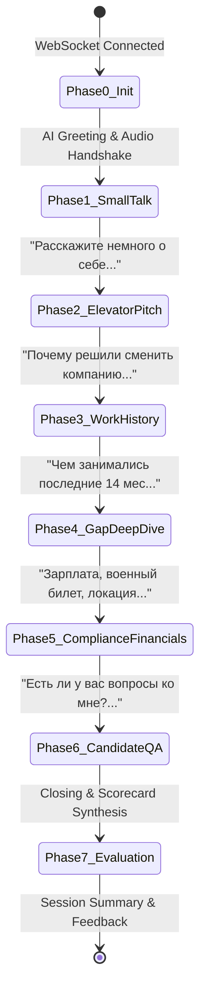
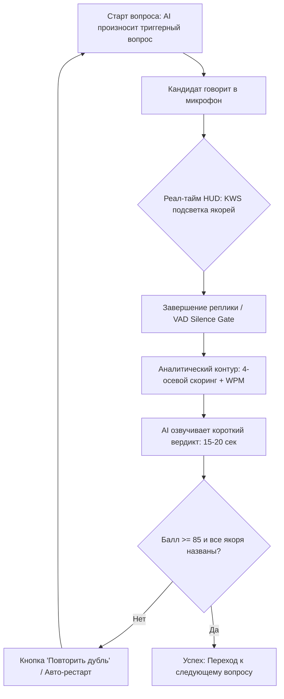

# Спецификация стейт-машин, Zero-Latency KWS HUD и речевой телеметрии

**Версия документа:** SOTA Late 2026 (Октябрь 2026)  
**Назначение:** Детальное инженерное руководство по реализации логики диалоговых фаз, клиентского споттинга ключевых слов и расчета метрик речи в реальном времени.

---

## 1. Топология А: Сквозная симуляция скрининга (Full Screening State Machine)

Полный скрининг длится 12–18 минут и координируется конечным автоматом с жесткими фазовыми переходами:



### Фазовый регламент:
1. **Phase 1: Small Talk (1 мин):** Настройка канала, приветствие, проверка слышимости.
2. **Phase 2: Elevator Pitch (2 мин):** Главный вопрос «Расскажите о себе». Активация таймера на 75 секунд. Модель слушает монолог кандидата без перебивания.
3. **Phase 3: Work History (3 мин):** Вопросы об опыте в «БТЛаб» (декомпозиция монолита, Kafka, Postgres).
4. **Phase 4: Gap & R&D Investigation (4 мин):** Каверзные вопросы о 14 месяцах перерыва, pre-revenue статусе и отсутствии чеков.
5. **Phase 5: Compliance & Compensation (2–3 мин):** Финансовые ожидания (310k–330k net), военный билет категории «В», удаленка в Краснодаре, notice period 1–1.5 недели.
6. **Phase 6: Reverse Q&A (2–3 мин):** Оценка 3 встречных вопросов кандидата (о целях найма, процессах релизов и следующих этапах).
7. **Phase 7: Comprehensive Scorecard (1 мин):** Выставление сводной оценки и генерация подробного отчета.

---

## 2. Топология Б: Высокочастотный Micro-Drill (Rapid-Fire State Machine)

Назначение режима: **выработка мышечной памяти речи (speech motor pattern)** для преодоления речевого ступора.



### Инварианты Micro-Drill:
* Время фидбека AI: **не более 15–20 секунд** (никаких долгих лекций).
* Фокус фидбека строго на ошибках: *«Ты говорил 95 секунд (превышение), забыл назвать СТД-СФР и использовал эвфемизм „проект надоел“. Давай еще раз, назови 3 якоря»*.
* Рестарт вопроса по одной кнопке в интерфейсе или голосовой команде *«Ещё дубль»*.

---

## 3. Архитектура Zero-Latency Keyword Spotting (KWS) для Visual HUD

### В чем проблема латентности:
Если ждать, пока аудиопоток уйдет в облако Google, расшифруется Gemini Live, и Gemini пришлет Tool Call обратно — задержка составит **1.5–3.0 секунды**. К этому моменту кандидат уже забыл, какое слово он произнес.

### Решение SOTA Late 2026: Двухконтурный параллельный KWS
```
                      ┌────────────────────────────────────────┐
                      │          Микрофон браузера             │
                      └──────────────────┬─────────────────────┘
                                         │
                 ┌───────────────────────┴────────────────────────┐
                 │                                                │
                 ▼                                                ▼
     [Контур 1: Live Audio Socket]                   [Контур 2: On-Device Speech KWS]
     NativeLiveVoiceEngine (16kHz PCM)               Web Audio / Web Speech API / Worker
                 │                                                │
                 ▼                                                ▼
     Upstream Gemini Live API (Google)               Локальный Regex/Phonetic Matcher
     (Ведение диалога и генерация ответа)            Задержка: < 150 миллисекунд!
                                                                  │
                                                                  ▼
                                                     [Visual HUD: Карточка горит зеленым]
```

* **Контур 1 (Транспорт):** Сырой 16kHz PCM аудиопоток идет через WebSocket в Gemini Live API для смыслового диалога.
* **Контур 2 (Мгновенный HUD):** Параллельно в браузере работает легковесный распознаватель речи (Web Speech API с флагом `interimResults: true` либо клиентский WebAssembly матчер). При появлении в промежуточной транскрипции стемминга ключевого слова (например, `отбокс`, `транзакционн`, `loom`, `сфр`, `2200`) карточка вспыхивает зеленым **мгновенно (<150 мс)**.

---

## 4. Алгоритмы речевой и поведенческой телеметрии

### 4.1. Words Per Minute (WPM) в скользящем окне
$$WPM = \frac{\text{Количество распознанных слов}}{\text{Время активной речи в секундах}} \times 60$$
* **Зеленая зона:** **110 – 135 WPM** (уверенная, размеренная сеньорная речь).
* **Желтая зона (Низкая скорость):** **< 95 WPM** (кандидат «тянет резину», зависает).
* **Красная зона (Тараторение):** **> 165 WPM** (симптом паники и стресса).

### 4.2. Hesitation Detection (Заминки нерешительности)
* Замеряются паузы тишины между словами внутри одной реплики.
* Пауза $> 1 500\text{ мс}$ фиксируется как `HesitationBurst`.
* Если за 75-секундный ответ накопилось $\ge 3$ заминок — снижается балл `DeliveryConfidence`.

### 4.3. Filler Word Spotter (Слова-паразиты)
Словарь регулярных выражений для детекции паразитарных связок:
`\b(ну|как бы|в общем|в общем-то|типа|наверное|э-э-э|м-м-м|так сказать|собственно говоря)\b`
Каждое совпадение инкрементирует `fillerWordsCount` и подсвечивается в итоговом разборе.
