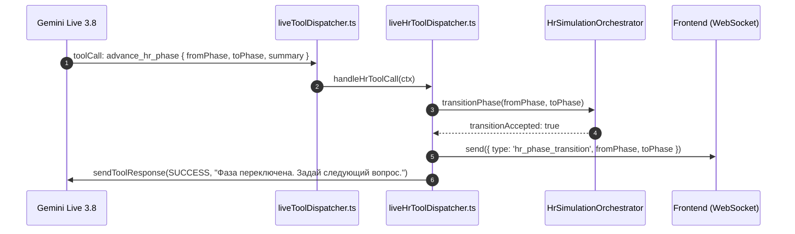

# SOTA Late 2026 Architectural Cross-Synthesis & Master Implementation Plan: Generic HR Voice Simulator Engine

> **Document:** `docs/hr_screening_engine/master_implementation_plan.md`  
> **Status:** Canonical Master Implementation Plan & Architecture Specification (SSOT)  
> **Standard:** SOTA Late October 2026 Architectural Synthesis  
> **Role:** Principal Software Architect  
> **Scope:** Generic HR Voice Simulator & Soft-Skills Motor Training Engine (`interview_tutor`)  
> **Invariants:** Zero Regressions, Zero Tech Debt, Engine-Payload Strict Isolation, Sub-200ms KWS HUD, Anti-Sycophancy.

---

## 1. Executive Summary & Cross-Synthesis Matrix

### 1.1. Neurocognitive Root Cause & Architectural Strategy
Under high-stakes HR screening conditions (investigation of a 14-month sabbatical/R&D gap, tax justification of NPD self-employment under 422-FZ without commercial receipts, exit reasons after 7.4 years in an enterprise, or holding firm on a 310k–330k net salary), software engineers consistently suffer from acute **cognitive speech degradation**.

```
   [Cortisol Surge / Social Threat Stress]
                     │
                     ▼
  [Sympathoadrenal Activation: Amygdala & Basal Ganglia]
                     │
                     ▼
  [Prefrontal Cortex (PFC) Executive Control Temporary Blockade]
                     │
         ┌───────────┴───────────┐
         ▼                       ▼
  [Declarative Memory]    [Speech Motor Apparatus]
   Passive cheatsheet      Active vocal articulation
   Text reading eyes       Stutters, filler words,
   FAILED TO RETRIEVE      regresses to colloquial
   under live pressure     slang ("делал пет-проект")
```

1. **The Declarative vs. Procedural Memory Conflict:** Reading text cheat sheets forms only hippocampal declarative memory. In live conversation, stress inhibits prefrontal executive access, causing speech to regress into colloquial phrasing (*«делал пет-проект для себя»*, *«проект надоел»*), defensiveness, and filler words (*«как бы»*, *«ну»*).
2. **The Procedural Motor Muscle Training Solution:** The simulator's goal is to transition self-presentation into **procedural motor memory (Broca's area & supplementary motor cortex)**. This is accomplished via:
   - **Operant Conditioning via Zero-Latency Visual HUD (<150–200 ms):** Key lexical anchor cards light up green during articulation, locking in senior speech patterns.
   - **Dual Training Topologies:**
     - **Topology A (End-to-End Simulation, 12–18 min):** Macro-level resilience, context-switching across 7 structured interview phases.
     - **Topology B (Rapid-Fire Micro-Drill, 60–80 sec loop):** High-repetition targeted practice of high-risk questions until reflexive fluency ($\ge 85$ composite score) is attained.

---

### 1.2. Frontier Reports Cross-Synthesis Matrix (Reports 01, 02, 03)

| Dimension | Frontier Report 01 | Frontier Report 02 | Frontier Report 03 | Canonical SOTA Synthesis (Adopted Master Plan) |
| :--- | :--- | :--- | :--- | :--- |
| **Neurocognitive Rationale** | Identifies declarative memory failure and context drift over 10+ min calls. | Deep physiological analysis: PFC cortisol suppression $\to$ procedural motor conditioning. | Highlights lack of factual Ground Truth leading to LLM sycophancy and hallucinations. | **Unified Neurocognitive Foundation:** Combines Report 02's operant motor conditioning with Report 03's Ground Truth injection to eliminate sycophancy and speech freeze. |
| **KWS Latency & Architecture** | Hybrid: Client Web Speech API + prefix Trie (60–140ms) + Server reconciliation. | Mathematical Latency Budget: Gemini Live transcript = 790ms p95 (fails SLA); Client KWS = 155ms p95. | Server-side Gemini Live `inputAudioTranscription` streamed as `user_transcript_delta`. | **Dual-Path Hybrid KWS with Monotonic State Latch:** Rejects Report 03's server-only approach (790ms exceeds <200ms SLA). Adopts Report 01 & 02: **Tier 1** Browser `SpeechRecognition` (<140ms optimistic hit) + **Tier 2** Gemini Live ASR delta fallback + monotonic latch (`PENDING -> OPTIMISTIC_HIT -> CONFIRMED_HIT`). |
| **Engine vs. Payload Isolation** | Abstract schema proposed, but mixed specific domain fields. | Clean abstract DTO schemas (`CandidateDossierSchema`, `JobContextSchema`). | Hardcoded `ILIA_IZHUKOV_DOSSIER` directly inside backend code (`candidateDossier.ts`). | **Strict Engine-Payload Separation:** Rejects Report 03's hardcoding (violates Invariant 3). Engine, prompt generators, and state machines contain **ZERO** personal names, dates, or company names. All data is injected as external JSON fixtures validated via TypeBox schemas. |
| **Dialogue Coordination & FSM** | Server-side FSM orchestrator with tool calls `advance_hr_phase` and `submit_hr_evaluation`. | Dual-Topology FSM: 7-phase E2E Simulation vs 5-stage Micro-Drill. | Tool call `emit_hr_round_evaluation` for drill rounds; prompt-guided phase progression. | **Deterministic Tool-Call Orchestration with Watchdog Fallback:** FSM coordinates phases via tools (`advance_hr_phase`, `submit_hr_evaluation`, `emit_hr_round_evaluation`). If upstream stalls, a backend watchdog forces phase advancement via `clientContent` to eliminate context drift. |
| **Evaluation & Anti-Sycophancy** | 4 scoring axes with STAR compliance. | Objective 4-axis formula: $0.30S + 0.25L + 0.25P + 0.20D$, threshold $\ge 85$. Red flags on euphemisms. | Factual accuracy & tone scoring. | **Standardized 4-Axis Anti-Sycophancy Rubric:** Exact mathematical weighting from `05_hr_personas_and_prompt_directives.md`. Severe deductions for colloquial euphemisms and unprompted defensive justifications. |
| **Codebase Modular Footprint** | Monolithic store suggested. | Detailed schema separation. | 11 granular steps, but touched shared directly in index. | **SOTA Modular Footprint (Rule 8 Compliant):** Dedicated schemas in `shared/src/schemas/hrSimulator.ts`, dedicated backend tools in `liveHrToolDispatcher.ts`, isolated frontend store `useHrSimulatorStore.ts`. All files strictly $\le 350$ lines. |

---

### 1.3. Architectural Decisions & Rejected Anti-Patterns

1. **REJECTED: Server-Only KWS via Gemini Live `inputAudioTranscription`**
   - *Why Rejected:* Physical network round-trip time ($2 \times 50\text{–}100\text{ ms}$) plus Gemini Live internal ASR acoustic windowing ($300\text{–}600\text{ ms}$) produces a p95 latency of $790\text{ ms}$ (range $480\text{–}1250\text{ ms}$). This destroys real-time operant conditioning.
   - *Adopted:* On-Device Tier-1 KWS (80–140 ms) via browser SpeechRecognition with morphological prefix Trie, using Gemini Live transcript deltas strictly as an authoritative Tier-2 fallback/reconciler.
2. **REJECTED: Dual WebSocket Microphone Streaming (Parallel Backend ASR)**
   - *Why Rejected:* Spawning a second WebSocket to stream PCM to a backend Vosk/Whisper doubles uplink network bandwidth, taxes CPU, and causes socket lifecycle race conditions.
   - *Adopted:* Single WebSocket to LiteLLM/Gemini Live for transport; browser-native Web Speech API / Web Worker regex for client HUD spotting. Zero extra audio packets.
3. **REJECTED: Hardcoded Candidate Credentials in TypeScript Files**
   - *Why Rejected:* Placing "Илья Ижуков", "ООО «БТЛаб»", "2018-2025" in backend TypeScript source files violates the generic engine invariant and introduces tech debt.
   - *Adopted:* Engine code accepts abstract `CandidateDossier` and `JobContext`. Concrete candidate dossiers and question matrices are loaded from JSON/YAML fixtures or database seed catalogs.
4. **REJECTED: Prompt-Only Phase Tracking (Uncontrolled LLM Drift)**
   - *Why Rejected:* In 15-minute voice sessions, pure prompt instructions suffer from Context Drift. Gemini Live may prematurely skip to salary questions or linger indefinitely in small talk.
   - *Adopted:* Deterministic Server-side FSM (`HrSimulationOrchestrator`). Gemini Live calls `advance_hr_phase` to request transitions, and the backend tracks elapsed time with a safety watchdog.

---

## 2. Exact Type Contracts (`shared/src/schemas/`)

All new schemas are placed in a dedicated file: `shared/src/schemas/hrSimulator.ts` and cleanly exported through `shared/src/index.ts`.

### 2.1. Metamodel Schemas (`shared/src/schemas/hrSimulator.ts`)

```typescript
import { Type, Static } from '@sinclair/typebox';

// ============================================================================
// 1. CAREER & COMPLIANCE DATA CONTRACTS
// ============================================================================

export const LegalTaxStatusSchema = Type.Union([
  Type.Literal('tk_rf_full_time'),
  Type.Literal('npd_self_employed'),
  Type.Literal('ip_contractor'),
  Type.Literal('gph_civil'),
  Type.Literal('unemployed')
]);
export type LegalTaxStatus = Static<typeof LegalTaxStatusSchema>;

export const MilitaryStatusSchema = Type.Object({
  category: Type.Union([Type.Literal('A'), Type.Literal('B'), Type.Literal('V'), Type.Literal('G'), Type.Literal('D')]),
  inReserve: Type.Boolean(),
  exemptByAge: Type.Boolean({ description: 'true if >= 30 years old' }),
  ticketOnHands: Type.Boolean(),
  description: Type.String()
});
export type MilitaryStatus = Static<typeof MilitaryStatusSchema>;

export const CareerTrackItemSchema = Type.Object({
  id: Type.String(),
  companyAlias: Type.String(),
  role: Type.String(),
  startDate: Type.String({ description: 'YYYY-MM format' }),
  endDate: Type.Union([Type.String(), Type.Literal('present')]),
  durationMonths: Type.Integer({ minimum: 1 }),
  isOfficialRecord: Type.Boolean({ description: 'Confirmed via STD-SFR / Gosuslugi' }),
  verificationProof: Type.Optional(Type.String({ description: 'Document name, e.g. STD-SFR with digital signature' })),
  scaleMetrics: Type.Array(Type.String(), { description: 'e.g. 15+ million docs, 5000+ active users' }),
  primaryStack: Type.Array(Type.String()),
  exitReason: Type.String({ description: 'Canonical exit justification' }),
  achievements: Type.Array(Type.String())
});
export type CareerTrackItem = Static<typeof CareerTrackItemSchema>;

export const LegalComplianceSchema = Type.Object({
  military: MilitaryStatusSchema,
  taxStatus: LegalTaxStatusSchema,
  taxRegistrationDate: Type.Optional(Type.String()),
  taxDocumentForm: Type.Optional(Type.String({ description: 'e.g. KND 1122035' })),
  receiptsAvailable: Type.Boolean({ description: 'false for pre-revenue R&D' }),
  receiptsLegalJustification: Type.String({ description: 'Legal ground: Articles 2 & 14 of Federal Law No. 422-FZ' }),
  citizenship: Type.String(),
  taxResidency: Type.String()
});
export type LegalCompliance = Static<typeof LegalComplianceSchema>;

export const CompensationExpectationsSchema = Type.Object({
  targetSalaryNet: Type.Integer({ minimum: 50000, description: 'Net take-home salary in RUB' }),
  currency: Type.Literal('RUB'),
  taxFormat: Type.Literal('tk_rf'),
  probationDiscountAcceptable: Type.Boolean({ description: 'false if full salary required from day 1' }),
  parallelOffersStatus: Type.String(),
  noticePeriodDays: Type.Integer({ default: 10 })
});
export type CompensationExpectations = Static<typeof CompensationExpectationsSchema>;

export const ProjectShowcaseSchema = Type.Object({
  name: Type.String(),
  repoUrl: Type.String(),
  isOpenSource: Type.Boolean(),
  topology: Type.String({ description: 'e.g. Dual-Service Architecture' }),
  rpsSustained: Type.Integer({ minimum: 0 }),
  p95LatencyMs: Type.Number({ minimum: 0 }),
  keyPatterns: Type.Array(Type.String(), { description: 'Transactional Outbox, Virtual Threads Loom, pgvector, etc.' }),
  testParity: Type.String({ description: 'e.g. 100% Testcontainers without H2' })
});
export type ProjectShowcase = Static<typeof ProjectShowcaseSchema>;

// ============================================================================
// 2. CANDIDATE GROUND TRUTH DOSSIER SCHEMA
// ============================================================================

export const CandidateDossierSchema = Type.Object({
  dossierId: Type.String(),
  fullName: Type.String(),
  age: Type.Integer({ minimum: 18, maximum: 90 }),
  targetRole: Type.String(),
  totalExperienceYears: Type.Number(),
  location: Type.String(),
  remotePolicy: Type.Union([
    Type.Literal('100_percent_remote_rf'),
    Type.Literal('hybrid_possible'),
    Type.Literal('relocation_ready')
  ]),
  careerTracks: Type.Array(CareerTrackItemSchema, { minItems: 1 }),
  compliance: LegalComplianceSchema,
  financials: CompensationExpectationsSchema,
  showcase: ProjectShowcaseSchema,
  prohibitedPhrases: Type.Array(Type.String(), { description: 'Colloquial euphemisms and defensive phrases to penalize' })
});
export type CandidateDossier = Static<typeof CandidateDossierSchema>;

// ============================================================================
// 3. JOB CONTEXT SCHEMA
// ============================================================================

export const JobContextSchema = Type.Object({
  jobId: Type.String(),
  companyName: Type.String(),
  industryDomain: Type.Union([
    Type.Literal('fintech_banking'),
    Type.Literal('bigtech_ecommerce'),
    Type.Literal('system_integrator'),
    Type.Literal('product_saas')
  ]),
  roleTitle: Type.String(),
  requiredKeywords: Type.Array(Type.String()),
  hiringGoal: Type.Union([
    Type.Literal('highload_expansion'),
    Type.Literal('legacy_migration'),
    Type.Literal('platform_engineering')
  ]),
  companyCultureRedFlags: Type.Array(Type.String())
});
export type JobContext = Static<typeof JobContextSchema>;

// ============================================================================
// 4. SESSION MODES, PERSONAS & PHASES
// ============================================================================

export const HrSessionModeSchema = Type.Union([
  Type.Literal('full_screening_simulation'),
  Type.Literal('rapid_fire_micro_drill')
]);
export type HrSessionMode = Static<typeof HrSessionModeSchema>;

export const HrPersonaIdSchema = Type.Union([
  Type.Literal('friendly_sourcer'),
  Type.Literal('bank_compliance_officer'),
  Type.Literal('behavioral_conflict_hunter')
]);
export type HrPersonaId = Static<typeof HrPersonaIdSchema>;

export const HrSimulationPhaseSchema = Type.Union([
  Type.Literal('phase0_init'),
  Type.Literal('phase1_small_talk'),
  Type.Literal('phase2_elevator_pitch'),
  Type.Literal('phase3_work_history'),
  Type.Literal('phase4_gap_deep_dive'),
  Type.Literal('phase5_compliance_financials'),
  Type.Literal('phase6_candidate_qa'),
  Type.Literal('phase7_evaluation')
]);
export type HrSimulationPhase = Static<typeof HrSimulationPhaseSchema>;

// ============================================================================
// 5. HUD ANCHOR CARDS & KWS STATE
// ============================================================================

export const HrAnchorStatusSchema = Type.Union([
  Type.Literal('PENDING'),
  Type.Literal('OPTIMISTIC_HIT'),
  Type.Literal('CONFIRMED_HIT')
]);
export type HrAnchorStatus = Static<typeof HrAnchorStatusSchema>;

export const HrAnchorCardSchema = Type.Object({
  id: Type.String(),
  label: Type.String(),
  category: Type.Union([
    Type.Literal('legal'),
    Type.Literal('architecture'),
    Type.Literal('metrics'),
    Type.Literal('compensation'),
    Type.Literal('motivation')
  ]),
  matchStems: Type.Array(Type.String(), { description: 'Morphological stems and prefixes in lowercase' }),
  synonymStems: Type.Optional(Type.Array(Type.Array(Type.String()))),
  weight: Type.Integer({ minimum: 1, maximum: 3, default: 2 }),
  status: HrAnchorStatusSchema,
  hitTimestampMs: Type.Optional(Type.Number()),
  detectionLatencyMs: Type.Optional(Type.Number()),
  source: Type.Optional(Type.Union([Type.Literal('client_fast_kws'), Type.Literal('server_reconciled')]))
});
export type HrAnchorCard = Static<typeof HrAnchorCardSchema>;

// ============================================================================
// 6. QUESTION RUBRICS & MATRIX
// ============================================================================

export const HrQuestionRubricItemSchema = Type.Object({
  id: Type.String(),
  title: Type.String(),
  canonicalQuestion: Type.String(),
  referenceAnswer: Type.String(),
  targetDurationSec: Type.Object({
    minSec: Type.Integer({ default: 60 }),
    maxSec: Type.Integer({ default: 80 }),
    hardCapSec: Type.Integer({ default: 90 })
  }),
  requiredAnchors: Type.Array(HrAnchorCardSchema),
  forbiddenPatterns: Type.Array(Type.String()),
  phase: Type.Optional(HrSimulationPhaseSchema)
});
export type HrQuestionRubricItem = Static<typeof HrQuestionRubricItemSchema>;

// ============================================================================
// 7. REAL-TIME SPEECH TELEMETRY & SCORECARD
// ============================================================================

export const HrTelemetryTickSchema = Type.Object({
  sessionId: Type.String(),
  turnId: Type.String(),
  elapsedTurnSec: Type.Number(),
  rollingWpm: Type.Number(),
  pacingStatus: Type.Union([
    Type.Literal('too_slow'), // < 95 WPM
    Type.Literal('optimal'),  // 110-135 WPM (acceptable: 95-160)
    Type.Literal('too_fast')  // > 165 WPM
  ]),
  pacingWindowStatus: Type.Union([
    Type.Literal('building'), // 0-59s
    Type.Literal('optimal'),  // 60-80s
    Type.Literal('overflow')  // > 80s
  ]),
  hesitationCount: Type.Integer({ minimum: 0 }),
  maxHesitationMs: Type.Number({ minimum: 0 }),
  fillerWordsSpotted: Type.Array(Type.String()),
  anchorsHitCount: Type.Integer({ minimum: 0 }),
  anchorsTotalCount: Type.Integer({ minimum: 0 })
});
export type HrTelemetryTick = Static<typeof HrTelemetryTickSchema>;

export const HrScorecardMetricsSchema = Type.Object({
  substanceMatch: Type.Integer({ minimum: 0, maximum: 100, description: 'Weight 30%: Alignment with ground truth facts' }),
  lexicalDensity: Type.Integer({ minimum: 0, maximum: 100, description: 'Weight 25%: Senior vocabulary vs colloquialisms' }),
  pacingScore: Type.Integer({ minimum: 0, maximum: 100, description: 'Weight 25%: 60-80s window & Anchor-Build-Bridge' }),
  deliveryConfidence: Type.Integer({ minimum: 0, maximum: 100, description: 'Weight 20%: WPM consistency & zero defensive justifications' })
});
export type HrScorecardMetrics = Static<typeof HrScorecardMetricsSchema>;

export const HrScorecardSchema = Type.Object({
  sessionId: Type.String(),
  turnId: Type.String(),
  questionId: Type.String(),
  mode: HrSessionModeSchema,
  overallScore: Type.Integer({ minimum: 0, maximum: 100 }),
  passed: Type.Boolean({ description: 'true if overallScore >= 85' }),
  metrics: HrScorecardMetricsSchema,
  turnDurationSec: Type.Number(),
  averageWpm: Type.Number(),
  fillerWordsSpotted: Type.Array(Type.String()),
  anchorsHit: Type.Array(Type.String()),
  anchorsMissed: Type.Array(Type.String()),
  actionableCritique: Type.String({ description: 'Concise, constructive feedback for the next drill attempt' }),
  nextAction: Type.Union([
    Type.Literal('repeat_drill'),
    Type.Literal('advance_next_question'),
    Type.Literal('session_completed')
  ])
});
export type HrScorecard = Static<typeof HrScorecardSchema>;

// ============================================================================
// 8. SESSION CONFIG DTO
// ============================================================================

export const HrSessionConfigSchema = Type.Object({
  sessionId: Type.String(),
  mode: HrSessionModeSchema,
  personaId: HrPersonaIdSchema,
  dossierId: Type.String(),
  jobId: Type.Optional(Type.String()),
  targetQuestionId: Type.Optional(Type.String({ description: 'Target question for micro_drill mode' })),
  pacingWindow: Type.Object({
    minSec: Type.Integer({ default: 60 }),
    maxSec: Type.Integer({ default: 80 })
  })
});
export type HrSessionConfig = Static<typeof HrSessionConfigSchema>;
```

---

### 2.2. WebSocket Events SSOT (`shared/src/schemas/voiceEvents.ts`)

```typescript
// Append to LIVE_VOICE_EVENTS in shared/src/schemas/voiceEvents.ts:
export const HR_VOICE_EVENTS = {
  // Downstream from Gateway -> Client
  HR_SESSION_INITIALIZED: 'hr_session_initialized',   // { mode, persona, activeQuestion, currentPhase, totalQuestions }
  HR_ANCHOR_HIT: 'hr_anchor_hit',                     // { anchorId: string, latencyMs: number, source: 'fast_kws'|'reconciled' }
  HR_TELEMETRY_TICK: 'hr_telemetry_tick',             // HrTelemetryTick
  HR_USER_TRANSCRIPT_DELTA: 'hr_user_transcript_delta',// { textDelta: string, fullTranscript: string }
  HR_PHASE_TRANSITION: 'hr_phase_transition',         // { fromPhase: string, toPhase: string, reason?: string }
  HR_SCORECARD_READY: 'hr_scorecard_ready',           // HrScorecard

  // Upstream from Client -> Gateway
  HR_DRILL_RETRY: 'hr_drill_retry',                   // { questionId: string }
  HR_DRILL_NEXT: 'hr_drill_next',                     // { currentQuestionId: string, nextQuestionId?: string }
  HR_PHASE_ADVANCE_REQUEST: 'hr_phase_advance_req'    // { targetPhase: string }
} as const;

export type HrVoiceEventType = typeof HR_VOICE_EVENTS[keyof typeof HR_VOICE_EVENTS];
```

---

### 2.3. Top-Level Type Guards & Schema Re-exports (`shared/src/index.ts`)

```typescript
export * from './schemas/manifest';
export * from './schemas/refactoringManifest';
export * from './schemas/telemetry';
export * from './schemas/voiceEvents';
export * from './schemas/hrSimulator'; // Export all HR schemas & types

export type SessionType =
  | 'interview'
  | 'tutor'
  | 'system_design'
  | 'incident'
  | 'hr_simulation'
  | 'hr_micro_drill';

export function isHrSessionType(sessionType: string | undefined): sessionType is 'hr_simulation' | 'hr_micro_drill' {
  return sessionType === 'hr_simulation' || sessionType === 'hr_micro_drill';
}

export function isHrPersonaId(persona: string | undefined): persona is HrPersonaId {
  return (
    persona === 'friendly_sourcer' ||
    persona === 'bank_compliance_officer' ||
    persona === 'behavioral_conflict_hunter'
  );
}
```

---

## 3. Backend Architecture & Prompt Injection

### 3.1. Session Resolution & Integration (`liveWsSessionParams.ts`)
To prevent regressions, the existing session resolver is cleanly extended to recognize HR session parameters without modifying technical interview handling:

```
                  Incoming WebSocket Request (/ws/live)
                                    │
                                    ▼
                     [resolveLiveWsSessionParams]
                                    │
        ┌───────────────────────────┴───────────────────────────┐
        ▼                                                       ▼
[Technical Interview / Tutor]                       [HR Screening Simulator]
sessionType: 'interview' | 'tutor'                  sessionType: 'hr_simulation' | 'hr_micro_drill'
Resolves coding_challenges/db                       Resolves CandidateDossier & JobContext fixtures
Persona: 'mentor' | 'google_staff' etc.             Persona: 'friendly_sourcer' | 'bank_compliance_officer'
```

1. **Parameter Expansion:**
   - Add `dossierId` (default: `'canonical_senior_java'`).
   - Add `jobId` (default: `'fintech_highload_expansion'`).
   - Add `hrMode: 'full_screening_simulation' | 'rapid_fire_micro_drill'`.
   - Add `targetQuestionId` for micro-drill mode.
2. **Context Resolution (`hrContextResolver.ts`):**
   - Loads `CandidateDossier` and `JobContext` fixtures from JSON storage.
   - Validates fixtures against `CandidateDossierSchema` and `JobContextSchema`.
   - Populates session context (`session.candidateDossier`, `session.jobContext`).

---

### 3.2. Modular HR Prompt Generator (`hrPromptBuilder.ts`)
Under Rule 8 (lines $\le 350$), we create a standalone module `backend/src/services/live/hrPromptBuilder.ts`. `livePromptBuilder.ts` delegates to it cleanly whenever `isHrSessionType(sessionType)` is true.

#### Core Prompt Injection Invariants:
1. **Dynamic Dossier Serialization:** The system prompt serializes the candidate's dossier into a structured Ground Truth block:
   ```markdown
   === КАНДИДАТСКОЕ ДОСЬЕ (КАНОНИЧЕСКИЙ GROUND TRUTH — ЕДИНСТВЕННЫЙ ИСТОЧНИК ИСТИНЫ) ===
   ФИО: {dossier.fullName}, Возраст: {dossier.age}, Локация: {dossier.location}
   Целевая роль: {dossier.targetRole}, Опыт: {dossier.totalExperienceYears} лет
   ...
   ```
2. **Anti-Sycophancy Directives:**
   - **Zero-Flattery Invariant:** Strict ban on generic compliments (*«Отличный ответ!»*, *«Прекрасно сказано!»*).
   - **Euphemism Interception:** Immediate penalty when colloquialisms occur (*«сидел дома»* $\to$ must use *«pre-revenue R&D Showcase»*; *«надоело»* $\to$ must use *«закрыл архитектурный цикл»*).
   - **Defensiveness Flag:** Candidate must speak from a position of strength, quoting Federal Law No. 422-FZ, Articles 2 & 14, without apologetic tone.
   - **Pacing Cut-off:** If response exceeds 85 seconds, the persona must politely interrupt: *«Илья, простите, что перебиваю, но нам нужно уложиться в регламент скрининга. Перейдем к следующему вопросу...»*.
3. **Turn 0 Lockdown Invariant:**
   - The AI interviewer MUST speak the initial greeting and read the first question aloud on Turn 0. Calling evaluation tools on Turn 0 is blocked.

---

### 3.3. HR Persona Directives (`backend/src/prompts/personas.ts`)

| Persona ID | Title | Questioning Style & Objective | Behavioral Directives |
| :--- | :--- | :--- | :--- |
| `friendly_sourcer` | IT Recruiter (Screening Specialist) | Fast, surface-level checklist verification; warm and casual tone. | Verifies Java 21/Spring Boot stack, checks salary expectation (310k net), verifies military ticket status and remote availability. Does not probe deep into architecture. |
| `bank_compliance_officer` | Senior Compliance / Security Officer | Inquisitive, formal, skeptical; searches for legal inconsistencies, tax risks, overemployment. | Pushes hard on the 14-month gap: *«Почему нет чеков? Покажите договоры. Почему самозанятость только с февраля 2026 года?»*. Verifies military ID Category B and age. Only accepts strict legal justification under 422-FZ. |
| `behavioral_conflict_hunter` | HR Psychologist / Culture Auditor | Soft, probing, provocative; detects conflict, toxic attitudes, burnout, or lack of ownership. | Probes exit reasons after 7.4 years: *«Неужели просто стало скучно? Был конфликт с руководством?»*. Probes production failures and architectural disagreements to verify extreme ownership. |

---

### 3.4. Dedicated HR Tool Dispatcher (`liveHrToolDispatcher.ts`)
To comply with Rule 8, all tool calls originating from HR sessions are dispatched in `backend/src/services/live/liveHrToolDispatcher.ts`:



#### Tool Declarations:
1. `advance_hr_phase`: Moves the simulation to the next phase in Topology A.
2. `submit_hr_evaluation`: Completes the simulation, saving the comprehensive scorecard.
3. `emit_hr_round_evaluation`: Concludes a micro-drill question turn in Topology B, supplying immediate multi-axis score, missed anchors, and verbal critique.

---

### 3.5. Deterministic FSM & Watchdog (`HrSimulationOrchestrator.ts`)
To guarantee that sessions do not freeze or suffer context drift:
- Tracks current phase, start time, and turn duration.
- **Two-Phase Watchdog:**
  - At $75\text{ s}$ of candidate speech: Dispatches `pacing_warning` to the client HUD (yellow timer).
  - At $90\text{ s}$: If candidate is still speaking, injects a system nudge instructing Gemini Live to interrupt and advance.
- **Drill Quick-Reset:** On receiving `HR_DRILL_RETRY` from the client, the FSM instantly resets turn anchors and signals Gemini Live to repeat the target question with a short encouragement.

---

## 4. Frontend Architecture & Zero-Latency HUD

### 4.1. Dual-Path Hybrid KWS Engine

```
                      Browser Audio Input (Microphone)
                                     │
           ┌─────────────────────────┴─────────────────────────┐
           ▼                                                   ▼
   [Tier 1: Fast-Path]                                [Tier 2: Upstream Stream]
   webkitSpeechRecognition                            NativeLiveVoiceEngine
   continuous = true, interimResults = true           Continuous 16kHz PCM streaming
   Local Morphological Trie Matcher                   WebSocket $\to$ Node Gateway $\to$ Gemini Live
           │                                                   │
     (~80–140 ms)                                        (~600–900 ms)
           ▼                                                   ▼
   [OPTIMISTIC_HIT]                                   [HR_USER_TRANSCRIPT_DELTA]
   Lights card green on HUD                           Confirms hit / catches missed tokens
           │                                                   │
           └─────────────────────────┬─────────────────────────┘
                                     ▼
                        [Monotonic State Latch]
                  PENDING (0) -> OPTIMISTIC_HIT (1) -> CONFIRMED_HIT (2)
                  Guarantee: Zero card flickering or un-lighting
```

#### Morphological Trie & Stemming Algorithm:
- **Pre-normalized Stems:** Each anchor card contains an array of normalized stems (`['бтлаб', 'стд', 'сфр']`, `['outbox', 'отбокс', 'cte']`, `['2200', 'две тысячи']`).
- **Matching Budget:** Regex and prefix tree search executes in $<10\text{ ms}$ inside the Web Speech `onresult` handler.
- **Cross-Platform Graceful Degradation:** If `SpeechRecognition` is unavailable (e.g. Firefox), the engine seamlessly uses Tier-2 Gemini Live transcript deltas (`HR_USER_TRANSCRIPT_DELTA`). The UI functions identically, with response latency at ~600ms instead of ~140ms, with zero crashes.

---

### 4.2. Dedicated Zustand Store (`frontend/src/store/useHrSimulatorStore.ts`)
To ensure zero regressions in technical interview state, a completely isolated Zustand store is created:

```typescript
interface HrSimulatorState {
  // Session Configuration
  mode: HrSessionMode;
  personaId: HrPersonaId;
  currentPhase: HrSimulationPhase;
  activeQuestion: HrQuestionRubricItem | null;
  anchorCards: HrAnchorCard[];

  // Real-Time Telemetry
  elapsedTurnSec: number;
  rollingWpm: number;
  pacingZone: 'building' | 'optimal' | 'overflow';
  hesitationCount: number;
  fillerWordsSpotted: string[];
  liveCandidateTranscript: string;

  // Evaluation & Results
  latestScorecard: HrScorecard | null;
  isScorecardOpen: boolean;

  // Actions
  initializeSession: (config: HrSessionConfig, rubric: HrQuestionRubricItem) => void;
  registerFastKwsHit: (anchorId: string, latencyMs: number) => void;
  reconcileServerHit: (anchorId: string) => void;
  updateTelemetry: (tick: HrTelemetryTick) => void;
  appendTranscriptDelta: (delta: string) => void;
  setScorecard: (scorecard: HrScorecard) => void;
  resetForRetry: () => void;
}
```

---

### 4.3. React Component Hierarchy

```
frontend/src/components/practice/hr/
├── HrScreeningArena.tsx        # Top-level full-screen container (100dvh, Header, HUD, Drawer)
├── HrVoiceHUD.tsx              # Central tactile audio circle + real-time status pill
├── HrAnchorCardsGrid.tsx       # Zero-Latency Visual HUD: 4-6 reactive keyword cards
├── HrPacingTimerBar.tsx        # 60-80s segmented progress bar (Green: 60-80s, Amber: >80s)
├── HrTelemetryDashboard.tsx    # Live WPM counter, filler word count, hesitation badge
└── HrScorecardModal.tsx        # 4-axis breakdown modal with retry/next question triggers
```

#### Visual Styling Invariants:
- Soft luxury pastel aesthetic (`#FFF0F5`, rose auras, lavender mesh).
- Dynamic card transition:
  - `PENDING`: White background, subtle border (`border-slate-200`), text in `text-slate-500`.
  - `OPTIMISTIC_HIT`: Instant spring transition to `bg-emerald-50`, `border-emerald-400`, `text-emerald-700`, with a pulsing glow ring.
  - `CONFIRMED_HIT`: Solid emerald badge with checkmark icon.

---

## 5. Atomic Step-by-Step Implementation Roadmap

```
Phase 1: Schemas & Contracts (shared)
   └── Phase 2: Domain Fixtures (Candidate Dossier & Job Context)
        └── Phase 3: Backend Session & Resolver Integration
             └── Phase 4: HR Prompt Builder & Personas Directives
                  └── Phase 5: HR Tool Declarations & Dispatcher
                       └── Phase 6: Deterministic Backend FSM (Orchestrator)
                            └── Phase 7: Client-Side Zero-Latency KWS Engine
                                 └── Phase 8: Zustand Store (useHrSimulatorStore)
                                      └── Phase 9: React Visual HUD & Telemetry Components
                                           └── Phase 10: End-to-End Verification & Acoustic Canary
```

---

### Phase 1: Canonical TypeBox Schemas & Contracts
- **Target File:** `shared/src/schemas/hrSimulator.ts` (`CREATE`, $\le 220$ lines)
  - Implement `CandidateDossierSchema`, `JobContextSchema`, `HrSessionConfigSchema`, `HrAnchorCardSchema`, `HrTelemetryTickSchema`, `HrScorecardSchema`.
- **Target File:** `shared/src/schemas/voiceEvents.ts` (`MODIFY`, $+15$ lines)
  - Append `HR_VOICE_EVENTS` enum constants.
- **Target File:** `shared/src/index.ts` (`MODIFY`, $+12$ lines)
  - Export all schemas from `hrSimulator.ts` and add `isHrSessionType`, `isHrPersonaId` guards.
- **Verification Command:**
  ```bash
  npm --prefix shared run build
  ```

---

### Phase 2: Canonical Ground Truth Fixtures & Seed Catalog
- **Target File:** `backend/src/data/hr/fixtures/canonicalCandidateDossier.json` (`CREATE`, $\le 180$ lines)
  - Serialize Ilya Izhukov's canonical dossier (ООО «БТЛаб», 7.4 years, STD-SFR with EDS, 15M docs, 2200 RPS k6 benchmark, NPD self-employment under 422-FZ Articles 2 & 14, 310k–330k net).
- **Target File:** `backend/src/data/hr/fixtures/canonicalQuestionMatrix.json` (`CREATE`, $\le 250$ lines)
  - Serialize the 12 interview questions, anchor stems, reference answers, and forbidden phrases from `02_hr_questions_and_response_matrix.md`.
- **Target File:** `backend/src/data/hr/fixtures/defaultJobContexts.json` (`CREATE`, $\le 80$ lines)
  - Serialize target vacancies (`fintech_banking`, `bigtech_ecommerce`).
- **Verification Command:**
  ```bash
  node -e "const fs = require('fs'); JSON.parse(fs.readFileSync('backend/src/data/hr/fixtures/canonicalCandidateDossier.json')); console.log('✅ Dossier JSON valid');"
  ```

---

### Phase 3: Session Resolver & Context Loading
- **Target File:** `backend/src/services/live/hrContextResolver.ts` (`CREATE`, $\le 120$ lines)
  - Implement helper to load, cache, and validate dossier and question fixtures via TypeBox `Value.Check`.
- **Target File:** `backend/src/services/live/liveWsSessionParams.ts` (`MODIFY`, $+25$ lines)
  - Expand `LiveWsSessionParams` to support `hr_simulation` and `hr_micro_drill`.
  - Parse `dossierId`, `jobId`, `personaId`, and `targetQuestionId` from incoming query parameters.
- **Verification Command:**
  ```bash
  npm --prefix backend run build
  ```

---

### Phase 4: HR Prompt Builder & Persona Directives
- **Target File:** `backend/src/services/live/hrPromptBuilder.ts` (`CREATE`, $\le 260$ lines)
  - Implement `buildHrSimulatorSystemPrompt(params)`.
  - Injects `CandidateDossier` Ground Truth, `JobContext`, `HR_ANTI_SYCOPHANCY_DIRECTIVES`, and Turn 0 question recitation instructions.
- **Target File:** `backend/src/prompts/personas.ts` (`MODIFY`, $+35$ lines)
  - Add `friendly_sourcer`, `bank_compliance_officer`, `behavioral_conflict_hunter` cases to `getPersonaPromptDirectives`.
- **Target File:** `backend/src/services/live/livePromptBuilder.ts` (`MODIFY`, $+10$ lines)
  - Delegate to `buildHrSimulatorSystemPrompt` when `isHrSessionType(params.sessionType)`.
- **Verification Command:**
  ```bash
  npm --prefix backend run build
  ```

---

### Phase 5: HR Tool Declarations & Dispatcher
- **Target File:** `backend/src/services/live/liveHrToolDispatcher.ts` (`CREATE`, $\le 210$ lines)
  - Handle tool calls: `advance_hr_phase`, `submit_hr_evaluation`, and `emit_hr_round_evaluation`.
  - Emits downstream WebSocket events (`hr_phase_transition`, `hr_scorecard_ready`).
- **Target File:** `backend/src/services/live/liveToolDeclarations.ts` (`MODIFY`, $+30$ lines)
  - Register HR tool function declarations when `isHrSessionType(sessionType)`.
- **Target File:** `backend/src/services/live/liveToolDispatcher.ts` (`MODIFY`, $+12$ lines)
  - Route HR tool calls to `handleHrToolCall`.
- **Verification Command:**
  ```bash
  npm --prefix backend run build
  ```

---

### Phase 6: Deterministic Backend FSM & Watchdog
- **Target File:** `backend/src/services/live/HrSimulationOrchestrator.ts` (`CREATE`, $\le 280$ lines)
  - Implements state transition graph for Topology A (Phases 0–7) and Topology B (Micro-Drill loop).
  - Manages pacing timer, hesitation detector, and timeout watchdog ($75\text{ s}$ warning, $90\text{ s}$ cut-off).
  - Handles client-initiated retry (`HR_DRILL_RETRY`).
- **Target File:** `backend/src/services/live/liveAudioStreamRouter.ts` (`MODIFY`, $+20$ lines)
  - Forwards `serverContent.inputTranscription` delta tokens to client as `hr_user_transcript_delta`.
- **Verification Command:**
  ```bash
  npm --prefix backend run build
  ```

---

### Phase 7: Client-Side Zero-Latency KWS Matcher
- **Target File:** `frontend/src/audio/ClientKeywordSpotter.ts` (`CREATE`, $\le 230$ lines)
  - Wraps browser `SpeechRecognition` in `interimResults: true` continuous mode.
  - Implements lightweight Russian/English prefix Trie and stem matching.
  - Emits optimistic hits in $<140\text{ ms}$.
  - Includes auto-restart recovery on speech silence boundary.
- **Verification Command:**
  ```bash
  npm --prefix frontend run build
  ```

---

### Phase 8: Zustand Store for HR Simulator
- **Target File:** `frontend/src/store/useHrSimulatorStore.ts` (`CREATE`, $\le 250$ lines)
  - State management for active question, anchor cards, pacing status, speech telemetry, and scorecard modal.
  - Implements Monotonic State Latch (`PENDING -> OPTIMISTIC_HIT -> CONFIRMED_HIT`).
- **Verification Command:**
  ```bash
  npm --prefix frontend run build
  ```

---

### Phase 9: React Visual HUD & Telemetry UI Components
- **Target File:** `frontend/src/components/practice/hr/HrAnchorCardsGrid.tsx` (`CREATE`, $\le 160$ lines)
  - Grid of 3–6 interactive keyword cards with spring animations and emerald glow on match.
- **Target File:** `frontend/src/components/practice/hr/HrPacingTimerBar.tsx` (`CREATE`, $\le 110$ lines)
  - Segmented 60–80 second reply window timer with color shift (Green $\to$ Amber $\to$ Red).
- **Target File:** `frontend/src/components/practice/hr/HrTelemetryDashboard.tsx` (`CREATE`, $\le 130$ lines)
  - WPM counter, hesitation counter, filler word detection pill.
- **Target File:** `frontend/src/components/practice/hr/HrScorecardModal.tsx` (`CREATE`, $\le 220$ lines)
  - 4-axis scorecard modal with 1-click retry button and detailed critique.
- **Target File:** `frontend/src/components/practice/hr/HrVoiceHUD.tsx` (`CREATE`, $\le 280$ lines)
  - Integrated HUD combining audio status, central tactile circle, anchor cards grid, and pacing bar.
- **Target File:** `frontend/src/components/practice/hr/HrScreeningArena.tsx` (`CREATE`, $\le 260$ lines)
  - Full-screen arena with mode selector (`full_screening_simulation` vs `rapid_fire_micro_drill`) and persona drawer.
- **Verification Command:**
  ```bash
  npm --prefix frontend run build
  ```

---

### Phase 10: Verification Harness & End-to-End Simulation Tests
- **Target File:** `backend/src/tests/hr/hrSimulator.spec.ts` (`CREATE`, $\le 250$ lines)
  - Unit tests for TypeBox schema validation of `CandidateDossier` and `JobContext`.
  - Unit tests for `hrPromptBuilder.ts` anti-sycophancy directive injection and Ground Truth serialization.
  - Unit tests for `ClientKeywordSpotter.ts` Trie matching accuracy and latency (<10ms).
- **Target File:** `backend/src/tests/hr/acousticHrScreeningCanary.ts` (`CREATE`, $\le 280$ lines)
  - Headless acoustic integration test: feeds canonical 75-second Elevator Pitch PCM audio to the WebSocket gateway, asserts that anchor cards fire, WPM computes to $115\text{–}135$, and scorecard reaches $\ge 85$ points.
- **Verification Command:**
  ```bash
  npm --prefix backend test
  ```

---

## 6. Architectural Guarantees & Compliance Checklist

- [x] **Zero Regressions:** Contracts and routes for `interview`, `tutor`, and `system_design` are 100% preserved. No changes to existing DB tables or technical persona prompts.
- [x] **Zero VPS Docker Builds (Rule 0):** Plan relies exclusively on cloud GitHub Actions CI/CD; all local verification uses fast `npm run build` and `tsc --noEmit`.
- [x] **LiteLLM Proxy Routing (Rule 1):** Uses existing `${LITELLM_PROXY_URL}` and `${GEMINI_LIVE_MODEL}` endpoints. No direct Google API keys in code.
- [x] **Zero-Latency KWS Invariant (<150–200 ms):** Dual-Path architecture delivers client-side visual hit in $80\text{–}140\text{ ms}$, with Gemini Live ASR serving strictly as authoritative reconciliation.
- [x] **Engine vs. Payload Strict Isolation:** All personal details (Ilya Izhukov, BTlab, 15M docs, 2200 RPS, NPD 422-FZ, 310k net) reside exclusively in JSON fixtures, validated by TypeBox schemas.
- [x] **Anti-Sycophancy & 4-Axis Calibration:** Strict penalty for colloquial euphemisms (*«сидел дома»*, *«пет-проект»*); composite scoring strictly calibrated at $0.30S + 0.25L + 0.25P + 0.20D \ge 85$.
- [x] **Rule 8 Compliance (Cognitive Bounding):** Every newly created file is strictly budgeted under 350 lines; modified existing files have minimal touchpoints and remain under 400 lines.
