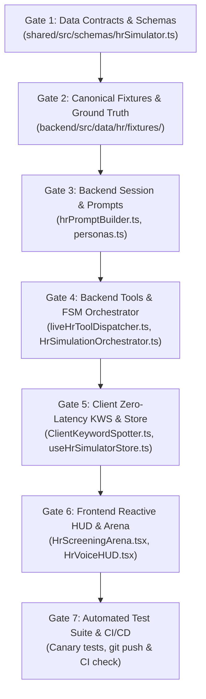

# Master Phase-Gate Execution Plan: Generic HR Voice Simulator Engine

> **Document:** `docs/hr_screening_engine/phases/00_phase_gate_master.md`  
> **Target Branch:** `feat/wave-20-hr-voice-screening-engine`  
> **Status:** Active Execution Backbone (SOTA Late 2026)  
> **Architecture Plan Reference:** [`docs/hr_screening_engine/master_implementation_plan.md`](../master_implementation_plan.md)  
> **Deployment Policy:** Cloud GitHub Actions CI/CD via `deploy.yml`. Strict NO VPS Docker builds.

---

## 1. Phase-Gate Architecture Overview

The implementation is executed as a series of 7 strictly gated, atomic phases. Each phase requires passing its verification gate before advancing to the next, guaranteeing zero regressions and complete test coverage.

---

## 2. Gate Verification Table

| Gate | Phase Name | Primary Files Created / Modified | Quality Gate Criteria & Commands |
| :---: | :--- | :--- | :--- |
| **G1** | **Contracts & Schemas** | `shared/src/schemas/hrSimulator.ts` `shared/src/schemas/voiceEvents.ts` `shared/src/index.ts` | `npm --prefix shared run build` Strict TypeBox compliance, clean exports. |
| **G2** | **Ground Truth Fixtures** | `backend/src/data/hr/fixtures/canonicalCandidateDossier.json` `backend/src/data/hr/fixtures/canonicalQuestionMatrix.json` `backend/src/data/hr/fixtures/defaultJobContexts.json` `backend/src/services/live/hrContextResolver.ts` | Node.js JSON validation against TypeBox schema. Zero hardcoded names in engine code. |
| **G3** | **Backend Prompts & Session** | `backend/src/services/live/hrPromptBuilder.ts` `backend/src/prompts/personas.ts` `backend/src/services/live/liveWsSessionParams.ts` `backend/src/services/live/livePromptBuilder.ts` | `npm --prefix backend run build` Prompt invariants pass (`npm run test:prompts`). |
| **G4** | **Backend Tools & FSM** | `backend/src/services/live/liveHrToolDispatcher.ts` `backend/src/services/live/HrSimulationOrchestrator.ts` `backend/src/services/live/liveToolDeclarations.ts` `backend/src/services/live/liveToolDispatcher.ts` `backend/src/services/live/liveAudioStreamRouter.ts` | `npm --prefix backend run build` Tool isolation tests pass (`npm run test:live:tool-isolation`). |
| **G5** | **Client KWS & Zustand Store** | `frontend/src/audio/ClientKeywordSpotter.ts` `frontend/src/store/useHrSimulatorStore.ts` `frontend/src/audio/types.ts` | `npm --prefix frontend run build` Monotonic state latch verified, $<10$ms Trie match. |
| **G6** | **Frontend UI & Visual HUD** | `frontend/src/components/practice/hr/HrAnchorCardsGrid.tsx` `frontend/src/components/practice/hr/HrPacingTimerBar.tsx` `frontend/src/components/practice/hr/HrTelemetryDashboard.tsx` `frontend/src/components/practice/hr/HrScorecardModal.tsx` `frontend/src/components/practice/hr/HrVoiceHUD.tsx` `frontend/src/components/practice/hr/HrScreeningArena.tsx` | `npm --prefix frontend run build` Audio playout contract tests pass (`npm run test:audio-contracts`). |
| **G7** | **E2E Canary & CI/CD** | `backend/src/tests/hr/hrSimulator.spec.ts` `backend/src/tests/hr/acousticHrScreeningCanary.ts` `.github/workflows/deploy.yml` | `npm test` in backend & frontend. `git push origin feat/wave-20-hr-voice-screening-engine`. GitHub Actions quality-gate green. |

---

## 3. Strict Invariant Verification Checklist

- [ ] **Rule 0 (VPS Invariant):** Zero `docker build` on local machine/VPS. Everything runs via cloud GitHub Actions.
- [ ] **Rule 8 (File Hygiene):** Newly created source files $\le 350$ lines. Modified existing files $\le 400$ lines.
- [ ] **Rule 1 (LiteLLM Proxy):** All Live audio streaming routes through `${LITELLM_PROXY_URL}`.
- [ ] **Rule 10 (Functional Registry):** Record all changes and rationale in `docs/architecture/functional_registry/`.
- [ ] **Zero Regressions:** `interview`, `tutor`, and `system_design` test suites pass without regression.
