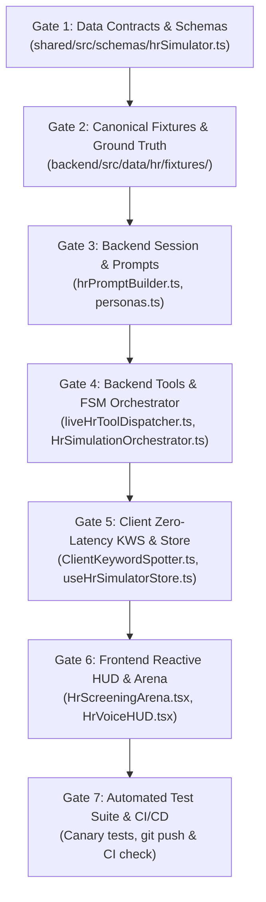
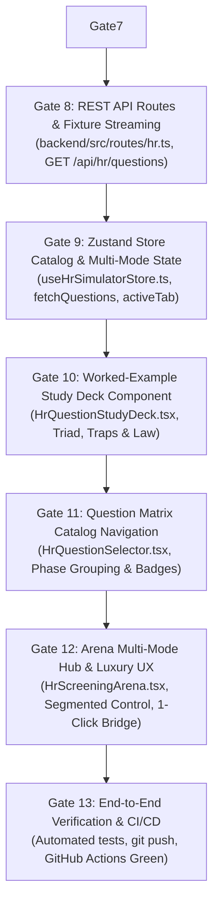

# Master Phase-Gate Execution Plan: Generic HR Voice Simulator Engine

> **Document:** `docs/hr_screening_engine/phases/00_phase_gate_master.md`  
> **Target Branch:** `feat/wave-20-hr-voice-screening-engine`  
> **Status:** Active Execution Backbone (SOTA Late 2026)  
> **Architecture Plan Reference:** [`docs/hr_screening_engine/master_implementation_plan.md`](../master_implementation_plan.md) & [`docs/hr_screening_engine/master_implementation_plan_wave21_pedagogical_suite.md`](../master_implementation_plan_wave21_pedagogical_suite.md)  
> **Deployment Policy:** Cloud GitHub Actions CI/CD via `deploy.yml`. Strict NO VPS Docker builds.

---

## 1. Phase-Gate Architecture Overview

The implementation is executed as a series of strictly gated, atomic phases. Each phase requires passing its verification gate before advancing to the next, guaranteeing zero regressions and complete test coverage.

### Wave 20: Core Multimodal Voice Engine & Real-Time HUD (Gates 1–7)

### Wave 21: Pedagogical Suite, Question Matrix Catalog & Worked Examples (Gates 8–13)

---

## 2. Gate Verification Table

| Gate | Phase Name | Primary Files Created / Modified | Quality Gate Criteria & Verification |
| :---: | :--- | :--- | :--- |
| **G1** | **Contracts & Schemas** | `shared/src/schemas/hrSimulator.ts` `shared/src/schemas/voiceEvents.ts` `shared/src/index.ts` | TypeBox compilation passes, zero circular dependencies. |
| **G2** | **Ground Truth Fixtures** | `backend/src/data/hr/fixtures/canonicalCandidateDossier.json` `backend/src/data/hr/fixtures/canonicalQuestionMatrix.json` `backend/src/data/hr/fixtures/defaultJobContexts.json` `backend/src/services/live/hrContextResolver.ts` | JSON fixtures validate 100% against schemas; zero hardcoded names in engine logic. |
| **G3** | **Backend Prompts & Session** | `backend/src/services/live/hrPromptBuilder.ts` `backend/src/prompts/personas.ts` `backend/src/services/live/liveWsSessionParams.ts` | Prompt builder invariants pass; anti-sycophancy rules strictly rendered. |
| **G4** | **Backend Tools & FSM** | `backend/src/services/live/liveHrToolDispatcher.ts` `backend/src/services/live/HrSimulationOrchestrator.ts` | Tools isolated, FSM transitions clean with watchdog safety fallback. |
| **G5** | **Client KWS & Zustand Store** | `frontend/src/audio/ClientKeywordSpotter.ts` `frontend/src/store/useHrSimulatorStore.ts` | Monotonic state latch verified (`PENDING -> OPTIMISTIC -> CONFIRMED`), Trie match $<10$ms. |
| **G6** | **Frontend UI & Visual HUD** | `frontend/src/components/practice/hr/HrAnchorCardsGrid.tsx` `frontend/src/components/practice/hr/HrPacingTimerBar.tsx` `frontend/src/components/practice/hr/HrTelemetryDashboard.tsx` `frontend/src/components/practice/hr/HrScorecardModal.tsx` `frontend/src/components/practice/hr/HrVoiceHUD.tsx` `frontend/src/components/practice/hr/HrScreeningArena.tsx` | Reactive HUD renders 4-axis scores, WPM, and pacing cleanly. |
| **G7** | **Acoustic Canary & Engine CI** | `backend/tests/test_hr_simulator_engine.js` `backend/tests/test_hr_acoustic_canary.js` `.github/workflows/deploy.yml` | All canary and acoustic tests pass, pushed and deployed cleanly via CI/CD. |
| **G8** | **HR REST API & Fixture Streaming** | `backend/src/routes/hr.ts` `backend/src/server.ts` `backend/tests/test_hr_routes.js` | `GET /api/hr/questions` and `GET /api/hr/dossier` return typed JSON payloads. Test exits with code 0. |
| **G9** | **Zustand Catalog & Selection State** | `frontend/src/store/useHrSimulatorStore.ts` | Store handles `questionsList`, `selectedQuestionId`, `activeTab: 'study' \| 'voice'`, and auto-initialization. |
| **G10** | **Worked-Example Study Deck** | `frontend/src/components/practice/hr/HrQuestionStudyDeck.tsx` | Renders canonical answer in Markdown, Triad breakdown, Required Anchors, and Anti-Pattern vs Senior Formula table. |
| **G11** | **Question Matrix Selector** | `frontend/src/components/practice/hr/HrQuestionSelector.tsx` | 12 questions categorized by phase with target duration chips and anchor counts. |
| **G12** | **Arena Multi-Mode Hub & Luxury UX** | `frontend/src/components/practice/hr/HrScreeningArena.tsx` | Seamless segmented switcher (`📘 Эталон и разбор` vs `🎙️ Голосовая арена`), 1-click bridge, luxury pastel aesthetics. |
| **G13** | **E2E Verification & CI/CD** | `backend/tests/test_hr_routes.js` GitHub Actions Workflow | All tests pass, git commit, push to `feat/wave-20-hr-voice-screening-engine`, CI/CD build green. |

---

## 3. Strict Invariant Verification Checklist

- [x] **Rule 0 (VPS Invariant):** Zero `docker build` on VPS. Cloud GitHub Actions runner builds images.
- [x] **Rule 8 (File Hygiene):** Newly created source files $\le 350$ lines. Modified existing files $\le 400$ lines.
- [x] **Rule 1 (LiteLLM Proxy):** All Live audio streaming routes through `${LITELLM_PROXY_URL}`.
- [x] **Rule 10 (Functional Registry):** Record all changes and rationale in `docs/architecture/functional_registry/`.
- [x] **Zero Regressions:** Existing interview, tutor, and theory modules remain untouched and operational.
