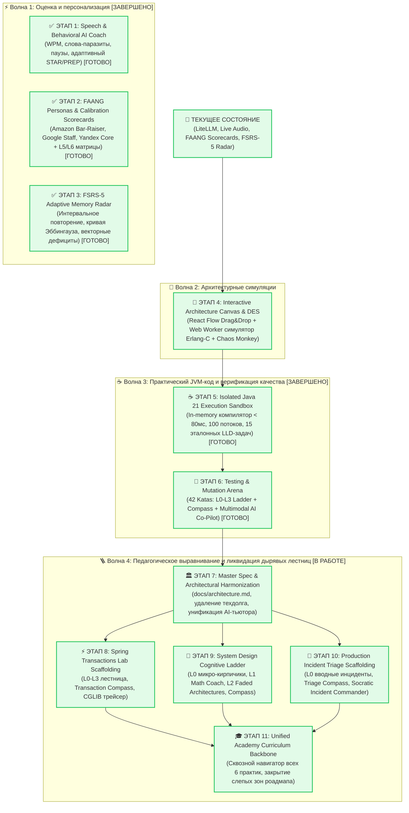

# 🗺️ Master Strategic Roadmap: InterviewPrep AI (Top-10 Global Standard, 2026–2027)

> **Статус:** Canonical Living Roadmap & Architectural Blueprint  
> **Целевой уровень:** Top-10 World-Class AI Interview Platform for Senior / Staff / Principal Engineers  
> **Методология:** Progressive Elaboration (Постепенное уточнение) & Vertical Slice Delivery  
> **Версия:** 1.0 (Сентябрь 2026)

---

## 1. Миссия и North Star Метрики

### Миссия
Трансформировать InterviewPrep AI из сильного нишевого тренажера по Spring/Java в **мировой эталон комплексной технической подготовки инженеров уровня Senior (L5), Staff (L6) и Principal (L7)**, объединяющий глубокую инженерию JVM с поведенческим речевым коучингом и интерактивным системным проектированием.

### North Star Метрики (Критерии мирового ТОП-10):
1. **Interview Realism Fidelity (IRF) > 95%:** Кандидат ощущает стресс, темп, структуру и вопросы на уровне реального раунда в Google, Amazon, Meta или Яндекс.
2. **First-Response Speech Latency (TTFB) < 350 мс:** Мгновенный отклик голосового агента без ощущения телефонной задержки.
3. **Knowledge Retention Rate (30 дней) > 85%:** Благодаря математической модели интервального повторения FSRS-5 дефициты закрываются на долгий срок, а не забываются через 48 часов.
4. **Zero-Ambiguity Code Execution:** Переход от статического анализа к реальному безопасному выполнению Java 21 тестов в песочнице за < 300 мс.

---

## 2. Граф Зависимостей Этапов (DAG)

Каждый этап представляет собой **законченный вертикальный срез (Vertical Slice)**, приносящий прямую ценность пользователю сразу после деплоя.

---

## 3. Сводная матрица этапов

> Полный научный и архитектурный синтез исследований: см. [00_MASTER_DEEP_RESEARCH_SYNTHESIS.md](file:///d:/projects/interview_projects/spring/docs/roadmap/reports/00_MASTER_DEEP_RESEARCH_SYNTHESIS.md).

| Этап | Документ спецификации | Главная ценность для кандидата | Сложность | Внешние зависимости | Статус |
| :--- | :--- | :--- | :--- | :--- | :--- |
| **Этап 1** | [phase_01_speech_analytics_and_star_coach.md](file:///d:/projects/interview_projects/spring/docs/roadmap/phase_01_speech_analytics_and_star_coach.md) | WPM-темп, детекция паразитов, адаптивный STAR/PREP/Rule of 3 | Завершено | Web Audio API, Web Speech API | ✅ **Завершено** |
| **Этап 2** | [phase_02_faang_personas_and_scorecards.md](file:///d:/projects/interview_projects/spring/docs/roadmap/phase_02_faang_personas_and_scorecards.md) | Калибровка грейда (L4/L5/L6), симуляция Amazon Bar-Raiser/Google Staff, официальный бланк | Завершено | LiteLLM Prompt Profiles | ✅ **Завершено** |
| **Этап 3** | [phase_03_fsrs5_adaptive_memory_radar.md](file:///d:/projects/interview_projects/spring/docs/roadmap/phase_03_fsrs5_adaptive_memory_radar.md) | Закрытие пробелов по кривой забывания FSRS-5, 3 зоны памяти, интерактивный слайдер | Завершено | SQLite, векторные эмбеддинги | ✅ **Завершено** |
| **Этап 4** | [phase_04_interactive_system_design_canvas.md](file:///d:/projects/interview_projects/spring/docs/roadmap/phase_04_interactive_system_design_canvas.md) | Drag & Drop холст HLD архитектуры + DES симулятор ($M/M/c$, $M/G/1$) + Chaos Monkey | Завершено | `@xyflow/react` (React Flow v12+) | ✅ **Завершено** |
| **Этап 5** | [phase_05_isolated_jvm_execution_sandbox.md](file:///d:/projects/interview_projects/spring/docs/roadmap/phase_05_isolated_jvm_execution_sandbox.md) | In-memory запуск Java 21 (< 80мс), 100 потоков стресс-теста + 15 LLD-задач BigTech | Завершено | Docker Zero-Trust / In-memory Compiler | ✅ **Завершено** |
| **Этап 6** | [phase_06_testing_and_mutation_arena.md](file:///d:/projects/interview_projects/spring/docs/roadmap/phase_06_testing_and_mutation_arena.md) | Режим Write-the-Tests, 42 каты (L0-L3 лестница, Testing Compass, Мутационный скор $\ge 85\%$) | Завершено | Песочница Этапа 5, Defect Injection | ✅ **Завершено** |
| **Этап 7** | [phase_07_master_spec_and_architectural_harmonization.md](file:///d:/projects/interview_projects/spring/docs/roadmap/phase_07_master_spec_and_architectural_harmonization.md) | Актуализация `docs/architecture.md`, очистка мертвого кода, типизация контрактов | 2-3 дня | Markdown, TypeScript DTO | ✅ **Готово (100%)** |
| **Этап 8** | [phase_08_spring_transactions_ladder_and_sandbox.md](file:///d:/projects/interview_projects/spring/docs/roadmap/phase_08_spring_transactions_ladder_and_sandbox.md) | 16 сценариев (L0-L3), Transaction Compass (`Ctrl + /`), визуализация CGLIB-прокси | 4-5 дней | Transaction Engine | ✅ **Готово (100%)** |
| **Этап 9** | [phase_09_system_design_cognitive_ladder.md](file:///d:/projects/interview_projects/spring/docs/roadmap/phase_09_system_design_cognitive_ladder.md) | L0 Building Blocks (8 кат), L1 Math Coach, L2 Faded Architectures, System Design Compass | 1 день | Cytoscape, Math Engine | ✅ **Готово (100%)** |
| **Этап 10** | [phase_10_production_incident_triage_scaffolding.md](file:///d:/projects/interview_projects/spring/docs/roadmap/phase_10_production_incident_triage_scaffolding.md) | L0 обучающие инциденты, Triage Compass (`Ctrl + /`), Socratic AI Incident Commander | 1 день | Dump Parsers, WebSockets | ✅ **Готово (100%)** |
| **Этап 11** | [phase_11_unified_academy_curriculum_backbone.md](file:///d:/projects/interview_projects/spring/docs/roadmap/phase_11_unified_academy_curriculum_backbone.md) | Сквозной дирижер подготовки, единые треки Junior->Senior->Staff, реактивный прогресс | 3-4 дня | FSRS-5 Radar, SQLite Store | ✅ **Готово (100%)** |

---

## 4. Незыблемые архитектурные инварианты (Hard Invariants)

Каждый этап обязан беспрекословно соблюдать правила, зафиксированные в [AGENTS.md](file:///d:/projects/interview_projects/spring/AGENTS.md):

1. **LiteLLM Proxy Invariant:** Никаких прямых вызовов API провайдеров (OpenAI, Google) из кода приложения. Все вызовы строго через `LiteLLM_Proxy` с ротацией ключей и Circuit Breaker.
2. **Dual-Sided Handshake & Audio Lockdown:** В голосовых сессиях микрофон разблокируется только после полного физического дренажа звука в наушниках (`onPlaybackFinished`) И события `turnComplete`. На 0-м шаге вызов оценочных тулов заблокирован.
3. **Zero-Phantom-Fallback Invariant:** Запрещено возвращать фейковые или захардкоженные статические ответы под видом генерации. При сбоях — `TaskRecoveryCard` с честным таймером и паузой.
4. **Deterministic Time & Money Invariant:** В задачах LLD запрещены прямые вызовы `System.currentTimeMillis()` и `Instant.now()`. Только `Clock`. Все деньги — `BigDecimal` с `RoundingMode.HALF_EVEN`.
5. **Multi-Modal Reference-Counted Scroll Lock & 100dvh:** Вложенные дроверы и модалки используют `useBodyScrollLock`. Все экраны вписываются в `100dvh` без прыжков мобильной клавиатуры.
6. **Single Source of Truth (SSOT) Progress:** Прогресс рассчитывается на бэкенде от реального количества вопросов в БД (`27`, а не `100`). `localStorage` никогда не перекрывает серверный стейт.

---

## 5. Процесс выполнения и перехода между этапами (Definition of Done)

Переход к следующему этапу разрешен **только** после соблюдения чек-листа:
- [ ] Полная реализация вертикального среза (Frontend + Backend + Database).
- [ ] 0 ошибок компиляции `tsc && vite build` (Frontend) и `tsc` (Backend).
- [ ] Автоматизированный интеграционный тест, покрывающий сценарий.
- [ ] Соответствие дизайн-системе пастельной роскоши (WCAG AA контраст, темная/светлая гармония).
- [ ] Фиксация изменений в чистом git-коммите с понятным описанием.
