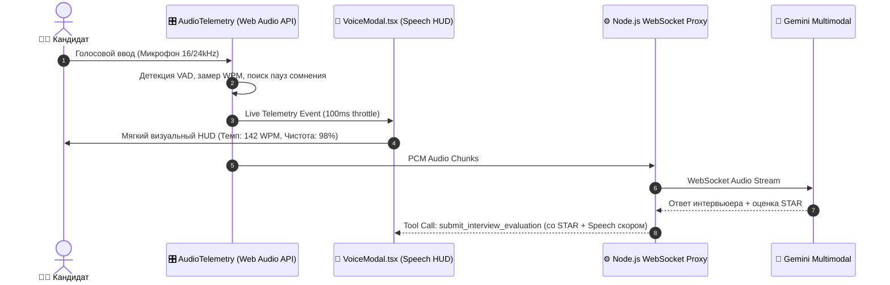

# 🎙️ Этап 1: Speech & Behavioral AI Coach (Речевая аналитика и STAR-коучинг)

> **Статус:** Спецификация готова к реализации  
> **Цель:** Превратить `VoiceModal.tsx` из обычного диктофона в премиального персонального речевого тренера уровня спикеров TED и директоров FAANG.  
> **Трудозатраты:** 3–4 дня | **Влияние на продукт:** Максимальное (High Impact)  
> **Инфраструктурные требования:** 0 новых серверов (Web Audio API + существующий WebSocket LiteLLM).

---

## 1. Проблема и мотивация

На реальных технических собеседованиях уровня **Senior / Staff** до 50% отказов происходят не из-за незнания Spring или многопоточности, а из-за **провала коммуникации**:
- **Стрессовый темп (Over-pacing):** Кандидат нервничает и тараторит со скоростью 190–220 слов/мин. Интервьюер перестает улавливать суть и устает.
- **Слова-паразиты (Filler Words):** «Э-э-э», «ну», «как бы», «типа», «в общем-то» засоряют речь каждые 5 секунд, создавая впечатление неуверенности.
- **Бессистемность (Stream of Consciousness):** Вместо четкого ответа кандидат 5 минут ходит вокруг да около без структуры. В BigTech стандартом является структура **STAR** (Situation, Task, Action, Result) или **PREP** (Point, Reason, Example, Point).

---

## 2. Архитектура и поток данных

---

## 3. Математика и метрики речевого анализа

### А. Темп речи (Words Per Minute — WPM)
- **Норма для спокойного технического объяснения:** **130 – 155 слов/мин**.
- **Зона предупреждения (спешка):** **165 – 185 слов/мин** (индикатор мягко предупреждает: «Сбавьте темп, вас трудно слушать»).
- **Зона критической тахилалии:** **> 190 слов/мин**.
- **Зона затягивания:** **< 105 слов/мин**.

### Б. Детекция слов-паразитов (Filler Lexicon)
Клиентский анализатор распознает паттерны в потоковом распознавании речи:
- **Русский язык:** `["эээ", "ммм", "как бы", "типа", "ну", "в общем-то", "короче", "так сказать", "значит"]`.
- **Английский язык:** `["um", "uh", "like", "you know", "basically", "sort of", "actually"]`.
- **Метрика чистоты речи (Speech Clarity Index):**  
  $$\text{Clarity} = \max\left(0, 100 - \frac{\text{FillerCount} \times 100}{\text{TotalWords}}\right)$$

### В. Анализ пауз (Hesitation vs. Thoughtful Silence)
- **Конструктивная пауза (1–3 сек):** Знак зрелого инженера, обдумывающего архитектурный компромисс. Оценивается положительно.
- **Ступор / Повисание (> 7 сек):** Индикатор растерянности. ИИ-интервьюер мягко подбадривает или задает наводящий подвопрос.

### Г. Адаптивная классификация вопросов и контекстный STAR / PREP
> [!IMPORTANT]
> **Принцип уместности (Anti-Cargo-Cult):** Метод STAR **категорически не применим** к теоретическим и механическим вопросам («В чем разница между @Component и @Service?» или «Как устроен CAS в AtomicInteger?»). Требовать STAR на таких вопросах — грубая ошибка.

Система автоматически классифицирует тип вопроса:
1. **Definitional & Under-the-Hood (Теория и кишки):**  
   *Пример:* «Как работает ConcurrentHashMap?»  
   *Ожидаемая структура:* **Rule of 3 / Conceptual Breakdown** (Определение -> Механика под капотом -> Подводные камни/JMM).
2. **Trade-offs & Architectural Choice (Архитектурный выбор):**  
   *Пример:* «Kafka или RabbitMQ для нотификаций?», «Оптимистические или пессимистические блокировки?»  
   *Ожидаемая структура:* **PREP** (Point -> Reason -> Example -> Point).
3. **Behavioral & Incidents (Опыт, аварии, ситуации):**  
   *Пример:* «Расскажите о самом тяжелом инциденте в проде», «Как вы решали конфликт требований?»  
   *Ожидаемая структура:* **STAR** (Situation -> Task -> Action -> Result).

### Д. Режим коучинга и перефразирования (Pedagogical Rephrasing)
- **Опциональный тумблер:** STAR/PREP-аналитика включается/выключается кандидатом в настройках или лобби.
- **Педагогическая подсказка в режиме Обучения:** Если вопрос ситуационный, а кандидат ответил сумбурно, ИИ не снижает оценку, а доброжелательно обучает:  
  *«Ты ответил технически верно, но в BigTech на подобные вопросы ждут структуру STAR. Вот как можно было перефразировать твой опыт: [Конкретный пример ответа по STAR]...»*.

---

## 4. UI/UX Спецификация: Премиальный Speech HUD

1. **Во время активного ответа ([VoiceModal.tsx](file:///d:/projects/interview_projects/spring/frontend/src/components/VoiceModal.tsx)):**
   - В нижней трети модального окна появляется полупрозрачная капсула с телеметрией в реальном времени:
     - **Индикатор WPM:** Цифра со скользящей цветовой шкалой (зеленый 140 WPM, персиковый при 175, розовый при 200+).
     - **Счетчик паразитов:** Бейдж `Слов-паразитов: 0` (при появлении мягкая микро-анимация `scale-110`).
     - **Индикатор структуры STAR:** 4 светящиеся иконки (S, T, A, R), которые мягко активируются по мере того, как кандидат раскрывает пункты.

2. **В итоговом отчете ([InterviewReportModal.tsx](file:///d:/projects/interview_projects/spring/frontend/src/components/InterviewReportModal.tsx)):**
   - Добавляется отдельная премиальная вкладка **«Речевая биометрия и STAR»**:
     - Радарная диаграмма: `Уверенность | Темп | Чистота | Структура STAR | Глубина`.
     - Таймлайн сессии с отметками заминок и советами коуча («На 2-й минуте вы затараторили при вопросе об изоляции транзакций — вдохните глубже и формулируйте через PREP»).

---

## 5. Изменения в кодовой базе

### Frontend
- **[NEW] `frontend/src/services/AcousticTelemetryEngine.ts`**:
  - Web Audio AnalyserNode + Web Speech API (или потоковый транскрипт Gemini).
  - Вычисление WPM скользящим окном в 15 секунд.
  - Детекция пауз и слов-паразитов.
- **[MODIFY] `frontend/src/components/VoiceModal.tsx`**:
  - Интеграция плавающего Speech HUD в нижней части экрана.
- **[MODIFY] `frontend/src/components/InterviewReportModal.tsx`**:
  - Отображение блока биометрии речи и STAR-скоркорда.

### Backend
- **[MODIFY] `backend/src/services/geminiLiveProxy.ts`**:
  - Расширение промпта `submit_interview_evaluation` полями `speechMetrics: { wpm, fillerCount, starScore: { situation, task, action, result }, speechFeedback }`.
- **[MODIFY] `backend/src/services/db.ts`**:
  - Миграция: добавление колонки `speech_telemetry_json TEXT` в `question_evaluations`.

---

## 6. Критерии приемки (Definition of Done)
- [ ] Speech HUD плавно работает на десктопе и мобильных устройствах (iPhone / Android) без просадок FPS (60+ FPS).
- [ ] Замер WPM точен в диапазоне ±10% относительно реального темпа.
- [ ] Детектируются типичные слова-паразиты в русской и английской речи.
- [ ] Итоговый отчет генерирует подробный разбор структуры STAR.
- [ ] 0 регрессий в существующих голосовых сценариях (инвариант Dual-Sided Handshake сохранен).
