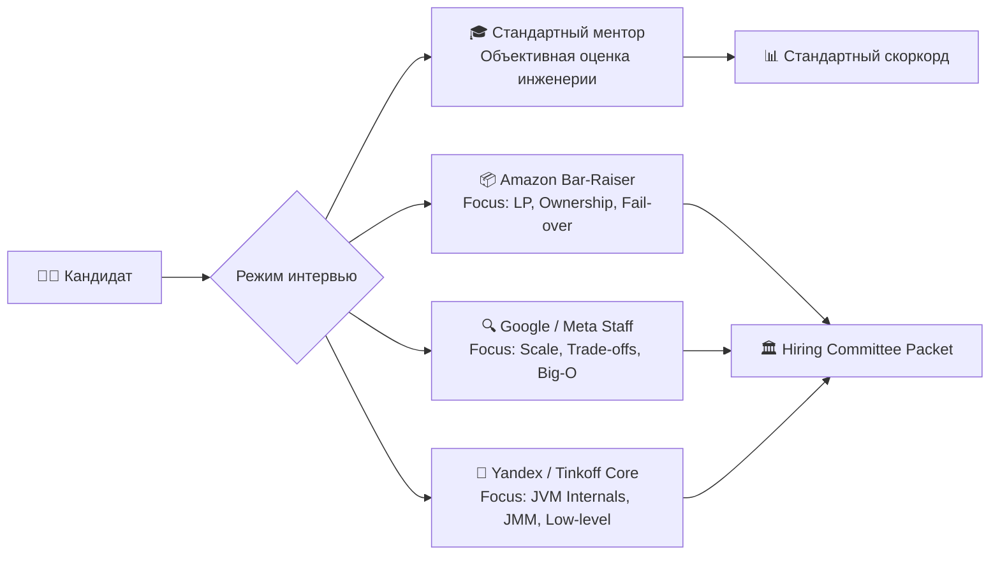

# 👔 Этап 2: FAANG Bar-Raiser Personas & Калибровочные скоркарды

> **Статус:** Спецификация готова к реализации  
> **Цель:** Заменить безликую общую оценку «85/100» на официальные матрицы комитетов найма FAANG и BigTech (Amazon Bar-Raiser, Google Staff, Yandex Core) с калибровкой грейда (L5 Senior / L6 Staff).  
> **Трудозатраты:** 3–4 дня | **Влияние на продукт:** Высокое (High Impact)  
> **Инфраструктурные требования:** LiteLLM промпт-профили + адаптивные скоркарды в SQLite.

---

## 1. Проблема и мотивация

Кандидат может получить 90% по теории Spring, но провалиться на собеседовании в конкретную компанию из-за несовпадения культуры оценки:
- **В Amazon** кандидата отсеивают, если он проектирует систему без оглядки на *Customer Obsession* и *Frugality* (избыточные затраты на облако).
- **В Google / Meta** кандидата отсекают за неумение четко аргументировать компромиссы (trade-offs) и оценить асимптотику в худшем случае ($O(N \log N)$ vs $O(N^2)$).
- **В Яндекс / Tinkoff** ключевой фильтр — это глубокое понимание JVM: что происходит в памяти при автобоксинге, как работает safepoint bias в HotSpot и почему `ConcurrentHashMap.size()` не блокирует таблицу.

Обычный тренажер ставит одинаковую оценку, вводя кандидата в заблуждение. Продукт мирового уровня обязан симулировать **специфику конкретного нанимающего комитета**.

---

## 2. Персоны интервьюеров (Опциональный режим симуляции)

> [!NOTE]
> **Режим по умолчанию:** «Стандартный технический ментор» (доброжелательный, объективный, без корпоративных предвзятостей).  
> Выбор персоны компании — это **опциональный переключатель в лобби/настройках перед интервью**. Кандидат сам решает, когда он готов тренироваться под конкретную компанию.

### 1. Amazon Bar-Raiser (ЛПР по культуре найма)
- **Тон:** Вежливый, настойчивый, копает в глубину (Deep Dive), ищет подтверждения Leadership Principles.
- **Любимые вопросы:** «Почему вы выбрали именно этот инструмент, а не более дешевый аналог?», «Расскажите о случае, когда ваша система упала — что лично вы сделали для предотвращения рецидива?».

### 2. Google / Meta Staff Interviewer (Архитектор масштабирования)
- **Тон:** Аналитичный, немногословный, ориентирован на чистую математику и распределенные системы.
- **Любимые вопросы:** «Что произойдет при сетевом разделении (Network Partition)? Какую сторону теоремы CAP вы жертвуете?», «Как распределятся шарды при добавлении 10 новых узлов?».

### 3. Yandex / Tinkoff Core Team (Инженер JVM-ядра)
- **Тон:** Академичный, строгий, бескомпромиссный к поверхностным знаниям.
- **Любимые вопросы:** «Какая структура данных лежит под капотом?», «Где аллоцируется этот объект — в куче или на стеке благодаря Escape Analysis?», «Почему здесь нельзя обойтись volatile?».

---

## 3. Матрица калибровки и скоркорд (Hiring Committee Packet)

Вместо абстрактных баллов результат форматируется как реальный вердикт комитета найма:

| Вердикт | Значение | Интерпретация для кандидата |
| :--- | :--- | :--- |
| **Strong Hire (SH)** | Топ 5% кандидатов | Оффер с повышением грейда (Staff / Lead) |
| **Hire (H)** | Соответствует L5 (Senior) | Уверенный стандартный оффер |
| **Leaning Hire (LH)** | Есть пробелы | Оффер на нижнюю границу вилки или L4 (Middle+) |
| **Leaning No Hire (LNH)** | Сомнения комитета | Отказ с подробным фидбеком для пересдачи |
| **Strong No Hire (SNH)** | Критические ошибки | Ред-флаг (попытка скрыть баг, незнание concurrency) |

### 4 Измерения скоркорда:
1. **Domain Depth (Глубина знаний):** Понимание деталей реализации, JMM, Spring lifecycle.
2. **System Architecture & Scalability:** Способность проектировать отказоустойчивые решения.
3. **Communication & Structure (STAR/PREP):** Четкость мысли, отсутствие воды, темп речи.
4. **Operational Excellence & Failure Modes:** Как система реагирует на сбои, тайм-ауты и перегрузки.

---

## 4. UI/UX Спецификация

1. **В лобби перед началом собеседования ([VoiceModal.tsx](file:///d:/projects/interview_projects/spring/frontend/src/components/VoiceModal.tsx) / [StudyDeck.tsx](file:///d:/projects/interview_projects/spring/frontend/src/components/StudyDeck.tsx)):**
   - Селектор персоны с пастельными карточками и фирменной айдентикой:
     - 📦 **Amazon Bar-Raiser** (акцент на масштабируемость и клиентоориентированность)
     - 🔍 **Google Staff** (акцент на компромиссы и асимптотику)
     - 🔴 **Yandex Core** (акцент на JVM Internals и потокобезопасность)
     - 🎓 **Socratic Mentor** (обучающий режим с подсказками)
   - Селектор целевого грейда: `Middle+ (L4)` | `Senior (L5)` | `Staff / Principal (L6+)`.

2. **В итоговом отчете ([InterviewReportModal.tsx](file:///d:/projects/interview_projects/spring/frontend/src/components/InterviewReportModal.tsx)):**
   - Оформление в стиле **«Официальный пакет комитета найма»**:
     - Печать вердикта: `STRONG HIRE (L5 Senior)`.
     - Персентиль по рынку: `Вы опережаете 84% кандидатов этого грейда`.
     - Список «Strengths & Red Flags» с цитатами из речи кандидата.

---

## 5. Изменения в кодовой базе

### Frontend
- **[NEW] `frontend/src/types/personas.ts`**:
  - Типы персон: `'amazon_bar_raiser' | 'google_staff' | 'yandex_core' | 'socratic_tutor'`.
  - Модель данных скоркорда FAANG (`FaangScorecard`).
- **[MODIFY] `frontend/src/components/VoiceModal.tsx`**:
  - Выбор персоны и грейда в шапке модалки.
- **[MODIFY] `frontend/src/components/InterviewReportModal.tsx`**:
  - Рендеринг официального бланка комитета найма с процентилями.

### Backend
- **[NEW] `backend/src/prompts/personas.ts`**:
  - Специализированные системные промпты для каждой персоны с калибровочными рубриками.
- **[MODIFY] `backend/src/services/geminiLiveProxy.ts`**:
  - Применение системного промпта выбранной персоны к Live-сессии.

---

## 6. Критерии приемки (Definition of Done)
- [ ] Голосовой агент четко меняет стиль ведения диалога в зависимости от выбранной персоны (Amazon ищет метрики, Yandex цепляется за сборщик мусора и volatile).
- [ ] Итоговый вердикт комитета найма аргументирован конкретными цитатами кандидата.
- [ ] Расчет персентиля дает реалистичную калибровку относительно заявленного грейда (Senior vs Staff).
