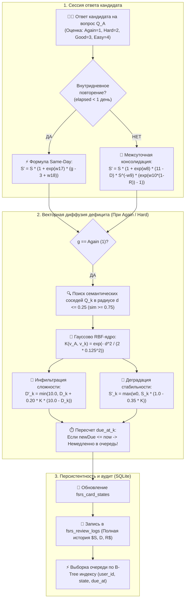

# 🧠 Этап 3 (SOTA Upgrade): FSRS-5 Canonical Engine & RBF Vector Deficit Diffusion

> **Статус:** Каноническая спецификация SOTA 2026  
> **Основание:** [FSRS-5 Vector Knowledge Architecture.md](file:///d:/projects/interview_projects/spring/ds_reports/FSRS-5%20Vector%20Knowledge%20Architecture.md)  
> **Цель:** Довести реализацию интервального повторения FSRS-5 до 100% математического соответствия стандартам Open Spaced Repetition (2025–2026), заменив эвристическое масштабирование интервалов непрерывной диффузией дефицитов на базе Гауссова RBF-ядра с инфильтрацией сложности $D$ и деградацией стабильности $S$, внедрить учет внутридневных повторений и аудит-журнал `fsrs_review_logs`.  
> **Трудозатраты:** 1 день | **Влияние на продукт:** Безупречная математическая модель долговременной памяти (Anki/SuperMemo SOTA Parity)

---

## 1. Архитектурная декомпозиция улучшений



---

## 2. Математический базис SOTA FSRS-5

### 2.1. Канонический расчет ретривабильности $R(t, S)$
Вероятность извлечения следа памяти через $t$ дней при стабильности $S$:
$$R(t, S) = \left(1 + \text{factor} \times \frac{t}{S}\right)^{-0.5}$$
где масштабный множитель аналитически зафиксирован:
$$\text{factor} = \frac{19}{81} \approx 0.2345679$$
**Инвариант калибровки:** При $t = S$ ретривабильность строго равна $R(S, S) = \left(1 + \frac{19}{81}\right)^{-0.5} = \sqrt{\frac{81}{100}} \equiv \mathbf{0.9000}$ (ровно $90\%$).

### 2.2. Формула внутридневных повторений (Same-Day Consolidation)
Если $t < 1$ день (например, повторение через 15 минут в рамках одной сессии), стандартная степенная кривая еще не активна. Применяются веса $w_{17} = 0.51655$ и $w_{18} = 0.66210$:
$$S'_{same\_day} = S \times \left(1 + e^{w_{17}} \times (g - 3 + w_{18})\right)$$
где $g \in \{1, 2, 3, 4\}$. Значение $S$ ограничивается снизу базовым порогом $w_0 = 0.40255$.

### 2.3. Векторная диффузия дефицита по Гауссову RBF-ядру
При оценке $g = 1$ (Again) на вопрос $Q_A$ запускается алгоритм каскадного пересчета смежных понятий.
1. **Метрика дистанции:**
   $$d(v_A, v_k) = 1 - \cos(v_A, v_k)$$
   Рассматриваются соседи с $d \le 0.25$ ($\cos \ge 0.75$).
2. **Гауссово RBF-ядро ($\sigma = 0.125$):**
   $$K(v_A, v_k) = \exp\left(-\frac{d(v_A, v_k)^2}{2 \times 0.125^2}\right) = \exp\left(-\frac{d^2}{0.03125}\right)$$
   *При $d = 0$: $K = 1.0$; при $d = 0.10$: $K \approx 0.726$; при $d = 0.25$: $K \approx 0.135$; при $d > 0.25$: $K = 0$.*
3. **Инфильтрация скрытой сложности ($\alpha = 0.20$):**
   $$D'_k = \min\left(10.0, \; D_k + 0.20 \times K(v_A, v_k) \times (10.0 - D_k)\right)$$
4. **Деградация стабильности памяти ($\beta = 0.35$):**
   $$S'_k = \max\left(w_0, \; S_k \times (1.0 - 0.35 \times K(v_A, v_k))\right)$$
5. **Пересчет межповторного интервала и даты:**
   $$\text{intervalDays} = S'_k$$
   $$\text{newDueAt} = \text{lastReviewAt} + \text{intervalDays} \times 86400 \times 1000$$
   Если $\text{newDueAt} \le now$, карточка немедленно внедряется в очередь сессии повторения (`immediatelyDue = true`).

---

## 3. Схема БД и индексация (SQLite)

### Таблица аудит-логов повторений (`fsrs_review_logs`):
```sql
CREATE TABLE IF NOT EXISTS fsrs_review_logs (
  log_id TEXT PRIMARY KEY,
  question_id TEXT NOT NULL,
  user_id TEXT NOT NULL,
  rating INTEGER NOT NULL,
  state INTEGER NOT NULL,
  due_at DATETIME NOT NULL,
  stability REAL NOT NULL,
  difficulty REAL NOT NULL,
  review_time DATETIME NOT NULL,
  created_at DATETIME DEFAULT CURRENT_TIMESTAMP
);

CREATE INDEX IF NOT EXISTS idx_fsrs_logs_history 
ON fsrs_review_logs (user_id, question_id, review_time DESC);
```

### Составной B-Tree индекс очереди повторений:
```sql
CREATE INDEX IF NOT EXISTS idx_fsrs_due_queue 
ON fsrs_card_states (user_id, state, due_at);
```

### Оптимальный запрос формирования очереди:
```sql
SELECT f.*, q.topic, q.question, q.answer
FROM fsrs_card_states f
JOIN questions q ON f.question_id = q.id
WHERE f.user_id = ? AND f.due_at <= CURRENT_TIMESTAMP
ORDER BY f.state DESC, f.due_at ASC
LIMIT ?;
```
*Сортировка `state DESC, due_at ASC` гарантирует, что карточки в статусе `Relearning (3)` (недавние провалы) всегда идут впереди плановых `Review (2)`.*

---

## 4. Пошаговый план внедрения (Actionable Checklist)

- [ ] **Шаг 1: Обновление математического ядра в `backend/src/services/fsrsEngine.ts`**:
  - Замена `DECAY_FACTOR = 0.19` на `DECAY_FACTOR = 19 / 81`.
  - Добавление проверки $elapsedDays < 1$ и ветки вычисления $S'_{same\_day}$ с параметрами $w_{17}, w_{18}$.
  - Реализация функции Гауссова RBF-ядра `calculateRbfKernel(distance: number): number`.
  - Полная переработка `propagateDeficitCluster`: чтение текущих $S_k, D_k$, применение инфильтрации сложности и деградации стабильности, запись новых $S', D'$ и `due_at`.
  - Сортировка очереди в `getFsrsQueue`: `ORDER BY state DESC, due_at ASC` с резервной сортировкой по $R$.
- [ ] **Шаг 2: Расширение схемы хранения в `backend/src/services/db.ts`**:
  - Создание таблицы `fsrs_review_logs` с индексами.
  - Добавление составного индекса `idx_fsrs_due_queue` на `fsrs_card_states (user_id, state, due_at)`.
  - Запись аудита в `fsrs_review_logs` при каждом вызове `updateFsrsCardState`.
- [ ] **Шаг 3: Синхронизация типов и API**:
  - Добавление `propagatedNeighbors` в возвращаемый DTO эндпоинта `POST /api/memory/fsrs/review`.
- [ ] **Шаг 4: Расширение тестового стенда `backend/tests/test_fsrs_engine.js`**:
  - Тест строгого инварианта: $R(S, S) \equiv 0.9000$.
  - Тест внутридневных повторений (Same-Day) при $elapsedDays = 0$.
  - Тест RBF-диффузии: проверка инфильтрации $D$ и деградации $S$ у соседних вопросов.
  - Тест персистентности логов в `fsrs_review_logs`.
- [ ] **Шаг 5: Валидация сборки**:
  - Прогон unit-тестов бэкенда (`npm test` / node runner).
  - Сборка фронтенда (`npm run build`).
