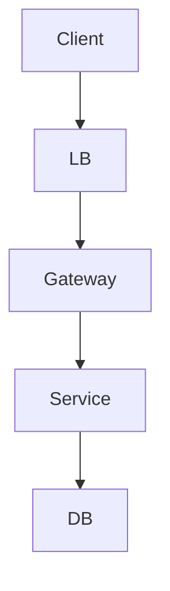
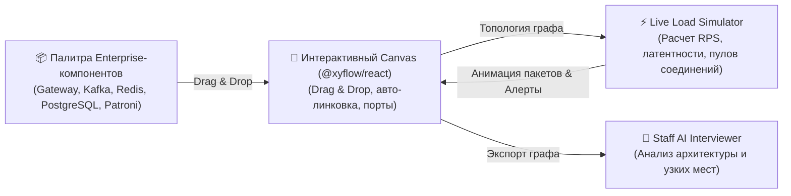

# 📐 Этап 4: Interactive Architecture Canvas & Load Simulator (System Design Studio)

> **Статус:** Спецификация готова к реализации  
> **Цель:** Заменить текстовый редактор Mermaid на полноценный визуальный интерактивный холст (Drag & Drop на `@xyflow/react`) с палитрой компонентов Spring/Cloud и **живой симуляцией нагрузки (100k RPS)**.  
> **Трудозатраты:** 6–8 дней | **Влияние на продукт:** Вау-эффект мирового уровня (Top-10 Feature)  
> **Инфраструктурные требования:** Клиентская библиотека `@xyflow/react` (бывший React Flow) + легковесный симулятор потоков данных.

---

## 1. Проблема и мотивация

В текущей версии [SystemDesignArena.tsx](file:///d:/projects/interview_projects/spring/frontend/src/components/system_design/SystemDesignArena.tsx) кандидат вынужден писать код Mermaid руками:

- **Это медленно и неестественно:** На реальных собеседованиях в FAANG никто не пишет код диаграммы — все рисуют на виртуальной доске (Excalidraw, Miro, Figma).
- **Диаграмма статична и нема:* Нельзя наглядно проверить, выдержит ли схема заявленные 50,000 RPS, хватит ли соединений в пуле HikariCP и не упадет ли Kafka при репликации.

---

## 2. Архитектура интерактивного холста

### Библиотека готовых компонентов (Enterprise Palette):
1. **Edge & Compute:**
   - Client (Web/Mobile), Cloudflare CDN, AWS ALB / NGINX, Spring Cloud Gateway, Core Spring Boot Service, Worker Node.
2. **Data & Cache:**
   - PostgreSQL (Master/Replica), Redis Sentinel/Cluster, MongoDB Sharded, ClickHouse OLAP, MinIO/S3 Bucket.
3. **Messaging & Streaming:**
   - Apache Kafka (Topics, Partitions, Consumer Groups), RabbitMQ, Debezium CDC.
4. **Resilience & Governance:**
   - Resilience4j Circuit Breaker, HashiCorp Vault, Keycloak Auth, OpenTelemetry Collector.

---

## 3. Симулятор нагрузки (Live Load & Chaos Engine)

Кандидат проектирует систему для сценария (например, «Платежный шлюз 20,000 TPS») и нажимает кнопку **«Запустить симуляцию нагрузки»**:

1. **Расчет потоков в реальном времени:**
   - Пользователь выставляет бегунок: `Трафик: 25,000 RPS (90% чтение / 10% запись)`.
   - По соединительным линиям холста начинают бежать анимированные частицы (SVG Flow Particles).
2. **Детектор перегрузок (Bottleneck Detection):**
   - Если между Gateway и реляционной БД нет слоя кэширования:
     - Узел PostgreSQL пульсирует красным:  
       `⚠️ HikariCP Pool Exhausted: 25,000 RPS превышает лимит одиночной БД (макс. 3,500 RPS). Необходим Redis Cache или шардирование!`
   - Если в Kafka не хватает партиций для консьюмеров:
     - Узел Kafka выдает алерт: `⚠️ Consumer Lag растет (+1,200 msg/sec). Увеличьте число партиций!`
3. **Кнопка «Chaos Monkey» (Стресс-тестирование отказа узла):**
   - Нажатие кнопки случайным образом убивает один из экземпляров сервиса или мастера БД.
   - Кандидат видит, переключается ли репликация (failover) без потери 500-х ошибок.

---

## 4. UI/UX Спецификация

- **Левая панель:** Аккордеон с готовыми пастельными блоками (иконки, бейджи протоколов: gRPC, REST, Kafka).
- **Центр:** Бесконечный холст с панорамированием (pan & zoom), сеткой и красивыми скругленными стрелками.
- **Верхняя панель управления:**
  - Ползунок нагрузки: `[ 1,000 RPS ──────●────── 100,000 RPS ]`.
  - Кнопка: `▶ Симулировать нагрузку` | `⚡ Chaos Monkey`.
  - Метрики системы: `Общая латентность: p99 = 42ms`, `Доступность: 99.99%`.
- **Правая панель:** Чат с Staff AI интервьюером (ИИ видит конфигурацию холста и задает точечные вопросы по соединениям и репликации).

---

## 5. Изменения в кодовой базе

### Frontend
- **Установка зависимости:** `npm install @xyflow/react` (легковесный современный форк React Flow).
- **[NEW] `frontend/src/components/system_design/canvas/ArchitectureCanvas.tsx`**:
  - Интерактивный канвас с поддержкой drag-and-drop узлов.
- **[NEW] `frontend/src/components/system_design/canvas/nodes/EnterpriseServiceNode.tsx`**:
  - Кастомные стилизованные узлы компонентов (Spring, Kafka, Postgres).
- **[NEW] `frontend/src/components/system_design/simulation/LoadSimulationEngine.ts`**:
  - Клиентский математический симулятор распределения трафика по графу.
- **[MODIFY] `frontend/src/components/system_design/SystemDesignArena.tsx`**:
  - Замена Mermaid на переключатель `[ Визуальный Canvas | Mermaid Код ]`.

---

## 6. Критерии приемки (Definition of Done)
- [ ] Перетаскивание и связывание компонентов работает плавно на 60 FPS.
- [ ] Симулятор нагрузки корректно находит элементарные ошибки (отсутствие кэша, узкое горлышко базы).
- [ ] Топология холста сериализуется в JSON и корректно передается в Staff AI для оценки.
- [ ] Возможность экспорта схемы в PNG / SVG / Mermaid в 1 клик.
