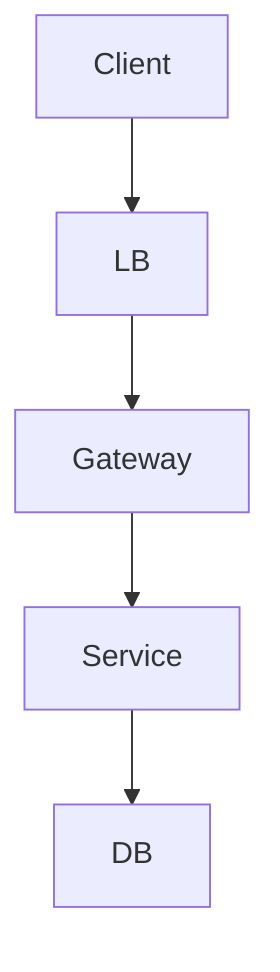
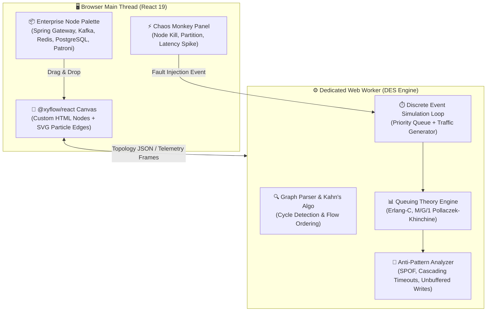

# 📐 Этап 4: Interactive Architecture Canvas & Load Simulator (System Design Studio)

> **Статус:** Актуализировано на основе Deep Research (Сентябрь 2026)  
> **Цель:** Заменить текстовый редактор Mermaid на полноценный визуальный интерактивный холст (Drag & Drop на `@xyflow/react`) с палитрой компонентов Spring/Cloud, **браузерным Web Worker симулятором дискретных событий (DES)** на базе формул теории очередей ($M/M/c$, $M/G/1$, Закон Литтла), детектором антипаттернов (SPOF, циклические зависимости через алгоритм Кана) и **инжектором хаоса (Chaos Monkey)**.  
> **Трудозатраты:** 6–8 дней | **Влияние на продукт:** Вау-эффект мирового уровня (Top-10 Feature)  
> **Инфраструктурные требования:** Клиентская библиотека `@xyflow/react` (React Flow v12+) + Web Worker DES Engine.

---

## 1. Проблема и мотивация

В текущей версии [SystemDesignArena.tsx](file:///d:/projects/interview_projects/spring/frontend/src/components/system_design/SystemDesignArena.tsx) кандидат вынужден писать код Mermaid руками:

- **Это неестественно:** На реальных собеседованиях в FAANG/BigTech архитектуру проектируют на интерактивной доске (Excalidraw, Miro, Figma).
- **Диаграмма статична и нема:** Нельзя проверить, выдержит ли схема заявленные 50,000 RPS, хватит ли соединений в пуле HikariCP, не возникнет ли каскадный таймаут и не упадет ли Kafka при репликации.
- **Отсутствие валидации:** Кандидат не видит узких мест (bottlenecks), пока интервьюер сам не укажет на них.

---

## 2. Архитектура интерактивного холста (React 19 + @xyflow/react)



### Библиотека готовых компонентов (Enterprise Palette):
1. **Edge & Compute:**
   - Client (Web/Mobile), Cloudflare CDN, AWS ALB / NGINX, Spring Cloud Gateway, Core Spring Boot Service, Worker Node.
2. **Data & Cache:**
   - PostgreSQL (Master/Replica с Patroni), Redis Sentinel/Cluster, MongoDB Sharded, ClickHouse OLAP, MinIO/S3 Bucket.
3. **Messaging & Streaming:**
   - Apache Kafka (Topics, Partitions, Consumer Groups), RabbitMQ, Debezium CDC.
4. **Resilience & Governance:**
   - Resilience4j Circuit Breaker, HashiCorp Vault, Keycloak Auth, OpenTelemetry Collector.

---

## 3. Математический движок симуляции нагрузки (Queuing Theory & DES)

Симуляция вынесена в отдельный Web Worker (`LoadSimulationWorker.ts`) для поддержания стабильных 60 FPS на основном потоке:

### 3.1. Формулы теории очередей:
1. **Сетевые пулы и многопоточные воркеры ($M/M/c$ / Erlang-C):**
   $$P_c = \frac{\frac{(c\rho)^c}{c!(1-\rho)}}{\sum_{k=0}^{c-1}\frac{(c\rho)^k}{k!} + \frac{(c\rho)^c}{c!(1-\rho)}}, \quad W_q = \frac{P_c}{c\mu - \lambda}$$
   - Используется для моделирования пула коннектов HikariCP, тредов Tomcat и воркеров Spring.
2. **Дисковые БД и хранилища ($M/G/1$ / Pollaczek-Khinchine):**
   $$W_q = \frac{\lambda (\sigma^2 + 1/\mu^2)}{2(1 - \lambda/\mu)}$$
   - Учитывает дисперсию дискового I/O при тяжелых запросах на запись.
3. **Закон Литтла для очередей брокеров (Kafka, RabbitMQ):**
   $$L = \lambda \cdot W$$
   - Рассчитывает динамический рост consumer lag и требуемое число партиций.
4. **Хвостовая латентность ($p95, p99, p99.9$):**
   - Моделируется через Log-Normal распределение для визуализации всплесков GC и сетевых ретрансмитов.

### 3.2. Автоматическое обнаружение антипаттернов:
1. **SPOF (Single Point of Failure):** Узел без реплик с входящим трафиком $> 500$ RPS при отсутствии fallback-маршрута.
2. **Синхронные циклические зависимости:** Алгоритм Кана (Kahn's algorithm) выявляет циклы между микросервисами, грозящие дедлоком при масштабировании.
3. **Unbuffered Database Writes:** Прямая синхронная запись из Gateway в БД при $\lambda > 3500$ RPS без буферизации в Kafka/RabbitMQ.
4. **Cascading Timeouts:** Таймаут родительского сервиса меньше суммарного таймаута дочерних зависимостей ($T_{parent} < \sum T_{child}$).

---

## 4. Инжектор хаоса (Chaos Monkey & Fault Injection)

Интерактивная панель позволяет кандидату протестировать отказоустойчивость:
1. **Убийство лидера БД (Kill Primary):**
   - Падение мастера PostgreSQL с Patroni. Симулятор задерживает запись на 10–14 секунд, моделируя перевыборы лидера через etcd/Raft. Если в схеме нет retry или очереди — фиксируются 500 ошибки.
2. **Разделение сети (Network Partition):**
   - Разрыв связи между датацентрами для проверки кворума и предотвращения Split-Brain.
3. **Всплеск задержки (Latency Injection) и Circuit Breaker:**
   - Имитация падения downstream-партнера (задержка 5000 мс). Демонстрация перехода Circuit Breaker: `CLOSED` $\rightarrow$ `OPEN` $\rightarrow$ `HALF_OPEN`.

---

## 5. Схема сериализации канваса (JSON Contract для LLM)

Топология холста сериализуется в структурированный JSON, совместимый с LiteLLM proxy и Gemini Live:

```typescript
export interface ArchitectureCanvasPayload {
  nodes: Array<{
    id: string;
    type: 'gateway' | 'service' | 'database' | 'cache' | 'queue' | 'loadbalancer';
    label: string;
    config: {
      replicas?: number;
      maxRpsCapacity?: number;
      poolSize?: number;
      readWriteRatio?: number;
      partitions?: number;
    };
  }>;
  edges: Array<{
    id: string;
    source: string;
    target: string;
    protocol: 'REST' | 'gRPC' | 'Kafka' | 'JDBC';
    isAsync: boolean;
    timeoutMs: number;
  }>;
  simulationMetrics?: {
    inputRps: number;
    p99LatencyMs: number;
    errorRatePercent: number;
    detectedBottlenecks: string[];
    spofNodes: string[];
  };
}
```

---

## 6. Изменения в кодовой базе

### Frontend
- **Установка зависимости:** `npm install @xyflow/react`
- **[NEW] `frontend/src/components/system_design/canvas/ArchitectureCanvas.tsx`**:
  - Интерактивный холст с pan, zoom, minimap, drag & drop палитрой и SVG Flow Particles.
- **[NEW] `frontend/src/components/system_design/canvas/nodes/EnterpriseServiceNode.tsx`**:
  - Кастомные ноды с цветовой индикацией загрузки (зеленый $\rightarrow$ желтый $\rightarrow$ красный пульс) и бейджами метрик.
- **[NEW] `frontend/src/components/system_design/simulation/LoadSimulationWorker.ts`**:
  - Web Worker с математическим DES-движком (Erlang-C, M/G/1, Kahn's cycle detector, Chaos Monkey).
- **[MODIFY] `frontend/src/components/system_design/SystemDesignArena.tsx`**:
  - Двухрежимный переключатель `[ 🎨 Интерактивный холст | 📜 Mermaid код ]`.
  - Кнопка отправки архитектурного графа на ревью Staff AI.

---

## 7. Критерии приемки (Definition of Done)
- [ ] Drag-and-Drop нод из палитры и соединение стрелками с выбором протокола (gRPC, REST, Kafka, JDBC).
- [ ] Плавный 60 FPS рендеринг даже при симуляции 100k RPS за счет выноса DES в Web Worker.
- [ ] Алгоритмическое детектирование SPOF и циклических зависимостей с отображением предупреждающих бейджей.
- [ ] Работа Chaos Monkey: наглядное переключение состояний Circuit Breaker и демонстрация перевыборов мастера Patroni.
- [ ] Бесшовная передача схемы в Gemini Live/Text через LiteLLM Proxy для архитектурного разбора.
