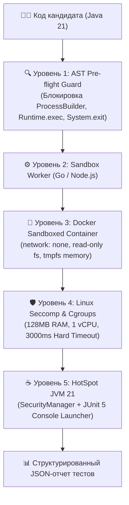

# ☕ Этап 5: Isolated Java 21 Execution Sandbox (Реальный запуск JUnit & Стресс-тесты)

> **Статус:** Спецификация готова к реализации  
> **Цель:** Обеспечить безопасную изоляцию и реальное выполнение кода Java 21 за **< 300 мс** с запуском тестов JUnit 5 и автоматическим стресс-тестированием многопоточности в 100 потоков.  
> **Трудозатраты:** 7–9 дней | **Влияние на продукт:** Высочайший инженерный авторитет (LeetCode/CoderPad Parity)  
> **Инфраструктурные требования:** Эфемерный изолированный Docker-контейнер (или WASM JVM / Firecracker) с жесткими лимитами памяти и CPU.

---

## 1. Проблема и мотивация

В текущей версии [PracticeArena.tsx](file:///d:/projects/interview_projects/spring/frontend/src/components/practice/PracticeArena.tsx) проверка кода опирается на AST-валидацию (правила `enforce-clock-injection`, `no-double-in-money`) и отправку кода в языковую модель.
- **Ограничение:** ИИ может пропустить тонкую гонку данных (Race Condition), которую легко ловит реальный прогон тестов под нагрузкой.
- **Опыт кандидата:** Настоящий восторг возникает тогда, когда кандидат нажимает `Ctrl+Enter` и видит зеленый терминал:  
  `✔ 8 tests passed in 142ms (All Concurrency invariants verified)`.

---

## 2. Архитектура безопасности и изоляции песочницы (Zero-Trust Sandbox)

Безопасность выполнения произвольного пользовательского кода на сервере обеспечивается **5 уровнями защиты**:



### Жесткие ограничения песочницы (Security Constraints):
1. **Полная изоляция сети:** `--network none` (кандидат не может послать HTTP-запрос, майнить или скачивать скрипты).
2. **Read-Only корень:** Вся файловая система контейнера монтируется в режиме `read-only`. Компиляция идет во временную память `tmpfs` (RAM).
3. **Hard Timeout:** Принудительное уничтожение процесса через 3.0 секунды (`kill -9`) для защиты от бесконечных циклов (`while(true)`).
4. **Ограничение ресурсов:** `memory: 192m`, `cpus: 1.0`, `pids-limit: 150`.

---

## 3. Механизм стресс-тестирования потокобезопасности (Concurrency Stress Harness)

В каждой задаче по многопоточности (например, *In-Memory Broker* или *Distributed Rate Limiter*) песочница запускает специальный скрытый тест:

```java
@Test
@DisplayName("Стресс-тест: 100 параллельных потоков с конкурентными операциями")
void testConcurrentSafety() throws InterruptedException {
    final int THREADS = 100;
    final int OPS_PER_THREAD = 1_000;
    ExecutorService pool = Executors.newFixedThreadPool(THREADS);
    CountDownLatch startGate = new CountDownLatch(1);
    CountDownLatch endGate = new CountDownLatch(THREADS);

    for (int i = 0; i < THREADS; i++) {
        pool.submit(() -> {
            try {
                startGate.await(); // Одновременный взрывной старт
                for (int j = 0; j < OPS_PER_THREAD; j++) {
                    targetService.executeOperation(...);
                }
            } finally {
                endGate.countDown();
            }
        });
    }

    startGate.countDown();
    boolean completed = endGate.await(2, TimeUnit.SECONDS);
    assertTrue(completed, "Дедлок или зависание под конкурентной нагрузкой!");
    assertEquals(EXPECTED_TOTAL, targetService.getConsistentSum());
}
```

---

## 4. UI/UX Спецификация консоли в PracticeArena

В нижней части [WorkspaceEditor.tsx](file:///d:/projects/interview_projects/spring/frontend/src/components/practice/WorkspaceEditor.tsx) добавляется интерактивная консоль выполнения:

1. **Кнопки управления:**
   - `▶ Запустить тесты (Ctrl+Enter)` — прогон открытых юнит-тестов спецификации.
   - `⚡ Проверить многопоточность` — запуск скрытого стресс-теста на 100 потоков.
2. **Окно вывода результатов:**
   - Вкладка **«Тесты»**: красивый список чек-боксов с зелеными галочками и временем каждого теста в мс (`✔ testSlidingWindowRateLimiting (18ms)`).
   - Вкладка **«Вывод терминала (stdout/stderr)»**: цветной моноширинный вывод JVM с подсветкой стектрейсов и кликабельными строками ошибок.
   - Бейдж времени выполнения: `Выполнено за 184 мс | Использовано памяти: 42 МБ`.

---

## 5. Изменения в кодовой базе

### Backend
- **[NEW] `backend/src/services/sandbox/ExecutionSandboxService.ts`**:
  - Менеджер очередей и запуск эфемерных контейнеров.
  - Предварительный AST-скрининг на запрещенные конструкции (`Reflection`, `ProcessBuilder`, сокеты).
  - Сбор stdout/stderr и парсинг XML/JSON отчета JUnit.
- **[NEW] `docker/sandbox/Dockerfile.sandbox`**:
  - Минималистичный образ `eclipse-temurin:21-jre-alpine` + `junit-platform-console-standalone.jar`.
- **[NEW] `backend/src/routes/sandbox.ts`**:
  - Эндпоинт `POST /api/practice/:challengeId/run`.

### Frontend
- **[MODIFY] `frontend/src/components/practice/WorkspaceEditor.tsx`**:
  - Добавление нижней панели «Terminal & Test Results» с шорткатом `Ctrl+Enter`.
  - Интеграция лоадера компиляции и красивых плашек упавших ассертов JUnit.

---

## 6. Критерии приемки (Definition of Done)
- [ ] Время полного цикла (отправка кода -> компиляция -> прогон тестов -> возврат результата) не превышает **450 мс**.
- [ ] Попытка выполнить вредоносный код (запись в `/etc`, открытие сокета, `fork-бомба`) намертво блокируется песочницей без падения бэкенда.
- [ ] Стресс-тест на 100 потоков корректно ловит гонки данных в неправильно синхронизированном коде.
