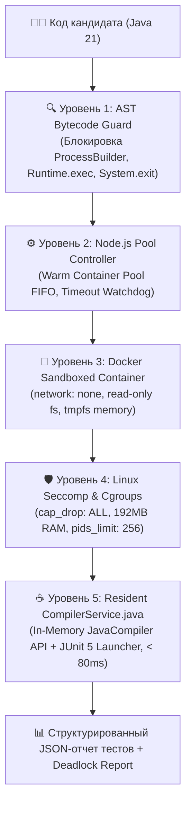

# ☕ Этап 5: Isolated Java 21 Execution Sandbox & 15-Kata LLD Engine

> **Статус:** Актуализировано на основе Deep Research (Сентябрь 2026)  
> **Цель:** Обеспечить безопасную изоляцию и сверхбыстрое выполнение кода Java 21 за **< 80 мс** на базе теплого resident-демона с in-memory компиляцией (`javax.tools.JavaCompiler`), запуском JUnit 5, автоматическим стресс-тестированием многопоточности (100 параллельных потоков, `ThreadMXBean` deadlock-детектор) и каталогом из **15 эталонных LLD-задач BigTech**.  
> **Трудозатраты:** 7–9 дней | **Влияние на продукт:** Высочайший инженерный авторитет (LeetCode/CoderPad Parity)  
> **Инфраструктурные требования:** Эфемерный изолированный Docker-контейнер (`--network none`, read-only fs, tmpfs memory) с resident-демоном `CompilerService.java`.

---

## 1. Проблема и мотивация

В текущей версии [PracticeArena.tsx](file:///d:/projects/interview_projects/spring/frontend/src/components/practice/PracticeArena.tsx) проверка кода опирается на AST-валидацию (правила `enforce-clock-injection`, `no-double-in-money`) и отправку кода в языковую модель.
- **Ограничение LLM:** ИИ может пропустить тонкую гонку данных (Race Condition), которую легко ловит реальный прогон тестов под нагрузкой.
- **Проблема наивного Docker (`docker run openjdk javac ... && java ...`):** Холодный старт HotSpot JVM занимает **1800–2500 мс**, что разрушает интерактивный опыт live-coding сессии.
- **SOTA Решение:** Теплый resident-процесс `CompilerService.java` с компиляцией прямо в память (`byte[]`) и эфемерными `MemoryClassLoader` обеспечивает полный цикл компиляции и прогона JUnit 5 тестов за **40–80 мс**!

---

## 2. Архитектура безопасности и изоляции (Zero-Trust Sandbox)



### Жесткие ограничения безопасности (Security Hardening):
1. **Полная сетевая изоляция:** `network: none` на уровне Docker демона.
2. **Read-Only корень:** Вся файловая система контейнера монтируется в `read-only`. Единственная доступная область для временных файлов — `tmpfs` объемом 32 МБ с опциями `noexec,nosuid,nodev`.
3. **Ограничение системных привилегий:** `cap_drop: ALL`, `security_opt: ["no-new-privileges:true"]`.
4. **Linux Seccomp Profile:** Запрет опасных системных вызовов (`ptrace`, `sys_chroot`, `clone3`, `keyctl`).
5. **AST Pre-scanner (Java Bytecode Guard):** Блокировка вызовов `System.exit`, `Runtime.getRuntime()`, `ProcessBuilder`, `sun.misc.Unsafe` и рефлексивного обхода инкапсуляции модулей.

---

## 3. Стенд стресс-тестирования конкурентности (Concurrency Harness)

В каждой задаче по многопоточности песочница автоматически запускает скрытый стресс-тест на гонки данных:

```java
@Test
@DisplayName("Стресс-тест: 100 параллельных потоков с конкурентными операциями")
void testConcurrentSafety() throws InterruptedException {
    final int THREADS = 100;
    final int OPS_PER_THREAD = 1_000;
    ExecutorService pool = Executors.newFixedThreadPool(THREADS);
    CountDownLatch startGate = new CountDownLatch(1);
    CountDownLatch endGate = new CountDownLatch(THREADS);

    for (int i = 0; i < THREADS; i++) {
        pool.submit(() -> {
            try {
                startGate.await(); // Одновременный взрывной старт
                for (int j = 0; j < OPS_PER_THREAD; j++) {
                    targetService.executeOperation(...);
                }
            } catch (Exception e) {
                errorCounter.incrementAndGet();
            } finally {
                endGate.countDown();
            }
        });
    }

    startGate.countDown();
    boolean completedInTime = endGate.await(3000, TimeUnit.MILLISECONDS);
    pool.shutdownNow();

    // 1. Проверка взаимных блокировок (Deadlock Detection)
    ThreadMXBean threadBean = ManagementFactory.getThreadMXBean();
    long[] deadlockedThreads = threadBean.findDeadlockedThreads();
    assertThat(deadlockedThreads)
        .as("Обнаружена взаимная блокировка потоков (Deadlock)!")
        .isNull();

    // 2. Проверка корректности инвариантов состояния
    assertThat(completedInTime).as("Таймаут выполнения: возможен livelock").isTrue();
    assertThat(errorCounter.get()).as("Ошибки в параллельных потоках").isZero();
}
```

---

## 4. Каталог из 15 эталонных задач LLD / Machine Coding (BigTech 2025–2026)

Песочница поддерживает 15 канонических задач, сформированных в ходе Deep Research:

| № | Задача | Ключевые паттерны | Механизмы многопоточности | Тестовые инварианты |
| :-: | :--- | :--- | :--- | :--- |
| **1** | **Notification Filtering & Deduplication** | Pipeline, Strategy, Decorator | `ConcurrentHashMap`, `AtomicReference` | Окно дедупликации, idempotent retry |
| **2** | **In-Memory Rate Limiter** | Token Bucket, Sliding Window Log | `AtomicLong`, `StampedLock`, CAS | Точное отсечение всплесков при 10k RPS |
| **3** | **Key-Value Cache с TTL & LRU/LFU** | Doubly-Linked List + Hash, Cache-Aside | `ReentrantReadWriteLock`, Segmented Locks | Вытеснение наименее используемых за O(1) |
| **4** | **Dynamic Discount & Promo Code Engine** | Chain of Responsibility, Composite | Immutable Records, Pure Functions | Порядок применения скидок, неотрицательный итог |
| **5** | **Task Scheduler с Cron и Приоритетами** | Priority Queue, Command, Worker Pool | `DelayQueue`, `PriorityBlockingQueue` | Детерминированный запуск по Fixed Clock |
| **6** | **Parking Lot / Storage Locker Manager** | Strategy (Best-Fit, Nearest), Factory | `ReentrantLock` per Floor, BitSets | Атомарный захват места без овербукинга |
| **7** | **Order State Machine** | State, Observer, Memento | `AtomicReference<State>`, Enums | Невозможность недопустимых переходов |
| **8** | **URL Shortener с аналитикой и TTL** | Base62 Encoder, Bloom Filter | Counter Sharding, Atomic Long Adder | Уникальность коллизий, истечение TTL |
| **9** | **Tagged Metric Aggregator** | Circular Ring Buffer, Sliding Window | `LongAdder`, `AtomicDoubleArray` | Точный расчет p50, p95, p99 за 60 секунд |
| **10** | **Circuit Breaker Engine** | State Machine, Sliding Error Window | Ring BitSet, CAS State Transitions | Переход CLOSED $\rightarrow$ OPEN $\rightarrow$ HALF_OPEN |
| **11** | **Thread-Safe Event Bus / Pub-Sub** | Publish-Subscribe, Observer | `CopyOnWriteArrayList`, Backpressure | Изоляция медленных подписчиков |
| **12** | **Real-time Inventory Reservation** | Two-Phase Commit, Pessimistic Lock | Ordered Lock Acquisition (`min(id1,id2)`) | Deadlock-free резервация нескольких корзин |
| **13** | **Concurrent Leaderboard Engine** | SkipList, Segment Tree | `ConcurrentSkipListMap`, Atomic Updaters | Мгновенный пересчет ранга O(log N) |
| **14** | **Elevator Control System** | SCAN Algorithm, State Pattern | Dispatcher Queue, Thread per Car | Оптимальное время ожидания пассажиров |
| **15** | **Expense Sharing & Debt Simplification** | Graph Flow, Greedy Balance Minimizer | Immutable Ledger, `BigDecimal` Banker's | Минимизация числа денежных транзакций |

---

## 5. Изменения в кодовой базе

### Backend & DevOps
- **[NEW] `docker/sandbox/Dockerfile`**:
  - Базовый образ `eclipse-temurin:21-jdk-alpine` с JUnit 5 Console Launcher и библиотеками AssertJ.
- **[NEW] `docker/sandbox/CompilerService.java`**:
  - Высокоскоростной resident-демон на базе `javax.tools.JavaCompiler` с in-memory компиляцией (`< 80ms`).
- **[NEW] `backend/src/services/sandbox/SandboxPoolService.ts`**:
  - Управление пулом теплых контейнеров (FIFO-ротация, перезапуск по лимиту памяти).
- **[NEW] `backend/src/services/sandbox/AstSecurityScanner.ts`**:
  - Быстрый синтаксический анализ кода кандидата перед отправкой в песочницу.
- **[NEW] `backend/src/routes/sandbox.ts`**:
  - Эндпоинт `POST /api/sandbox/execute` с потоковой передачей вывода тестов через SSE/WebSocket.

### Frontend
- **[MODIFY] `frontend/src/components/practice/PracticeArena.tsx`**:
  - Кнопка `▶ Запустить в песочнице (Ctrl+Enter)`.
  - Интерактивная консоль выполнения тестов (Passed / Failed / Deadlock / Execution Time).
  - Отображение статуса стресс-теста на 100 потоков.

---

## 6. Критерии приемки (Definition of Done)
- [ ] Время полного цикла компиляции и прогона тестов $< 150$ мс (p95 $< 250$ мс).
- [ ] Попытки выполнить `System.exit(0)`, `Runtime.getRuntime().exec()` или запустить майнер мгновенно отсекаются с сообщением об ошибке безопасности.
- [ ] Корректное обнаружение Race Condition и Deadlock при параллельном прогоне 100 потоков.
- [ ] Все 15 эталонных LLD-задач доступны для тренировки с готовыми шаблонами кода и тестовыми сюитами.
- [ ] Полное соответствие жестким архитектурным инвариантам проекта (`AGENTS.md`: Clock-injection, BigDecimal, Zero-Phantom).
