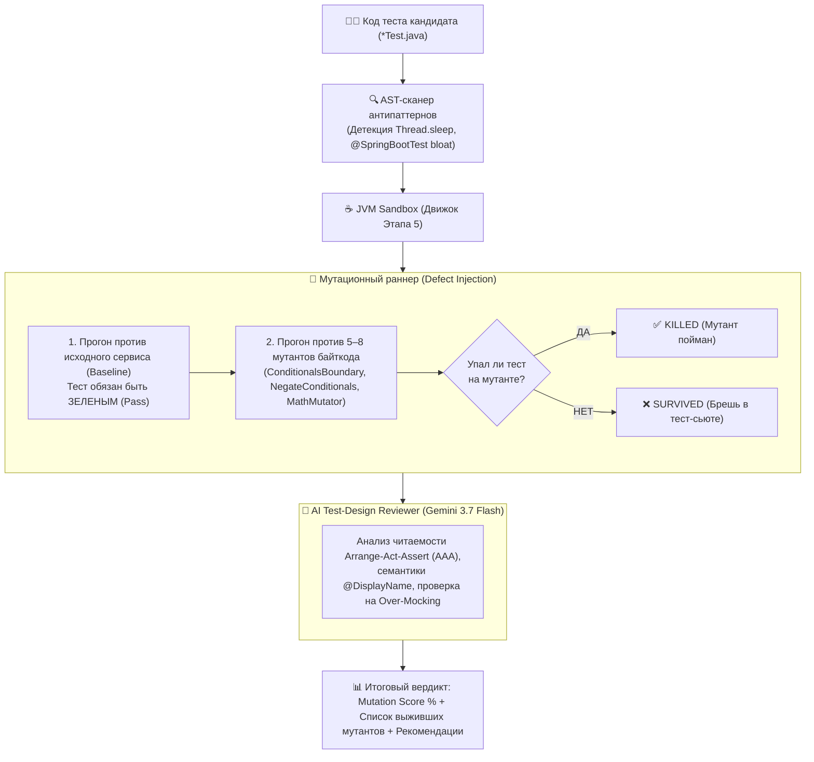

# 🧪 Этап 6: Testing & Mutation Arena (Write-the-Tests & Kill-the-Mutants Katas)

> **Статус:** Спроектировано на основе Deep Research (Сентябрь 2026)  
> **Основание:** [Evaluating Testing in Technical Interviews.md](file:///d:/projects/interview_projects/spring/ds_reports/Evaluating%20Testing%20in%20Technical%20Interviews.md), [Java Testing Katas and Benchmarks.md](file:///d:/projects/interview_projects/spring/ds_reports/Java%20Testing%20Katas%20and%20Benchmarks.md), [Java Testing Katas Research.md](file:///d:/projects/interview_projects/spring/ds_reports/Java%20Testing%20Katas%20Research.md)  
> **Цель:** Предоставить интерактивный тренажер инженерного тест-дизайна, где кандидат пишет **только тесты** (`*Test.java`) на JUnit 5, AssertJ, Mockito 5, Testcontainers и Awaitility, а платформа физически компилирует их в JVM-песочнице (Этап 5), прогоняет против скрытых байткод-мутантов и рассчитывает **Mutation Score** ($\ge 85\%$) с детекцией антипаттернов BigTech (Over-mocking, Flaky sleep, Assertion-free tests).  
> **Трудозатраты:** 6–8 дней | **Влияние на продукт:** Закрытие фундаментальной слепой зоны между теорией и реальным наймом (Stripe Bug Squash, Revolut Take-Home, Google Test Design)  
> **Инфраструктурные требования:** Опирается на готовую Zero-Trust Docker песочницу и in-memory compiler daemon Этапа 5.

---

## 1. Проблема и мотивация

В современном найме (2025–2026) способность писать рабочий бизнес-код частично обесценилась из-за генеративных AI-ассистентов. Главным дифференциатором инженера уровня Senior / Staff стало **умение строить защитные спецификации, выявлять краевые аномалии и проектировать архитектурные швы для тестирования**.

### Текущий разрыв платформы:
- В каталоге тем есть мощный теоретический блок по JUnit 5 и Mockito (28+ вопросов).
- В `PracticeArena` есть задачи LLD, но в них кандидат пишет бизнес-код, а тесты запускает платформа.
- **Слепая зона:** Кандидат **никогда не пишет код тестов своими руками** в интерактивном редакторе и не учится «убивать мутантов», из-за чего теряется на реальных live-pairing и bug-squash секциях Stripe, Revolut, Uber, Yandex и Tinkoff.

---

## 2. Архитектура двухступенчатой оценки (Dual-Pass Evaluation Pipeline)



### Мутационные операторы (Defect Injection Operators):
1. `ConditionalsBoundaryMutator`: Замена `>` на `>=`, `<` на `<=` (проверка краевых условий $N, N-1, N+1$).
2. `NegateConditionalsMutator`: Инверсия `==` в `!=`, `if (x)` в `if (!x)`.
3. `MathMutator`: Замена `+` на `-`, `*` на `/` (ошибки финансовых расчетов).
4. `VoidMethodCallMutator`: Удаление вызовов `auditService.log()`, `repository.save()`.
5. `ReturnValsMutator`: Замена возвращаемого значения на `null`, `0` или `emptyList()`.

---

## 3. Каталог 35 канонических задач по 6 архетипам

### Архетип 1: Legacy Seams & Approval Testing (5 задач)
- **KATA-TEST-01:** *TripService Decoupling (Sandro Mancuso)* — создание шва `Subclass and Override` для изоляции статического `UserSession.getInstance()`.
- **KATA-TEST-02:** *Gilded Rose Approval Testing (Emily Bache)* — параметризованный снимок (Golden Master) 100 состояний до начала рефакторинга.
- **KATA-TEST-03:** *Overloaded Constructor Seam* — внедрение `java.time.Clock` через package-private конструктор без изменения публичного контракта.
- **KATA-TEST-04:** *Static Wrapper Seam* — оборачивание статического `SecurityContextHolder.getContext()` в изолируемый провайдер.
- **KATA-TEST-05:** *Trivia Legacy Characterization* — фиксация недетерминированного генератора случайных чисел через ApprovalTests.

### Архетип 2: Advanced JUnit 5 & Parametric Testing (7 задач)
- **KATA-TEST-06:** *Financial Transaction Validator* — `@ParameterizedTest` + `@MethodSource` со `Stream<Arguments>` и читаемыми именами `name = "[{index}] {0} -> {1}"`.
- **KATA-TEST-07:** *Order State Machine Dynamic Tests* — динамическая генерация дерева проверок графа состояний через `@TestFactory` и `DynamicTest`.
- **KATA-TEST-08:** *ThreadLocal Context Extension* — кастомный `BeforeEachCallback` / `AfterEachCallback` для гарантированной очистки контекста.
- **KATA-TEST-09:** *Account Lifecycle BDD Specs* — многоуровневое структурирование спецификаций через `@Nested` (`Given`, `When`, `Then`).
- **KATA-TEST-10:** *Custom ArgumentConverter* — кастомный конвертер строковых CSV-пейлоадов в доменные объекты `Money(amount, currency)`.
- **KATA-TEST-11:** *TemporaryFolder & Resource Lifecycle* — детерминированная изоляция временных файлов без утечки дескрипторов.
- **KATA-TEST-12:** *Conditional Execution via Assumptions* — выборочный прогон тестов через `assumeTrue(isDatabaseAvailable)`.

### Архетип 3: Modern Mockito 5 (6 задач)
- **KATA-TEST-13:** *Spring Boot 3.4+ `@MockitoBean` Migration* — тестирование веб-слоя с современным `@MockitoBean` вместо устаревшего `@MockBean`.
- **KATA-TEST-14:** *Strict Audit Trail Verification (`InOrder`)* — проверка жесткой хронологии: списание средств $\to$ фиксация в аудит-логе $\to$ отправка SMS.
- **KATA-TEST-15:** *Deterministic UUID v7 Testing (`mockStatic`)* — контролируемый перехват статического генератора ID.
- **KATA-TEST-16:** *Asynchronous Event Capturing (`ArgumentCaptor`)* — захват и валидация сложного DTO сообщения в очереди.
- **KATA-TEST-17:** *Network Retry Simulation (`thenThrow().thenReturn()`)* — верификация Resilience4j механизма повторных попыток.
- **KATA-TEST-18:** *Partial Mocking via `@Spy`* — тестирование сервиса с реальным исполнением безопасных методов и моком опасного внешнего сокета.

### Архетип 4: Testcontainers & Infrastructure Integration (6 задач)
- **KATA-TEST-19:** *PostgreSQL `@ServiceConnection` & Flyway* — автоконфигурация DataSource без устаревшего `DynamicPropertyRegistry`.
- **KATA-TEST-20:** *Pessimistic Locking Test (`SELECT FOR UPDATE`)* — проверка исключения гонки двух конкурентных списаний в реальной БД.
- **KATA-TEST-21:** *Redis Caching & TTL Expiration* — проверка работы аннотаций `@Cacheable`, `@CacheEvict` и времени жизни ключей.
- **KATA-TEST-22:** *Idempotent Kafka Consumer* — отправка дублирующихся сообщений и проверка однократного сохранения в таблицу Outbox.
- **KATA-TEST-23:** *Database Rollback on Unchecked Exception* — верификация `@Transactional` отката при падении промежуточного шага.
- **KATA-TEST-24:** *Elasticsearch Full-Text Search Slice* — интеграционная проверка поискового индекса товаров в контейнере.

### Архетип 5: Spring Boot Slices & ArchUnit (5 задач)
- **KATA-TEST-25:** *`@WebMvcTest` + Problem Details (RFC 7807)* — валидация стандартизированных JSON-ошибок (400 Bad Request, 409 Conflict).
- **KATA-TEST-26:** *`@DataJpaTest` & N+1 Query Detection* — проверка генерации SQL-запросов и запрета декартова произведения при eager fetching.
- **KATA-TEST-27:** *`@JsonTest` Serialization & Deserialization* — проверка кастомных Jackson-сериализаторов денежных единиц и масок банковских карт.
- **KATA-TEST-28:** *ArchUnit Layer Isolation* — архитектурная фитнес-функция: контроллеры не обращаются к репозиториям напрямую.
- **KATA-TEST-29:** *ArchUnit Deprecated API Guard* — запрет использования `java.util.Date` и `java.text.SimpleDateFormat`.

### Архетип 6: Concurrency & Failure Injection (6 задач)
- **KATA-TEST-30:** *Awaitility vs Flaky Sleep* — переписывание нестабильного асинхронного теста на `await().atMost(2, SECONDS).untilAsserted(...)`.
- **KATA-TEST-31:** *Virtual Thread Pinning Detector* — проверка, что сервис под высокой нагрузкой не блокирует carrier-потоки в `synchronized`.
- **KATA-TEST-32:** *Double-Entry Ledger Deadlock Test* — провокация дедлока при встречных переводах (`A->B` и `B->A`) через `CountDownLatch`.
- **KATA-TEST-33:** *Resilience4j Circuit Breaker State Transition* — проверка перехода состояний `CLOSED -> OPEN -> HALF_OPEN` при 50% сбоев.
- **KATA-TEST-34:** *High-Contention Counter Benchmark* — тест на сохранение атомарности при 10 000 параллельных инкрементов.
- **KATA-TEST-35:** *WireMock Chaos Injection* — симуляция таймаута внешнего шлюза (HTTP 504) и проверка корректного fallback-ответа.

---

## 4. Пользовательский интерфейс: режим «Write-the-Tests» в PracticeArena

В существующей [PracticeArena.tsx](file:///d:/projects/interview_projects/spring/frontend/src/components/practice/PracticeArena.tsx) добавляется специализированный рабочий режим:

```
┌────────────────────────────────────────────────────────────────────────────────────────┐
│ [← Назад в Каталог]  KATA-TEST-19: PostgreSQL @ServiceConnection    [⚡ Запустить тест] │
├───────────────────────────────┬────────────────────────────────────────────────────────┤
│ СПЕЦИФИКАЦИЯ И МУТАЦИИ        │ РЕДАКТОР ТЕСТОВ (src/test/java/.../OrderTest.java)     │
│ 📋 Требования задачи          │ 1  @Test                                               │
│ 🎯 Целевой Mutation Score:    │ 2  @DisplayName("Should kill boundary discount mutant")│
│    85% (минимум 5 из 6)       │ 3  void shouldKillBoundaryMutant() {                   │
│                               │ 4      var order = new Order();                        │
│ 🧬 РАДАР МУТАНТОВ (Live):     │ 5      assertThat(order.discount(new BigDecimal(100))) │
│ [✅ KILLED] Boundary Line 42  │ 6          .isEqualByComparingTo(BigDecimal.ZERO);     │
│ [✅ KILLED] Negate Line 55    │ 7  }                                                   │
│ [❌ SURVIVED] Math Line 70    │                                                        │
│ ----------------------------- ├────────────────────────────────────────────────────────┤
│ 🚨 АУДИТ КАЧЕСТВА ТЕСТА:      │ ТЕРМИНАЛ / ЛОГИ МУТАЦИЙ:                               │
│ • Over-mocking: НЕТ ✅         │ > JVM compilation in 42ms                             │
│ • Flaky sleep: НЕТ ✅          │ > Running 3 candidate tests against 6 mutants...       │
│ • AAA Pattern: Соблюден ✅    │ > [FAIL] Mutant #3 survived! (MathMutator in line 70)  │
│                               │ > Mutation Score: 83.3% (Need >= 85.0% to pass)        │
└───────────────────────────────┴────────────────────────────────────────────────────────┘
```

---

## 5. План реализации по шагам

1. **Шаг 1: Расширение DTO и манифеста задач (`practice.ts`)**:
   - Поле `challengeMode: 'machine_coding' | 'write_the_tests'`.
   - Конфигурация мутантов: `mutants: Array<{ id: string, name: string, description: string, mutator: string, file: string, line: number }>`.
   - Порог прохождения: `requiredMutationScore: number` (по умолчанию 85).
2. **Шаг 2: Мутационный раннер в JVM Sandbox (расширение Этапа 5)**:
   - Внедрение класса `MutationExecutionHarness.java` в in-memory песочницу:
     - Шаг A: Запуск теста кандидата против эталона $\to$ `assertAllPassed`.
     - Шаг B: Запуск теста кандидата против поочередно мутированных классов $\to$ фиксация `Killed` / `Survived`.
     - Шаг C: Расчет $\text{Score} = (\text{Killed} / \text{Total}) \times 100$.
3. **Шаг 3: AI Code Quality Reviewer (`testingQualityEvaluator.ts`)**:
   - Анализ исходного текста теста через LiteLLM Proxy (Gemini 3.7 Flash) на предмет антипаттернов (*Over-mocking, Flaky sleep, Assertion-free tests*).
4. **Шаг 4: UI Интеграция в PracticeArena**:
   - Добавление вкладки фильтра «Testing & Mutation Katas» в [PracticeCatalog.tsx](file:///d:/projects/interview_projects/spring/frontend/src/components/practice/PracticeCatalog.tsx).
   - Отображение интерактивного виджета **«Mutation Radar»** в панели спецификации [ChallengeSpecPanel.tsx](file:///d:/projects/interview_projects/spring/frontend/src/components/practice/ChallengeSpecPanel.tsx).
5. **Шаг 5: Заполнение каталога из 35 задач**:
   - Экспорт готовых манифестов из отчетов Deep Research в `challengeSeedData.ts`.

---

## 6. Definition of Done (Критерии готовности)

- [ ] Все 35 задач скомпилированы и содержат эталонный `GoldenMasterTest.java`, убивающий 100% мутантов.
- [ ] Время прогона мутационного набора из 6 мутантов в JVM-песочнице составляет **< 150 мс**.
- [ ] Детектор антипаттернов корректно штрафует тесты с `Thread.sleep` и пустыми ассертами.
- [ ] Фронтенд успешно собирается (`npm run build`, 0 ошибок TS).
- [ ] 100% покрытие unit-тестами логики расчета мутационного скора.
