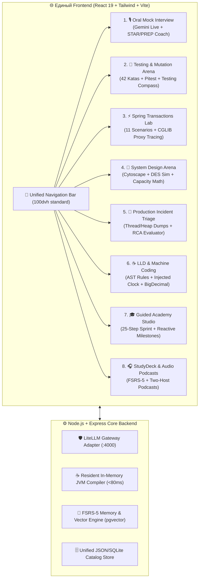

# 🏛️ Этап 7: Master Architectural Harmonization & SSOT Specification

> **Статус:** Проектирование и аудит (Сентябрь 2026)  
> **Цель:** Актуализировать генеральную спецификацию `docs/architecture.md`, устранить архитектурную рассинхронизацию между 8 модулями платформы, очистить кодовую базу от мертвого кода и зафиксировать единые контракты обмена данными.  
> **Трудозатраты:** 2–3 дня | **Приоритет:** P0 (Блокирующий для масштабирования)  
> **Связанные документы:** [00_MASTER_ROADMAP.md](file:///d:/projects/interview_projects/spring/docs/roadmap/00_MASTER_ROADMAP.md), [AGENTS.md](file:///d:/projects/interview_projects/spring/AGENTS.md)

---

## 1. Проблема и контекст

Кодовая база совершила качественный скачок: реализованы голосовые собеседования с ультранизкой задержкой, мутационное тестирование на 42 каты, интерактивный System Design, Incident Triage и Spring Transactions Lab.
Однако генеральная документация `docs/architecture.md` застряла на версии начала 2025 года (описаны лишь 3 ранних модуля).

### Выявленный технический долг:
1. **Рассинхрон документации**: 60% активного функционала не описано в `docs/architecture.md`.
2. **Мертвый код и рудименты**:
   - Пустая директория `frontend/src/components/roadmap/` (функционал перенесен в `academy/`).
   - Разрозненные каталоги: часть данных в `json/` на бэкенде, часть захардкожена в TypeScript (`frontend/src/data/transactionLabCatalog.ts`).
3. **Фрагментация AI-ассистентов**: В `PracticeArena` реализован эталонный `PracticeTutorDrawer` с голосом Gemini Live и текстовым SSE, в то время как другие арены используют устаревшие или изолированные модалки без поддержки прерываний (barge-in).

---

## 2. Архитектура целевого состояния (8 столпов платформы)



---

## 3. План реализации по шагам

### Шаг 7.1: Полное обновление `docs/architecture.md`
- Зафиксировать подробные C4-диаграммы, Mermaid sequence-диаграммы для всех 8 модулей.
- Описать жизненный цикл веб-сокетов (двусторонний хендшейк, закрытие сессий, детекция пауз).
- Задокументировать контракты REST API и структуры данных DTO.

### Шаг 7.2: Санация кодовой базы (Clean-up)
- Удалить пустую папку `frontend/src/components/roadmap/`.
- Вынести каталог транзакций из `transactionLabCatalog.ts` в единый структурированный JSON `json/spring_transaction_scenarios.json` с типизированным контрактом на бэкенде.
- Проверить и удалить неиспользуемые импорты и устаревшие стили.

### Шаг 7.3: Унификация AI Tutor Interface Contract
- Описать в `frontend/src/types/tutor.ts` универсальный интерфейс для Socratic AI Tutor:
  ```typescript
  export interface SocraticTutorConfig {
    arena: 'testing' | 'transactions' | 'system_design' | 'triage' | 'lld';
    scenarioId: string;
    compassId: string;
    systemPromptPersona: string;
    contextPayload: () => Record<string, any>;
  }
  ```
- Подготовить архитектуру для переиспользования единого `PracticeTutorDrawer` во всех аренах.

---

## 4. Критерии приемки (Definition of Done)
- [ ] `docs/architecture.md` отражает 100% активных фич платформы.
- [ ] Отсутствуют устаревшие директории и неиспользуемые файлы.
- [ ] Контракты API и каталоги централизованы и типизированы.
- [ ] Сборка фронтенда и бэкенда проходит с нулевыми предупреждениями (`0 errors`).
