# ⚡ Этап 8: Spring Transactions Lab Scaffolding & Real Execution Engine

> **Статус:** Завершено (Сентябрь 2026)  
> **Цель:** Устранить когнитивный разрыв в арене транзакций Spring, внедрить 4-уровневую педагогическую лестницу (от примитивов к дедлокам пула соединений), добавить **Transaction Compass** (`Ctrl + /`) и визуализатор прокси-перехватчиков.  
> **Трудозатраты:** Реализовано | **Приоритет:** P1  
> **Связанные документы:** [transactionLabCatalog.ts](file:///d:/projects/interview_projects/spring/frontend/src/data/transactionLabCatalog.ts), [AGENTS.md](file:///d:/projects/interview_projects/spring/AGENTS.md)

---

## 1. Диагностика «Дырявой лестницы»

В исходной версии каталога было лишь 11 сценариев с резким перепадом сложности между L0 и L3.
В обновленной версии реализована строгая 4-уровневая педагогическая лестница из 16 сценариев: от ловушек проверяемых исключений и обхода CGLIB-прокси до взаимных блокировок пула HikariCP по теореме Бретта Вулдриджа.

---

## 2. Новая 4-уровневая структура каталога (16 сценариев)

```mermaid
graph TD
    subgraph Level0 ["🌱 L0: Transaction Primitives (Основы и ловушки)"]
        T01["L0-01: Checked Exception Rollback Trap\n(Почему IOException не откатывает транзакцию без rollbackFor)"]
        T02["L0-02: Self-Invocation Bypass\n(Обход CGLIB прокси при вызове this.method())"]
        T03["L0-03: ReadOnly Dirty-Checking Bypass\n(Экономия RAM и CPU: FlushMode.MANUAL в Hibernate)"]
        T04["L0-04: Propagation REQUIRED vs REQUIRES_NEW\n(Изолированный логгер аудита при откате родителя)"]
    end

    subgraph Level1 ["🔍 L1: Synchronization & Lifecycle (Швы интеграции)"]
        T05["L1-01: After-Commit Notification Race\n(Отправка Kafka-сообщения только ПОСЛЕ успешного коммита)"]
        T06["L1-02: Private Method @Transactional No-Op\n(Почему Spring игнорирует аннотацию на non-public методах)"]
        T07["L1-03: UnexpectedRollbackException Trap\n(Перехват исключения в вызывающем коде без REQUIRES_NEW)"]
        T08["L1-04: External I/O Idle-in-Transaction\n(Блокирующий сетевой I/O внутри транзакции истощает пул)"]
    end

    subgraph Level2 ["⚡ L2: Advanced Concurrency & Isolation (Изоляция данных)"]
        T09["L2-01: Non-Repeatable Read vs Repeatable Read\n(Фантомные чтения и Snapshot Isolation в MVCC)"]
        T10["L2-02: OptimisticLockException & Retry AOP Collision\n(Коллизия порядков AOP перехватчиков @Retryable)"]
        T11["L2-03: Distributed Saga Compensating Actions\n(Откат двухфазной распределенной операции)"]
        T12["L2-04: Isolation Leak Across Pooled Connection\n(Утечка параметров изоляции в пул соединений)"]
    end

    subgraph Level3 ["🔥 L3: Combat Production Failures (Боевой уровень)"]
        T13["L3-01: HikariCP Pool Starvation Deadlock\n(Формула пула соединений P >= T * (D - 1) + 1)"]
        T14["L3-02: Async Transactional Context Loss\n(@Async в новом потоке без Security и Transaction Context)"]
        T15["L3-03: Write Skew & Transactional Outbox\n(Аномалия несогласованности при параллельных транзакциях)"]
        T16["L3-04: Nested Savepoints & Partial Rollback\n(Использование PROPAGATION_NESTED с точками сохранения JDBC)"]
    end

    Level0 --> Level1 --> Level2 --> Level3
```

---

## 3. Transaction Compass (`Ctrl + /`)

Внедрена интерактивная шторка-шпаргалка `TransactionCompassSheet.tsx`:
1. **Жизненный цикл CGLIB перехватчика**:
   `Caller -> CGLIB Proxy -> TransactionInterceptor -> PlatformTransactionManager -> Target Method -> Commit/Rollback`.
2. **Матрица распространения (Propagation Matrix)**:
   * `REQUIRED`: присоединиться к текущей или создать новую.
   * `REQUIRES_NEW`: приостановить текущую (`suspend`), занять 2-й коннект из пула, выполнить и закоммитить, возобновить 1-й.
   * `MANDATORY`: упасть с исключением, если транзакции нет.
   * `NESTED`: создать JDBC Savepoint внутри существующей физической транзакции.
3. **Памятка по исключениям**:
   * По умолчанию откат происходит **ТОЛЬКО** на `RuntimeException` и `Error`.
   * Для checked exceptions обязателен атрибут `@Transactional(rollbackFor = Exception.class)`.

---

## 4. Интерактивный трейсер вызовов (Proxy Visualizer)
Добавлен интерактивный компонент, показывающий кандидату:
* Сколько физических соединений сейчас занято из `HikariCP`.
* Происходит ли `suspend` внешней транзакции.
* Срабатывает ли CGLIB-перехватчик или метод вызывается напрямую.

---

## 5. Критерии приемки (Definition of Done)
- [x] Каталог транзакций расширен до 16 структурированных сценариев с тегами сложности (`L0`–`L3`).
- [x] Внедрена шторка **Transaction Compass** с горячей клавишей `Ctrl + /` и иконкой в тулбаре.
- [x] Подключен **PracticeTutorDrawer** (Socratic AI Tutor в голосовом и текстовом режимах).
- [x] Валидатор корректно различает CGLIB self-invocation, checked rollback и pool starvation.
