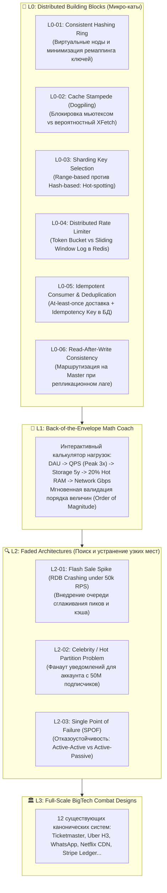

# 📐 Этап 9: System Design Arena Cognitive Ladder (От микро-блоков к распределенным гигантам)

> **Статус:** Проектирование (Сентябрь 2026)  
> **Цель:** Ликвидировать самую опасную «дырявую лестницу» платформы — скачок неподготовленного кандидата сразу в проектирование Ticketmaster на 100k RPS. Внедрить микро-каты базовых строительных блоков (L0), калькулятор прикидок Back-of-the-Envelope (L1), архитектурный рефакторинг узких мест (L2) и **System Design Compass** (`Ctrl + /`).  
> **Трудозатраты:** 5–7 дней | **Приоритет:** P1  
> **Связанные документы:** [system_design_scenarios.json](file:///d:/projects/interview_projects/spring/json/system_design_scenarios.json), [SystemDesignArena.tsx](file:///d:/projects/interview_projects/spring/frontend/src/components/system_design/SystemDesignArena.tsx)

---

## 1. Диагностика «Дырявой лестницы»

Сейчас в каталоге [system_design_scenarios.json](file:///d:/projects/interview_projects/spring/json/system_design_scenarios.json) содержится 12 отличных сценариев (Uber H3, Netflix CDN, Stripe Ledger, WhatsApp, Ticketmaster).
Однако новичок или Middle-разработчик сталкивается с:
1. **Параличом чистого холста**: Непонимание, с какого сервиса начать декомпозицию (Read Path vs Write Path).
2. **Арифметическим шоком**: Неумение мгновенно переводить 50 млн DAU в QPS, IOPS, объем дисков и пропускную способность сетевых интерфейсов.
3. **Отсутствием понимания строительных кирпичиков**: Кандидат пытается использовать Redis там, где нужен Kafka, или шардировать базу по случайному UUID, теряя возможность выборки по диапазонам.

---

## 2. Новая 4-уровневая структура System Design Arena

---

## 3. System Design Compass (`Ctrl + /`)

Контекстная шторка-шпаргалка содержит:
1. **Numbers Every Systems Engineer Should Know (Задержки в 2026 году)**:
   * L1 cache reference: `0.5 ns`
   * RAM access: `100 ns`
   * NVMe SSD random read: `10-20 µs`
   * Data center round-trip (RTT): `0.5 ms`
   * Cross-continental RTT (EU -> US): `150 ms`
2. **CAP & PACELC Cheat Sheet**:
   * В случае разделения сети ($P$): выбор между доступностью ($A$) и согласованностью ($C$).
   * В штатном режиме ($E$): выбор между задержкой ($L$) и согласованностью ($C$).
3. **Дерево выбора хранилищ данных (Data Store Decision Tree)**:
   * OLTP ACID (PostgreSQL / CockroachDB) $\rightarrow$ Financial ledgers, ACID guarantees.
   * Key-Value (Redis / DynamoDB) $\rightarrow$ Caching, Session store, Rate limiting.
   * Append-Only Log / Event Streaming (Kafka) $\rightarrow$ Asynchronous decoupling, Event sourcing.
   * Analytical OLAP (ClickHouse / Snowflake) $\rightarrow$ Real-time aggregations, metrics, analytics.

---

## 4. Интеграция с мультимодальным AI Tutor
Внедрение компонента `PracticeTutorDrawer` прямо на холст Cytoscape:
* Кандидат может голосом обсудить архитектурные компромиссы (Trade-offs) с ИИ в роли **Google Staff Architect**.
* Тактильный Barge-In: в любой момент перебить рассуждения ассистента кликом по центральной кнопке.

---

## 5. Критерии приемки (Definition of Done)
- [ ] Разработаны 6 интерактивных микро-кат `L0`.
- [ ] Встроен калькулятор прикидок `L1` с подсказками степеней 2 и 10 ($2^{10} \approx 10^3, 2^{20} \approx 10^6, 2^{30} \approx 10^9$).
- [ ] Реализованы 3 задачи на архитектурный рефакторинг готовых схем `L2`.
- [ ] Доступен **System Design Compass** по `Ctrl + /`.
