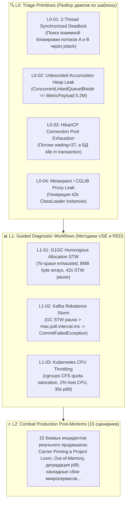

# 🚨 Этап 10: Production Incident Triage Scaffolding & Socratic Co-Pilot

> **Статус:** Завершено (Сентябрь 2026)  
> **Цель:** Превратить сухой тренажер расследования инцидентов (15 сценариев) в управляемый детективный практикум. Добавить вводные обучающие инциденты (L0/L1), инструмент подсказок **Triage Compass** (`Ctrl + /`) и подключить Socratic AI Incident Commander.  
> **Трудозатраты:** Завершено за 1 день | **Приоритет:** P2  
> **Связанные документы:** [IncidentTriageStudio.tsx](file:///d:/projects/interview_projects/spring/frontend/src/components/triage/IncidentTriageStudio.tsx), [production_triage_challenges.json](file:///d:/projects/interview_projects/spring/json/production_triage_challenges.json)

---

## 1. Диагностика «Дырявой лестницы»

В исходной версии [production_triage_challenges.json](file:///d:/projects/interview_projects/spring/json/production_triage_challenges.json) содержалось 15 аварийных сценариев (дедлоки, утечки памяти в OldGen, отказ пула соединений, зависание GC).
Однако кандидат, не имеющий опыта дежурств (On-Call SRE), попадал в ступор:
* Видел 150 потоков в `jstack` и не знал, по какому признаку их фильтровать.
* Не понимал разницу между `BLOCKED` (монитор Java synchronized) и `WAITING (parking)` (`LockSupport.park()` в `ReentrantLock` / `CompletableFuture`).
* Пытался угадать причину без системного фреймворка расследования.

---

## 2. Новая структура уровней расследования (Реализовано: 22 сценария)

---

## 3. Triage Compass (`Ctrl + /`)

Контекстная шторка быстрого вызова включает 5 Золотых Правил:
1. **Состояния потоков Java (Thread State Cheatsheet)**:
   * `RUNNABLE (On-CPU)` vs `RUNNABLE (Socket I/O in socketRead0/EPoll.wait)`.
   * `BLOCKED`: Поток ждет освобождения монитора `synchronized` (`- waiting to lock <0x...>`).
   * `WAITING (parking)`: Поток заблокирован через `LockSupport.park()` (HikariCP, пулы потоков, `CompletableFuture`).
   * `TIMED_WAITING`: Ожидание с таймаутом (`Thread.sleep`, `poll(timeout)`).
   * `Loom Pinning`: VirtualThread заблокирован внутри `synchronized`, парализуя Carrier Thread.
2. **Алгоритм поиска Deadlock & HikariCP Starvation**:
   * Взаимные циклические блокировки потоков (`Found one Java-level deadlock:`).
   * Петля исчерпания пула HikariCP при вложенных транзакциях: `@Transactional(propagation = Propagation.REQUIRES_NEW)` при $T_{\text{threads}} \ge P_{\text{size}}$.
3. **Архитипы сбоев памяти (Eclipse MAT & Dominator Tree)**:
   * Утечка OldGen кучи: Доминатор $>30\%$, `Path to GC Roots` исключая soft/weak ссылки, `ThreadLocal` без `remove()`.
   * Утечка Metaspace: Множество эфемерных `ClassLoader` из-за генерации динамических CGLIB / ByteBuddy прокси.
   * Утечка Direct Off-Heap: Netty `ByteBuf` без `ReferenceCountUtil.release()`, куча пуста ($<20\%$), но RSS контейнера убивает Kubernetes OOMKilled.
4. **STW-паузы и задержки Safepoints**:
   * G1GC Humongous Allocation: объекты $>50\%$ размера региона G1 минуют Eden, фрагментируя OldGen $\to$ `To-space exhausted` $\to$ Full GC на десятки секунд.
   * ZGC Allocation Stalls: Аллокация опережает сборщик мусора $\to$ принудительный троттлинг потоков.
   * Safepoint Counted Loops: JIT C2 удаляет Safepoint Polls из циклов `for (int i = 0; i < N; i++)` $\to$ один поток задерживает Safepoint Sync на секунды.
5. **Научный метод триажа: RED vs USE и минимизация Blast Radius**:
   * RED: Rate, Errors, Duration (клиентский опыт).
   * USE: Utilization, Saturation, Errors (состояние ресурсов хоста).
   * Принцип минимального радиуса поражения (Blast Radius): запрет слепых рестартов и раздувания пулов под нагрузкой.

---

## 4. Интеграция с Socratic AI Incident Commander
- Вкладка **Incident Commander** в `IncidentTriageStudio.tsx`:
  * Интерактивный чат оперативного штаба (War Room) через эндпоинт `POST /api/triage/probe`.
  * AI выступает в роли дежурного лида (Lead Incident Commander), направляющего расследование строго сократическим методом.
  * Прямой мост из компаса: кнопка «Спросить Incident Commander» мгновенно переносит правило в контекст расследования.

---

## 5. Критерии приемки (Definition of Done)
- [x] Добавлены 4 вводных сценария `L0` с атомарными микро-дампами (`triage-l0-01` .. `triage-l0-04`).
- [x] Добавлены 3 сценария `L1` на методики RED/USE, STW и троттлинг (`triage-l1-01` .. `triage-l1-03`).
- [x] 15 существующих сценариев переведены на грейд `L2` (итого 22 сценария).
- [x] Внедрена шторка **Triage Compass** (`Ctrl + /`, `TriageCompassSheet.tsx`).
- [x] Реализован эндпоинт `POST /api/triage/probe` и вкладка Incident Commander.
- [x] 0 ошибок сборки (`npm run build` в `frontend` и `backend`).
