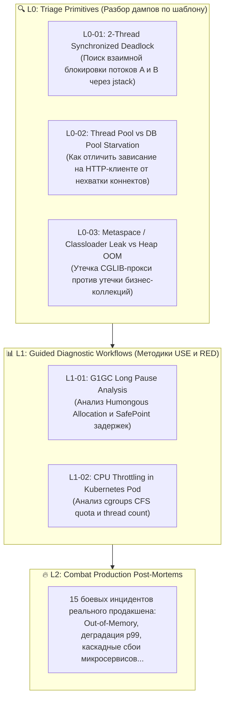

# 🚨 Этап 10: Production Incident Triage Scaffolding & Socratic Co-Pilot

> **Статус:** Проектирование (Сентябрь 2026)  
> **Цель:** Превратить сухой тренажер расследования инцидентов (15 сценариев) в управляемый детективный практикум. Добавить вводные обучающие инциденты (L0/L1), инструмент подсказок **Triage Compass** (`Ctrl + /`) и подключить голосового Socratic AI Incident Commander.  
> **Трудозатраты:** 3–4 дня | **Приоритет:** P2  
> **Связанные документы:** [IncidentTriageStudio.tsx](file:///d:/projects/interview_projects/spring/frontend/src/components/triage/IncidentTriageStudio.tsx), [production_triage_challenges.json](file:///d:/projects/interview_projects/spring/json/production_triage_challenges.json)

---

## 1. Диагностика «Дырявой лестницы»

В текущей версии [production_triage_challenges.json](file:///d:/projects/interview_projects/spring/json/production_triage_challenges.json) содержится 15 отличных аварийных сценариев (дедлоки, утечки памяти в OldGen, отказ пула соединений, зависание GC).
Однако кандидат, не имеющий опыта дежурств (On-Call SRE), попадает в ступор:
* Видит 150 потоков в `jstack` и не знает, по какому признаку их фильтровать.
* Не понимает разницу между `BLOCKED` (монитор Java synchronized) и `WAITING (parking)` (`LockSupport.park()` в `ReentrantLock` / `CompletableFuture`).
* Пытается угадать причину без системного фреймворка расследования.

---

## 2. Новая структура уровней расследования

---

## 3. Triage Compass (`Ctrl + /`)

Контекстная шторка быстрого вызова включает:
1. **Состояния потоков Java (Thread State Cheatsheet)**:
   * `RUNNABLE`: Поток выполняет байткод на CPU или ожидает завершения сокетного I/O.
   * `BLOCKED`: Поток ждет освобождения классического монитора `synchronized`.
   * `WAITING (parking)`: Поток заблокирован через `LockSupport.park()` (`java.util.concurrent`, пулы потоков, `CountDownLatch`).
   * `TIMED_WAITING`: Ожидание с таймаутом (`Thread.sleep`, `socket.read(timeout)`, `poll(timeout)`).
2. **Паттерны детекции аномалий**:
   * *Deadlock*: Искать блок `"Found one Java-level deadlock:"` в конце `jstack`.
   * *Connection Pool Exhaustion*: Множество потоков зависли в `com.zaxxer.hikari.pool.HikariPool.getConnection()`.
   * *OldGen Leak*: В `jcmd GC.class_histogram` класс `byte[]` (`[B`) или `ConcurrentHashMap$Node` занимают гигабайты и не освобождаются после Full GC.
3. **Методика RED / USE**:
   * Rate (Частота запросов) $\rightarrow$ Errors (Ошибки) $\rightarrow$ Duration (Длительность).

---

## 4. Интеграция с Socratic AI Incident Commander
* Внедрение `PracticeTutorDrawer` с голосом Gemini Live.
* AI выступает в роли дежурного лида (Incident Commander), который направляет кандидата сократическими вопросами:
  > *«Обрати внимание на стек потока `http-nio-8080-exec-14`. Какую операцию он пытается выполнить и какого ресурса ждет?»*

---

## 5. Критерии приемки (Definition of Done)
- [ ] Добавлены 3 вводных сценария `L0` с обучающей подсветкой строк дампа.
- [ ] Внедрена шторка **Triage Compass** (`Ctrl + /`).
- [ ] Подключен `PracticeTutorDrawer` с контекстным промптом Incident Commander.
