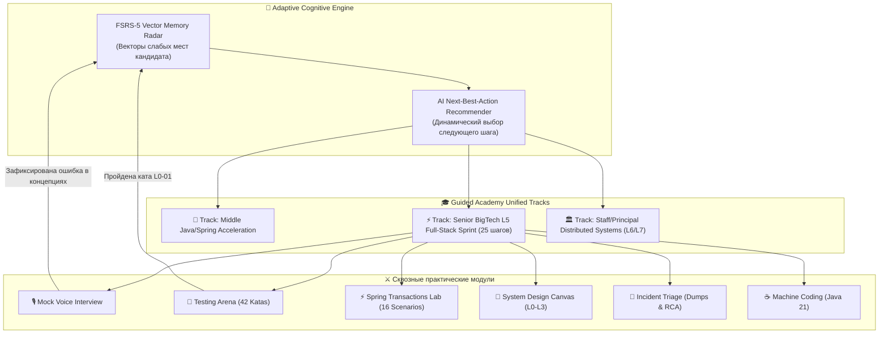

# 🎓 Этап 11: Unified Academy Curriculum Backbone & Seamless Integration

> **Статус:** Проектирование (Сентябрь 2026)  
> **Цель:** Превратить Guided Academy Studio в единый сквозной дирижер подготовки кандидата. Бесшовно объединить все практические арены (Тестирование, Транзакции, System Design, LLD, Triage, Mock Interview) в персонализированные маршруты подготовки с адаптацией от FSRS-5 Vector Memory Radar.  
> **Трудозатраты:** 3–4 дня | **Приоритет:** P1  
> **Связанные документы:** [AcademyStudio.tsx](file:///d:/projects/interview_projects/spring/frontend/src/components/academy/AcademyStudio.tsx), [guided_roadmaps.json](file:///d:/projects/interview_projects/spring/backend/src/routes/guided_roadmaps.json)

---

## 1. Проблема изолированности модулей

Сейчас платформа обладает богатейшим арсеналом из 8 самостоятельных инструментов.
Однако пользователь чувствует себя потерянным («каталожная слепота»):
* Он не знает, в каком порядке проходить каты.
* Он только что завалил вопрос по транзакциям на устном интервью, но система не ведет его за руку в Spring Transactions Lab на конкретный сценарий.
* В роадмапе Академии [guided_roadmaps.json](file:///d:/projects/interview_projects/spring/backend/src/routes/guided_roadmaps.json) **до сих пор отсутствуют ссылки на новые 42 каты мутационного тестирования и 11 сценариев транзакций**.

---

## 2. Архитектура единого образовательного контура



---

## 3. Обновление схемы роадмапов (`guided_roadmaps.json`)

В каждый шаг роадмапа внедряется типизированный селектор целевой арены:
```json
{
  "id": "step_07_spring_transactional_boundaries",
  "title": "Границы транзакций и CGLIB-прокси",
  "targetArena": "transactions",
  "targetScenarioId": "L0_02_self_invocation_bypass",
  "estimatedMinutes": 20,
  "requiredForGrade": "L5",
  "prerequisiteStepIds": ["step_06_spring_core_aop"]
}
```

Поддерживаемые типы `targetArena`:
* `oral_interview` (устный вопрос/диалог)
* `testing_mutation` (ката в Testing Arena)
* `transactions` (сценарий в Spring Transactions Lab)
* `system_design` (задача в System Design Arena)
* `incident_triage` (расследование в Triage Studio)
* `machine_coding` (LLD-задача)

---

## 4. Виджет «Next Best Step» на Главном экране
На Dashboard кандидата выводится персональная карточка следующего оптимального шага:
> *«На вчерашнем интервью с Amazon Bar-Raiser возникли сомнения при расчете пула соединений. Рекомендуемый шаг: Пройти сценарий [L3-01: HikariCP Pool Starvation Deadlock] в Spring Transactions Lab (15 минут)»*.

---

## 5. Критерии приемки (Definition of Done)
- [ ] Роадмап в `guided_roadmaps.json` актуализирован: все 6 практических арен интегрированы в единую цепочку шагов.
- [ ] Переход из Академии открывает нужную кату в целевой арене с предустановленным контекстом.
- [ ] Реактивный трекинг прогресса: решение каты в Testing Arena или Transactions Lab автоматически отмечает шаг в Академии как завершенный (`isCompleted = true`).
