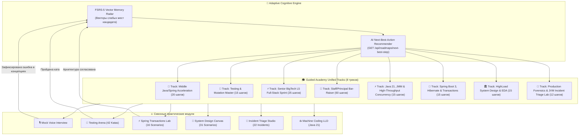

# 🎓 Этап 11: Unified Academy Curriculum Backbone & Seamless Integration

> **Статус:** Завершено (100%) (Сентябрь 2026)  
> **Цель:** Превратить Guided Academy Studio в единый сквозной дирижер подготовки кандидата. Бесшовно объединить все практические арены (Тестирование, Транзакции, System Design, LLD, Triage, Mock Interview) в персонализированные маршруты подготовки с адаптацией от FSRS-5 Vector Memory Radar.  
> **Трудозатраты:** 3–4 дня | **Приоритет:** P1  
> **Связанные документы:** [AcademyStudio.tsx](file:///d:/projects/interview_projects/spring/frontend/src/components/academy/AcademyStudio.tsx), [guided_roadmaps.json](file:///d:/projects/interview_projects/spring/json/guided_roadmaps.json)

---

## 1. Проблема изолированности модулей

Ранее платформа обладала богатейшим арсеналом из 8 самостоятельных инструментов, однако существовала проблема каталожной слепоты:
* Пользователь не знал оптимального порядка прохождения каты.
* После устного интервью по транзакциям система не вела за руку в Spring Transactions Lab на конкретный сценарий.
* В роадмапах Академии отсутствовали прямые типизированные ссылки на 42 каты мутационного тестирования и 16 сценариев транзакций.

---

## 2. Архитектура единого образовательного контура



---

## 3. Схема роадмапов (`guided_roadmaps.json`)

В каждый шаг всех 8 роадмапов внедрен типизированный селектор целевой арены:
```json
{
  "stepNumber": 8,
  "title": "CGLIB Proxy Bypass & HikariCP Starvation",
  "seniorBarConcept": "Обход CGLIB при self-invocation и дедлок пула соединений HikariCP по формуле Вулдриджа",
  "targetArena": "transactions",
  "targetScenarioId": "self_invocation_bypass",
  "estimatedMinutes": 25,
  "requiredForGrade": "L5",
  "domain": "databases",
  "pedagogicalRationale": "Закрепляет работу CGLIB-прокси на интерактивном визуализаторе транзакций перед переходом к распределенным транзакциям."
}
```

Поддерживаемые типы `targetArena`:
* `oral_interview` (устный вопрос/диалог с Gemini Live)
* `testing_mutation` (ката в Automated & Mutation Testing Arena)
* `transactions` (сценарий в Spring Transactions Lab)
* `system_design` (задача в System Design Arena)
* `incident_triage` (расследование в Incident Triage Studio)
* `machine_coding` (LLD-задача)
* `theory` (база знаний и карточки)

---

## 4. Виджет «Next Best Action» в AcademyStudio

На странице трека выводится персональная интерактивная карточка следующего оптимального шага:
- Автоматический выбор шага по топологическому порядку с учетом `prerequisiteStepIds`.
- Балансировка когнитивной нагрузки (Cognitive Interleaving): чередование разномодальных практик.
- Отображение арены, времени прохождения, домена и блока «Почему именно этот шаг».
- 1-клик запуск нужной арены с предзагруженным сценарием (`launchAcademyStepTarget`).
- Хлебные крошки (`academyBreadcrumbContext`) с возможностью возврата назад в программу курса.

---

## 5. Критерии приемки (Definition of Done)
- [x] Роадмапы в `guided_roadmaps.json` и SQLite актуализированы: все 6 практических арен интегрированы в единую цепочку шагов во всех 8 треках (включая новые `middle-java-spring-20` и `testing-mutation-master-15`).
- [x] Переход из Академии открывает нужную кату в целевой арене с предустановленным контекстом через `launchAcademyStepTarget`.
- [x] Реактивный трекинг прогресса: решение сценария в Transactions Lab, каты в Testing Arena, инцидента в Triage Studio или задачи в System Design автоматически отмечает шаг в Академии как завершенный (`isCompleted = true`).
- [x] Создан эндпоинт `GET /api/roadmaps/next-best-step` и интерактивный компонент `NextBestActionCard.tsx` в пастельном неоморфизме.
- [x] Нулевые регрессии сборки: `tsc && vite build` (Frontend) и `tsc` (Backend) компилируются с 0 ошибок.
